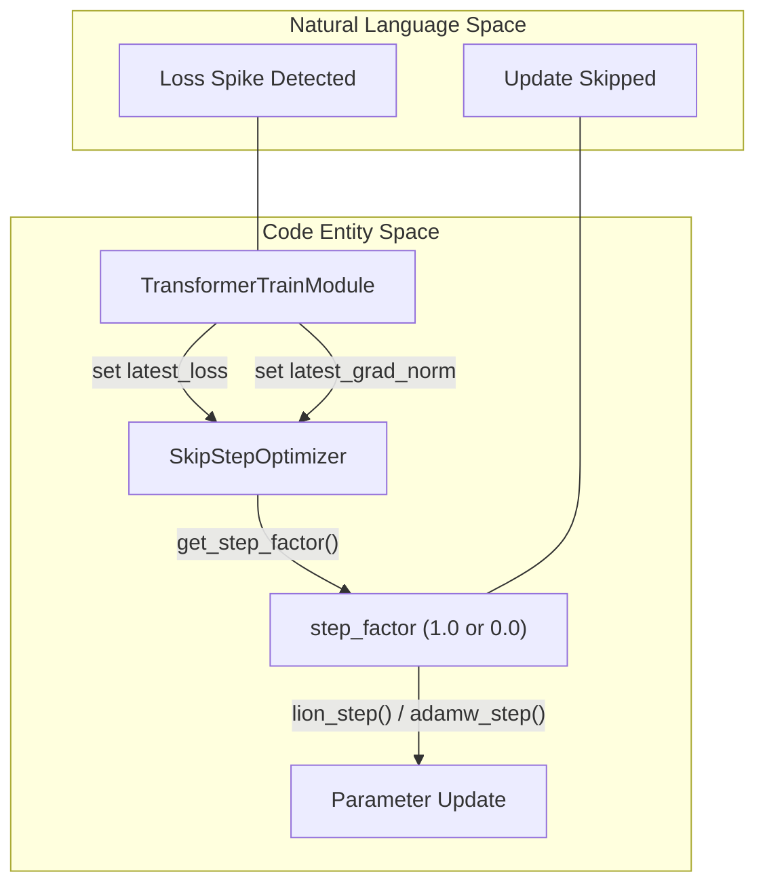
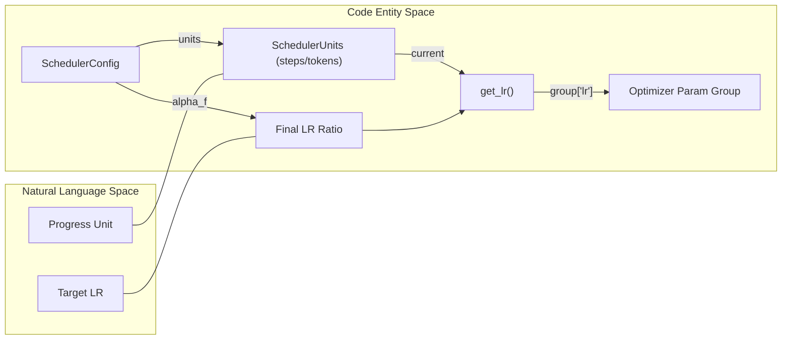

<!-- source: DeepWiki mcp.deepwiki.com · repo allenai/EMO · page 3.5 Optimizers and Learning Rate Schedulers · fetched 2026-10-26 -->

# Optimizers and Learning Rate Schedulers

Relevant source files

The following files were used as context for generating this wiki page:

- [src/olmo_core/distributed/parallel/__init__.py](src/olmo_core/distributed/parallel/__init__.py)
- [src/olmo_core/distributed/parallel/pipeline_parallel.py](src/olmo_core/distributed/parallel/pipeline_parallel.py)
- [src/olmo_core/optim/__init__.py](src/olmo_core/optim/__init__.py)
- [src/olmo_core/optim/adam.py](src/olmo_core/optim/adam.py)
- [src/olmo_core/optim/adamw.py](src/olmo_core/optim/adamw.py)
- [src/olmo_core/optim/config.py](src/olmo_core/optim/config.py)
- [src/olmo_core/optim/dion.py](src/olmo_core/optim/dion.py)
- [src/olmo_core/optim/lion.py](src/olmo_core/optim/lion.py)
- [src/olmo_core/optim/muon.py](src/olmo_core/optim/muon.py)
- [src/olmo_core/optim/noop.py](src/olmo_core/optim/noop.py)
- [src/olmo_core/optim/scheduler.py](src/olmo_core/optim/scheduler.py)
- [src/olmo_core/optim/skip_step_optimizer.py](src/olmo_core/optim/skip_step_optimizer.py)
- [src/olmo_core/train/callbacks/list_checkpointer.py](src/olmo_core/train/callbacks/list_checkpointer.py)
- [src/scripts/reshard_core_checkpoint.py](src/scripts/reshard_core_checkpoint.py)
- [src/test/optim/adamw_test.py](src/test/optim/adamw_test.py)
- [src/test/optim/lion_test.py](src/test/optim/lion_test.py)
- [src/test/optim/scheduler_test.py](src/test/optim/scheduler_test.py)
- [src/test/optim/skip_step_optimizer_test.py](src/test/optim/skip_step_optimizer_test.py)
- [src/test/scripts/reshard_core_checkpoint_test.py](src/test/scripts/reshard_core_checkpoint_test.py)

The EMO codebase provides a flexible infrastructure for parameter optimization, supporting standard optimizers, specialized "Skip Step" variants for stability, and matrix-aware optimizers like Muon. The system is built on a configuration-driven pattern where `OptimConfig` and `Scheduler` objects define the behavior of the training loop.

## Optimizer Configuration

The base class for all optimizer configurations is `OptimConfig` [src/olmo_core/optim/config.py:57-60](). It handles the mapping of model parameters to optimizer groups, support for `torch.compile`, and the persistence of "fixed fields" during checkpoint restoration.

### Parameter Grouping and Overrides
By default, all parameters with `requires_grad=True` are placed into a single optimizer group. Users can customize this using `OptimGroupOverride` [src/olmo_core/optim/config.py:43-54]().

*   **FQN Glob Matching**: Parameters are matched using fully qualified names (FQNs) or wildcards [src/olmo_core/optim/config.py:45-48]().
*   **Strictness**: By default, if a glob pattern fails to match any parameter, an `OLMoConfigurationError` is raised [src/olmo_core/optim/config.py:113-114]().
*   **Priority**: Parameters are assigned to the first override group they match. Any remaining parameters are placed in a default group [src/olmo_core/optim/config.py:144-148]().

### Matrix-Aware Optimization
For advanced optimizers like **Muon**, EMO uses `MatrixAwareOptimConfig` [src/olmo_core/optim/muon.py:45](). This class automatically categorizes parameters into:
1.  **Matrix**: 2D hidden weights (optimized via Muon) [src/olmo_core/optim/muon.py:108]().
2.  **Embed**: Input embeddings (optimized via AdamW) [src/olmo_core/optim/muon.py:111-113]().
3.  **Vector**: 1D gains/biases (optimized via AdamW) [src/olmo_core/optim/muon.py:114]().
4.  **LM Head**: The final output layer [src/olmo_core/optim/muon.py:115-117]().

Sources: [src/olmo_core/optim/config.py](), [src/olmo_core/optim/muon.py]()

## Optimizer Implementations

EMO supports a wide range of optimizers, including several custom implementations designed for large-scale training stability.

### Skip-Step Optimizers
`SkipStepOptimizer` [src/olmo_core/optim/skip_step_optimizer.py:12-31]() is a base class that monitors a rolling window of losses and gradient norms. If the current step's values exceed a threshold (defined by `sigma_factor` standard deviations), the update is effectively skipped [src/olmo_core/optim/skip_step_optimizer.py:86-109]().

| Optimizer | Config Class | Description |
| :--- | :--- | :--- |
| **AdamW** | `AdamWConfig` | Standard Adam with decoupled weight decay. Supports `foreach` kernels [src/olmo_core/optim/adamw.py:50](). |
| **SkipStepAdamW** | `SkipStepAdamWConfig` | AdamW variant that can skip updates during loss spikes [src/olmo_core/optim/adamw.py:105](). |
| **Lion** | `LionConfig` | Memory-efficient optimizer using the sign of the update [src/olmo_core/optim/lion.py:39](). |
| **SkipStepLion** | `SkipStepLionConfig` | Lion variant with skip-step logic [src/olmo_core/optim/lion.py:82](). |
| **Muon** | `MuonConfig` | Orthogonalization-based optimizer for hidden weights [src/olmo_core/optim/muon.py:45](). |
| **Dion** | `DionConfig` | Interface for the `dion` package [src/olmo_core/optim/dion.py](). |
| **Noop** | `NoOpConfig` | An optimizer that does nothing, useful for debugging or evaluation [src/olmo_core/optim/noop.py](). |

### Data Flow: Skip-Step Logic
This diagram illustrates how the `TransformerTrainModule` interacts with a `SkipStepOptimizer` to decide whether to apply an update.

Title: Skip-Step Decision Flow

Sources: [src/olmo_core/optim/skip_step_optimizer.py](), [src/olmo_core/optim/lion.py](), [src/olmo_core/optim/adamw.py]()

## Learning Rate Schedulers

Schedulers in EMO are `Registrable` components that determine the learning rate based on training progress, which can be measured in either **steps** or **tokens** [src/olmo_core/optim/scheduler.py:21-24]().

### Progress System
The `set_lr` function [src/olmo_core/optim/scheduler.py:46]() retrieves the current progress from the `Trainer` state:
*   **Steps**: Uses `trainer.global_step` against `trainer.max_steps` [src/olmo_core/optim/scheduler.py:75-76]().
*   **Tokens**: Uses `trainer.global_train_tokens_seen` against `trainer.max_tokens` [src/olmo_core/optim/scheduler.py:85-86]().

### Key Scheduler Types

1.  **CosineWithWarmup (`CosWithWarmup`)**: Linear warmup followed by a cosine decay to a final value defined by `alpha_f` [src/olmo_core/optim/scheduler.py:58-73]().
2.  **WSD (Warmup-Stable-Decay)**: A three-phase scheduler featuring linear warmup, a stable peak LR phase, and a final decay phase [src/olmo_core/optim/scheduler.py:158-172]().
3.  **WSDS (Warmup-Stable-Decay-Simplified)**: Optimized for continual pretraining, allowing multiple periods where the LR resets to peak after a decay [src/olmo_core/optim/scheduler.py:276-310]().
4.  **SequentialScheduler**: Chains multiple schedulers together, switching based on predefined step/token milestones [src/olmo_core/optim/scheduler.py:734-750]().

### Progress Mapping Diagram
This diagram shows how the configuration parameters map to the internal scheduler logic.

Title: Scheduler Progress Mapping

### Alpha_f and Decay Logic
Many schedulers use `alpha_f` to define the minimum learning rate as a fraction of the `initial_lr`.
*   **Linear Decay**: `new_lr = initial_lr * (1 - (1 - alpha_f) * progress)` [src/olmo_core/optim/scheduler.py:521]().
*   **Cosine Decay**: Uses `0.5 * (1 + cos(pi * progress))` to interpolate between `initial_lr` and `initial_lr * alpha_f` [src/olmo_core/optim/scheduler.py:642]().

Sources: [src/olmo_core/optim/scheduler.py](), [src/olmo_core/optim/__init__.py]()

---

