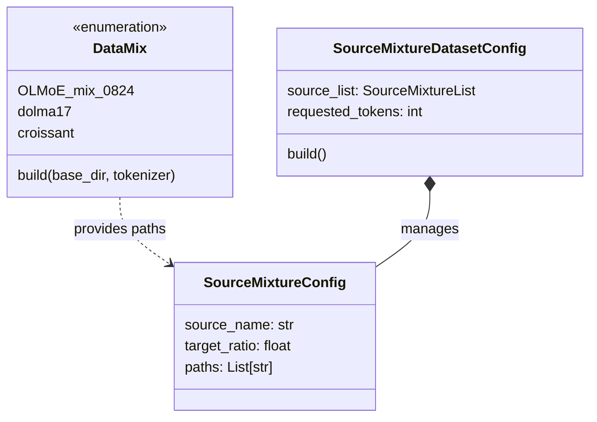

<!-- source: DeepWiki mcp.deepwiki.com · repo allenai/EMO · page 4 Data Pipeline · fetched 2026-10-26 -->

# Data Pipeline

<details>
<summary>Relevant source files</summary>

The following files were used as context for generating this wiki page:

- [docs/source/guides/data_mixing.rst](docs/source/guides/data_mixing.rst)
- [src/olmo_core/data/__init__.py](src/olmo_core/data/__init__.py)
- [src/olmo_core/data/data_loader.py](src/olmo_core/data/data_loader.py)
- [src/olmo_core/data/mixes/OLMoE-mix-0824.txt](src/olmo_core/data/mixes/OLMoE-mix-0824.txt)
- [src/olmo_core/data/mixes/__init__.py](src/olmo_core/data/mixes/__init__.py)
- [src/olmo_core/data/mixes/croissant.txt](src/olmo_core/data/mixes/croissant.txt)
- [src/olmo_core/data/mixes/dolma17.txt](src/olmo_core/data/mixes/dolma17.txt)
- [src/olmo_core/data/mixes/v3-small-ppl-validation.txt](src/olmo_core/data/mixes/v3-small-ppl-validation.txt)
- [src/olmo_core/data/numpy_dataset.py](src/olmo_core/data/numpy_dataset.py)
- [src/olmo_core/data/source_mixture.py](src/olmo_core/data/source_mixture.py)
- [src/olmo_core/data/tokenizer.py](src/olmo_core/data/tokenizer.py)
- [src/olmo_core/data/types.py](src/olmo_core/data/types.py)
- [src/olmo_core/data/utils.py](src/olmo_core/data/utils.py)
- [src/test/data/data_loader_test.py](src/test/data/data_loader_test.py)
- [src/test/data/fixtures.py](src/test/data/fixtures.py)
- [src/test/data/mixes_test.py](src/test/data/mixes_test.py)
- [src/test/data/numpy_dataset_test.py](src/test/data/numpy_dataset_test.py)
- [src/test/data/source_mixture_test.py](src/test/data/source_mixture_test.py)
- [src/test/data/tokenizer_test.py](src/test/data/tokenizer_test.py)
- [src/test/data/utils_test.py](src/test/data/utils_test.py)

</details>


The EMO data pipeline is designed for high-performance, distributed training on massive tokenized datasets. It utilizes pre-tokenized NumPy arrays to minimize CPU overhead during training and provides a robust system for mixing multiple data sources with deterministic sampling.

## Overview

The system transitions from raw data to training batches through several layers of abstraction:
1.  **Data Mixes**: Registries of tokenized file paths and source labels.
2.  **Source Mixture**: Logic for apportioning tokens from various sources based on target ratios.
3.  **NumPy Datasets**: Specialized `Dataset` implementations for Fixed Sequence Length (FSL) or Variable Sequence Length (VSL) training.
4.  **Data Loaders**: Distributed, stateful loaders that manage shuffling, resumption, and multi-threaded loading.

### Data Flow Diagram

The following diagram illustrates how data moves from storage into the model, associating code entities with their roles in the pipeline.

```mermaid
graph TD
    subgraph "Storage Layer"
        [DataMix_Registry] -- "build()" --> [Numpy_Files]
        [Numpy_Files] --> [memmap]
    end

    subgraph "Dataset Layer"
        [SourceMixtureDatasetConfig] -- "build()" --> [SourceMixtureDataset]
        [SourceMixtureDataset] --> [NumpyFSLDataset]
        [NumpyFSLDataset] --> [NumpyPackedFSLDataset]
    end

    subgraph "Loading Layer"
        [NumpyFSLDataLoader] -- "iter_batches()" --> [DataCollator]
        [DataCollator] -- "split_batch()" --> [Trainer_Loop]
    end

    [DataMix_Registry]:::code
    [NumpyFSLDataset]:::code
    [NumpyFSLDataLoader]:::code
    [SourceMixtureDatasetConfig]:::code
    
    classDef code font-family:monospace, stroke-width:2px;
```
**Sources:** [src/olmo_core/data/numpy_dataset.py:106-123](), [src/olmo_core/data/data_loader.py:54-103](), [src/olmo_core/data/source_mixture.py:23-24]()

---

## NumPy Datasets and Data Loaders

The core of the data pipeline is the `NumpyDatasetBase` [src/olmo_core/data/numpy_dataset.py:106-123](), which provides an interface for datasets backed by `numpy` arrays on disk. These datasets use `np.memmap` to efficiently access large files without loading them entirely into RAM.

### Key Dataset Variants
*   **FSL (Fixed Sequence Length)**: Standard pretraining where every instance is exactly `sequence_length` tokens. Variants include `NumpyFSLDataset` (standard) and `NumpyPackedFSLDataset` (uses Best-Fit-Decreasing bin packing to minimize padding) [src/olmo_core/data/numpy_dataset.py:68-87]().
*   **VSL (Variable Sequence Length)**: Supports curriculum learning where sequence lengths grow over time, implemented in `NumpyVSLDataset` [src/olmo_core/data/numpy_dataset.py:81]().

### Data Loaders
`NumpyFSLDataLoader` and `NumpyVSLDataLoader` provide distributed, deterministic loading [src/olmo_core/data/data_loader.py:46-47](). They support:
*   **Stateful Resumption**: Capturing and restoring the `state_dict` to ensure the exact data order is maintained after a crash or restart [src/olmo_core/data/data_loader.py:167-171]().
*   **Global Determinism**: Using a `fingerprint` of the dataset to ensure all ranks are training on the same data mix [src/olmo_core/data/numpy_dataset.py:212-223]().

For details on dataset types and distributed resumption, see **[NumPy Datasets and Data Loaders](#4.1)**.

---

## Data Mixes and Source Mixture System

EMO uses a sophisticated mixing system to combine disparate datasets (e.g., Common Crawl, Code, Math) into a single training stream.

### Data Mixes Registry
The `DataMix` enum [src/olmo_core/data/mixes/__init__.py:33-103]() acts as a registry for known datasets like `OLMoE_mix_0824` or `dolma17`. Calling `DataMix.build()` resolves these into lists of absolute paths to `.npy` files [src/olmo_core/data/mixes/__init__.py:123-169]().

### Source Mixture Logic
The `SourceMixtureDatasetConfig` [src/olmo_core/data/source_mixture.py:23-24]() handles the math of data apportionment. It uses Hamilton apportionment to determine exactly how many tokens to take from each source to meet a `target_ratio` while respecting `max_repetition_ratio` constraints [src/olmo_core/data/source_mixture.py:30-60]().

### Code Entity Association: Mixing Logic


**Sources:** [src/olmo_core/data/mixes/__init__.py:33-103](), [src/olmo_core/data/source_mixture.py:29-60](), [src/olmo_core/data/source_mixture.py:127-150]()

For details on the registry and how to configure mixtures, see **[Data Mixes and Source Mixture System](#4.2)**.

---

## Tokenizer Configuration

The `TokenizerConfig` [src/olmo_core/data/tokenizer.py:47-75]() stores critical metadata used by the datasets and model:
*   `vocab_size`: Total tokens in the vocabulary.
*   `eos_token_id`: Used as a document separator (e.g., `100257` for Dolma2) [src/olmo_core/data/tokenizer.py:91]().
*   `pad_token_id`: Used for padding instances in `NumpyPaddedFSLDataset`.

The system includes pre-defined configurations for `dolma2`, `gpt2`, and `gpt_neox_olmo_dolma_v1_5` [src/olmo_core/data/tokenizer.py:85-132]().

**Sources:** [src/olmo_core/data/tokenizer.py:47-132]()

---

## Utility Functions

The pipeline includes several low-level utilities in `olmo_core.data.utils` for manipulating batches:
*   `split_batch`: Breaks a large batch into micro-batches for gradient accumulation [src/olmo_core/data/utils.py:43-72]().
*   `melt_batch`: Increases batch size by shortening sequence length (used in VSL curriculum) [src/olmo_core/data/utils.py:74-116]().
*   `write_document_indices`: Generates metadata files containing the start/end offsets of documents within a `.npy` file [src/olmo_core/data/utils.py:153-167]().

**Sources:** [src/olmo_core/data/utils.py:43-167]()

---

