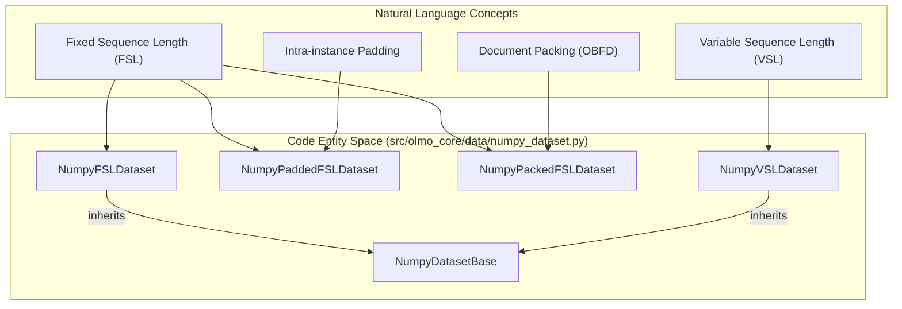
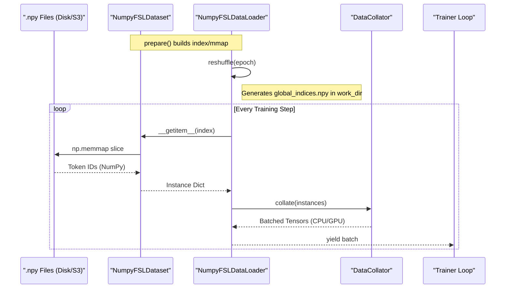

<!-- source: DeepWiki mcp.deepwiki.com · repo allenai/EMO · page 4.1 NumPy Datasets and Data Loaders · fetched 2026-10-26 -->

# NumPy Datasets and Data Loaders

Relevant source files

The following files were used as context for generating this wiki page:

- [docs/source/fs_cache.rst](docs/source/fs_cache.rst)
- [docs/source/guides/data_loading.rst](docs/source/guides/data_loading.rst)
- [docs/source/guides/data_mixing.rst](docs/source/guides/data_mixing.rst)
- [src/olmo_core/data/__init__.py](src/olmo_core/data/__init__.py)
- [src/olmo_core/data/collator.py](src/olmo_core/data/collator.py)
- [src/olmo_core/data/composable/data_loader.py](src/olmo_core/data/composable/data_loader.py)
- [src/olmo_core/data/composable/mixing_token_source.py](src/olmo_core/data/composable/mixing_token_source.py)
- [src/olmo_core/data/composable/numpy_document_source.py](src/olmo_core/data/composable/numpy_document_source.py)
- [src/olmo_core/data/composable/sampling_document_source.py](src/olmo_core/data/composable/sampling_document_source.py)
- [src/olmo_core/data/composable/sampling_instance_source.py](src/olmo_core/data/composable/sampling_instance_source.py)
- [src/olmo_core/data/composable/sampling_token_source.py](src/olmo_core/data/composable/sampling_token_source.py)
- [src/olmo_core/data/data_loader.py](src/olmo_core/data/data_loader.py)
- [src/olmo_core/data/numpy_dataset.py](src/olmo_core/data/numpy_dataset.py)
- [src/olmo_core/data/source_mixture.py](src/olmo_core/data/source_mixture.py)
- [src/olmo_core/data/types.py](src/olmo_core/data/types.py)
- [src/olmo_core/data/utils.py](src/olmo_core/data/utils.py)
- [src/test/data/collator_test.py](src/test/data/collator_test.py)
- [src/test/data/composable/sampling_instance_source_test.py](src/test/data/composable/sampling_instance_source_test.py)
- [src/test/data/composable/sampling_token_source_test.py](src/test/data/composable/sampling_token_source_test.py)
- [src/test/data/custom_data_loader.py](src/test/data/custom_data_loader.py)
- [src/test/data/custom_data_loader_test.py](src/test/data/custom_data_loader_test.py)
- [src/test/data/data_loader_test.py](src/test/data/data_loader_test.py)
- [src/test/data/fixtures.py](src/test/data/fixtures.py)
- [src/test/data/numpy_dataset_test.py](src/test/data/numpy_dataset_test.py)
- [src/test/data/source_mixture_test.py](src/test/data/source_mixture_test.py)
- [src/test/data/utils_test.py](src/test/data/utils_test.py)

This page provides a detailed technical reference for the EMO/OLMo-Core data pipeline, focusing on datasets backed by NumPy arrays and their corresponding distributed data loaders. The system is designed for high-performance pre-training, supporting fixed sequence length (FSL), variable sequence length (VSL), document packing, and stateful resumption.

## Core Dataset Architecture

The data pipeline is built around the `NumpyDatasetBase` abstract class [src/olmo_core/data/numpy_dataset.py:106-123](). It manages access to 1D NumPy arrays of token IDs (typically generated by the Dolma toolkit) and provides a unified interface for metadata, fingerprinting, and data access.

### Lifecycle and Preparation
Before use in a distributed environment, datasets must be prepared. The `prepare()` method [src/olmo_core/data/numpy_dataset.py:284-307]() is called to handle one-time setup tasks like building indices or calculating document boundaries. This process is coordinated across processes using a barrier [src/olmo_core/data/numpy_dataset.py:303-303]().

### Determinism and Fingerprinting
To ensure reproducibility and detect configuration mismatches during resumption, every dataset generates a `fingerprint` [src/olmo_core/data/numpy_dataset.py:212-223]().
- **Fingerprint Fields**: Includes `vocab_size`, `pad_token_id`, `eos_token_id`, `dtype`, and `bos_token_id` [src/olmo_core/data/numpy_dataset.py:205-209]().
- **File Integrity**: Hashes the base names and sizes of all underlying NumPy array files [src/olmo_core/data/numpy_dataset.py:221-222]().

### Natural Language to Code Entity Space: Dataset Hierarchy
The following diagram maps the conceptual data strategies to their implementation classes.

Sources: [src/olmo_core/data/numpy_dataset.py:68-87](), [docs/source/guides/data_loading.rst:54-106]()

---

## FSL Dataset Variants

### 1. NumpyFSLDataset (Concatenate and Chunk)
The default strategy for FSL training. It treats all tokens from all files as a single contiguous stream and chunks them into `sequence_length` instances [docs/source/guides/data_loading.rst:60-73]().
- **Intra-document Masking**: If `generate_doc_lengths=True`, the dataset returns document boundaries to prevent cross-document attention [src/olmo_core/data/numpy_dataset.py:532-540]().
- **Label Masking**: Supports optional boolean masks to ignore specific tokens during loss calculation [src/olmo_core/data/numpy_dataset.py:463-470]().

### 2. NumpyPaddedFSLDataset
Ensures that tokens from different documents never appear in the same training instance [docs/source/guides/data_loading.rst:97-106]().
- **Mechanism**: Documents shorter than `sequence_length` are padded to the full length.
- **Efficiency**: Can be less efficient than packing if document lengths vary significantly.

### 3. NumpyPackedFSLDataset (OBFD)
Implements Optimized Best-Fit Decreasing (OBFD) bin-packing [docs/source/guides/data_loading.rst:84-96]().
- **Bin-Packing**: Packs multiple documents into a single `sequence_length` instance to minimize padding without fragmenting documents.
- **LongDocStrategy**: Defines how to handle documents exceeding `sequence_length`:
    - `truncate`: Discard excess tokens [src/olmo_core/data/types.py:15-18]().
    - `fragment`: Split into smaller segments [src/olmo_core/data/types.py:20-24]().

Sources: [src/olmo_core/data/numpy_dataset.py:447-567](), [src/olmo_core/data/types.py:10-25](), [docs/source/guides/data_loading.rst:54-106]()

---

## Variable Sequence Length (VSL) and Curriculum

`NumpyVSLDataset` supports training where sequence lengths change over time, often used for "curriculum learning" where the model starts on short sequences and gradually moves to longer ones [src/olmo_core/data/numpy_dataset.py:917-940]().

### VSL Curriculums
The dataset behavior is governed by a `VSLCurriculum` [src/olmo_core/data/numpy_dataset.py:768-782]().

| Curriculum Class | Behavior |
| :--- | :--- |
| `VSLNaturalCurriculum` | Uses documents in their natural lengths, grouped into buckets of similar sizes [src/olmo_core/data/numpy_dataset.py:791-815](). |
| `VSLGrowP2Curriculum` | Increases sequence length by powers of 2 at specific token thresholds [src/olmo_core/data/numpy_dataset.py:868-884](). |
| `VSLGrowLinearCurriculum`| Linearly increases sequence length over training [src/olmo_core/data/numpy_dataset.py:887-900](). |

Sources: [src/olmo_core/data/numpy_dataset.py:768-900]()

---

## Data Loaders and Distributed Determinism

`DataLoaderBase` and its subclasses manage the distribution of data across Data Parallel (DP) ranks while maintaining strict determinism and stateful resumption [src/olmo_core/data/data_loader.py:54-82]().

### Distributed Coordination
- **Global Indices**: The data loader calculates a global order of instances for the entire epoch.
- **DP Sharding**: Each rank `dp_rank` out of `dp_world_size` picks instances using a stride: `indices[dp_rank::dp_world_size]` [src/olmo_core/data/data_loader.py:443-444]().
- **Work Directory**: A local `work_dir` shared among local ranks is used to cache shuffled indices [src/olmo_core/data/data_loader.py:87-97]().

### Stateful Resumption
The `state_dict()` and `load_state_dict()` methods allow the trainer to resume exactly where it left off [src/olmo_core/data/data_loader.py:321-344]().
- **Bookkeeping**: Tracks `batches_processed` and the current `epoch` [src/olmo_core/data/data_loader.py:324-325]().
- **Verification**: On load, it verifies the `fingerprint` of the dataset to ensure the data files haven't changed [src/olmo_core/data/data_loader.py:355-364]().

### Data Flow Diagram
The following diagram illustrates the flow from raw NumPy files on disk to training batches in GPU memory.

Sources: [src/olmo_core/data/data_loader.py:430-463](), [src/olmo_core/data/numpy_dataset.py:284-307](), [src/olmo_core/data/collator.py:17-25]()

---

## Key Functions and Utilities

- **`get_document_lengths`**: Scans a NumPy array for `eos_token_id` to build a document index [src/olmo_core/data/utils.py:199-231]().
- **`memmap_to_write`**: Utility for creating or opening a NumPy memmap for writing [src/olmo_core/data/utils.py:521-536]().
- **`bucket_documents`**: Used by VSL datasets to group documents by length to minimize padding within a batch [src/olmo_core/data/utils.py:417-434]().
- **`melt_batch`**: Shortens sequence length and increases batch size proportionally, useful for sequence length warmup [src/olmo_core/data/utils.py:74-116]().

Sources: [src/olmo_core/data/utils.py:1-550]()

---

