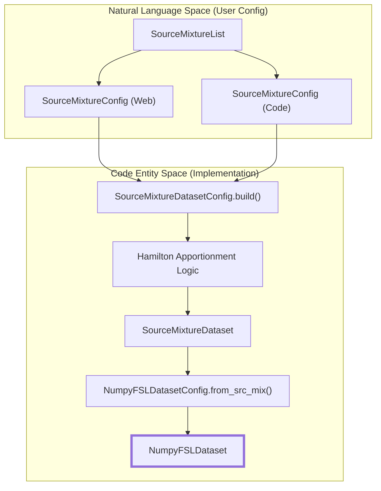
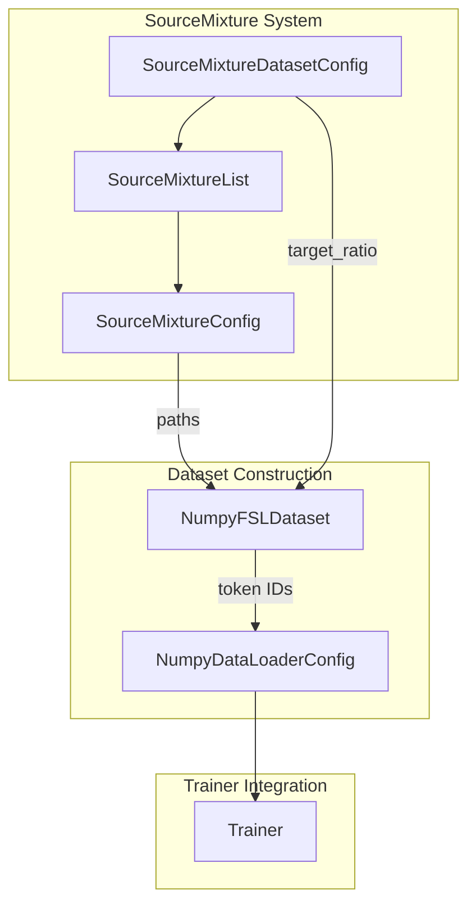

<!-- source: DeepWiki mcp.deepwiki.com · repo allenai/EMO · page 4.2 Data Mixes and Source Mixture System · fetched 2026-10-26 -->

# Data Mixes and Source Mixture System

Relevant source files

The following files were used as context for generating this wiki page:

- [docs/source/guides/data_mixing.rst](docs/source/guides/data_mixing.rst)
- [src/olmo_core/data/__init__.py](src/olmo_core/data/__init__.py)
- [src/olmo_core/data/data_loader.py](src/olmo_core/data/data_loader.py)
- [src/olmo_core/data/mixes/OLMoE-mix-0824.txt](src/olmo_core/data/mixes/OLMoE-mix-0824.txt)
- [src/olmo_core/data/mixes/__init__.py](src/olmo_core/data/mixes/__init__.py)
- [src/olmo_core/data/mixes/code_fim_cpp.txt](src/olmo_core/data/mixes/code_fim_cpp.txt)
- [src/olmo_core/data/mixes/code_fim_java.txt](src/olmo_core/data/mixes/code_fim_java.txt)
- [src/olmo_core/data/mixes/code_fim_python.txt](src/olmo_core/data/mixes/code_fim_python.txt)
- [src/olmo_core/data/mixes/croissant.txt](src/olmo_core/data/mixes/croissant.txt)
- [src/olmo_core/data/mixes/dolma17.txt](src/olmo_core/data/mixes/dolma17.txt)
- [src/olmo_core/data/mixes/v3-small-ppl-validation.txt](src/olmo_core/data/mixes/v3-small-ppl-validation.txt)
- [src/olmo_core/data/numpy_dataset.py](src/olmo_core/data/numpy_dataset.py)
- [src/olmo_core/data/source_mixture.py](src/olmo_core/data/source_mixture.py)
- [src/olmo_core/data/tokenizer.py](src/olmo_core/data/tokenizer.py)
- [src/olmo_core/data/types.py](src/olmo_core/data/types.py)
- [src/olmo_core/data/utils.py](src/olmo_core/data/utils.py)
- [src/test/data/data_loader_test.py](src/test/data/data_loader_test.py)
- [src/test/data/fixtures.py](src/test/data/fixtures.py)
- [src/test/data/mixes_test.py](src/test/data/mixes_test.py)
- [src/test/data/numpy_dataset_test.py](src/test/data/numpy_dataset_test.py)
- [src/test/data/source_mixture_test.py](src/test/data/source_mixture_test.py)
- [src/test/data/tokenizer_test.py](src/test/data/tokenizer_test.py)
- [src/test/data/utils_test.py](src/test/data/utils_test.py)

This page documents the EMO data infrastructure, focusing on the registry of predefined data mixes, the logic for combining disparate data sources into a unified stream, and the configuration of tokenizers used across the project.

## DataMix Registry

The `DataMix` system provides a centralized registry for managing large-scale pretraining and evaluation datasets. It abstracts the underlying file paths and allows for tokenizer-specific path resolution.

### Core Implementation
The system is built around the `DataMix` enum, which inherits from `DataMixBase` [src/olmo_core/data/mixes/__init__.py:14-33](). Each entry in the enum corresponds to a `.txt` file in `src/olmo_core/data/mixes/` containing a list of labels and relative paths [src/olmo_core/data/mixes/__init__.py:173-182]().

Key features include:
*   **Tokenizer Mapping**: The `build` method automatically adjusts file paths based on the `TokenizerName` provided, mapping identifiers like `dolma2` to specific directory suffixes (e.g., `dolma2-tokenizer`) [src/olmo_core/data/mixes/__init__.py:123-154]().
*   **Aliasing**: Supports legacy names (e.g., `dolma3-0625-6T-mix` maps to `OLMo-mix-0625`) via the `_missing_` class method [src/olmo_core/data/mixes/__init__.py:104-121]().

### Notable Mixes
| Mix Name | Description | Source File |
| :--- | :--- | :--- |
| `OLMoE-mix-0824` | Primary mix for EMO/OLMoE 0824 models. | `OLMoE-mix-0824.txt` |
| `dolma17` | Standard Dolma v1.7 dataset. | `dolma17.txt` |
| `croissant` | Large-scale French/multilingual data. | `croissant.txt` |
| `code_fim_python` | Python data formatted for Fill-In-the-Middle (FIM). | `code_fim_python.txt` |
| `v3_small_ppl_validation` | Standard validation set for perplexity tracking. | `v3-small-ppl-validation.txt` |

Sources: [src/olmo_core/data/mixes/__init__.py:39-103](), [src/olmo_core/data/mixes/croissant.txt:1-75]()

---

## Source Mixture System

The Source Mixture system is responsible for calculating how many tokens to sample from various sources to meet a global token budget while respecting constraints like repetition limits.

### Configuration Classes
1.  **`SourceMixtureConfig`**: Defines a single source, its `target_ratio`, `max_repetition_ratio`, and `max_source_fraction` [src/olmo_core/data/source_mixture.py:30-61]().
2.  **`SourceMixtureList`**: A collection of source configs that must have `target_ratio` values summing to 1.0 [src/olmo_core/data/source_mixture.py:127-149]().
3.  **`SourceMixtureDatasetConfig`**: The top-level config that takes a `SourceMixtureList` and a `requested_tokens` count to build a materialized dataset [src/olmo_core/data/source_mixture.py:191-220]().

### Apportionment Logic
The system uses a **Hamilton apportionment** (Largest Remainder Method) to distribute tokens across sources [src/olmo_core/data/source_mixture.py:343-350](). It performs a two-pass calculation:
1.  **Initial Pass**: Calculates raw token requirements based on `target_ratio`.
2.  **Constraint Pass**: Adjusts counts if a source exceeds its `max_repetition_ratio` (upsampling limit) or `max_source_fraction` [src/olmo_core/data/source_mixture.py:355-380]().

### Data Flow Diagram: Source to Dataset
The following diagram illustrates how raw source configurations are transformed into a `NumpyFSLDataset` via the mixture system.

Sources: [src/olmo_core/data/source_mixture.py:127-150](), [src/olmo_core/data/source_mixture.py:343-380](), [src/test/data/fixtures.py:39-65]()

---

## Tokenizer Configuration

`TokenizerConfig` standardizes how tokenizers are handled across the training pipeline. It is a `Config` object that stores vocabulary details and special token IDs.

### Key Attributes
*   **`vocab_size`**: The total number of tokens in the vocabulary [src/olmo_core/data/tokenizer.py:52-55]().
*   **`eos_token_id`**: Used as the document separator in many OLMo datasets [src/olmo_core/data/tokenizer.py:57-60]().
*   **`pad_token_id`**: Used for batch alignment [src/olmo_core/data/tokenizer.py:62-65]().

### Predefined Tokenizers
The `TokenizerConfig` class provides class methods for standard tokenizers:
*   **Dolma2**: `vocab_size=100278`, `eos_token_id=100257` [src/olmo_core/data/tokenizer.py:85-95]().
*   **GPT-NeoX OLMo**: `vocab_size=50280`, `eos_token_id=50279` [src/olmo_core/data/tokenizer.py:110-119]().

The system supports a `padded_vocab_size` method to round the vocabulary up to a multiple (default 128) for optimized hardware performance [src/olmo_core/data/tokenizer.py:77-82]().

Sources: [src/olmo_core/data/tokenizer.py:47-160]()

---

## Implementation Details and Data Flow

The integration of these components occurs during the experiment setup. A `SourceMixtureDatasetConfig` is typically used to create a `NumpyFSLDataset`, which is then wrapped in a `NumpyFSLDataLoader`.

### Dataset Hierarchy and Mixing

Sources: [src/olmo_core/data/numpy_dataset.py:125-142](), [src/olmo_core/data/data_loader.py:43-49](), [src/test/data/fixtures.py:17-67]()

### Fingerprinting for Resumption
Every dataset generates a `fingerprint` based on its configuration and the specific files included [src/olmo_core/data/numpy_dataset.py:212-224](). This ensures that when training is resumed from a checkpoint, the data loader is using the exact same data mix. If the mix changes (e.g., due to missing files in `OLMo-mix-0625`), the user must explicitly set `ignore_fingerprint_mismatch=True` in the `NumpyDataLoaderConfig` [src/olmo_core/data/source_mixture.py:97-104]().

### Repetition and Repetition Filtering
The `InstanceFilterConfig` provides parameters to detect and filter repetitive sequences within instances, with defaults for `repetition_max_period` (13) and `repetition_max_count` (32) [src/olmo_core/data/numpy_dataset.py:99-103]().

Sources: [src/olmo_core/data/numpy_dataset.py:99-103](), [src/olmo_core/data/numpy_dataset.py:212-224](), [src/olmo_core/data/source_mixture.py:97-104]()

---

