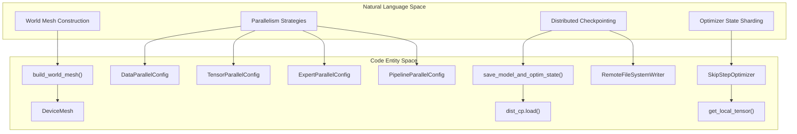
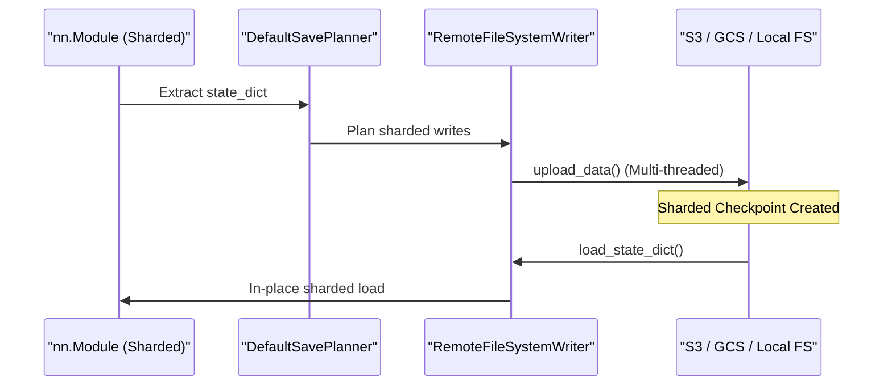

<!-- source: DeepWiki mcp.deepwiki.com · repo allenai/EMO · page 5 Distributed Training Infrastructure · fetched 2026-10-26 -->

# Distributed Training Infrastructure

Relevant source files

The following files were used as context for generating this wiki page:

- [src/olmo_core/distributed/checkpoint/__init__.py](src/olmo_core/distributed/checkpoint/__init__.py)
- [src/olmo_core/distributed/parallel/__init__.py](src/olmo_core/distributed/parallel/__init__.py)
- [src/olmo_core/distributed/parallel/pipeline_parallel.py](src/olmo_core/distributed/parallel/pipeline_parallel.py)
- [src/olmo_core/distributed/utils.py](src/olmo_core/distributed/utils.py)
- [src/olmo_core/optim/__init__.py](src/olmo_core/optim/__init__.py)
- [src/olmo_core/optim/adamw.py](src/olmo_core/optim/adamw.py)
- [src/olmo_core/optim/config.py](src/olmo_core/optim/config.py)
- [src/olmo_core/optim/lion.py](src/olmo_core/optim/lion.py)
- [src/olmo_core/optim/scheduler.py](src/olmo_core/optim/scheduler.py)
- [src/olmo_core/train/callbacks/list_checkpointer.py](src/olmo_core/train/callbacks/list_checkpointer.py)
- [src/olmo_core/utils.py](src/olmo_core/utils.py)
- [src/test/distributed/checkpoint_test.py](src/test/distributed/checkpoint_test.py)
- [src/test/optim/adamw_test.py](src/test/optim/adamw_test.py)
- [src/test/optim/lion_test.py](src/test/optim/lion_test.py)
- [src/test/optim/scheduler_test.py](src/test/optim/scheduler_test.py)
- [src/test/optim/skip_step_optimizer_test.py](src/test/optim/skip_step_optimizer_test.py)

The distributed training infrastructure in EMO and `olmo_core` provides a flexible stack for scaling Large Language Models across massive GPU clusters. It abstracts the complexities of device topology, multi-dimensional parallelism, and efficient state management in a distributed environment.

## Overview of the Distributed Stack

The infrastructure is built on top of PyTorch Distributed, extending it with custom device mesh management and specialized sharding strategies. The system is designed to handle various forms of parallelism—Data (DP), Tensor (TP), Context (CP), Expert (EP), and Pipeline (PP)—simultaneously.

### System Architecture Diagram
This diagram illustrates the relationship between the high-level distributed utilities and the underlying PyTorch entities.

**Distributed Infrastructure Mapping**

**Sources:** [src/olmo_core/distributed/parallel/__init__.py:51-118](), [src/olmo_core/distributed/checkpoint/__init__.py:189-202](), [src/olmo_core/distributed/utils.py:30-45]()

---

## Parallelism Strategies

The core of the distributed system is the `DeviceMesh`, which organizes available GPUs into a multi-dimensional grid. Each dimension corresponds to a specific parallelism strategy.

*   **Data Parallelism (DP):** Supports standard Distributed Data Parallel (DDP) and Fully Sharded Data Parallel (FSDP/HSDP). Hybrid Sharded Data Parallel (HSDP) is particularly used to limit sharding within nodes while replicating across nodes.
*   **Tensor Parallelism (TP):** Shards individual layers (Columnwise/Rowwise) across devices. Note that in EMO, TP is generally mutually exclusive with Expert Parallelism (EP).
*   **Expert Parallelism (EP):** Specifically for Mixture-of-Experts (MoE) models, EP shards experts across the `dp_shard` dimension when using HSDP.
*   **Pipeline Parallelism (PP):** Splits the model layers across different stages, using schedules like `1F1B` or `GPipe` to manage microbatch execution.
*   **Context Parallelism (CP):** Shards the sequence dimension to handle extremely long contexts.

The `build_world_mesh` function [src/olmo_core/distributed/parallel/__init__.py:110-148]() is the primary entry point for configuring these dimensions.

For details, see [Parallelism Strategies](#5.1).

**Sources:** [src/olmo_core/distributed/parallel/__init__.py:51-98](), [src/olmo_core/distributed/parallel/pipeline_parallel.py:25-62]()

---

## Distributed Checkpointing Utilities

The `olmo_core.distributed.checkpoint` module provides a high-level API for saving and loading sharded states. A key feature is the ability to save with one distributed topology (e.g., 64 GPUs) and load with another (e.g., 32 GPUs or a single GPU for inference).

### Checkpointing Flow
The following diagram shows how sharded model states are handled during the save/load lifecycle.

**Checkpoint Lifecycle**

**Sources:** [src/olmo_core/distributed/checkpoint/__init__.py:72-119](), [src/olmo_core/distributed/checkpoint/__init__.py:159-185]()

Key functions include:
*   `save_model_and_optim_state`: Handles the complexities of saving sharded models and their associated optimizer states [src/olmo_core/distributed/checkpoint/__init__.py:189-202]().
*   `unshard_checkpoint`: A utility to convert sharded distributed checkpoints into a single `safetensors` file for easier distribution [src/olmo_core/distributed/checkpoint/__init__.py:20-24]().
*   `RemoteFileSystemReader/Writer`: Custom backends that allow direct I/O with cloud storage (S3/GCS) without local staging [src/olmo_core/distributed/checkpoint/filesystem.py]().

For details, see [Distributed Checkpointing Utilities](#5.2).

**Sources:** [src/olmo_core/distributed/checkpoint/__init__.py:1-24](), [src/test/distributed/checkpoint_test.py:14-24]()

---

## Infrastructure Utilities

A suite of utility functions ensures the environment is correctly configured for distributed execution.

### Environment Management
The `init_distributed` function [src/olmo_core/distributed/utils.py:30-45]() manages the initialization of the process group. It includes specialized logic for different clusters (Beaker, Jupiter, Pluto) to set optimal NCCL environment variables like `NCCL_IB_HCA` or `NCCL_SOCKET_IFNAME` [src/olmo_core/distributed/utils.py:63-114]().

### Common Distributed Functions
| Function | Description |
| :--- | :--- |
| `barrier()` | Synchronizes all ranks in the process group. |
| `get_rank()` | Returns the global rank of the current process. |
| `get_local_rank()` | Returns the rank of the process on the current node. |
| `get_fs_local_rank()` | Returns the rank relative to processes sharing a filesystem [src/olmo_core/distributed/utils.py:141-146](). |
| `get_local_tensor()` | Extracts the local shard of a `DTensor` for optimizer updates [src/olmo_core/optim/adamw.py:171-183](). |

**Sources:** [src/olmo_core/distributed/utils.py:1-148](), [src/olmo_core/utils.py:128-153]()

---

## Optimizers and Schedulers

Distributed training requires optimizers that understand sharded parameters. `olmo_core` provides `SkipStepOptimizer` [src/olmo_core/optim/skip_step_optimizer.py](), which can skip updates based on gradient health (e.g., `SkipStepAdamW`).

The `OptimConfig` [src/olmo_core/optim/config.py:57-65]() class allows for `group_overrides`, enabling different hyper-parameters (like weight decay) for specific parameter groups identified by FQN globs [src/olmo_core/optim/config.py:44-54]().

**Sources:** [src/olmo_core/optim/config.py:120-154](), [src/olmo_core/optim/scheduler.py:27-35](), [src/olmo_core/optim/adamw.py:105-136]()

---

