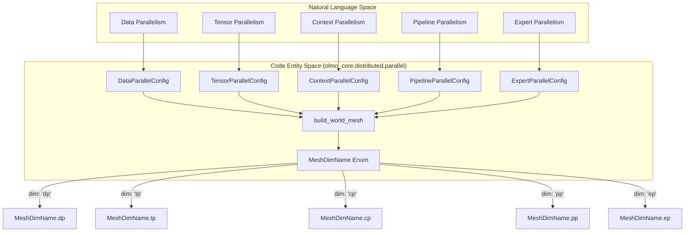
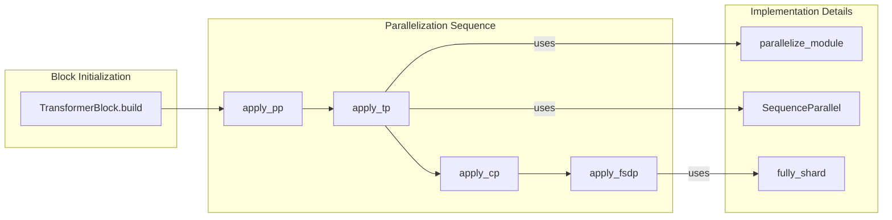

<!-- source: DeepWiki mcp.deepwiki.com · repo allenai/EMO · page 5.1 Parallelism Strategies · fetched 2026-10-26 -->

# Parallelism Strategies

Relevant source files

The following files were used as context for generating this wiki page:

- [src/olmo_core/distributed/parallel/__init__.py](src/olmo_core/distributed/parallel/__init__.py)
- [src/olmo_core/distributed/parallel/pipeline_parallel.py](src/olmo_core/distributed/parallel/pipeline_parallel.py)
- [src/olmo_core/float8/__init__.py](src/olmo_core/float8/__init__.py)
- [src/olmo_core/float8/ao.py](src/olmo_core/float8/ao.py)
- [src/olmo_core/internal/cookbook.py](src/olmo_core/internal/cookbook.py)
- [src/olmo_core/nn/feed_forward.py](src/olmo_core/nn/feed_forward.py)
- [src/olmo_core/nn/transformer/__init__.py](src/olmo_core/nn/transformer/__init__.py)
- [src/olmo_core/nn/transformer/block.py](src/olmo_core/nn/transformer/block.py)
- [src/olmo_core/nn/transformer/config.py](src/olmo_core/nn/transformer/config.py)
- [src/olmo_core/nn/transformer/init.py](src/olmo_core/nn/transformer/init.py)
- [src/olmo_core/nn/transformer/model.py](src/olmo_core/nn/transformer/model.py)
- [src/olmo_core/optim/__init__.py](src/olmo_core/optim/__init__.py)
- [src/olmo_core/optim/adamw.py](src/olmo_core/optim/adamw.py)
- [src/olmo_core/optim/config.py](src/olmo_core/optim/config.py)
- [src/olmo_core/optim/lion.py](src/olmo_core/optim/lion.py)
- [src/olmo_core/optim/scheduler.py](src/olmo_core/optim/scheduler.py)
- [src/olmo_core/train/callbacks/list_checkpointer.py](src/olmo_core/train/callbacks/list_checkpointer.py)
- [src/test/float8/ao_test.py](src/test/float8/ao_test.py)
- [src/test/nn/transformer/model_test.py](src/test/nn/transformer/model_test.py)
- [src/test/optim/adamw_test.py](src/test/optim/adamw_test.py)
- [src/test/optim/lion_test.py](src/test/optim/lion_test.py)
- [src/test/optim/scheduler_test.py](src/test/optim/scheduler_test.py)
- [src/test/optim/skip_step_optimizer_test.py](src/test/optim/skip_step_optimizer_test.py)

The EMO repository utilizes a sophisticated distributed training stack built on PyTorch's `DeviceMesh` and `DTensor` abstractions. It supports a multi-dimensional parallelism strategy including Data Parallelism (DP/FSDP), Tensor Parallelism (TP), Context Parallelism (CP), Expert Parallelism (EP), and Pipeline Parallelism (PP).

## Device Mesh Construction

The foundation of distributed execution is the `build_world_mesh` function, which partitions the available GPUs into a multi-dimensional logical grid.

### Mesh Dimensions
The `MeshDimName` enum defines the standard dimensions used throughout the codebase:
*   `dp`: Data parallel (replicated or sharded).
*   `tp`: Tensor parallel.
*   `cp`: Context parallel.
*   `pp`: Pipeline parallel.
*   `ep`: Expert parallel (specifically for MoE experts).

The dimensions are ordered to optimize for network topology, typically placing higher-bandwidth requirements (like TP/CP) on intra-node links.

### The `build_world_mesh` Lifecycle
1.  **Degree Validation**: The function ensures that the product of all requested degrees (e.g., `dp_degree * tp_degree * pp_degree`) matches the total world size [src/olmo_core/distributed/parallel/__init__.py:165-190]().
2.  **Dimension Ordering**: It builds the mesh by appending dimensions in a specific order: `pp` -> `dp_replicate` -> `dp_shard` -> `cp` -> `tp` [src/olmo_core/distributed/parallel/__init__.py:206-235]().
3.  **HSDP Support**: When using Hybrid Sharded Data Parallelism (HSDP), the DP dimension is split into `dp_replicate` (inter-node) and `dp_shard` (intra-node) [src/olmo_core/distributed/parallel/__init__.py:212-217]().

**Sources:** [src/olmo_core/distributed/parallel/__init__.py:51-98](), [src/olmo_core/distributed/parallel/__init__.py:110-220]()

---

## Data Parallelism (FSDP & HSDP)

EMO relies primarily on Fully Sharded Data Parallelism (FSDP).

### Wrapping Strategies
The `TransformerDataParallelWrappingStrategy` determines how modules are wrapped for sharding:
*   `full`: Wraps every transformer block and the LM head separately [src/olmo_core/nn/transformer/config.py:45-48]().
*   `blocks`: Wraps blocks but leaves the LM head as part of the outer wrapper [src/olmo_core/nn/transformer/config.py:50-53]().
*   `fine_grained`: Wraps specific sub-modules within blocks (e.g., Attention and MLP separately) [src/olmo_core/nn/transformer/config.py:55-58]().

### Implementation in Blocks
Each `TransformerBlockBase` implementation must provide an `apply_fsdp` method. This method uses `fully_shard` to distribute parameters across the `dp_mesh` [src/olmo_core/nn/transformer/block.py:82-89]().

**Sources:** [src/olmo_core/nn/transformer/config.py:40-60](), [src/olmo_core/nn/transformer/block.py:82-89]()

---

## Tensor Parallelism (TP)

Tensor Parallelism shards individual weight matrices across multiple GPUs.

### Rowwise and Columnwise Sharding
TP is implemented using `parallelize_module` from PyTorch's `torch.distributed.tensor.parallel`.
*   **Columnwise**: Typically used for the first linear layer in an MLP (expanding the dimension).
*   **Rowwise**: Used for the second linear layer (reducing back to `d_model`) [src/olmo_core/nn/transformer/model.py:22-26]().

### Sequence Parallelism
When TP is active, the model often employs `SequenceParallel` to shard the activations along the sequence dimension, reducing memory pressure during the forward pass [src/olmo_core/nn/transformer/block.py:167-174]().

**Sources:** [src/olmo_core/nn/transformer/model.py:22-26](), [src/olmo_core/nn/transformer/block.py:155-200]()

---

## Context Parallelism (CP)

Context Parallelism is used to handle extremely long sequences by sharding the sequence dimension across GPUs within the `cp_mesh`.

### CP Styles
1.  **Ring Context Parallel**: Uses a ring-style communication pattern for attention [src/olmo_core/nn/transformer/model.py:34-35]().
2.  **Ulysses Context Parallel**: Uses all-to-all communication to redistribute sequence chunks [src/olmo_core/nn/transformer/model.py:36-37]().

The `apply_cp` method in `TransformerBlock` propagates these configurations to the underlying `Attention` or `SequenceMixer` modules [src/olmo_core/nn/transformer/block.py:201-209]().

**Sources:** [src/olmo_core/nn/transformer/model.py:34-37](), [src/olmo_core/nn/transformer/block.py:70-76]()

---

## Expert Parallelism (EP)

Expert Parallelism is critical for EMO's MoE architecture. It shards the experts of an MoE layer across the `ep_mesh`.

### All-to-All Routing
In an EP configuration, tokens are routed to experts located on different ranks. This involves an `all-to-all` communication step where tokens are dispatched to the rank holding their assigned expert and then returned after computation.

### Integration with HSDP
Currently, Expert Parallelism is primarily supported in conjunction with HSDP, where the `ep` dimension is mapped to the `dp_shard` dimension to minimize communication latency [src/olmo_core/distributed/parallel/__init__.py:193-200]().

**Sources:** [src/olmo_core/distributed/parallel/__init__.py:87-95](), [src/olmo_core/distributed/parallel/__init__.py:184-200]()

---

## Pipeline Parallelism (PP)

Pipeline Parallelism splits the model layers across different GPUs (stages).

### Schedules and Styles
EMO supports several schedules via the `PipelineScheduleType` enum:
*   `1F1B`: One-Forward-One-Backward schedule (Standard and Interleaved) [src/olmo_core/distributed/parallel/pipeline_parallel.py:37-38]().
*   `GPipe`: Simple batch-splitting schedule [src/olmo_core/distributed/parallel/pipeline_parallel.py:39]().

The `PipelineSplitStyle` defines how stages are assigned to ranks:
*   `loop`: Standard sequential assignment (e.g., Rank 0 gets layers 0-2, Rank 1 gets 3-5).
*   `v`: A "V-style" schedule used for specific zero-bubble optimizations [src/olmo_core/distributed/parallel/pipeline_parallel.py:20-22]().

### Data Flow
The `PipelineSchedule` class wraps the PyTorch `PipelineStage` objects and manages the execution of microbatches [src/olmo_core/distributed/parallel/pipeline_parallel.py:137-189]().

**Sources:** [src/olmo_core/distributed/parallel/pipeline_parallel.py:25-61](), [src/olmo_core/distributed/parallel/pipeline_parallel.py:137-200]()

---

## FP8 Quantization

EMO supports FP8 training and inference via the `Float8Config`. This is integrated into the parallelism strategy to ensure that sharding and quantization are applied in the correct order.

### Integration
When `float8_enabled` is True, the `apply_tp` and `apply_fsdp` methods in transformer blocks adjust their logic to handle the scaled FP8 tensors [src/olmo_core/nn/transformer/block.py:156-182](). The model can also precompute dynamic scales for FSDP [src/olmo_core/nn/transformer/model.py:175]().

**Sources:** [src/olmo_core/nn/transformer/model.py:33](), [src/olmo_core/nn/transformer/block.py:65](), [src/olmo_core/nn/transformer/model.py:174-175]()

---

## System Architecture Diagrams

### Parallelism Dimension Mapping
The following diagram illustrates how high-level parallelism configurations are mapped to code entities and `DeviceMesh` dimensions.

**Sources:** [src/olmo_core/distributed/parallel/__init__.py:51-118]()

### Transformer Block Parallelization Flow
This diagram shows the sequence of applying parallelism strategies to a `TransformerBlock`.

**Sources:** [src/olmo_core/nn/transformer/block.py:60-94](), [src/olmo_core/nn/transformer/block.py:155-209]()

---

## Summary of Parallelism Components

| Strategy | Config Class | Sub-Mesh Function | Key Module Methods |
| :--- | :--- | :--- | :--- |
| **Data (FSDP)** | `DataParallelConfig` | `get_dp_model_mesh` | `apply_fsdp` |
| **Tensor** | `TensorParallelConfig` | `get_tp_mesh` | `apply_tp` |
| **Context** | `ContextParallelConfig` | `get_cp_mesh` | `apply_cp` |
| **Pipeline** | `PipelineParallelConfig` | `get_pp_mesh` | `apply_pp` |
| **Expert** | `ExpertParallelConfig` | `get_ep_mesh` | `MoEBase.apply_ep` |

**Sources:** [src/olmo_core/distributed/parallel/__init__.py:22-46](), [src/olmo_core/nn/transformer/block.py:60-94]()

---

