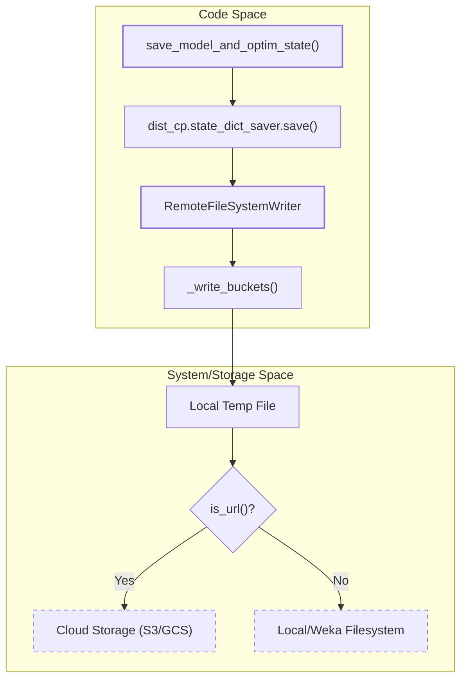
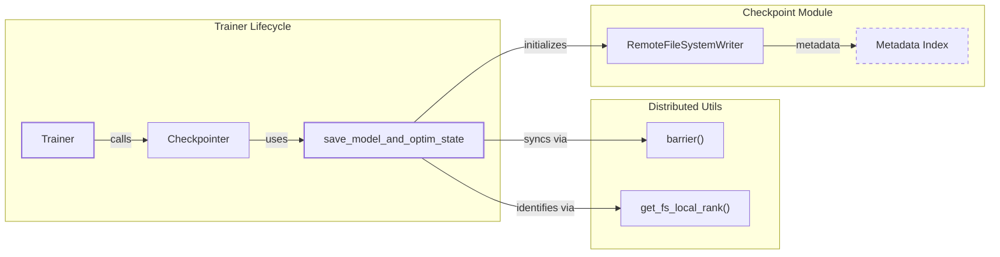

<!-- source: DeepWiki mcp.deepwiki.com · repo allenai/EMO · page 5.2 Distributed Checkpointing Utilities · fetched 2026-10-26 -->

# Distributed Checkpointing Utilities

Relevant source files

The following files were used as context for generating this wiki page:

- [src/olmo_core/distributed/checkpoint/__init__.py](src/olmo_core/distributed/checkpoint/__init__.py)
- [src/olmo_core/distributed/checkpoint/filesystem.py](src/olmo_core/distributed/checkpoint/filesystem.py)
- [src/olmo_core/distributed/utils.py](src/olmo_core/distributed/utils.py)
- [src/olmo_core/fs_cache.py](src/olmo_core/fs_cache.py)
- [src/olmo_core/generate/generation_module/transformer/config.py](src/olmo_core/generate/generation_module/transformer/config.py)
- [src/olmo_core/generate/generation_module/transformer/generation_module.py](src/olmo_core/generate/generation_module/transformer/generation_module.py)
- [src/olmo_core/utils.py](src/olmo_core/utils.py)
- [src/scripts/merge_core_checkpoints.py](src/scripts/merge_core_checkpoints.py)
- [src/test/distributed/checkpoint/filesystem_test.py](src/test/distributed/checkpoint/filesystem_test.py)
- [src/test/distributed/checkpoint_test.py](src/test/distributed/checkpoint_test.py)
- [src/test/generate/generation_module/transformer/generation_module_test.py](src/test/generate/generation_module/transformer/generation_module_test.py)
- [src/test/scripts/merge_core_checkpoints_test.py](src/test/scripts/merge_core_checkpoints_test.py)

The `olmo_core.distributed.checkpoint` module provides a high-level, unified API for saving and loading distributed checkpoints across local and remote filesystems. It is designed to handle complex distributed topologies (e.g., FSDP, Tensor Parallelism) seamlessly, allowing a checkpoint saved with one configuration (e.g., 64 GPUs) to be loaded into another (e.g., 8 GPUs or a single CPU) [src/olmo_core/distributed/checkpoint/__init__.py:1-24]().

## Core API Functions

The module provides several key functions for managing model and optimizer states.

| Function | Description |
| :--- | :--- |
| `save_model_and_optim_state` | Saves model and optimizer state dicts, handling sharding and flattening [src/olmo_core/distributed/checkpoint/__init__.py:189-201](). |
| `load_model_and_optim_state` | Loads model/optimizer state in-place, supporting different distributed topologies [src/olmo_core/distributed/checkpoint/__init__.py:246-254](). |
| `unshard_checkpoint` | Converts a sharded distributed checkpoint into a single monolithic file (e.g., `.pt` or `.safetensors`) [src/olmo_core/distributed/checkpoint/__init__.py:504-517](). |
| `save_state_dict` | Low-level utility to save an arbitrary dictionary to a distributed format [src/olmo_core/distributed/checkpoint/__init__.py:72-83](). |
| `get_checkpoint_metadata` | Retrieves metadata about the tensors stored in a checkpoint without loading them [src/olmo_core/distributed/checkpoint/__init__.py:587-593](). |

**Sources:** [src/olmo_core/distributed/checkpoint/__init__.py:51-66](), [src/olmo_core/distributed/checkpoint/__init__.py:189-254]()

## Implementation and Data Flow

The checkpointing system utilizes a custom filesystem backend to interface with `torch.distributed.checkpoint`. This allows for efficient I/O directly to cloud storage (S3/GCS) where each rank only downloads or uploads the specific shards it owns [src/olmo_core/distributed/checkpoint/__init__.py:8-12]().

### Checkpoint Storage Logic
When saving, the system uses `RemoteFileSystemWriter` to coordinate uploads. If `throttle_uploads` is enabled, the system restricts the number of concurrent uploads per node to prevent saturating network bandwidth [src/olmo_core/distributed/checkpoint/filesystem.py:193-209]().

### Data Flow: Distributed Save
The following diagram illustrates the flow from code entities to the physical storage layer during a distributed save operation.

**System Entity Mapping: Distributed Save**

**Sources:** [src/olmo_core/distributed/checkpoint/__init__.py:189-244](), [src/olmo_core/distributed/checkpoint/filesystem.py:105-168](), [src/olmo_core/distributed/checkpoint/filesystem.py:187-209]()

## Unsharding and Conversion

`unshard_checkpoint` is a critical utility for interoperability. It reads a sharded checkpoint and merges the fragments into a single file. This is often used before converting models to HuggingFace format or for offline analysis [src/olmo_core/distributed/checkpoint/__init__.py:504-517]().

*   **Strategies**: Supports `UnshardStrategy.cpu` (merging on CPU) or `UnshardStrategy.gpu` (faster, requires sufficient VRAM) [src/olmo_core/distributed/checkpoint/__init__.py:476-483]().
*   **Formats**: Can output standard Torch `.pt` files or `safetensors` [src/olmo_core/distributed/checkpoint/__init__.py:515-517]().

**Sources:** [src/olmo_core/distributed/checkpoint/__init__.py:504-585]()

## Custom Filesystem Backend

The `RemoteFileSystemReader` and `RemoteFileSystemWriter` classes extend PyTorch's storage abstractions to support EMO's I/O requirements.

### Key Features:
1.  **Threaded/Process I/O**: Uses `ThreadPoolExecutor` or `ProcessPoolExecutor` to parallelize tensor R/W operations [src/olmo_core/distributed/checkpoint/filesystem.py:205-206]().
2.  **Plan Caching**: Supports `enable_plan_caching` to speed up repeated checkpointing during training [src/olmo_core/distributed/checkpoint/__init__.py:105-106]().
3.  **Atomic Writes**: Writes to a temporary `.distcp` file before renaming/uploading to ensure atomicity [src/olmo_core/distributed/checkpoint/filesystem.py:110-147]().

**Sources:** [src/olmo_core/distributed/checkpoint/filesystem.py:187-210](), [src/olmo_core/distributed/checkpoint/filesystem.py:321-340]()

## Distributed Utilities

The module relies on several low-level distributed helpers found in `olmo_core.distributed.utils`.

*   **`barrier()`**: A wrapper around `dist.barrier()` that works even in non-distributed environments [src/olmo_core/distributed/utils.py:186-193]().
*   **`get_fs_local_rank()`**: Returns the rank of the process relative to the local filesystem. This is crucial for operations where only one process per node should perform I/O (e.g., extracting a dataset) [src/olmo_core/distributed/utils.py:244-257]().
*   **`broadcast_object()`**: Simplifies broadcasting Python objects from rank 0 to all other ranks [src/olmo_core/distributed/utils.py:290-305]().

**Sources:** [src/olmo_core/distributed/utils.py:1-305]()

## Checkpoint Metadata and Merging

The `get_checkpoint_metadata` function allows inspection of a checkpoint's structure (keys, tensor shapes, dtypes) without loading the actual data [src/olmo_core/distributed/checkpoint/__init__.py:587-603](). This is used by the `merge_core_checkpoints.py` script to perform weight averaging across multiple training runs.

**Logic for Weight Averaging:**
1.  Load metadata for all source checkpoints.
2.  Validate that all checkpoints share the same keys [src/scripts/merge_core_checkpoints.py:39-58]().
3.  Load tensors in batches (default 128) to manage memory [src/scripts/merge_core_checkpoints.py:98-114]().
4.  Perform in-place addition with scaling: `merged.add_(current, alpha=1/N)` [src/scripts/merge_core_checkpoints.py:113-114]().

**Sources:** [src/scripts/merge_core_checkpoints.py:24-128]()

## System Integration Diagram

The following diagram shows how the checkpointing utilities integrate with the broader training infrastructure.

**System Entity Mapping: Training Integration**

**Sources:** [src/olmo_core/distributed/checkpoint/__init__.py:189-201](), [src/olmo_core/distributed/utils.py:186-257](), [src/olmo_core/distributed/checkpoint/filesystem.py:187-200]()

---

