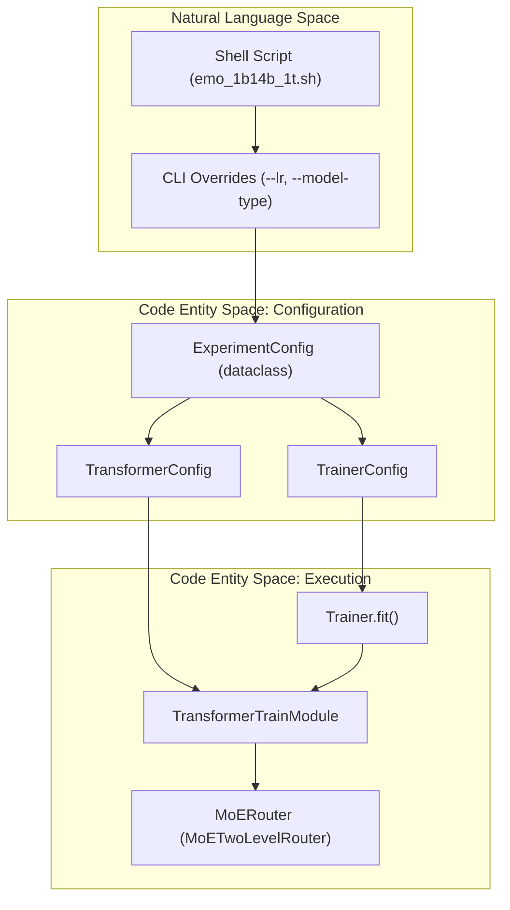
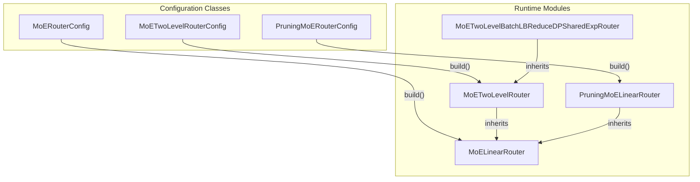

<!-- source: DeepWiki mcp.deepwiki.com · repo allenai/EMO · page 6 Training Scripts and Model Configurations · fetched 2026-10-26 -->

# Training Scripts and Model Configurations

Relevant source files

The following files were used as context for generating this wiki page:

- [.gitignore](.gitignore)
- [README.md](README.md)
- [scripts/RUN_TEMPLATES.md](scripts/RUN_TEMPLATES.md)
- [scripts/models/dense_1b_130b.sh](scripts/models/dense_1b_130b.sh)
- [scripts/models/emo_1b14b_130b.sh](scripts/models/emo_1b14b_130b.sh)
- [scripts/models/emo_1b14b_1t.sh](scripts/models/emo_1b14b_1t.sh)
- [scripts/models/emo_1b14b_1t_emoanneal.sh](scripts/models/emo_1b14b_1t_emoanneal.sh)
- [scripts/models/stdmoe_1b14b_130b.sh](scripts/models/stdmoe_1b14b_130b.sh)
- [scripts/models/stdmoe_1b14b_1t.sh](scripts/models/stdmoe_1b14b_1t.sh)
- [scripts/models/stdmoe_1b14b_1t_emoanneal.sh](scripts/models/stdmoe_1b14b_1t_emoanneal.sh)
- [scripts/models/stdmoe_1b14b_1t_stdanneal.sh](scripts/models/stdmoe_1b14b_1t_stdanneal.sh)
- [scripts/models/stdmoe_1b4b_130b.sh](scripts/models/stdmoe_1b4b_130b.sh)
- [scripts/selective_hf/hf_finetune_with_selective_easy_ep.sh](scripts/selective_hf/hf_finetune_with_selective_easy_ep.sh)
- [scripts/selective_hf/hf_finetune_with_selective_layerwise.sh](scripts/selective_hf/hf_finetune_with_selective_layerwise.sh)
- [src/olmo_core/nn/moe/mutualinfo_router.py](src/olmo_core/nn/moe/mutualinfo_router.py)
- [src/olmo_core/nn/moe/pruning_router.py](src/olmo_core/nn/moe/pruning_router.py)
- [src/olmo_core/nn/moe/router.py](src/olmo_core/nn/moe/router.py)
- [src/olmo_core/nn/moe/twolevel_batchlb_reducedp_sharedexp_router.py](src/olmo_core/nn/moe/twolevel_batchlb_reducedp_sharedexp_router.py)
- [src/olmo_core/nn/moe/twolevel_batchlb_reducedp_sharedexppool_router.py](src/olmo_core/nn/moe/twolevel_batchlb_reducedp_sharedexppool_router.py)
- [src/olmo_core/nn/moe/twolevel_router.py](src/olmo_core/nn/moe/twolevel_router.py)
- [src/olmo_core/nn/moe/twolevel_topp_batchlb_router.py](src/olmo_core/nn/moe/twolevel_topp_batchlb_router.py)
- [src/scripts/official/README.md](src/scripts/official/README.md)
- [src/scripts/train/README.md](src/scripts/train/README.md)
- [src/scripts/train/olmoe-1B-7B_finetune.py](src/scripts/train/olmoe-1B-7B_finetune.py)
- [src/scripts/train/olmoe-1B-7B_fsl.py](src/scripts/train/olmoe-1B-7B_fsl.py)

The EMO repository provides a comprehensive suite of training scripts for modular Mixture-of-Experts (MoE) pretraining, dense baseline construction, fine-tuning, and systematic scaling experiments. These scripts bridge the high-level `ExperimentConfig` definitions with the underlying `olmo_core` training infrastructure.

## EMO and MoE Pretraining Scripts

The primary entry point for MoE pretraining is `src/scripts/train/olmoe-1B-7B_fsl.py`. This script handles the configuration of EMO's modular routing mechanisms and standard MoE baselines.

- **Primary Entrypoint**: `olmoe-1B-7B_fsl.py` uses an `ExperimentConfig` dataclass to orchestrate the model, dataset, and trainer components [src/scripts/train/olmoe-1B-7B_fsl.py:116-137]().
- **Model Type Selection**: The `--model-type` CLI flag determines which router is injected into the `TransformerBlockConfig`. Options include standard `moe`, `two-level_lb-batch_reduce-dp` (document-aware), and variants with shared expert pools [scripts/RUN_TEMPLATES.md:121-126]().
- **Dynamic Pool Sizing**: The `ExpertPoolSchedulerCallback` allows for scheduling the size of the expert pool over the course of training [src/scripts/train/olmoe-1B-7B_fsl.py:81-81]().
- **Shell Script Entrypoints**: Pre-configured shell scripts in `scripts/models/` provide the exact hyperparameters used for major releases, such as `emo_1b14b_1t.sh` and `stdmoe_1b14b_1t.sh` [README.md:58-62]().

For details, see [EMO and MoE Pretraining Scripts](#6.1).

### Sources:
- [src/scripts/train/olmoe-1B-7B_fsl.py:116-137]()
- [scripts/RUN_TEMPLATES.md:121-126]()
- [README.md:58-62]()

## Dense Baseline and Fine-tuning Scripts

To validate the efficiency of EMO, the repository includes scripts for training dense models and performing modular-aware fine-tuning.

- **Dense Baselines**: `src/scripts/train/olmo2-1B.py` is used to train architecture-matched dense models [scripts/RUN_TEMPLATES.md:34-54]().
- **Modular Fine-tuning**: `src/scripts/train/olmoe-1B-7B_finetune.py` implements `apply_pruned_routers`, which replaces standard routers with `PruningMoELinearRouter` based on an activation file [src/scripts/train/olmoe-1B-7B_finetune.py:151-196]().
- **SFT and Midtraining**: Scripts like `Olmo-3-7B-SFT.py` and various midtraining templates support instruction tuning and domain-specific extensions [scripts/RUN_TEMPLATES.md:127-163]().
- **Workflow**: The `launch_common.sh` script provides a unified launcher for local and Beaker-based execution [scripts/RUN_TEMPLATES.md:5-20]().

For details, see [Dense Baseline and Fine-tuning Scripts](#6.2).

### Sources:
- [src/scripts/train/olmoe-1B-7B_finetune.py:151-196]()
- [scripts/RUN_TEMPLATES.md:34-54]()
- [scripts/RUN_TEMPLATES.md:127-163]()

## Model Ladder Framework

The `model_ladder` subsystem is designed for Chinchilla-optimal scaling experiments, allowing researchers to sweep model sizes and token counts systematically.

- **Configurators**: Uses `TransformerModelConfigurator` and `WSDSChinchillaRunConfigurator` to generate consistent configurations across different scales.
- **Ladder Scripts**: Specialized scripts like `olmo3_ladder.py` and `muon_ladder.py` utilize the `ModelLadderBase` to launch multiple related experiments.
- **Parallelism**: Integrated with `DeviceMeshSpec` to automatically handle FSDP and TP settings based on the model size.

For details, see [Model Ladder Framework](#6.3).

## System Mapping: Config to Execution

The following diagram illustrates how Python-based configurations in `src/scripts/train/` are transformed into running training modules.

### Configuration Lifecycle

Sources: [src/scripts/train/olmoe-1B-7B_fsl.py:116-155](), [src/olmo_core/nn/moe/twolevel_router.py:18-40]()

## Router Configuration Hierarchy

EMO uses a specialized hierarchy of routers that are selected during the configuration build phase.

### Router Implementation Mapping

Sources: [src/olmo_core/nn/moe/router.py:90-137](), [src/olmo_core/nn/moe/twolevel_router.py:18-21](), [src/olmo_core/nn/moe/pruning_router.py:18-33]()

## Summary of Key Training Scripts

| Script Path | Primary Purpose | Key Components |
|:---|:---|:---|
| `olmoe-1B-7B_fsl.py` | EMO/MoE Pretraining | `ExperimentConfig`, `MoETwoLevelRouter` |
| `olmoe-1B-7B_finetune.py` | Selective Fine-tuning | `apply_pruned_routers`, `PruningMoERouter` |
| `olmo2-1B.py` | Dense Baseline | `TransformerConfig` (default blocks) |
| `olmo3_ladder.py` | Scaling Sweeps | `ModelLadderBase`, `WSDSChinchillaRunConfigurator` |

### Sources:
- [src/scripts/train/olmoe-1B-7B_fsl.py:1-20]()
- [src/scripts/train/olmoe-1B-7B_finetune.py:1-20]()
- [scripts/RUN_TEMPLATES.md:32-54]()

---

