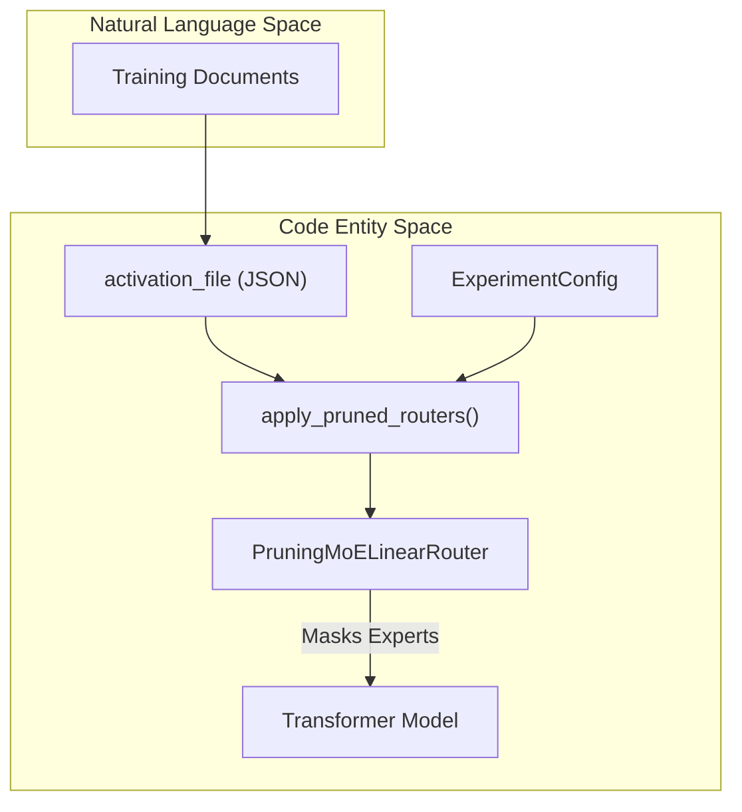
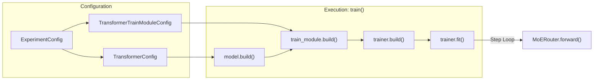

<!-- source: DeepWiki mcp.deepwiki.com · repo allenai/EMO · page 6.1 EMO and MoE Pretraining Scripts · fetched 2026-10-26 -->

# EMO and MoE Pretraining Scripts

Relevant source files

The following files were used as context for generating this wiki page:

- [.gitignore](.gitignore)
- [scripts/models/dense_1b_130b.sh](scripts/models/dense_1b_130b.sh)
- [scripts/models/emo_1b14b_130b.sh](scripts/models/emo_1b14b_130b.sh)
- [scripts/models/emo_1b14b_1t.sh](scripts/models/emo_1b14b_1t.sh)
- [scripts/models/emo_1b14b_1t_emoanneal.sh](scripts/models/emo_1b14b_1t_emoanneal.sh)
- [scripts/models/stdmoe_1b14b_130b.sh](scripts/models/stdmoe_1b14b_130b.sh)
- [scripts/models/stdmoe_1b14b_1t.sh](scripts/models/stdmoe_1b14b_1t.sh)
- [scripts/models/stdmoe_1b14b_1t_emoanneal.sh](scripts/models/stdmoe_1b14b_1t_emoanneal.sh)
- [scripts/models/stdmoe_1b14b_1t_stdanneal.sh](scripts/models/stdmoe_1b14b_1t_stdanneal.sh)
- [scripts/models/stdmoe_1b4b_130b.sh](scripts/models/stdmoe_1b4b_130b.sh)
- [src/olmo_core/nn/moe/mutualinfo_router.py](src/olmo_core/nn/moe/mutualinfo_router.py)
- [src/olmo_core/nn/moe/pruning_router.py](src/olmo_core/nn/moe/pruning_router.py)
- [src/olmo_core/nn/moe/router.py](src/olmo_core/nn/moe/router.py)
- [src/olmo_core/nn/moe/twolevel_batchlb_reducedp_sharedexp_router.py](src/olmo_core/nn/moe/twolevel_batchlb_reducedp_sharedexp_router.py)
- [src/olmo_core/nn/moe/twolevel_batchlb_reducedp_sharedexppool_router.py](src/olmo_core/nn/moe/twolevel_batchlb_reducedp_sharedexppool_router.py)
- [src/olmo_core/nn/moe/twolevel_router.py](src/olmo_core/nn/moe/twolevel_router.py)
- [src/olmo_core/nn/moe/twolevel_topp_batchlb_router.py](src/olmo_core/nn/moe/twolevel_topp_batchlb_router.py)
- [src/scripts/beaker/launch_test.py](src/scripts/beaker/launch_test.py)
- [src/scripts/train/OLMoE2-large.py](src/scripts/train/OLMoE2-large.py)
- [src/scripts/train/OLMoE2-medium.py](src/scripts/train/OLMoE2-medium.py)
- [src/scripts/train/all_reduce_bench.py](src/scripts/train/all_reduce_bench.py)
- [src/scripts/train/olmoe-1B-7B_finetune.py](src/scripts/train/olmoe-1B-7B_finetune.py)
- [src/scripts/train/olmoe-1B-7B_fsl.py](src/scripts/train/olmoe-1B-7B_fsl.py)
- [src/scripts/train/olmoe-1B-7B_fsl_anneal.py](src/scripts/train/olmoe-1B-7B_fsl_anneal.py)
- [src/scripts/train/olmoe-1B-7B_fsl_extension.py](src/scripts/train/olmoe-1B-7B_fsl_extension.py)

This page documents the primary entrypoints and configurations for training Mixture-of-Experts (MoE) models within the EMO framework. It covers the core pretraining script, the configuration system for experiments, specialized router selection, and dynamic expert pool scheduling.

## Core Pretraining Script: `olmoe-1B-7B_fsl.py`

The script `src/scripts/train/olmoe-1B-7B_fsl.py` serves as the primary entrypoint for Fixed Sequence Length (FSL) pretraining of MoE models [src/scripts/train/olmoe-1B-7B_fsl.py:1-7](). It orchestrates the construction of the model, data loaders, and the trainer using a centralized `ExperimentConfig` [src/scripts/train/olmoe-1B-7B_fsl.py:140-155]().

### ExperimentConfig Dataclass
The `ExperimentConfig` inherits from `olmo_core.config.Config` and encapsulates all necessary components for a training run [src/scripts/train/olmoe-1B-7B_fsl.py:116-137]().

| Field | Type | Description |
| :--- | :--- | :--- |
| `model` | `TransformerConfig` | Defines architecture (layers, heads, experts, top-k) [src/scripts/train/olmoe-1B-7B_fsl.py:118](). |
| `dataset` | `NumpyDatasetConfig` | Configuration for the pre-tokenized training data [src/scripts/train/olmoe-1B-7B_fsl.py:120](). |
| `data_loader` | `NumpyDataLoaderConfig` | Settings for batching and distributed data fetching [src/scripts/train/olmoe-1B-7B_fsl.py:122](). |
| `trainer` | `TrainerConfig` | General training loop settings (checkpoints, callbacks) [src/scripts/train/olmoe-1B-7B_fsl.py:124](). |
| `train_module` | `TransformerTrainModuleConfig` | Optimizer, scheduler, and parallelism (DP/EP) settings [src/scripts/train/olmoe-1B-7B_fsl.py:126](). |

**Sources:** [src/scripts/train/olmoe-1B-7B_fsl.py:116-137](), [src/scripts/train/olmoe-1B-7B_fsl.py:140-173]()

## Router Selection and `model_type`

The repository supports various router implementations that can be toggled via CLI flags or configuration overrides. The selection of `model_type` determines which router configuration is built into the `TransformerConfig`.

### Router Variant Implementations
The EMO framework provides several specialized routers beyond the standard linear router:

*   **MoELinearRouter**: The baseline implementation [src/olmo_core/nn/moe/router.py:45]().
*   **MoETwoLevelRouter**: Implements document-aware routing by restricting expert selection to a subset (pool) for each document [src/olmo_core/nn/moe/twolevel_router.py:18-21]().
*   **MoETwoLevelBatchLBReduceDPSharedExpRouter**: A complex variant combining two-level routing, batch-level load balancing, and shared experts [src/olmo_core/nn/moe/twolevel_batchlb_reducedp_sharedexp_router.py:17-30]().
*   **MoETwoLevelTopPBatchLBRouter**: Dynamically adjusts the document expert pool size based on a `top_p` probability threshold [src/olmo_core/nn/moe/twolevel_topp_batchlb_router.py:19-34]().
*   **MoEMutualInfoRouter**: Introduces entropy-based losses (conditional and unconditional) to encourage expert specialization via mutual information [src/olmo_core/nn/moe/mutualinfo_router.py:18-35]().

### Router Gating and Expert Selection Logic
The routing process typically follows this flow:
1.  **Jitter**: Adding noise to inputs [src/olmo_core/nn/moe/router.py:236]().
2.  **Logit Computation**: `get_expert_logits` produces scores for each expert [src/olmo_core/nn/moe/router.py:240]().
3.  **Masking**: (Optional) Masking experts based on document boundaries or pruning [src/olmo_core/nn/moe/twolevel_router.py:93-96]().
4.  **Gating**: Applying `softmax` or `sigmoid` [src/olmo_core/nn/moe/router.py:243-248]().
5.  **Top-K**: Selecting the `top_k` experts [src/olmo_core/nn/moe/router.py:251]().

**Sources:** [src/olmo_core/nn/moe/router.py:73-112](), [src/olmo_core/nn/moe/twolevel_router.py:18-49](), [src/olmo_core/nn/moe/mutualinfo_router.py:18-44]()

## ExpertPoolSchedulerCallback

The `ExpertPoolSchedulerCallback` allows for dynamic adjustment of the expert pool size during training [src/scripts/train/olmoe-1B-7B_fsl.py:81](). This is critical for EMO experiments where the model might start with a large pool and gradually restrict it to force specialization.

The pool schedule is often parsed from a string specification (e.g., `"{0: 64, 1000: 32}"`) where keys are steps and values are the `document_expert_pool` size [src/scripts/train/olmoe-1B-7B_fsl.py:101-112]().

**Sources:** [src/scripts/train/olmoe-1B-7B_fsl.py:81](), [src/scripts/train/olmoe-1B-7B_fsl.py:101-112]()

## Selective Expert Usage and Pruning Scripts

For fine-tuning or specialized pretraining (annealing), the `olmoe-1B-7B_finetune.py` script introduces the `apply_pruned_routers` function [src/scripts/train/olmoe-1B-7B_finetune.py:151-155]().

### Activation-Based Pruning
The `PruningMoELinearRouter` uses an external `activation_file` (generated during profiling) to determine which experts are the most active per layer [src/olmo_core/nn/moe/pruning_router.py:40-48](). It then masks out all but the `prune_keep_k` most active experts [src/olmo_core/nn/moe/pruning_router.py:118-119]().

### Data Flow: Activation to Pruned Model
The following diagram illustrates how expert activation data is used to configure a pruned model for fine-tuning.

**Title: Activation-Based Router Pruning Flow**

**Sources:** [src/scripts/train/olmoe-1B-7B_finetune.py:96-106](), [src/olmo_core/nn/moe/pruning_router.py:18-51](), [src/olmo_core/nn/moe/pruning_router.py:118-120]()

## Shell Scripts for Model Configurations

The directory `scripts/models/` contains shell scripts that define hyperparameters for specific model scales and training regimes. These scripts typically invoke the Python training entrypoints with specific overrides.

| Script | Purpose |
| :--- | :--- |
| `emo_1b14b_1t.sh` | Standard EMO pretraining for 1B/14B model on 1T tokens. |
| `stdmoe_1b14b_1t.sh` | Baseline standard MoE pretraining. |
| `emo_1b14b_1t_emoanneal.sh` | Annealing phase for an EMO model. |
| `dense_1b_130b.sh` | Dense baseline training script. |

These scripts handle the translation of research parameters (like total tokens) into the `Duration` and `Scheduler` configurations used by `olmo_core` [src/scripts/train/olmoe-1B-7B_fsl_anneal.py:71-73]().

## Training Lifecycle and Integration

The pretraining scripts integrate with the `Trainer` via `DownstreamEvaluatorCallback` to perform zero-shot or few-shot evaluation during the training run [src/scripts/train/olmoe-1B-7B_fsl.py:76]().

**Title: Pretraining Script Execution and Component Assembly**

**Sources:** [src/scripts/train/olmoe-1B-7B_fsl.py:140-173](), [src/olmo_core/nn/moe/router.py:228-251]()

### Key Functions
*   `build_config`: Merges CLI overrides with default `ExperimentConfig` [src/scripts/train/olmoe-1B-7B_finetune.py:197]().
*   `apply_pruned_routers`: Iterates through model blocks and swaps standard routers for `PruningMoELinearRouter` [src/scripts/train/olmoe-1B-7B_finetune.py:151-194]().
*   `parse_poolsched`: Utility for converting string-based schedules into step-to-pool-size dictionaries [src/scripts/train/olmoe-1B-7B_fsl.py:101-112]().

**Sources:** [src/scripts/train/olmoe-1B-7B_fsl.py](), [src/olmo_core/nn/moe/router.py](), [src/scripts/train/olmoe-1B-7B_finetune.py]()

---

