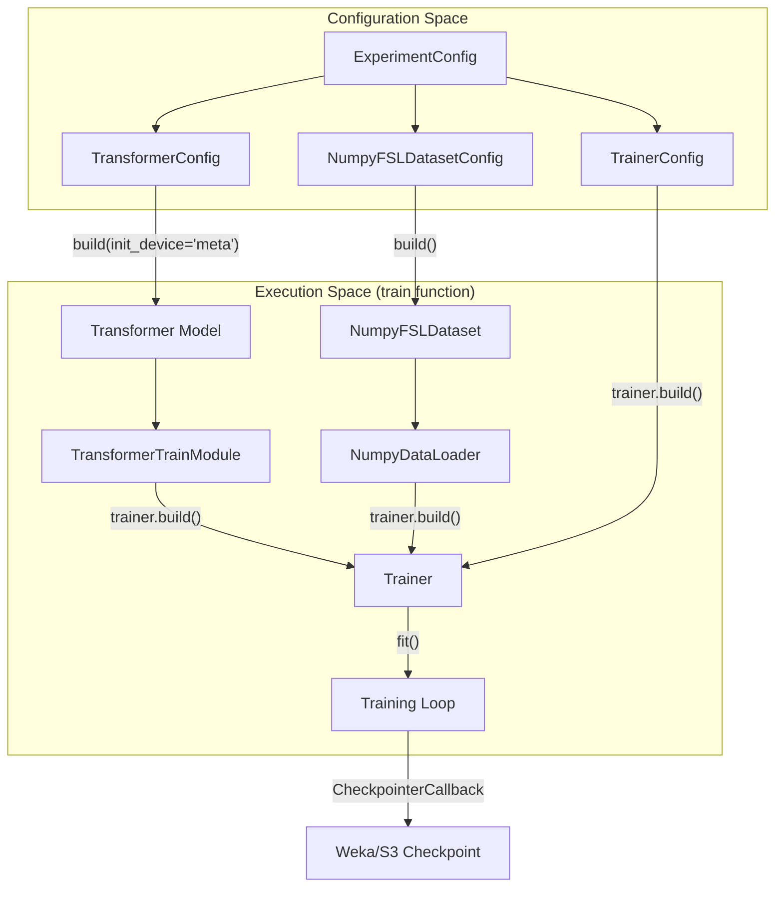
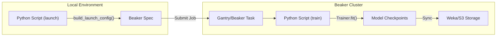

<!-- source: DeepWiki mcp.deepwiki.com · repo allenai/EMO · page 6.2 Dense Baseline and Fine-tuning Scripts · fetched 2026-10-26 -->

# Dense Baseline and Fine-tuning Scripts

Relevant source files

The following files were used as context for generating this wiki page:

- [src/olmo_core/data/mixes/OLMo-midtraining-mix-0625-100B.txt](src/olmo_core/data/mixes/OLMo-midtraining-mix-0625-100B.txt)
- [src/olmo_core/data/mixes/OLMo-midtraining-mix-0925-ingredient1-100B.txt](src/olmo_core/data/mixes/OLMo-midtraining-mix-0925-ingredient1-100B.txt)
- [src/olmo_core/data/mixes/OLMo-midtraining-mix-0925-ingredient2-100B.txt](src/olmo_core/data/mixes/OLMo-midtraining-mix-0925-ingredient2-100B.txt)
- [src/olmo_core/nn/moe/twolevel_batchlb_fullzloss_router.py](src/olmo_core/nn/moe/twolevel_batchlb_fullzloss_router.py)
- [src/olmo_core/nn/moe/twolevel_batchlb_nomaskaux_router.py](src/olmo_core/nn/moe/twolevel_batchlb_nomaskaux_router.py)
- [src/olmo_core/nn/moe/twolevel_batchlb_router.py](src/olmo_core/nn/moe/twolevel_batchlb_router.py)
- [src/olmo_core/nn/moe/twolevel_pbatchlb_router.py](src/olmo_core/nn/moe/twolevel_pbatchlb_router.py)
- [src/olmo_core/nn/moe/twolevel_sampling_nolb_router.py](src/olmo_core/nn/moe/twolevel_sampling_nolb_router.py)
- [src/scripts/official/OLMo2/README.md](src/scripts/official/OLMo2/README.md)
- [src/scripts/official/OLMo3/OLMo-3-1025-32B-midtrain-ingredient-1.py](src/scripts/official/OLMo3/OLMo-3-1025-32B-midtrain-ingredient-1.py)
- [src/scripts/official/OLMo3/OLMo-3-1025-32B-midtrain-ingredient-2.py](src/scripts/official/OLMo3/OLMo-3-1025-32B-midtrain-ingredient-2.py)
- [src/scripts/official/OLMo3/OLMo-3-1025-32B.csv](src/scripts/official/OLMo3/OLMo-3-1025-32B.csv)
- [src/scripts/official/OLMo3/OLMo-3-1025-7B-midtrain.py](src/scripts/official/OLMo3/OLMo-3-1025-7B-midtrain.py)
- [src/scripts/train/OLMo2/anneal/OLMo2-32B-anneal.py](src/scripts/train/OLMo2/anneal/OLMo2-32B-anneal.py)
- [src/scripts/train/olmo2-1B.py](src/scripts/train/olmo2-1B.py)
- [src/scripts/train/olmo2-1B_finetune.py](src/scripts/train/olmo2-1B_finetune.py)
- [src/scripts/train/sft/Olmo-2-7B-SFT.py](src/scripts/train/sft/Olmo-2-7B-SFT.py)
- [src/scripts/train/sft/Olmo-3-32B-SFT.py](src/scripts/train/sft/Olmo-3-32B-SFT.py)
- [src/scripts/train/sft/Olmo-3-7B-SFT.py](src/scripts/train/sft/Olmo-3-7B-SFT.py)
- [src/scripts/train/sft/README.md](src/scripts/train/sft/README.md)

This section covers the scripts and configurations used for training dense baseline models (OLMo2), performing Supervised Fine-tuning (SFT), and executing mid-training or annealing stages. These scripts utilize the `olmo_core` infrastructure to manage complex training lifecycles, including multi-node distribution and automated Beaker launches.

## Dense Pretraining: OLMo2-1B

The `olmo2-1B.py` script serves as a reference implementation for training a dense Transformer model. It defines an `ExperimentConfig` that encapsulates the model, dataset, and trainer specifications [src/scripts/train/olmo2-1B.py:65-86]().

### Configuration and Execution Flow
The script follows a standard pattern:
1.  **Config Definition**: Uses `TransformerConfig.olmo2_1B_v2` for the architecture [src/scripts/train/olmo2-1B.py:134-136]().
2.  **Environment Setup**: Calls `prepare_training_environment()` to initialize distributed groups and logging [src/scripts/train/olmo2-1B.py:31]().
3.  **Component Building**: Models are built on the `"meta"` device first to avoid OOM during initialization [src/scripts/train/olmo2-1B.py:98]().
4.  **Resumption**: The script checks for existing checkpoints in the `save_folder` before falling back to a provided `load_path` [src/scripts/train/olmo2-1B.py:112-117]().

### Model Training Workflow
The following diagram illustrates the data flow from configuration to the training loop.

**Dense Training Lifecycle**

Sources: [src/scripts/train/olmo2-1B.py:89-120](), [src/scripts/train/olmo2-1B.py:123-181]()

---

## Supervised Fine-tuning (SFT)

SFT scripts in the EMO repository are optimized for high-throughput and long-context training (up to 32k or 64k tokens). These scripts support `Olmo-2-7B`, `Olmo-3-7B`, and `Olmo-3-32B` architectures.

### Key SFT Components
-   **Bin-Packing**: SFT datasets are pre-tokenized and packed using `NumpyPackedFSLDatasetConfig` to maximize compute efficiency [src/scripts/train/sft/Olmo-3-7B-SFT.py:20]().
-   **Dynamic Batching**: The `BatchSizeConfig` class automatically calculates `grad_accum_steps` and `cp_degree` (Context Parallelism) based on the GPU type and target sequence length [src/scripts/train/sft/Olmo-3-7B-SFT.py:74-151]().
-   **Efficiency**: SFT using `olmo_core` is reported to be ~8x more compute-efficient than standard implementations due to the data pipeline and optimized training loop [src/scripts/train/sft/README.md:3-5]().

### SFT Implementation Details
| Feature | Implementation |
| :--- | :--- |
| **Optimizer** | `SkipStepAdamWConfig` with linear decay [src/scripts/train/sft/Olmo-3-7B-SFT.py:38](). |
| **Parallelism** | FSDP (`DataParallelType.fsdp`) with optional Context Parallelism [src/scripts/train/sft/Olmo-3-7B-SFT.py:57-62](). |
| **Checkpointing** | `CheckpointerCallback` with ephemeral saves for preemptible instances [src/scripts/train/sft/Olmo-3-7B-SFT.py:47](). |
| **Data Strategy** | `LongDocStrategy.truncate` for sequences exceeding max length [src/scripts/train/sft/Olmo-3-7B-SFT.py:23](). |

Sources: [src/scripts/train/sft/README.md:1-112](), [src/scripts/train/sft/Olmo-3-7B-SFT.py:74-151]()

---

## Mid-training and Annealing

Mid-training scripts are used for continued pretraining on specialized data mixes or for the final "annealing" phase of a model's lifecycle.

### OLMo-3 Mid-training
The `OLMo-3-1025-7B-midtrain.py` script demonstrates mid-training on 100B tokens using the `OLMo_midtraining_mix_0625_100B` data mix [src/scripts/official/OLMo3/OLMo-3-1025-7B-midtrain.py:56-57]().

**Technical Specifications:**
-   **Activation Checkpointing**: Uses `TransformerActivationCheckpointingConfig` with `selected_modules` mode, specifically targeting `feed_forward` blocks to save memory [src/scripts/official/OLMo3/OLMo-3-1025-7B-midtrain.py:88-91]().
-   **HSDP**: Uses Hybrid Sharded Data Parallelism (`DataParallelType.hsdp`) for multi-node efficiency [src/scripts/official/OLMo3/OLMo-3-1025-7B-midtrain.py:83]().
-   **Load Strategy**: Employs `LoadStrategy.always` to ensure training starts from a specific pretrained checkpoint [src/scripts/official/OLMo3/OLMo-3-1025-7B-midtrain.py:102]().

### Dense Fine-tuning with Router Pruning
For MoE models, `olmoe-1B-7B_finetune.py` (referenced as dense fine-tuning in context of pruning) is used to apply pruned router configurations. It typically utilizes a `LinearWithWarmup` scheduler [src/scripts/train/olmo2-1B_finetune.py:198-200]() and requires `NumpyPaddedFSLDatasetConfig` for instruction-style data where padding is necessary [src/scripts/train/olmo2-1B_finetune.py:150-157]().

Sources: [src/scripts/official/OLMo3/OLMo-3-1025-7B-midtrain.py:1-147](), [src/scripts/train/olmo2-1B_finetune.py:1-201]()

---

## Launch Workflow: Beaker and Templates

The repository uses a "Launch-Train" pattern. A script is executed with the `launch` subcommand, which creates a Beaker experiment and submits itself with the `train` subcommand [src/scripts/train/sft/README.md:106]().

### RUN_TEMPLATES.md and launch_common.sh
The workflow relies on standardized environment variables and shell templates:
1.  **Beaker Secrets**: Requires `BEAKER_TOKEN`, `AWS_CREDENTIALS`, and `WANDB_API_KEY` to be configured in the workspace [src/scripts/train/sft/README.md:72-78]().
2.  **Storage Mounts**: Weka buckets (e.g., `oe-training-default`) are mounted to provide access to datasets and checkpoint save locations [src/scripts/train/sft/README.md:79-82]().

**Beaker Execution Flow**

Sources: [src/scripts/train/sft/README.md:86-112](), [src/scripts/train/sft/Olmo-3-7B-SFT.py:29-35]()

---

