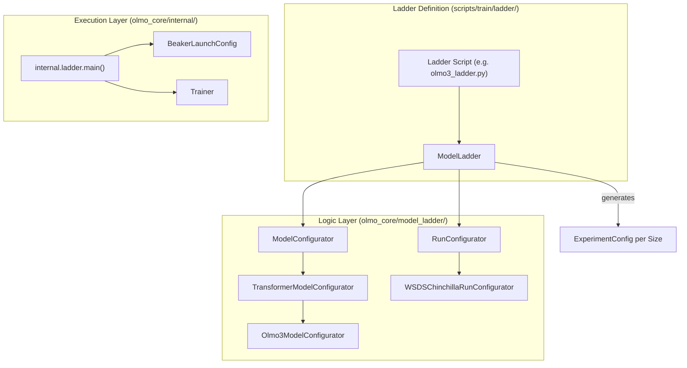
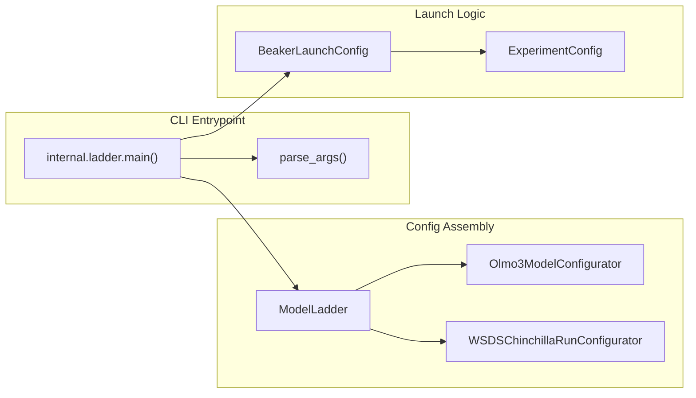

<!-- source: DeepWiki mcp.deepwiki.com · repo allenai/EMO · page 6.3 Model Ladder Framework · fetched 2026-10-26 -->

# Model Ladder Framework

<details>
<summary>Relevant source files</summary>

The following files were used as context for generating this wiki page:

- [src/olmo_core/data/misc/__init__.py](src/olmo_core/data/misc/__init__.py)
- [src/olmo_core/data/misc/code_fresh_export.py](src/olmo_core/data/misc/code_fresh_export.py)
- [src/olmo_core/data/mixes/code-fresh-ppl-validation.txt](src/olmo_core/data/mixes/code-fresh-ppl-validation.txt)
- [src/olmo_core/internal/ladder.py](src/olmo_core/internal/ladder.py)
- [src/olmo_core/model_ladder/__init__.py](src/olmo_core/model_ladder/__init__.py)
- [src/olmo_core/model_ladder/base.py](src/olmo_core/model_ladder/base.py)
- [src/olmo_core/model_ladder/transformer_model_configurator.py](src/olmo_core/model_ladder/transformer_model_configurator.py)
- [src/olmo_core/model_ladder/wsds_chinchilla_run_configurator.py](src/olmo_core/model_ladder/wsds_chinchilla_run_configurator.py)
- [src/scripts/train/ladder/2026Q1/gated_attn_gnope_ladder.py](src/scripts/train/ladder/2026Q1/gated_attn_gnope_ladder.py)
- [src/scripts/train/ladder/2026Q1/gated_attn_ladder.py](src/scripts/train/ladder/2026Q1/gated_attn_ladder.py)
- [src/scripts/train/ladder/2026Q1/gnope_ladder.py](src/scripts/train/ladder/2026Q1/gnope_ladder.py)
- [src/scripts/train/ladder/2026Q1/init_style_ladder.py](src/scripts/train/ladder/2026Q1/init_style_ladder.py)
- [src/scripts/train/ladder/2026Q1/instance_packing_ladder.py](src/scripts/train/ladder/2026Q1/instance_packing_ladder.py)
- [src/scripts/train/ladder/2026Q1/more_norms_ladder.py](src/scripts/train/ladder/2026Q1/more_norms_ladder.py)
- [src/scripts/train/ladder/2026Q1/muon_ladder.py](src/scripts/train/ladder/2026Q1/muon_ladder.py)
- [src/scripts/train/ladder/gemma_like_ladder.py](src/scripts/train/ladder/gemma_like_ladder.py)
- [src/scripts/train/ladder/olmo3_ladder.py](src/scripts/train/ladder/olmo3_ladder.py)
- [src/scripts/train/smoketests/code-fresh-ppl-eval-test.py](src/scripts/train/smoketests/code-fresh-ppl-eval-test.py)
- [src/test/data/misc/code_fresh_export_test.py](src/test/data/misc/code_fresh_export_test.py)

</details>


The `model_ladder` subsystem provides a structured framework for conducting Chinchilla-optimal scaling experiments. It automates the generation of model configurations, learning rate schedules, and distributed execution parameters across a range of model sizes (e.g., 60M to 13B parameters). This framework is primarily used to evaluate architectural interventions (like new normalization layers or optimizers) across scales to ensure research findings generalize.

## Core Architecture

The framework is built on a hierarchy of abstract base classes that decouple model architecture definition from the training run dynamics and hardware allocation.

### System Overview Diagram


**Sources:** [src/olmo_core/model_ladder/base.py:205-220](), [src/olmo_core/internal/ladder.py:33-70]()

### Key Classes

| Class | Role |
| :--- | :--- |
| `ModelLadder` | The top-level container that orchestrates a suite of runs across different `sizes`. [src/olmo_core/model_ladder/base.py:205-220]() |
| `ModelConfigurator` | Abstract class for building the `ModelConfig` and `TrainModule` for a specific size spec. [src/olmo_core/model_ladder/base.py:95-149]() |
| `RunConfigurator` | Abstract class for calculating Chinchilla-optimal batch sizes, durations, and LR schedules. [src/olmo_core/model_ladder/base.py:151-203]() |
| `DeviceMeshSpec` | Describes minimum hardware requirements (`world_size`, `dp_world_size`) for a given model size. [src/olmo_core/model_ladder/base.py:48-61]() |

## Chinchilla Scaling Logic

The `WSDSChinchillaRunConfigurator` implements the logic for Chinchilla-optimal training using the **WSD-S** (Warmup-Stable-Decay Stepped) schedule.

### Configuration Formulas
The configurator uses empirical scaling laws to derive parameters:
*   **Target Batch Size**: $2048 \times 160 \times (\frac{N}{108M})^{2/3}$, assuming sequence length 2048. [src/olmo_core/model_ladder/wsds_chinchilla_run_configurator.py:60-63]()
*   **Base Learning Rate**: $0.0047 \times (\frac{N}{108M})^{-1/3}$, typically divided by 2.0 for stability in WSD schedules. [src/olmo_core/model_ladder/wsds_chinchilla_run_configurator.py:73-81]()
*   **Stepped Schedule**: If enabled, peak LR is scaled by $1/\sqrt{D}$ where $D$ is the Chinchilla multiple (e.g., 1xC, 2xC). [src/olmo_core/model_ladder/wsds_chinchilla_run_configurator.py:42-48](), [src/olmo_core/model_ladder/wsds_chinchilla_run_configurator.py:113-115]()

### WSD-S Schedule Implementation
The `configure_lr_scheduler` function generates a `WSDS` scheduler that includes multiple decay periods. For a given `chinchilla_multiple` (e.g., 4.0), it generates checkpoints and decay stages for 0.5xC, 1xC, 2xC, and 4xC. [src/olmo_core/model_ladder/wsds_chinchilla_run_configurator.py:107-132]()

**Sources:** [src/olmo_core/model_ladder/wsds_chinchilla_run_configurator.py:22-158]()

## Model Configuration and Sizing

The `TransformerModelConfigurator` maps size strings (e.g., "1B", "7B") to concrete architecture parameters and hardware constraints.

### Size Enumeration
The `TransformerSize` enum defines standard sizes and provides helper properties to calculate the approximate parameter count (`approx_num_params`). [src/olmo_core/model_ladder/transformer_model_configurator.py:26-46]()

### Hardware Mapping
The framework automatically determines the appropriate `rank_microbatch_size` and `DeviceMeshSpec` based on the model size and the target GPU type (e.g., H100, B200).
*   **Micro-batch size**: Varies from $16 \times 4096$ for 190M models to $2 \times 4096$ for 7B+ models. [src/olmo_core/model_ladder/transformer_model_configurator.py:115-128]()
*   **Device Mesh**: Models < 13B default to a single node (8 GPUs); larger models require at least 32 GPUs. [src/olmo_core/model_ladder/transformer_model_configurator.py:148-152]()

**Sources:** [src/olmo_core/model_ladder/transformer_model_configurator.py:78-153]()

## Data Flow and Launch Lifecycle

The ladder execution is managed via `olmo_core.internal.ladder.main()`, which parses CLI arguments and dispatches commands.

### Code Entity Relationship Diagram


**Sources:** [src/olmo_core/internal/ladder.py:33-222](), [src/olmo_core/model_ladder/base.py:205-250]()

### Execution Commands
Ladder scripts support several sub-commands:
1.  `dry-run`: Simulates the configuration and renders an LR schedule plot using `matplotlib`. [src/olmo_core/internal/ladder.py:191-195](), [src/olmo_core/model_ladder/wsds_chinchilla_run_configurator.py:160-167]()
2.  `launch`: Submits a batch of jobs to Beaker, one for each model size requested. [src/olmo_core/internal/ladder.py:220-223]()
3.  `run`: The local entrypoint executed inside the container, which builds the `Trainer` and starts training. [src/olmo_core/internal/ladder.py:212-218]()

**Sources:** [src/olmo_core/internal/ladder.py:179-223]()

## Standard Ladder Scripts

The repository includes several specialized ladder implementations in `src/scripts/train/ladder/`:

*   **`olmo3_ladder.py`**: The baseline ladder for OLMo3 experiments. [src/scripts/train/ladder/olmo3_ladder.py:1-23]()
*   **`muon_ladder.py`**: Tests the Muon optimizer across scales, implementing a custom `MuonWSDSChinchillaRunConfigurator`. [src/scripts/train/ladder/2026Q1/muon_ladder.py:36-54]()
*   **`more_norms_ladder.py`**: Investigates architectural changes like Peri-LN (from Gemma 3) and embedding normalization. [src/scripts/train/ladder/2026Q1/more_norms_ladder.py:16-57]()
*   **`gated_attn_ladder.py`**: Evaluates headwise gating in attention mechanisms. [src/scripts/train/ladder/2026Q1/gated_attn_ladder.py:15-24]()

### Example: Customizing a Ladder
To create a new ladder, developers typically define a `configure_model` function that modifies the `TransformerModelConfigurator` with specific `model_construction_kwargs`.

```python
def configure_model(args: argparse.Namespace) -> TransformerModelConfigurator:
    return Olmo3ModelConfigurator(
        model_construction_kwargs=dict(
            block_name=TransformerBlockType.peri_norm,
            embedding_norm=LayerNormConfig(name=LayerNormType.rms, eps=1e-6)
        ),
    )
```
**Sources:** [src/scripts/train/ladder/2026Q1/more_norms_ladder.py:37-57]()

---

