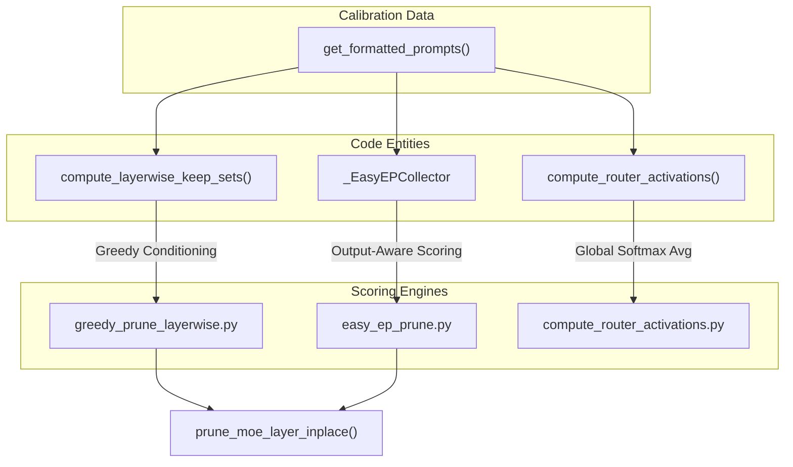
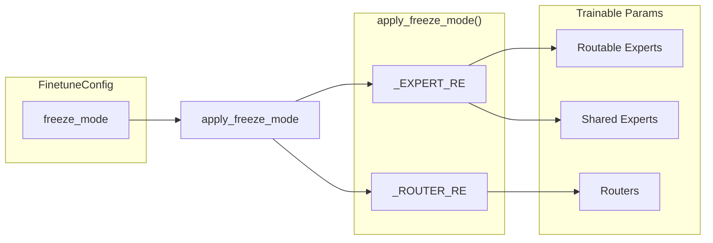

<!-- source: DeepWiki mcp.deepwiki.com · repo allenai/EMO · page 7 Expert Pruning and Selective Expert Usage · fetched 2026-10-26 -->

# Expert Pruning and Selective Expert Usage

Relevant source files

The following files were used as context for generating this wiki page:

- [README.md](README.md)
- [scripts/RUN_TEMPLATES.md](scripts/RUN_TEMPLATES.md)
- [scripts/selective_hf/hf_finetune_with_selective_easy_ep.sh](scripts/selective_hf/hf_finetune_with_selective_easy_ep.sh)
- [scripts/selective_hf/hf_finetune_with_selective_layerwise.sh](scripts/selective_hf/hf_finetune_with_selective_layerwise.sh)
- [src/hf_training/compute_router_activations.py](src/hf_training/compute_router_activations.py)
- [src/hf_training/easy_ep_prune.py](src/hf_training/easy_ep_prune.py)
- [src/hf_training/finetune.py](src/hf_training/finetune.py)
- [src/hf_training/greedy_prune_layerwise.py](src/hf_training/greedy_prune_layerwise.py)
- [src/hf_training/greedy_prune_layerwise_variable.py](src/hf_training/greedy_prune_layerwise_variable.py)
- [src/scripts/official/README.md](src/scripts/official/README.md)
- [src/scripts/train/README.md](src/scripts/train/README.md)

EMO (Expert-Modular OLMoE) is designed to enable **selective expert usage**, allowing a model to utilize as little as 12.5% of its total experts (e.g., 16 out of 128) for specific tasks or documents with minimal performance degradation [README.md:22-22](). This modularity is achieved through a pipeline of activation profiling, expert selection (pruning), and selective fine-tuning.

### High-Level Pruning Pipeline

The pruning workflow typically follows these stages:
1.  **Activation Collection**: Running a small set of "calibration" data through the model to record which experts are most active or important.
2.  **Expert Selection**: Applying a scoring algorithm (e.g., Average Softmax or EASY-EP) to identify a subset of experts to retain.
3.  **Model Modification**: Creating a new HuggingFace model where the MoE layers are physically pruned to the selected subset.
4.  **Selective Fine-tuning**: Optionally fine-tuning the pruned model to recover performance on the target task.

### Code-to-System Mapping: Pruning Infrastructure

The following diagram illustrates how the research concepts of pruning map to specific Python entities in the `src/hf_training` directory.

**Expert Selection Architecture**

Sources: [src/hf_training/compute_router_activations.py:33-44](), [src/hf_training/greedy_prune_layerwise.py:183-195](), [src/hf_training/easy_ep_prune.py:114-132](), [src/hf_training/greedy_prune_layerwise.py:51-65]()

---

## 7.1 Activation Collection and Expert Scoring
Before pruning, the system must determine expert importance. This is done by calculating scores across a calibration set (e.g., MMLU or GSM8K). 

*   **Global Profiling**: `compute_router_activations.py` performs a standard forward pass and computes average softmax probabilities for every expert across all layers [src/hf_training/compute_router_activations.py:4-13]().
*   **Logit Extraction**: Scripts like `launch_logits.py` are used for large-scale extraction of router probabilities across pretraining data to analyze modularity.

For details, see [Activation Collection and Expert Scoring](#7.1).

## 7.2 Pruning Methods: Greedy Layerwise and EASY-EP
EMO supports several advanced pruning strategies that go beyond simple global averaging:

*   **Greedy Layerwise**: Implemented in `greedy_prune_layerwise.py`, this method prunes the model one layer at a time. It uses an `EarlyExit` hook to stop the forward pass after the target layer, ensuring that the activation statistics for layer $L+1$ are conditioned on the already-pruned representation of layer $L$ [src/hf_training/greedy_prune_layerwise.py:8-17]().
*   **EASY-EP**: Implemented in `easy_ep_prune.py`, this is an output-aware scoring method. It weights expert importance by the norm of the expert's output and the token's overall contribution to the hidden state ($1 - \text{cos\_sim}$) [src/hf_training/easy_ep_prune.py:2-10]().
*   **Variable Pruning**: `greedy_prune_layerwise_variable.py` allows for heterogeneous pruning, where different layers retain different numbers of experts [src/hf_training/greedy_prune_layerwise_variable.py:2-8]().

For details, see [Pruning Methods: Greedy Layerwise and EASY-EP](#7.2).

## 7.3 Selective Fine-tuning Pipeline
Once a model is pruned, it can be fine-tuned using the `finetune.py` script. A key feature of EMO is **Selective Fine-tuning**, where only specific parts of the modular architecture are updated.

**Fine-tuning Control Flow**

Sources: [src/hf_training/finetune.py:49-80](), [src/hf_training/finetune.py:130-151]()

The pipeline supports several `freeze_mode` settings:
*   `routed`: Only the selected expert MLPs are trainable [src/hf_training/finetune.py:76-77]().
*   `routed_shared`: Both selected and shared experts are trainable [src/hf_training/finetune.py:78-78]().
*   `routed_shared_router`: Experts and the router are trainable, while attention and norms remain frozen [src/hf_training/finetune.py:79-79]().

For details, see [Selective Fine-tuning Pipeline](#7.3).

---
**Sources:**
- [README.md:22-22]()
- [src/hf_training/finetune.py:49-80]()
- [src/hf_training/finetune.py:130-190]()
- [src/hf_training/compute_router_activations.py:33-100]()
- [src/hf_training/greedy_prune_layerwise.py:1-25]()
- [src/hf_training/greedy_prune_layerwise.py:51-182]()
- [src/hf_training/easy_ep_prune.py:1-23]()
- [src/hf_training/greedy_prune_layerwise_variable.py:1-16]()

---

