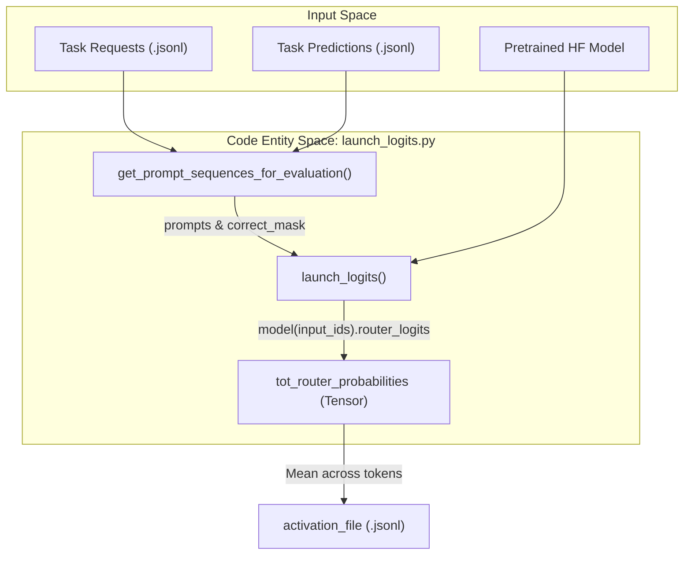
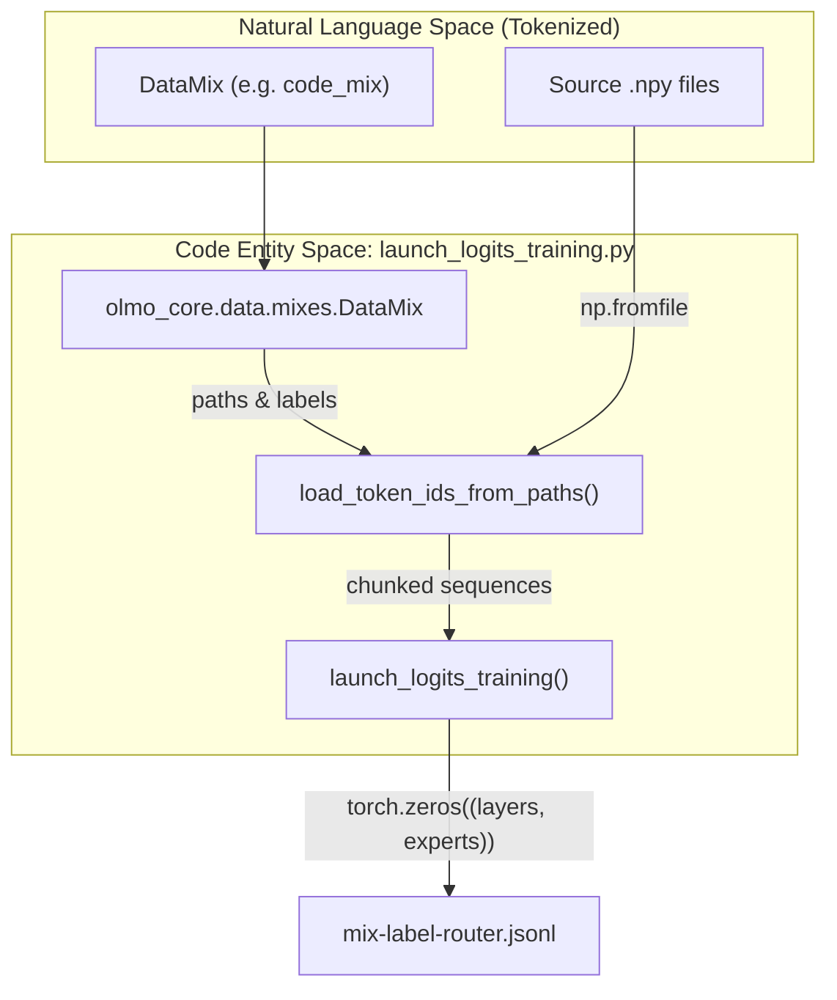

<!-- source: DeepWiki mcp.deepwiki.com · repo allenai/EMO · page 7.1 Activation Collection and Expert Scoring · fetched 2026-10-26 -->

# Activation Collection and Expert Scoring

<details>
<summary>Relevant source files</summary>

The following files were used as context for generating this wiki page:

- [src/hf_training/LogMoECallback.py](src/hf_training/LogMoECallback.py)
- [src/hf_training/TrainerDebug.py](src/hf_training/TrainerDebug.py)
- [src/hf_training/prune_hf_model.py](src/hf_training/prune_hf_model.py)
- [src/olmo_core/nn/hf/__init__.py](src/olmo_core/nn/hf/__init__.py)
- [src/olmo_core/nn/hf/convert_checkpoint.py](src/olmo_core/nn/hf/convert_checkpoint.py)
- [src/olmo_core/train/callbacks/hf_converter.py](src/olmo_core/train/callbacks/hf_converter.py)
- [src/scripts/eval/extract_finetuning_examples.py](src/scripts/eval/extract_finetuning_examples.py)
- [src/scripts/eval/launch_logits.py](src/scripts/eval/launch_logits.py)
- [src/scripts/eval/launch_logits_random.py](src/scripts/eval/launch_logits_random.py)
- [src/scripts/eval/launch_logits_training.py](src/scripts/eval/launch_logits_training.py)
- [src/scripts/eval/prepare_finetuning_masks.py](src/scripts/eval/prepare_finetuning_masks.py)
- [src/test/examples/huggingface/convert_checkpoint_to_hf_hybrid_test.py](src/test/examples/huggingface/convert_checkpoint_to_hf_hybrid_test.py)
- [src/test/train/callbacks/hf_converter_test.py](src/test/train/callbacks/hf_converter_test.py)

</details>


This page documents the infrastructure for profiling MoE router activations across various data sources. These profiling scripts are a prerequisite for expert pruning and selective fine-tuning, as they provide the empirical usage statistics required to determine which experts are specialized for specific tasks or domains.

## Overview of Activation Collection

The EMO pipeline relies on "one-shot" activation profiling. Instead of tracking activations during training, these scripts load a pretrained model and perform a forward pass over a target dataset (evaluation tasks or pretraining mixes) to extract router logits. These logits are aggregated into an `activation_file` (JSONL format) which contains the `avg_router_probabilities` for every expert in every layer.

### Core Components

| Script | Purpose | Data Source |
| :--- | :--- | :--- |
| `launch_logits.py` | Task-specific router logit extraction. | Evaluation tasks (MMLU, GSM8K, etc.) |
| `launch_logits_training.py` | Pretraining data activation profiling. | `DataMix` pre-tokenized `.npy` files. |
| `compute_router_activations.py` | Global one-shot profiling. | General text/datasets. |
| `launch_logits_random.py` | Baseline generation. | Randomized probabilities for ablation. |

## Task-Specific Profiling (`launch_logits.py`)

The `launch_logits.py` script extracts router activations from specific evaluation tasks. It matches evaluation requests (from `oe-eval`) with model predictions to optionally filter for only "correct" sequences, allowing researchers to study the expert utilization of the model when it is performing successfully.

### Key Implementation Details
- **Sequence Retrieval**: It uses `get_prompt_sequences_for_evaluation` to load context and continuations from `.jsonl` files [src/scripts/eval/launch_logits.py:43-104]().
- **Correctness Filtering**: If `--use_correct_only` is set, it filters sequences based on the `acc_raw` metric from the evaluation results [src/scripts/eval/launch_logits.py:173-174]().
- **Aggregation**: It accumulates router probabilities across all tokens in the batch using a running sum `tot_router_probabilities` of shape `(num_layers, num_experts)` [src/scripts/eval/launch_logits.py:165-169]().

### Data Flow: Evaluation Logits Extraction
The following diagram illustrates how evaluation data and a pretrained model are combined to produce router activation profiles.


Sources: [src/scripts/eval/launch_logits.py:43-174]()

## Pretraining Data Profiling (`launch_logits_training.py`)

To understand expert specialization on the pretraining distribution, `launch_logits_training.py` profiles activations across `DataMix` sources (e.g., `code_mix`). It processes raw tokenized data in fixed-length chunks.

### Implementation Details
- **Deterministic Loading**: `load_token_ids_from_paths` sorts and shuffles paths with a fixed seed to ensure reproducibility [src/scripts/eval/launch_logits_training.py:64-113]().
- **Chunking**: Data is loaded from `.npy` files and concatenated into a stream, then chunked into sequences of `seq_length` [src/scripts/eval/launch_logits_training.py:101-106]().
- **Layer-wise probabilities**: For each batch, it extracts `router_logits` (if available in the model output) or applies a softmax to the gate outputs to get probabilities [src/scripts/eval/launch_logits_training.py:195-200]().

### Data Flow: Pretraining Mix Profiling
This diagram maps the pretraining data entities to the extraction logic.


Sources: [src/scripts/eval/launch_logits_training.py:15-113](), [src/scripts/eval/launch_logits_training.py:116-183]()

## Activation File Format

All profiling scripts output a JSONL format compatible with the pruning scripts (e.g., `prune_hf_model.py`).

**Example `activation_file` entry:**
```json
{
  "avg_router_probabilities": [
    [0.12, 0.05, 0.01, "... (num_experts values)"], 
    "... (num_layers entries)"
  ]
}
```

This file serves as the "scorecard" for experts. Pruning scripts like `get_experts_to_keep` in `prune_hf_model.py` use `torch.topk` on these probabilities to select the most relevant experts per layer [src/hf_training/prune_hf_model.py:32-52]().

## Integration with Fine-tuning

While activation collection is usually a one-shot offline process, the repository also includes a `LogMoeCallback` for the HuggingFace `Trainer`. This callback is used during subsequent fine-tuning to monitor the Load Balancing (LB) and Cross-Entropy (CE) losses of the MoE router [src/hf_training/LogMoECallback.py:6-13]().

### LogMoeCallback Lifecycle
1. **`on_train_begin`**: Registers a forward hook on the model [src/hf_training/LogMoECallback.py:55-59]().
2. **`_forward_hook`**: Extracts `lb_loss` and `ce_loss` from the model outputs and scales them by the `router_aux_loss_coef` [src/hf_training/LogMoECallback.py:39-53]().
3. **`on_substep_end` / `on_step_end`**: Accumulates the latest stashed losses [src/hf_training/LogMoECallback.py:81-87]().
4. **`on_log`**: Reduces losses across processes (if using DDP/FSDP) and resets the window [src/hf_training/LogMoECallback.py:89-136]().

Sources: [src/hf_training/LogMoECallback.py:6-136]()

---

