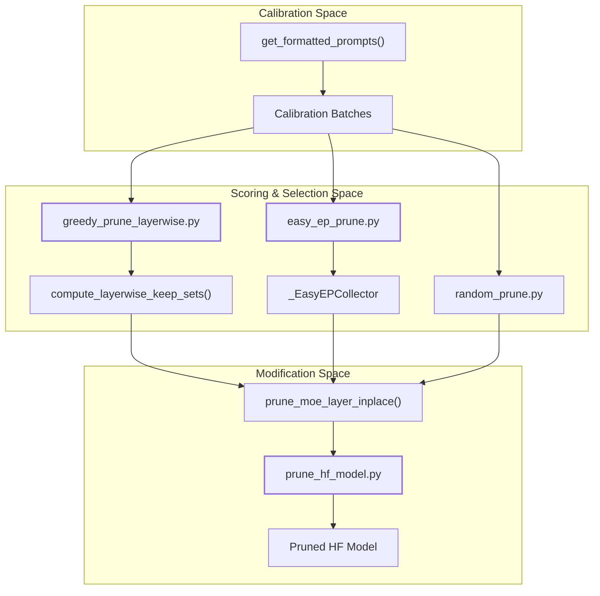

<!-- source: DeepWiki mcp.deepwiki.com · repo allenai/EMO · page 7.2 Pruning Methods: Greedy Layerwise and EASY-EP · fetched 2026-10-26 -->

# Pruning Methods: Greedy Layerwise and EASY-EP

Relevant source files

The following files were used as context for generating this wiki page:

- [src/hf_training/LogMoECallback.py](src/hf_training/LogMoECallback.py)
- [src/hf_training/TrainerDebug.py](src/hf_training/TrainerDebug.py)
- [src/hf_training/compute_router_activations.py](src/hf_training/compute_router_activations.py)
- [src/hf_training/easy_ep_prune.py](src/hf_training/easy_ep_prune.py)
- [src/hf_training/finetune.py](src/hf_training/finetune.py)
- [src/hf_training/greedy_prune_layerwise.py](src/hf_training/greedy_prune_layerwise.py)
- [src/hf_training/greedy_prune_layerwise_variable.py](src/hf_training/greedy_prune_layerwise_variable.py)
- [src/hf_training/merge_pruned_experts_back.py](src/hf_training/merge_pruned_experts_back.py)
- [src/hf_training/prune_hf_model.py](src/hf_training/prune_hf_model.py)
- [src/hf_training/random_prune.py](src/hf_training/random_prune.py)
- [src/scripts/eval/launch_logits_training.py](src/scripts/eval/launch_logits_training.py)
- [src/scripts/eval/prune_moe_checkpoint.py](src/scripts/eval/prune_moe_checkpoint.py)

This page documents the implementation and usage of expert pruning methods for Mixture-of-Experts (MoE) models. These methods allow for the creation of smaller, specialized models by selecting a subset of experts from a large pretrained MoE based on activation patterns or output-aware importance scores.

## Overview of Pruning Pipeline

The pruning pipeline typically involves three stages:
1.  **Activation Collection**: Running a calibration set through the full model to record how often each expert is used or how much it contributes to the output.
2.  **Expert Selection**: Applying a scoring algorithm (e.g., Greedy Layerwise or EASY-EP) to identify the top-k experts to retain.
3.  **Model Modification**: Creating a new HuggingFace model with modified weights and configurations where the unselected experts are removed.

### Pruning Logic Flow

Title: Pruning Data Flow and Entity Mapping

Sources: [src/hf_training/greedy_prune_layerwise.py:8-25](), [src/hf_training/easy_ep_prune.py:5-15](), [src/hf_training/prune_hf_model.py:1-17]()

---

## Greedy Layerwise Pruning

The greedy layerwise approach, implemented in `greedy_prune_layerwise.py`, prunes experts one layer at a time. Unlike global one-shot pruning, it accounts for the fact that pruning layer $l$ changes the input distribution for layer $l+1$.

### Implementation Details
- **Iterative Refinement**: For each layer $l$, the script runs validation batches through the model where layers $0 \dots l-1$ are already pruned.
- **Forward Hooks**: It captures raw gate logits at the current layer using `register_forward_hook` [src/hf_training/greedy_prune_layerwise.py:155-162]().
- **Early Exit**: To optimize performance, it uses an `EarlyExit` exception in a pre-forward hook on layer $l+1$ to abort the forward pass immediately after capturing the necessary logits for layer $l$ [src/hf_training/greedy_prune_layerwise.py:158-177]().
- **In-place Modification**: The function `prune_moe_layer_inplace` modifies the `nn.ModuleList` of experts and the router's `gate.weight` directly [src/hf_training/greedy_prune_layerwise.py:51-81]().

### Variable Keep-K
The script `greedy_prune_layerwise_variable.py` extends this logic to support heterogeneous pruning. It accepts a `keep-k-per-layer` list, allowing different layers to retain different numbers of experts (e.g., keeping more experts in early layers and fewer in deep layers) [src/hf_training/greedy_prune_layerwise_variable.py:40-67]().

Sources: [src/hf_training/greedy_prune_layerwise.py:8-25](), [src/hf_training/greedy_prune_layerwise.py:45-49](), [src/hf_training/greedy_prune_layerwise_variable.py:1-15]()

---

## EASY-EP: Output-Aware Scoring

EASY-EP (Expert Assessment with Simple Yet-effective scoring) is implemented in `easy_ep_prune.py`. It moves beyond simple activation frequency by considering the norm of the expert's output and its contribution to the token representation.

### Scoring Formula
The score for expert $i$ is calculated as:
$$\sum_{t} (g_{i,t} \cdot \|E_i(h_t)\|) \cdot (1 - \text{cos\_sim}(h_t, h_t + \bar{h}_t))$$
Where:
- $g_{i,t}$: Router gate value for expert $i$ at token $t$.
- $\|E_i(h_t)\|$: The L2 norm of the expert's output.
- $1 - \text{cos\_sim}(\dots)$: A weight representing the token's contribution to the residual stream.

### Key Components
- **`_EasyEPCollector`**: A class that manages hooks to capture $h_{in}$ (input to MLP) and $h_{out}$ (output of MLP) across all layers in a single pass [src/hf_training/easy_ep_prune.py:114-132]().
- **`compute_easy_ep_score_for_batch`**: Replicates the routing logic (including EMO's two-level softmax for shared experts) to accurately assign scores [src/hf_training/easy_ep_prune.py:43-76]().

Sources: [src/hf_training/easy_ep_prune.py:1-15](), [src/hf_training/easy_ep_prune.py:78-111]()

---

## Model Modification and Architecture Support

The script `prune_hf_model.py` performs the actual weight surgery on HuggingFace models. It supports multiple MoE architectures by detecting the specific attribute names used for experts and gates.

### Supported Architectures
| Architecture | Expert Path | Gate Path |
| :--- | :--- | :--- |
| **OLMoE** | `model.layers[i].mlp.experts` | `model.layers[i].mlp.gate` |
| **Mixtral** | `model.layers[i].block_sparse_moe.experts` | `model.layers[i].block_sparse_moe.gate` |

### Parameter Copying Logic
When pruning, the weights must be carefully sliced. For a router weight of shape `(num_experts, hidden_size)`, the script selects the rows corresponding to `experts_to_keep` [src/hf_training/prune_hf_model.py:98-102]().

For internal `olmo-core` checkpoints (non-HF), `prune_moe_checkpoint.py` provides `copy_param_with_prune` which handles:
- **Case 1 (Experts)**: Tensors of shape `(num_experts * expert_dim, hidden_dim)` [src/scripts/eval/prune_moe_checkpoint.py:130-172]().
- **Case 2 (Router)**: Flat tensors viewed as `(num_experts, hidden_dim)` [src/scripts/eval/prune_moe_checkpoint.py:93-128]().

Sources: [src/hf_training/prune_hf_model.py:55-76](), [src/hf_training/prune_hf_model.py:122-143](), [src/scripts/eval/prune_moe_checkpoint.py:68-90]()

---

## Baselines and Utilities

### Random Pruning
`random_prune.py` serves as a baseline. It randomly selects experts to keep using a fixed seed. It respects the shared-expert configuration by ensuring that if a model has $N$ shared experts, it retains $N$ experts from the shared pool and selects the remainder from the standard pool [src/hf_training/random_prune.py:1-17]().

### Activation Collection
- **`compute_router_activations.py`**: Standard utility to compute average router probabilities on HF datasets like GSM8K or MMLU [src/hf_training/compute_router_activations.py:33-59]().
- **`launch_logits_training.py`**: Specialized for pretraining data. It loads `olmo-core` `DataMix` objects and processes pre-tokenized `.npy` files [src/scripts/eval/launch_logits_training.py:17-20]().

### Expert Re-injection
`merge_pruned_experts_back.py` allows taking a finetuned pruned model and copying its trained experts back into the original full-sized "parent" model. This is used to evaluate if specialized finetuning on a subset of experts can improve the base model's performance on specific domains [src/hf_training/merge_pruned_experts_back.py:1-21]().

Sources: [src/hf_training/random_prune.py:74-81](), [src/hf_training/merge_pruned_experts_back.py:105-156](), [src/scripts/eval/launch_logits_training.py:116-144]()

---

