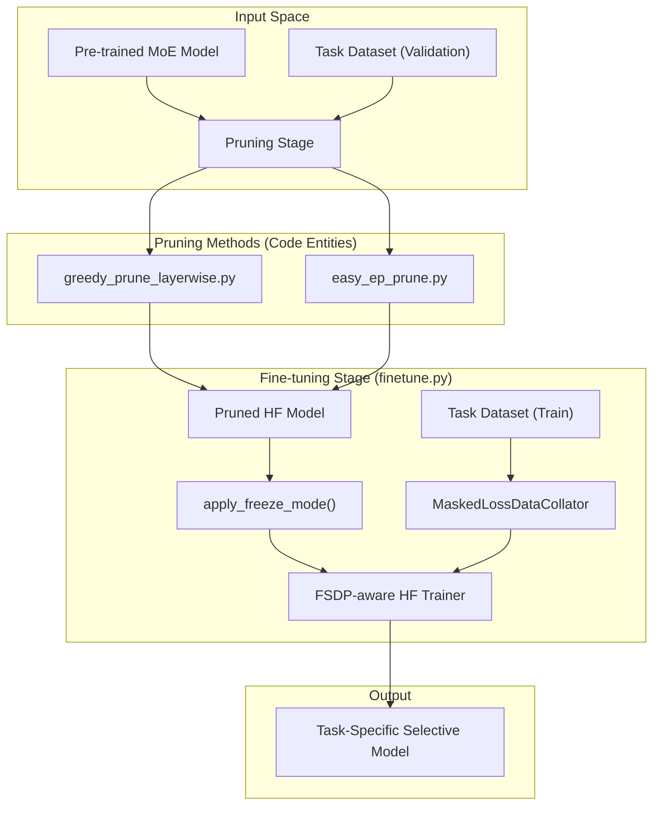
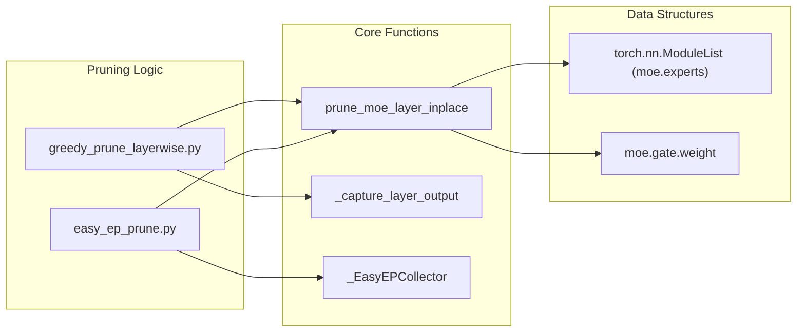

<!-- source: DeepWiki mcp.deepwiki.com · repo allenai/EMO · page 7.3 Selective Fine-tuning Pipeline · fetched 2026-10-26 -->

# Selective Fine-tuning Pipeline

Relevant source files

The following files were used as context for generating this wiki page:

- [scripts/selective_hf/launch_selective_hf.sh](scripts/selective_hf/launch_selective_hf.sh)
- [scripts/selective_hf/launch_selective_method_hf.sh](scripts/selective_hf/launch_selective_method_hf.sh)
- [scripts/selective_hf/launch_selective_validation_hf.sh](scripts/selective_hf/launch_selective_validation_hf.sh)
- [src/hf_training/compute_router_activations.py](src/hf_training/compute_router_activations.py)
- [src/hf_training/easy_ep_prune.py](src/hf_training/easy_ep_prune.py)
- [src/hf_training/finetune.py](src/hf_training/finetune.py)
- [src/hf_training/greedy_prune_layerwise.py](src/hf_training/greedy_prune_layerwise.py)
- [src/hf_training/greedy_prune_layerwise_variable.py](src/hf_training/greedy_prune_layerwise_variable.py)
- [src/scripts/eval/prepare_pruning_per_task.sh](src/scripts/eval/prepare_pruning_per_task.sh)

The selective fine-tuning pipeline is the final stage of the EMO research workflow. It integrates expert pruning with domain-specific adaptation using a specialized HuggingFace-based training loop. This pipeline allows for training only the parameters relevant to selected experts while maintaining the integrity of shared components.

## Pipeline Architecture and Data Flow

The pipeline operates by taking a base MoE model, applying a selection method (Layerwise or EASY-EP) to prune experts based on task-specific activations, and then fine-tuning the resulting sub-network.

### High-Level Training Flow

Title: Selective Fine-tuning Data Flow

**Sources:** [src/hf_training/finetune.py:1-20](), [src/hf_training/greedy_prune_layerwise.py:1-26](), [src/hf_training/easy_ep_prune.py:1-23]()

## Core Components of finetune.py

The primary entry point for training is `src/hf_training/finetune.py`. It utilizes the HuggingFace `Trainer` but extends it with custom logic for MoE architectures and selective parameter freezing.

### FinetuneConfig
The `FinetuneConfig` dataclass defines the hyperparameters and architectural settings for the run [src/hf_training/finetune.py:48-80](). Key parameters include:
*   `model_path`: Path to the pruned model.
*   `freeze_mode`: Determines which parts of the MoE are trainable.
*   `num_checkpoints`: Controls the frequency of checkpointing to ensure `N` saves across the total steps [src/hf_training/finetune.py:119-123]().

### MaskedLossDataCollator
To support fine-tuning on completion-only data (e.g., GSM8K or MMLU), the `MaskedLossDataCollator` preserves pre-computed labels. It ensures that positions marked with `-100` are ignored during loss calculation, preventing the model from learning to predict the prompt [src/hf_training/finetune.py:83-116]().

### Freeze Modes
The `apply_freeze_mode` function implements the "Selective" aspect of the fine-tuning. It uses regular expressions to identify expert MLPs and routers within the model's named parameters [src/hf_training/finetune.py:126-127]().

| Mode | Trainable Parameters | Frozen Parameters |
| :--- | :--- | :--- |
| `none` | Everything | None |
| `routed` | Routable experts only | Shared experts, Router, Attention, Norms, Embeddings |
| `routed_shared` | Routable + Shared experts | Router, Attention, Norms, Embeddings |
| `routed_shared_router` | Routable + Shared experts + Router | Attention, Norms, Embeddings |

The shared expert is identified by index range (the last `num_shared_experts` in the `ModuleList`) [src/hf_training/finetune.py:130-147]().

**Sources:** [src/hf_training/finetune.py:48-190]()

## Expert Selection Methods

The pipeline supports two primary selection methods that generate the "keep sets" used for pruning before fine-tuning.

### Greedy Layerwise Pruning
Implemented in `greedy_prune_layerwise.py`, this method prunes one layer at a time. It uses an `EarlyExit` hook [src/hf_training/greedy_prune_layerwise.py:45-48]() to abort forward passes early, significantly speeding up activation collection for later layers. Each layer's selection is conditioned on the pruned representation of all previous layers [src/hf_training/greedy_prune_layerwise.py:8-14]().

### EASY-EP (Expert Assessment with Simple Yet-effective scoring)
Implemented in `easy_ep_prune.py`, this is a one-shot method. It scores experts using the formula $c_{i,t} \times s_t$, where $c$ is the output-aware expert importance and $s$ is the token contribution weight based on cosine similarity [src/hf_training/easy_ep_prune.py:2-10](). Unlike the greedy approach, it performs a single forward pass through the unpruned model [src/hf_training/easy_ep_prune.py:12-14]().

Title: Pruning Logic Code Entity Mapping

**Sources:** [src/hf_training/greedy_prune_layerwise.py:51-81](), [src/hf_training/easy_ep_prune.py:114-168]()

## Orchestration and Shell Scripts

The pipeline is typically executed via shell scripts that manage the transition from activation collection to pruning and finally fine-tuning.

### Main Execution Scripts
*   **`launch_selective_hf.sh`**: The primary entry point for running the full sweep. It iterates over models, keep-k values, and task groups [scripts/selective_hf/launch_selective_hf.sh:12-34]().
*   **`launch_selective_method_hf.sh`**: A variant used to sweep across different selection methods (layerwise vs. easy_ep vs. random) [scripts/selective_hf/launch_selective_method_hf.sh:22-26]().
*   **`launch_selective_validation_hf.sh`**: Used for ablation studies on calibration set size, sweeping `NUM_SELECTIVE_EXAMPLES_VALUES` from 1 to 100 or the full pool [scripts/selective_hf/launch_selective_validation_hf.sh:34]().

### Data Preparation
The script `src/scripts/eval/prepare_pruning_per_task.sh` automates the data logistics [src/scripts/eval/prepare_pruning_per_task.sh:1-9]():
1.  Generates requests for validation and training sets.
2.  Invokes `launch_logits.py` to extract expert activations [src/scripts/eval/prepare_pruning_per_task.sh:128-135]().
3.  Extracts fine-tuning examples into JSONL format [src/scripts/eval/prepare_pruning_per_task.sh:139-141]().

**Sources:** [scripts/selective_hf/launch_selective_hf.sh:1-127](), [src/scripts/eval/prepare_pruning_per_task.sh:1-144]()

---

