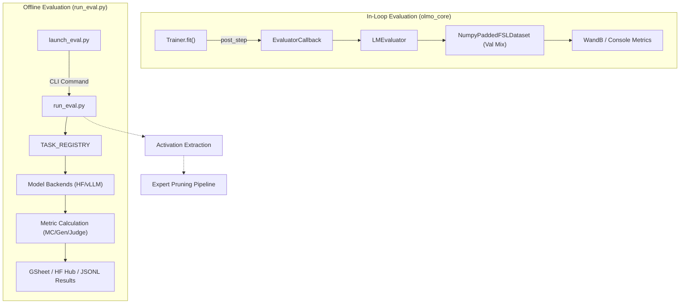
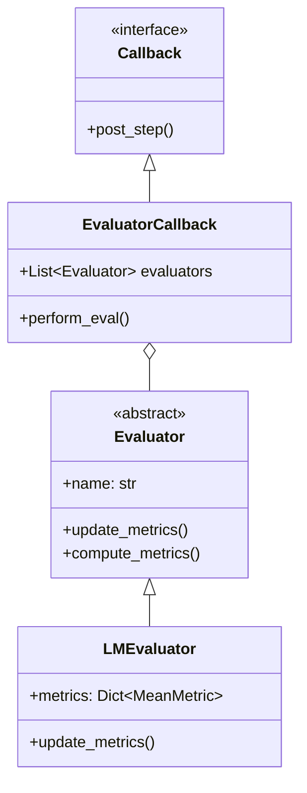

<!-- source: DeepWiki mcp.deepwiki.com · repo allenai/EMO · page 8 Evaluation Framework · fetched 2026-10-26 -->

# Evaluation Framework

Relevant source files

The following files were used as context for generating this wiki page:

- [src/hf_training/data_utils.py](src/hf_training/data_utils.py)
- [src/offline_evals/__init__.py](src/offline_evals/__init__.py)
- [src/offline_evals/run_eval.py](src/offline_evals/run_eval.py)
- [src/offline_evals/tasks/splits_gsm8k.py](src/offline_evals/tasks/splits_gsm8k.py)
- [src/offline_evals/tasks/splits_mmlu.py](src/offline_evals/tasks/splits_mmlu.py)
- [src/offline_evals/tasks/splits_mmlu_pro.py](src/offline_evals/tasks/splits_mmlu_pro.py)
- [src/olmo_core/eval/evaluator.py](src/olmo_core/eval/evaluator.py)
- [src/olmo_core/eval/lm_evaluator.py](src/olmo_core/eval/lm_evaluator.py)
- [src/olmo_core/train/callbacks/evaluator_callback.py](src/olmo_core/train/callbacks/evaluator_callback.py)
- [src/scripts/eval/get_mmlu_subjects.py](src/scripts/eval/get_mmlu_subjects.py)
- [src/scripts/eval/launch_eval.py](src/scripts/eval/launch_eval.py)
- [src/scripts/eval/tasks.py](src/scripts/eval/tasks.py)
- [src/scripts/eval/testbed_arc_easy.sh](src/scripts/eval/testbed_arc_easy.sh)

The EMO repository features a dual-track evaluation system designed to handle both high-frequency performance monitoring during training and rigorous, task-based benchmarking for research analysis.

1.  **Offline Evaluation Engine (`run_eval.py`)**: A standalone framework for executing comprehensive benchmarks (MMLU, GSM8K, etc.) using various backends like HuggingFace, vLLM, or LiteLLM. It supports complex pruning-aware evaluations and generates detailed metrics for research papers.
2.  **In-Loop Evaluators (`olmo_core`)**: A lightweight evaluation subsystem integrated into the training loop via `EvaluatorCallback`. It computes real-time metrics (Perplexity, Cross-Entropy) on validation mixes to monitor model convergence.

---

## System Architecture: Evaluation Tracks

The following diagram illustrates the relationship between the training loop evaluators and the offline benchmarking suite.

### Evaluation Data Flow

**Sources:** [src/olmo_core/train/callbacks/evaluator_callback.py:45-115](), [src/offline_evals/run_eval.py:110-212](), [src/scripts/eval/launch_eval.py:69-160]()

---

## 8.1 Offline Evaluation Engine (run_eval.py)

The offline engine is the primary tool for generating benchmark results. It is orchestrated by `run_eval.py` and supports a wide range of request types, including `LOGLIKELIHOOD` for multiple-choice and `GENERATE_UNTIL` for open-ended tasks.

*   **Execution**: Managed via `launch_eval.py`, which resolves task suites (e.g., `MC9`, `Gen5`) and maps them to `MODEL_CONFIGS`.
*   **Backends**: Integrates with `HFLM_Verbose` for HuggingFace models and `VLLM_Verbose` for high-throughput inference.
*   **Pruning Support**: A unique feature of this engine is the ability to prune MoE experts on-the-fly during evaluation using `--do_prune` and an `--activation_file`.
*   **Feedback Loop**: Utilities in `data_utils.py` facilitate an evaluation-to-finetuning loop by extracting examples and preparing masked datasets for supervised fine-tuning (SFT).

For details, see [Offline Evaluation Engine (run_eval.py)](#8.1).

**Sources:** [src/offline_evals/run_eval.py:112-225](), [src/scripts/eval/launch_eval.py:216-220](), [src/hf_training/data_utils.py:1-9]()

---

## 8.2 Evaluation Tasks and Benchmarks

The framework supports an extensive registry of tasks, many of which are customized for the EMO research goals (e.g., studying expert specialization via task clustering).

| Task Category | Examples | Custom Logic |
| :--- | :--- | :--- |
| **Reasoning** | GSM8K, ARC, MMLU-Pro | `CustomPerplexityMetric`, `SoftLoss` |
| **Knowledge** | MMLU (57 subjects) | Router-based clustering variants |
| **Linguistic** | HellaSwag, Winogrande | Multiple-choice log-likelihood |
| **Specialized** | ChemBench, LegalBench | Domain-specific formatting |

*   **MMLU Variants**: Includes "merged" variants where pruning and fine-tuning share the same data splits to prevent leakage, and "cluster" variants that group subjects based on router activation patterns.
*   **Metrics**: Beyond standard accuracy, the framework implements `mc_softloss` and `bits_per_byte` for more granular performance analysis.

For details, see [Evaluation Tasks and Benchmarks](#8.2).

**Sources:** [src/offline_evals/__init__.py:9-65](), [src/offline_evals/tasks/splits_mmlu.py:8-100](), [src/offline_evals/tasks/splits_gsm8k.py:44-63]()

---

## 8.3 In-Loop Evaluators (olmo_core)

In-loop evaluation is handled by the `olmo_core.eval` subsystem. Unlike the offline engine, these evaluators run on the same hardware as the training process and typically measure loss on pre-tokenized NumPy datasets.

*   **EvaluatorCallback**: Triggered at specified `eval_interval` steps. It switches the `TrainModule` to eval mode and iterates through registered `Evaluator` instances.
*   **LMEvaluator**: Specifically designed for language modeling. It computes Cross-Entropy (CE) loss and Perplexity (PPL) across multiple data labels within a single validation mix.
*   **Determinism**: Uses `NumpyFSLDataLoader` to ensure that truncated evaluation runs (limited by `eval_duration`) always start from the same data offset for consistent tracking.

For details, see [In-Loop Evaluators (olmo_core)](#8.3).

### In-Loop Class Hierarchy

**Sources:** [src/olmo_core/train/callbacks/evaluator_callback.py:45-115](), [src/olmo_core/eval/evaluator.py:9-32](), [src/olmo_core/eval/lm_evaluator.py:14-39]()

---

