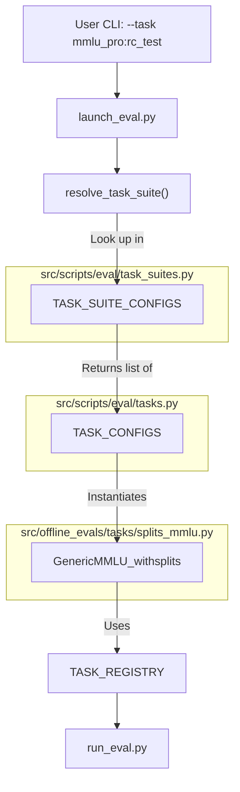
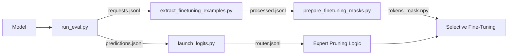

<!-- source: DeepWiki mcp.deepwiki.com · repo allenai/EMO · page 8.1 Offline Evaluation Engine (run_eval.py) · fetched 2026-10-26 -->

# Offline Evaluation Engine (run_eval.py)

Relevant source files

The following files were used as context for generating this wiki page:

- [.pre-commit-config.yaml](.pre-commit-config.yaml)
- [src/hf_training/data_utils.py](src/hf_training/data_utils.py)
- [src/offline_evals/__init__.py](src/offline_evals/__init__.py)
- [src/offline_evals/run_eval.py](src/offline_evals/run_eval.py)
- [src/offline_evals/tasks/chembench.py](src/offline_evals/tasks/chembench.py)
- [src/offline_evals/tasks/frenchbench.py](src/offline_evals/tasks/frenchbench.py)
- [src/offline_evals/tasks/legalbench.py](src/offline_evals/tasks/legalbench.py)
- [src/offline_evals/tasks/splits_gsm8k.py](src/offline_evals/tasks/splits_gsm8k.py)
- [src/offline_evals/tasks/splits_mmlu.py](src/offline_evals/tasks/splits_mmlu.py)
- [src/offline_evals/tasks/splits_mmlu_pro.py](src/offline_evals/tasks/splits_mmlu_pro.py)
- [src/olmo_core/data/mixes/mimic-pmc-5B.txt](src/olmo_core/data/mixes/mimic-pmc-5B.txt)
- [src/olmo_core/nn/hf/__init__.py](src/olmo_core/nn/hf/__init__.py)
- [src/olmo_core/nn/hf/convert_checkpoint.py](src/olmo_core/nn/hf/convert_checkpoint.py)
- [src/olmo_core/train/callbacks/hf_converter.py](src/olmo_core/train/callbacks/hf_converter.py)
- [src/scripts/eval/extract_finetuning_examples.py](src/scripts/eval/extract_finetuning_examples.py)
- [src/scripts/eval/get_mmlu_subjects.py](src/scripts/eval/get_mmlu_subjects.py)
- [src/scripts/eval/launch_eval.py](src/scripts/eval/launch_eval.py)
- [src/scripts/eval/launch_logits.py](src/scripts/eval/launch_logits.py)
- [src/scripts/eval/prepare_finetuning_masks.py](src/scripts/eval/prepare_finetuning_masks.py)
- [src/scripts/eval/print_evals.py](src/scripts/eval/print_evals.py)
- [src/scripts/eval/task_suites.py](src/scripts/eval/task_suites.py)
- [src/scripts/eval/tasks.py](src/scripts/eval/tasks.py)
- [src/scripts/eval/testbed_arc_easy.sh](src/scripts/eval/testbed_arc_easy.sh)
- [src/test/examples/huggingface/convert_checkpoint_to_hf_hybrid_test.py](src/test/examples/huggingface/convert_checkpoint_to_hf_hybrid_test.py)
- [src/test/train/callbacks/hf_converter_test.py](src/test/train/callbacks/hf_converter_test.py)

The Offline Evaluation Engine is a comprehensive framework for benchmarking models on a wide variety of tasks, supporting multiple model backends and specialized evaluation-to-finetuning workflows. It serves as the primary tool for validating EMO research, specifically for profiling expert activations and generating data for selective fine-tuning.

## Core Evaluation Engine (`run_eval.py`)

`run_eval.py` is the main entry point for executing evaluation tasks. It leverages `oe-eval` (Open Evaluation) components to manage model backends, task registries, and metric calculation.

### Implementation and Data Flow
The engine operates by loading a model via a specified backend, resolving a list of tasks from the `TASK_REGISTRY`, and iterating through task instances to generate predictions.

**Key Components:**
- **TASK_REGISTRY**: A centralized registry in `src/offline_evals/__init__.py` [src/offline_evals/__init__.py:5-66]() that aggregates tasks from various submodules including MMLU splits, GSM8K, and specialized benchmarks like `chembench` or `legalbench`.
- **Model Backends**: Supports HuggingFace (`HFLM_Verbose`), vLLM (`VLLM_Verbose`), and LiteLLM [src/offline_evals/run_eval.py:20-22]().
- **Request Types**: Handles multiple evaluation paradigms including `loglikelihood` (for multiple choice/perplexity) and `generate_until` (for free-form generation) [src/offline_evals/run_eval.py:18-28]().

### Process Lifecycle
1. **Argument Parsing**: Processes model paths, task lists, and execution parameters like `--batch-size` or `--gpus` [src/offline_evals/run_eval.py:111-212]().
2. **Task Resolution**: Converts high-level task names or "suites" into concrete `Task` objects.
3. **Inference**: Uses the selected backend (e.g., `vllm` for speed) to process batches of requests.
4. **Metric Calculation**: Aggregates results and computes primary metrics (e.g., accuracy, F1, bits-per-byte).
5. **Logging/Export**: Writes results to local JSONL files, Google Sheets, or WandB [src/offline_evals/run_eval.py:32-36]().

**Sources:** [src/offline_evals/run_eval.py:1-212](), [src/offline_evals/__init__.py:1-66]()

---

## Task Orchestration and Configuration

The evaluation system uses a hierarchical resolution strategy where high-level "suites" (e.g., `mmlu:rc_test`) are expanded into individual sub-tasks.

### Task Suite Resolution
The `launch_eval.py` script acts as a wrapper that resolves these suites before invoking the underlying evaluation engine.

| Entity | Description | Code Pointer |
| :--- | :--- | :--- |
| `TASK_CONFIGS` | Dict of individual task settings (split, metric, shots) | [src/scripts/eval/tasks.py:16-17]() |
| `TASK_SUITE_CONFIGS` | Groupings of tasks for easier launching (e.g., `frenchbench:rc`) | [src/scripts/eval/task_suites.py:9-65]() |
| `MODEL_CONFIGS` | Predefined model paths and initialization arguments | [src/scripts/eval/launch_eval.py:17-21]() |

### Natural Language Space to Code Entity Space: Task Resolution
This diagram illustrates how a user-provided task string is resolved into executable code entities.

**Sources:** [src/scripts/eval/launch_eval.py:216-218](), [src/scripts/eval/task_suites.py:6-65](), [src/scripts/eval/tasks.py:16-17](), [src/offline_evals/tasks/splits_mmlu.py:103-133]()

---

## Evaluation-to-Finetuning Feedback Loop

A core feature of the EMO project is using evaluation data to perform "Selective Fine-tuning." This involves extracting examples where the model performed correctly and preparing them for further training.

### 1. Example Extraction (`extract_finetuning_examples.py`)
This script parses the `requests.jsonl` files produced during a `run_eval.py` execution. It filters for "correct" examples based on the request type:
- **Loglikelihood**: Selects examples where the predicted index matches the label [src/scripts/eval/extract_finetuning_examples.py:45-54]().
- **Generate Until**: Extracts the context and the gold choice [src/scripts/eval/extract_finetuning_examples.py:55-61]().

### 2. Tokenization and Masking
Data must be formatted so the model only learns from the answer portion, not the prompt.
- **`tokenize_and_mask_example`**: In `src/hf_training/data_utils.py`, this function finds the `delimiter` (e.g., "Answer:") and sets labels for all preceding tokens to `-100` [src/hf_training/data_utils.py:195-207]().
- **`prepare_finetuning_masks.py`**: A standalone script for large-scale processing. it creates `.npy` mask files that correspond to tokenized binary files [src/scripts/eval/prepare_finetuning_masks.py:45-65](). It handles specific logic for document separators (`100257`) [src/scripts/eval/prepare_finetuning_masks.py:86-112]().

### 3. Logit Extraction (`launch_logits.py`)
Used for EMO pruning, this script runs a model over evaluation prompts to extract router probabilities. It calculates `tot_router_probabilities` (summed across tokens) for every layer and expert [src/scripts/eval/launch_logits.py:165-170]().

### Feedback Loop Architecture

**Sources:** [src/scripts/eval/extract_finetuning_examples.py:70-98](), [src/scripts/eval/prepare_finetuning_masks.py:45-160](), [src/scripts/eval/launch_logits.py:121-170](), [src/hf_training/data_utils.py:195-207]()

---

## Advanced Task Implementations

### MMLU with Custom Splits
`GenericMMLU_withsplits` [src/offline_evals/tasks/splits_mmlu.py:103]() extends the standard MMLU task to support a 60/40 split of the HF `test` set into a new `train` and `test` set [src/offline_evals/tasks/splits_mmlu.py:104-125](). This allows researchers to prune or finetune on a subset of MMLU while evaluating on a strictly held-out portion.

### GSM8K Perplexity
`GSM8K_Perplexity_Base` [src/offline_evals/tasks/splits_gsm8k.py:44]() modifies the standard math task to evaluate via `CustomPerplexityMetric` [src/offline_evals/tasks/splits_gsm8k.py:65]() rather than exact match. It includes a `normalize_answer_str` function that strips Chain-of-Thought (CoT) markers to create natural-appearing strings for bits-per-byte calculation [src/offline_evals/tasks/splits_gsm8k.py:145-163]().

**Sources:** [src/offline_evals/tasks/splits_mmlu.py:103-125](), [src/offline_evals/tasks/splits_gsm8k.py:44-163]()

---

