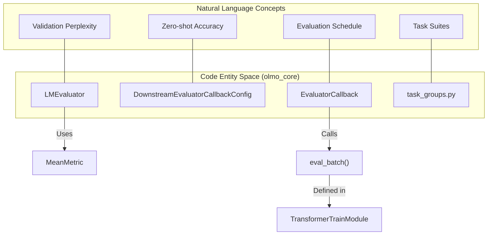
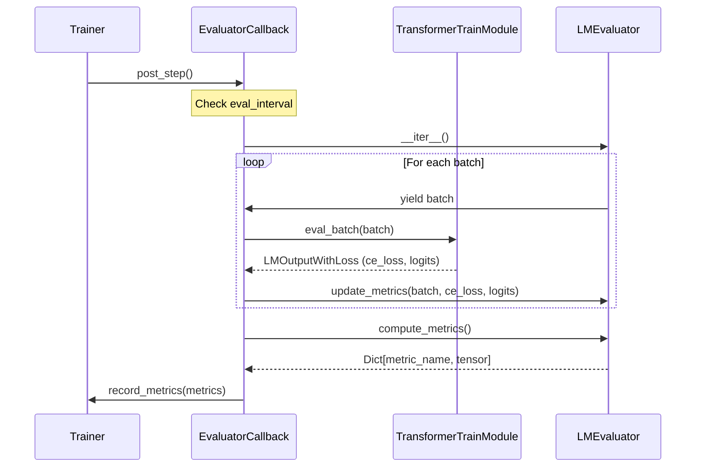

<!-- source: DeepWiki mcp.deepwiki.com · repo allenai/EMO · page 8.3 In-Loop Evaluators (olmo_core) · fetched 2026-10-26 -->

# 8.3 In-Loop Evaluators (olmo_core)

Relevant source files

The following files were used as context for generating this wiki page:

- [CLAUDE.md](CLAUDE.md)
- [src/olmo_core/eval/evaluator.py](src/olmo_core/eval/evaluator.py)
- [src/olmo_core/eval/lm_evaluator.py](src/olmo_core/eval/lm_evaluator.py)
- [src/olmo_core/eval/task_groups.py](src/olmo_core/eval/task_groups.py)
- [src/olmo_core/train/callbacks/evaluator_callback.py](src/olmo_core/train/callbacks/evaluator_callback.py)
- [src/olmo_core/train/callbacks/post_train_eval.py](src/olmo_core/train/callbacks/post_train_eval.py)
- [src/scripts/analysis/generate_cluster_viz.py](src/scripts/analysis/generate_cluster_viz.py)
- [src/scripts/analysis/generate_token_cluster_viz.py](src/scripts/analysis/generate_token_cluster_viz.py)
- [src/scripts/clustering/visualize.py](src/scripts/clustering/visualize.py)

The `olmo_core.eval` subsystem provides infrastructure for performing evaluations directly within the training loop. Unlike offline evaluation frameworks that run as separate jobs, in-loop evaluators allow for real-time monitoring of model performance on validation mixes and downstream tasks (zero/few-shot) during pretraining.

## System Architecture

The evaluation system is built around the `Evaluator` base class and integrated into the `Trainer` via the `EvaluatorCallback`.

### Core Components

| Component | Class/Entity | Purpose |
| :--- | :--- | :--- |
| **Orchestrator** | `EvaluatorCallback` | Manages timing, data loading, and metric recording during training steps. |
| **Base Evaluator** | `Evaluator` | Abstract base for all in-loop evaluation tasks. |
| **LM Evaluator** | `LMEvaluator` | Computes Cross-Entropy (CE) loss and Perplexity (PPL) on validation datasets. |
| **Task Registry** | `task_groups.py` | Pre-defined sets of downstream tasks (e.g., `FULL_TASKS`, `FAST_TASKS`). |
| **Post-Train Trigger** | `PostTrainEvalCallback` | Automatically launches external Beaker evaluation jobs upon training completion. |

### Natural Language to Code Entity Space

The following diagram maps high-level evaluation concepts to their specific implementations in the `olmo_core` codebase.

**Evaluation Mapping: Concepts to Code**

Sources: [src/olmo_core/train/callbacks/evaluator_callback.py:44-49](), [src/olmo_core/eval/lm_evaluator.py:14-27](), [src/olmo_core/eval/task_groups.py:164-169]()

## EvaluatorCallback Lifecycle

The `EvaluatorCallback` is responsible for pausing the training loop at specified intervals to run evaluation passes. It supports running multiple evaluators in sequence.

### Execution Flow

1.  **Trigger**: Evaluation is triggered by `post_step()` based on `eval_interval` or `fixed_steps` [src/olmo_core/train/callbacks/evaluator_callback.py:107-114]().
2.  **Setup**: The trainer puts the model into evaluation mode and resets metrics [src/olmo_core/train/callbacks/evaluator_callback.py:133-136]().
3.  **Batch Loop**:
    *   Batches are moved to the device [src/olmo_core/train/callbacks/evaluator_callback.py:145]().
    *   `TransformerTrainModule.eval_batch()` is called to get logits and un-reduced CE loss [src/olmo_core/train/callbacks/evaluator_callback.py:170-172]().
    *   `evaluator.update_metrics()` processes the outputs [src/olmo_core/train/callbacks/evaluator_callback.py:176]().
4.  **Reduction**: Once the duration (e.g., 1 epoch) is reached, `evaluator.compute_metrics()` aggregates results across ranks [src/olmo_core/train/callbacks/evaluator_callback.py:228]().
5.  **Logging**: Metrics are logged to the console and external trackers (WandB/Comet) [src/olmo_core/train/callbacks/evaluator_callback.py:231-240]().

**Data Flow: Trainer to Evaluator**

Sources: [src/olmo_core/train/callbacks/evaluator_callback.py:116-245](), [src/olmo_core/eval/evaluator.py:57-77]()

## LMEvaluator Implementation

The `LMEvaluator` is the primary tool for measuring language modeling performance on specific validation mixes.

### Key Features
*   **Dataset Mapping**: Uses a "label" field in the dataset metadata to track metrics for different data sources within the same evaluator [src/olmo_core/eval/lm_evaluator.py:19-23]().
*   **Metric Computation**: Calculates both `CE loss` and `PPL` (Perplexity) per label [src/olmo_core/eval/lm_evaluator.py:120-121]().
*   **Deterministic Loading**: If `deterministic=True`, it pins the data loader to `epoch=1` to ensure that truncated evaluations (using `Duration`) see the same data samples every time [src/olmo_core/eval/evaluator.py:23-31]().

### Configuration via Factory
The `from_numpy_dataset` class method allows easy instantiation from pre-tokenized `NumpyPaddedFSLDataset` objects [src/olmo_core/eval/lm_evaluator.py:42-56]().

Sources: [src/olmo_core/eval/lm_evaluator.py:14-127](), [src/olmo_core/eval/evaluator.py:9-32]()

## Task Groups Registry

The `src/olmo_core/eval/task_groups.py` file defines standardized suites of downstream tasks used for in-loop or post-train evaluation.

| Group Name | Contents | Use Case |
| :--- | :--- | :--- |
| `full__small_compute` | ARC, HellaSwag, MMLU (RC variants), GSM8K (BPB) | Small models (e.g., 1B) or short runs. |
| `full__large_compute` | ARC, HellaSwag, MMLU (MC variants), Codex | Large-scale pretraining (e.g., 7B+). |
| `fast` | Subset of OLMES and Basic Skills | Rapid feedback during development. |

*   **RC (Rank Classification)**: Scoring completion options based on likelihood.
*   **MC (Multiple Choice)**: Standard multiple-choice evaluation.
*   **BPB (Bits Per Byte)**: Normalized loss-based evaluation for generative tasks.

Sources: [src/olmo_core/eval/task_groups.py:4-169]()

## Post-Training Evaluation

The `PostTrainEvalCallback` automates the transition from pretraining to comprehensive downstream benchmarking.

### Workflow
1.  **Priority**: It runs with `priority = -2`, ensuring it executes after the `HFConverterCallback` (priority -1) has finished converting the final checkpoint to HuggingFace format [src/olmo_core/train/callbacks/post_train_eval.py:86]().
2.  **Checkpoint Discovery**: It searches the save folder for a directory with the `-hf` suffix [src/olmo_core/train/callbacks/post_train_eval.py:170-188]().
3.  **Job Launch**: It uses `subprocess` to trigger `gantry` (Beaker) jobs for the tasks defined in `DEFAULT_EVAL_TASKS` [src/olmo_core/train/callbacks/post_train_eval.py:22-67]().

Sources: [src/olmo_core/train/callbacks/post_train_eval.py:71-150]()

---

