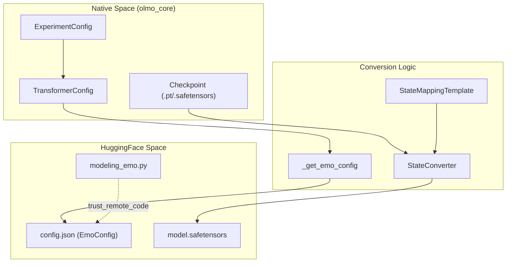
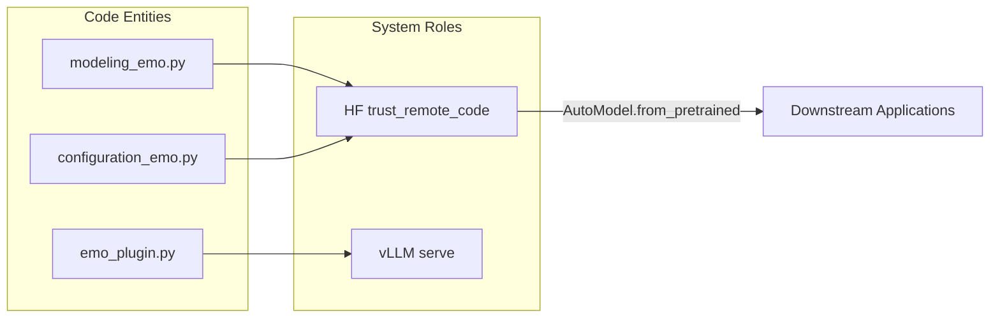

<!-- source: DeepWiki mcp.deepwiki.com · repo allenai/EMO · page 9 HuggingFace and vLLM Interoperability · fetched 2026-10-26 -->

# HuggingFace and vLLM Interoperability

Relevant source files

The following files were used as context for generating this wiki page:

- [src/examples/huggingface/convert_checkpoint_to_hf.py](src/examples/huggingface/convert_checkpoint_to_hf.py)
- [src/hf_training/EmoForCausalLMDebug.py](src/hf_training/EmoForCausalLMDebug.py)
- [src/hf_trust_remote_code/README.md](src/hf_trust_remote_code/README.md)
- [src/hf_trust_remote_code/emo/configuration_emo.py](src/hf_trust_remote_code/emo/configuration_emo.py)
- [src/hf_trust_remote_code/emo/modeling_emo.py](src/hf_trust_remote_code/emo/modeling_emo.py)
- [src/hf_trust_remote_code/migrate_to_emo.py](src/hf_trust_remote_code/migrate_to_emo.py)
- [src/hf_trust_remote_code/upload_to_hf.py](src/hf_trust_remote_code/upload_to_hf.py)
- [src/olmo_core/nn/hf/checkpoint.py](src/olmo_core/nn/hf/checkpoint.py)
- [src/olmo_core/nn/hf/config.py](src/olmo_core/nn/hf/config.py)
- [src/olmo_core/nn/hf/convert.py](src/olmo_core/nn/hf/convert.py)
- [src/vllm_plugin/emo_plugin.py](src/vllm_plugin/emo_plugin.py)
- [src/vllm_plugin/pyproject.toml](src/vllm_plugin/pyproject.toml)

The EMO ecosystem provides a comprehensive pipeline for exporting models from the native `olmo_core` training format to the HuggingFace (HF) Transformers ecosystem and high-performance serving engines like vLLM. This interoperability is achieved through a robust checkpoint conversion system, custom modeling implementations for the `trust_remote_code` protocol, and a specialized vLLM plugin.

### Model Export and Conversion Flow

The conversion process bridges the gap between `olmo_core`'s modular architecture and the standardized formats required by downstream tools. The primary entry point for this flow is the `convert_checkpoint_to_hf.py` script [src/examples/huggingface/convert_checkpoint_to_hf.py:1-18]().

#### Conversion Architecture
The system uses a template-based mapping to translate weights between the two frameworks. The `StateConverter` utilizes `StateMappingTemplate` and placeholders like `LAYER` and `EXPERT` to handle the repeating structures of Transformer blocks and MoE experts [src/olmo_core/nn/hf/convert.py:9-20]().

| Component | Responsibility | Key Code Entities |
| :--- | :--- | :--- |
| **CLI Wrapper** | Handles user arguments and environment setup | `convert_checkpoint_to_hf.py` |
| **State Mapping** | Defines the key-to-key translation map | `HF_TO_OLMO_CORE_WEIGHT_MAPPINGS` |
| **Config Generation** | Maps `olmo_core` configs to HF `PretrainedConfig` | `get_hf_config`, `_get_emo_config` |
| **Validation** | Verifies numerical parity between converted and original models | `convert_checkpoint_to_hf(..., validate=True)` |

**System Flow: Checkpoint Conversion**

Sources: [src/examples/huggingface/convert_checkpoint_to_hf.py:101-125](), [src/olmo_core/nn/hf/convert.py:30-54](), [src/olmo_core/nn/hf/config.py:49-114]().

For details on the template system and hybrid model handling, see **[Checkpoint Conversion (olmo_core ↔ HuggingFace)](#9.1)**.

---

### Inference and Serving Implementation

To support EMO's unique architectural features (such as modular MoE routing and shared experts) without requiring a custom fork of the `transformers` library, the repository provides standalone modeling files.

#### EmoForCausalLM and Remote Code
The `EmoForCausalLM` implementation allows users to load EMO models using `AutoModelForCausalLM.from_pretrained(..., trust_remote_code=True)` [src/hf_trust_remote_code/README.md:1-5](). This implementation includes:
*   **`modeling_emo.py`**: A complete implementation of the EMO architecture using standard PyTorch and Transformers primitives [src/hf_trust_remote_code/emo/modeling_emo.py:1-42]().
*   **`configuration_emo.py`**: Defines `EmoConfig`, which captures MoE-specific hyperparameters like `num_experts_per_tok` and `num_shared_experts` [src/hf_trust_remote_code/emo/configuration_emo.py:28-101]().

#### vLLM Integration
For high-throughput serving, a dedicated vLLM plugin is provided in `src/vllm_plugin/`. This plugin registers `EmoForCausalLM` within the vLLM `ModelRegistry` and utilizes optimized kernels like `FusedMoE` for the routing layers [src/vllm_plugin/emo_plugin.py:1-17](), [src/vllm_plugin/emo_plugin.py:187-199]().

**Entity Mapping: Serving Infrastructure**

Sources: [src/hf_trust_remote_code/upload_to_hf.py:32-41](), [src/vllm_plugin/emo_plugin.py:12-17](), [src/hf_trust_remote_code/README.md:36-43]().

For details on serving EMO models and the vLLM plugin architecture, see **[EmoForCausalLM and vLLM Plugin](#9.2)**.

---

### Text Generation Subsystem

The `olmo_core.generate` module provides a native inference path within the training environment, primarily used for validation and interactive debugging via `chat.py`.

*   **`TransformerGenerationModule`**: Wraps the native `Transformer` model for efficient autoregressive generation, managing the KV cache lifecycle [src/olmo_core/generate/model.py]().
*   **`GenerationConfig`**: Controls sampling behavior, including temperature, top-p, and top-k parameters.
*   **Interactive Chat**: The `chat.py` utility provides a Rich-based UI for interacting with models directly from `olmo_core` checkpoints.

For details on the internal generation engine, see **[Text Generation Module](#9.3)**.

---

### Sub-pages

*   **[Checkpoint Conversion (olmo_core ↔ HuggingFace)](#9.1)**: Detailed documentation of the conversion API, state mapping templates, and automated conversion callbacks.
*   **[EmoForCausalLM and vLLM Plugin](#9.2)**: Implementation details for the `trust_remote_code` modeling files and the vLLM integration for production serving.
*   **[Text Generation Module](#9.3)**: Overview of the native sampling and generation utilities used for interactive testing and in-loop evaluation.

---

