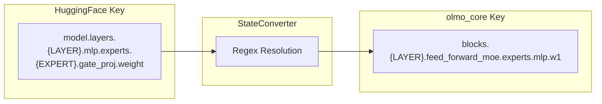
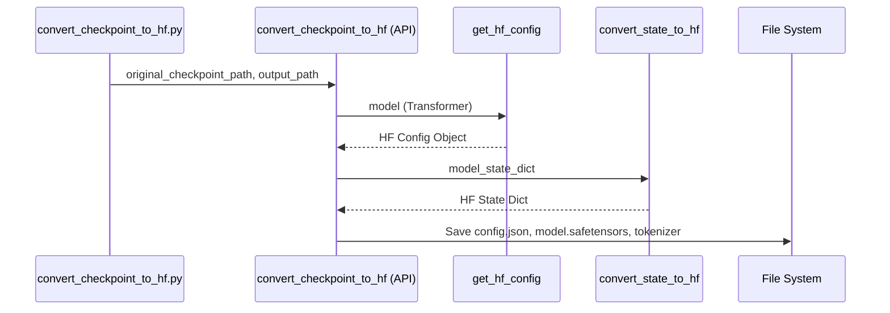

<!-- source: DeepWiki mcp.deepwiki.com · repo allenai/EMO · page 9.1 Checkpoint Conversion (olmo_core ↔ HuggingFace) · fetched 2026-10-26 -->

# Checkpoint Conversion (olmo_core ↔ HuggingFace)

Relevant source files

The following files were used as context for generating this wiki page:

- [src/examples/huggingface/convert_checkpoint_from_hf.py](src/examples/huggingface/convert_checkpoint_from_hf.py)
- [src/examples/huggingface/convert_checkpoint_to_hf.py](src/examples/huggingface/convert_checkpoint_to_hf.py)
- [src/hf_training/EmoForCausalLMDebug.py](src/hf_training/EmoForCausalLMDebug.py)
- [src/hf_trust_remote_code/emo/modeling_emo.py](src/hf_trust_remote_code/emo/modeling_emo.py)
- [src/olmo_core/nn/hf/__init__.py](src/olmo_core/nn/hf/__init__.py)
- [src/olmo_core/nn/hf/checkpoint.py](src/olmo_core/nn/hf/checkpoint.py)
- [src/olmo_core/nn/hf/config.py](src/olmo_core/nn/hf/config.py)
- [src/olmo_core/nn/hf/convert.py](src/olmo_core/nn/hf/convert.py)
- [src/olmo_core/nn/hf/convert_checkpoint.py](src/olmo_core/nn/hf/convert_checkpoint.py)
- [src/olmo_core/train/callbacks/hf_converter.py](src/olmo_core/train/callbacks/hf_converter.py)
- [src/scripts/eval/extract_finetuning_examples.py](src/scripts/eval/extract_finetuning_examples.py)
- [src/scripts/eval/launch_logits.py](src/scripts/eval/launch_logits.py)
- [src/scripts/eval/prepare_finetuning_masks.py](src/scripts/eval/prepare_finetuning_masks.py)
- [src/test/examples/huggingface/convert_checkpoint_from_hf_test.py](src/test/examples/huggingface/convert_checkpoint_from_hf_test.py)
- [src/test/examples/huggingface/convert_checkpoint_to_hf_hybrid_test.py](src/test/examples/huggingface/convert_checkpoint_to_hf_hybrid_test.py)
- [src/test/examples/huggingface/convert_checkpoint_to_hf_test.py](src/test/examples/huggingface/convert_checkpoint_to_hf_test.py)
- [src/test/nn/hf/checkpoint_test.py](src/test/nn/hf/checkpoint_test.py)
- [src/test/nn/hf/config_test.py](src/test/nn/hf/config_test.py)
- [src/test/nn/hf/convert_test.py](src/test/nn/hf/convert_test.py)
- [src/test/train/callbacks/hf_converter_test.py](src/test/train/callbacks/hf_converter_test.py)
- [src/vllm_plugin/emo_plugin.py](src/vllm_plugin/emo_plugin.py)

This section documents the infrastructure for bi-directional checkpoint conversion between the `olmo_core` native format and the HuggingFace (HF) `transformers` ecosystem. This system enables interoperability for inference, fine-tuning, and research analysis.

## Overview

The conversion system is built on a template-driven mapping architecture that translates between `olmo_core`'s modular `nn.Module` hierarchy and the flattened or differently structured hierarchies typical of HuggingFace models (e.g., `Llama`, `Olmo2`, `Olmo3`, and `Emo`).

Key capabilities include:
- **CLI and API Support**: Scripts for manual conversion and a Python API for programmatic use.
- **Architecture Mapping**: Support for dense models (OLMo2/3), MoE models (OLMoE), and hybrid architectures (GDN + Attention).
- **Auto-conversion**: A training callback to automatically generate a HF-compatible checkpoint upon training completion.
- **Validation**: Bit-wise or logit-level validation to ensure parity between source and target models.

---

## The StateConverter System

The conversion logic relies on the `StateConverter` class and a template-based mapping system defined in `olmo_core.nn.conversion`.

### Mapping Templates
Instead of hardcoding every layer name, the system uses `StateMappingTemplate` with `TemplatePlaceholder` variables. This allows a single mapping definition to cover all layers and experts in a model [src/olmo_core/nn/hf/convert.py:18-20]().

| Placeholder | Description |
| :--- | :--- |
| `LAYER` | Represents the transformer block index (e.g., `0`, `1`, `2`). |
| `EXPERT` | Represents the expert index in MoE layers. |

### Weight and Module Mappings
Mappings are defined in `HF_TO_OLMO_CORE_WEIGHT_MAPPINGS` for individual parameter tensors and `HF_TO_OLMO_CORE_MODULE_MAPPINGS` for entire sub-modules [src/olmo_core/nn/hf/convert.py:30-94]().

**Example Mapping Flow:**

*Sources: [src/olmo_core/nn/hf/convert.py:50-53](), [src/olmo_core/nn/conversion/state_mapping.py:10-14]()*

---

## Converting to HuggingFace

### CLI Wrapper
The script `convert_checkpoint_to_hf.py` serves as the primary entry point for users [src/examples/huggingface/convert_checkpoint_to_hf.py:1-18](). It loads the `experiment_config` from the checkpoint directory to automatically determine the model architecture and tokenizer settings [src/examples/huggingface/convert_checkpoint_to_hf.py:101-110]().

### Configuration Mapping
The function `get_hf_config` (and internal helper `_get_emo_config`) maps `olmo_core` configurations to HF `PretrainedConfig` objects [src/olmo_core/nn/hf/config.py:49-149]().

- **Dense Models**: Maps to `Olmo2Config` or `Olmo3Config`.
- **EMO Models**: Maps to `EmoConfig` or `EmoSharedConfig`. It handles complex EMO features like `num_shared_experts`, `top_k` routing, and hybrid dense/MoE layer stacks [src/olmo_core/nn/hf/config.py:115-149]().

### Implementation Detail: Hybrid Models
Hybrid models (e.g., Gated Delta Net + Attention) require special handling. These are often saved as raw `config.json` and `model.safetensors` rather than via `save_pretrained()` because they may use custom `trust_remote_code` implementations like `EmoForCausalLM` [src/examples/huggingface/convert_checkpoint_to_hf.py:4-6]().

**Conversion Data Flow:**

*Sources: [src/olmo_core/nn/hf/checkpoint.py:134-180](), [src/olmo_core/nn/hf/config.py:49-55]()*

---

## Converting from HuggingFace

The `convert_checkpoint_from_hf.py` script allows users to take a model from the HuggingFace Hub and convert it into an `olmo_core` checkpoint for fine-tuning [src/examples/huggingface/convert_checkpoint_from_hf.py:1-13]().

### Process
1. **Config Reconstruction**: The script maps HF architecture names (e.g., `olmo2_7b`) to `olmo_core` `TransformerConfig` factory methods [src/examples/huggingface/convert_checkpoint_from_hf.py:50-82]().
2. **State Loading**: `load_hf_model` downloads the weights, resizes embeddings if necessary, and applies the inverse mapping via `convert_state_from_hf` [src/olmo_core/nn/hf/checkpoint.py:44-115]().
3. **Saving**: The resulting state is saved using `save_model_and_optim_state` in the native `olmo_core` sharded format [src/examples/huggingface/convert_checkpoint_from_hf.py:35]().

---

## HFConverterCallback

For seamless research workflows, the `HFConverterCallback` can be added to the `Trainer`. It triggers at the end of training (`post_train`) to produce a HF-ready model automatically [src/olmo_core/train/callbacks/hf_converter.py:22-37]().

### Distributed Considerations
In distributed environments (FSDP), all ranks must participate in the callback because gathering the full model state dict is a collective operation [src/olmo_core/train/callbacks/hf_converter.py:112-123](). 
- **Rank 0**: Performs the conversion and I/O.
- **Other Ranks**: Participate in the `dist_cp_sd.get_model_state_dict` call and then wait at a barrier [src/olmo_core/train/callbacks/hf_converter.py:125-133]().

| Parameter | Default | Description |
| :--- | :--- | :--- |
| `output_folder` | `None` | Defaults to `{checkpoint_path}-hf` [src/olmo_core/train/callbacks/hf_converter.py:195](). |
| `dtype` | `bfloat16` | Precision for saved weights [src/olmo_core/train/callbacks/hf_converter.py:52](). |
| `validate` | `False` | If true, runs a forward pass on both models to check logit parity [src/olmo_core/train/callbacks/hf_converter.py:57](). |

*Sources: [src/olmo_core/train/callbacks/hf_converter.py:22-123]()*

---

## Summary of Key Functions

| Entity | Location | Role |
| :--- | :--- | :--- |
| `convert_checkpoint_to_hf` | `olmo_core.nn.hf` | Main API for OLMo → HF [src/olmo_core/nn/hf/checkpoint.py:134](). |
| `load_hf_model` | `olmo_core.nn.hf.checkpoint` | Main API for HF → OLMo [src/olmo_core/nn/hf/checkpoint.py:44](). |
| `get_hf_config` | `olmo_core.nn.hf.config` | Maps `Transformer` to HF `PretrainedConfig` [src/olmo_core/nn/hf/config.py:18](). |
| `StateConverter` | `olmo_core.nn.conversion` | Engine for applying key-to-key templates [src/olmo_core/nn/hf/convert.py:9](). |
| `HF_TO_OLMO_CORE_WEIGHT_MAPPINGS` | `olmo_core.nn.hf.convert` | The source of truth for key translations [src/olmo_core/nn/hf/convert.py:30](). |

*Sources: [src/olmo_core/nn/hf/checkpoint.py](), [src/olmo_core/nn/hf/config.py](), [src/olmo_core/nn/hf/convert.py]()*

---

