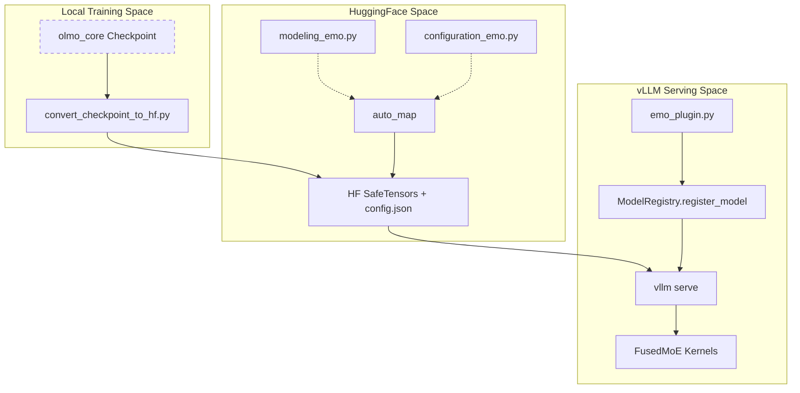
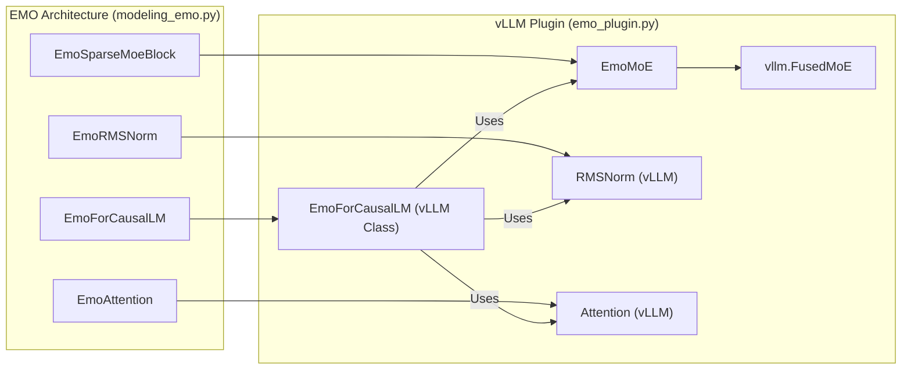

<!-- source: DeepWiki mcp.deepwiki.com · repo allenai/EMO · page 9.2 EmoForCausalLM and vLLM Plugin · fetched 2026-10-26 -->

# EmoForCausalLM and vLLM Plugin

<details>
<summary>Relevant source files</summary>

The following files were used as context for generating this wiki page:

- [src/examples/huggingface/convert_checkpoint_to_hf.py](src/examples/huggingface/convert_checkpoint_to_hf.py)
- [src/hf_training/EmoForCausalLMDebug.py](src/hf_training/EmoForCausalLMDebug.py)
- [src/hf_trust_remote_code/README.md](src/hf_trust_remote_code/README.md)
- [src/hf_trust_remote_code/emo/configuration_emo.py](src/hf_trust_remote_code/emo/configuration_emo.py)
- [src/hf_trust_remote_code/emo/modeling_emo.py](src/hf_trust_remote_code/emo/modeling_emo.py)
- [src/hf_trust_remote_code/migrate_to_emo.py](src/hf_trust_remote_code/migrate_to_emo.py)
- [src/hf_trust_remote_code/olmo2_noqknorm_prenorm/configuration_olmo2_noqknorm_prenorm.py](src/hf_trust_remote_code/olmo2_noqknorm_prenorm/configuration_olmo2_noqknorm_prenorm.py)
- [src/hf_trust_remote_code/olmo2_noqknorm_prenorm/modeling_olmo2_noqknorm_prenorm.py](src/hf_trust_remote_code/olmo2_noqknorm_prenorm/modeling_olmo2_noqknorm_prenorm.py)
- [src/hf_trust_remote_code/test_load.py](src/hf_trust_remote_code/test_load.py)
- [src/hf_trust_remote_code/upload_to_hf.py](src/hf_trust_remote_code/upload_to_hf.py)
- [src/hf_trust_remote_code/upload_to_hf.sh](src/hf_trust_remote_code/upload_to_hf.sh)
- [src/olmo_core/nn/hf/checkpoint.py](src/olmo_core/nn/hf/checkpoint.py)
- [src/olmo_core/nn/hf/config.py](src/olmo_core/nn/hf/config.py)
- [src/olmo_core/nn/hf/convert.py](src/olmo_core/nn/hf/convert.py)
- [src/vllm_plugin/emo_plugin.py](src/vllm_plugin/emo_plugin.py)
- [src/vllm_plugin/pyproject.toml](src/vllm_plugin/pyproject.toml)

</details>


This page documents the integration of EMO models into the HuggingFace and vLLM ecosystems. It covers the `trust_remote_code` implementation for seamless loading via the `transformers` library, the specialized `Olmo2NoQKNormPrenorm` variant, and the standalone vLLM plugin for high-performance serving.

## EmoForCausalLM and trust_remote_code

To support EMO models without requiring a custom fork of the HuggingFace `transformers` library, the repository provides standalone modeling and configuration files designed for use with `trust_remote_code=True` [src/hf_trust_remote_code/README.md:1-6]().

### Implementation Details
The `EmoForCausalLM` architecture supports modular Mixture-of-Experts (MoE) with features like shared experts and flexible routing.

*   **Modeling**: `modeling_emo.py` implements the core transformer logic, including `EmoRMSNorm` [src/hf_trust_remote_code/emo/modeling_emo.py:46-64](), `EmoMLP` [src/hf_trust_remote_code/emo/modeling_emo.py:66-91](), and the MoE routing logic.
*   **Configuration**: `configuration_emo.py` defines `EmoConfig`, which tracks hyperparameters such as `num_experts`, `num_experts_per_tok`, and `num_shared_experts` [src/vllm_plugin/emo_plugin.py:61-138]().
*   **Auto-Map**: To enable `AutoModelForCausalLM` to find these classes, the `config.json` is patched with an `auto_map` dictionary [src/hf_trust_remote_code/upload_to_hf.py:32-41]().

### Olmo2NoQKNormPrenorm
A variant called `Olmo2NoQKNormPrenormForCausalLM` is provided for dense baselines (e.g., 1B models) that do not use QK-normalization and follow a specific pre-normalization pattern [src/hf_trust_remote_code/README.md:12](). This variant uses its own configuration [src/hf_trust_remote_code/olmo2_noqknorm_prenorm/modeling_olmo2_noqknorm_prenorm.py:28]() and attention implementation [src/hf_trust_remote_code/olmo2_noqknorm_prenorm/modeling_olmo2_noqknorm_prenorm.py:127-161]().

### Deployment Workflow
The script `upload_to_hf.py` automates the process of preparing a checkpoint for the HuggingFace Hub:
1.  Detects the architecture from the local `config.json` [src/hf_trust_remote_code/upload_to_hf.py:44-54]().
2.  Stages the necessary `.py` files into the model directory [src/hf_trust_remote_code/upload_to_hf.py:57-80]().
3.  Patches the `auto_map` in `config.json` [src/hf_trust_remote_code/upload_to_hf.py:75-78]().
4.  Uploads the folder to the Hub [src/hf_trust_remote_code/upload_to_hf.py:83-105]().

**Sources:** [src/hf_trust_remote_code/README.md:1-85](), [src/hf_trust_remote_code/upload_to_hf.py:1-173](), [src/hf_trust_remote_code/emo/modeling_emo.py:1-153]().

---

## vLLM Plugin

The `emo_plugin.py` provides a standalone vLLM model implementation that registers `EmoForCausalLM` for high-throughput inference [src/vllm_plugin/emo_plugin.py:1-17]().

### Architecture Integration
The plugin bridges the EMO architecture to vLLM's optimized kernels:
*   **FusedMoE**: Uses vLLM's `FusedMoE` layer to handle routed experts efficiently [src/vllm_plugin/emo_plugin.py:187-198]().
*   **Parallelism**: Supports Tensor Parallelism (TP) via `QKVParallelLinear` and `RowParallelLinear` [src/vllm_plugin/emo_plugin.py:33-37](), and Pipeline Parallelism (PP) via the `SupportsPP` interface [src/vllm_plugin/emo_plugin.py:46]().
*   **Custom Routing**: Implements `_shared_expert_routing` to handle checkpoints where a subset of experts are always active [src/vllm_plugin/emo_plugin.py:200-210]().

### Serving EMO Models
To serve an EMO model with vLLM, use the `--model-impl` flag to point to the plugin:
```bash
vllm serve /path/to/checkpoint --model-impl emo_plugin --trust-remote-code
```
[src/vllm_plugin/emo_plugin.py:5-7]()

### Model Registration
The plugin can also be registered programmatically using the vLLM `ModelRegistry` [src/vllm_plugin/emo_plugin.py:13-16](). It includes a custom `EmoConfig` that maps the architecture's specific keys (like `num_experts_per_tok`) to vLLM's expected formats [src/vllm_plugin/emo_plugin.py:61-138]().

**Sources:** [src/vllm_plugin/emo_plugin.py:1-210](), [src/vllm_plugin/pyproject.toml:1-17]().

---

## Data Flow: Checkpoint to Serving

The following diagram illustrates the lifecycle of an EMO model from an `olmo_core` checkpoint to a served vLLM endpoint.

### Model Conversion and Registration

**Sources:** [src/examples/huggingface/convert_checkpoint_to_hf.py:111-125](), [src/hf_trust_remote_code/upload_to_hf.py:32-41](), [src/vllm_plugin/emo_plugin.py:1-17]().

---

## Component Mapping: EMO Architecture to vLLM

This diagram maps specific EMO architectural components to their vLLM counterparts within the plugin.

### Class and Function Mapping

**Sources:** [src/hf_trust_remote_code/emo/modeling_emo.py:46-150](), [src/vllm_plugin/emo_plugin.py:31-44](), [src/vllm_plugin/emo_plugin.py:145-198]().

---

## Configuration Mapping

The following table describes how `olmo_core` parameters are mapped to the HF/vLLM `EmoConfig`.

| olmo_core Parameter | EmoConfig Key | Description |
| :--- | :--- | :--- |
| `d_model` | `hidden_size` | The size of the embedding and hidden layers [src/olmo_core/nn/hf/config.py:156](). |
| `n_layers` | `num_hidden_layers` | Total number of transformer blocks [src/olmo_core/nn/hf/config.py:159](). |
| `router.num_experts` | `num_experts` | Total number of experts in the MoE layer [src/olmo_core/nn/hf/config.py:135](). |
| `router.top_k` | `num_experts_per_tok` | Number of experts selected per token [src/olmo_core/nn/hf/config.py:170](). |
| `router.num_shared_experts` | `num_shared_experts` | Number of non-routed, always-active experts [src/olmo_core/nn/hf/config.py:148](). |

**Sources:** [src/olmo_core/nn/hf/config.py:49-173](), [src/vllm_plugin/emo_plugin.py:61-138]().

---

