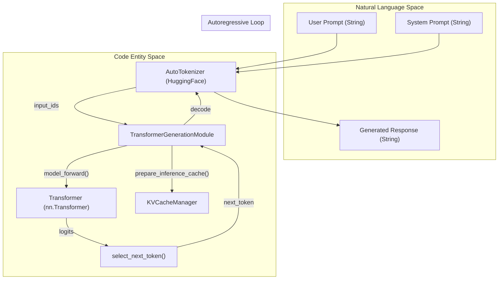
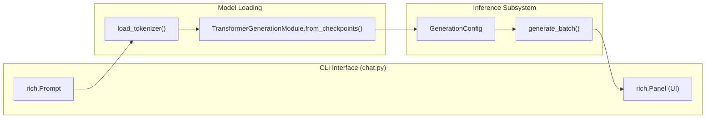

<!-- source: DeepWiki mcp.deepwiki.com · repo allenai/EMO · page 9.3 Text Generation Module · fetched 2026-10-26 -->

# Text Generation Module

Relevant source files

The following files were used as context for generating this wiki page:

- [src/olmo_core/distributed/checkpoint/filesystem.py](src/olmo_core/distributed/checkpoint/filesystem.py)
- [src/olmo_core/fs_cache.py](src/olmo_core/fs_cache.py)
- [src/olmo_core/generate/chat.py](src/olmo_core/generate/chat.py)
- [src/olmo_core/generate/generation_module/transformer/config.py](src/olmo_core/generate/generation_module/transformer/config.py)
- [src/olmo_core/generate/generation_module/transformer/generation_module.py](src/olmo_core/generate/generation_module/transformer/generation_module.py)
- [src/scripts/merge_core_checkpoints.py](src/scripts/merge_core_checkpoints.py)
- [src/test/distributed/checkpoint/filesystem_test.py](src/test/distributed/checkpoint/filesystem_test.py)
- [src/test/generate/generation_module/transformer/generation_module_test.py](src/test/generate/generation_module/transformer/generation_module_test.py)
- [src/test/scripts/merge_core_checkpoints_test.py](src/test/scripts/merge_core_checkpoints_test.py)

The text generation module in OLMo-core provides a high-performance subsystem for autoregressive decoding from Transformer models. It encapsulates model parallelization, KV cache management, and sampling strategies into a unified interface designed for both programmatic use and interactive CLI applications.

### Overview and Core Components

The generation subsystem is primarily centered around the `TransformerGenerationModule`, which wraps a standard `Transformer` model and handles the complexities of distributed inference and state management [src/olmo_core/generate/generation_module/transformer/generation_module.py:46-60]().

| Component | Class / Module | Responsibility |
| :--- | :--- | :--- |
| **Generation Engine** | `TransformerGenerationModule` | Orchestrates the forward pass, cache management, and token selection loop [src/olmo_core/generate/generation_module/transformer/generation_module.py:46](). |
| **Configuration** | `GenerationConfig` | Defines sampling parameters like temperature, top-p, top-k, and stopping criteria [src/olmo_core/generate/generation_module/transformer/config.py:13](). |
| **Sampling Logic** | `select_next_token` | Implements the mathematical logic for greedy and stochastic token selection [src/olmo_core/generate/generation_module/transformer/generation_module.py:32](). |
| **Cache Management** | `KVCacheManager` | Handles the allocation and resetting of key-value caches within attention layers [src/olmo_core/generate/generation_module/transformer/generation_module.py:108-119](). |

**Sources:** [src/olmo_core/generate/generation_module/transformer/generation_module.py:31-124](), [src/olmo_core/generate/generation_module/transformer/config.py:28-46]()

---

### TransformerGenerationModule Implementation

The `TransformerGenerationModule` is responsible for preparing a model for inference, which includes applying parallelism (DP/TP) and optionally compiling the model via `torch.compile` [src/olmo_core/generate/generation_module/transformer/generation_module.py:74-81]().

#### Data Flow: Generation Loop
The following diagram illustrates the transition from Natural Language inputs to the execution of code entities during the generation process.

**Natural Language to Code Entity Space: Generation Lifecycle**

**Sources:** [src/olmo_core/generate/generation_module/transformer/generation_module.py:108-152](), [src/olmo_core/generate/chat.py:158-162]()

#### Key Methods
- `prepare_inference_cache(batch_size, max_seq_len)`: Iterates through model blocks to initialize or reset `KVCacheManager` for each `Attention` layer [src/olmo_core/generate/generation_module/transformer/generation_module.py:108-119]().
- `generate_batch(...)`: The primary entry point for decoding. It supports `return_logits`, `return_logprobs`, and `completions_only` flags [src/olmo_core/generate/generation_module/transformer/generation_module.py:142-152]().
- `model_forward(input_ids, ...)`: Executes the model in `eval` mode using `torch.inference_mode()` [src/olmo_core/generate/generation_module/transformer/generation_module.py:135-139]().

**Sources:** [src/olmo_core/generate/generation_module/transformer/generation_module.py:108-152]()

---

### Generation Configuration and Sampling

The `GenerationConfig` object controls the behavior of the `select_next_token` utility. It supports standard LLM sampling parameters.

| Parameter | Type | Description |
| :--- | :--- | :--- |
| `do_sample` | `bool` | Whether to use multinomial sampling or greedy decoding [src/olmo_core/generate/chat.py:139](). |
| `temperature` | `float` | Softmax temperature for scaling logits [src/olmo_core/generate/chat.py:141](). |
| `top_p` | `float` | Nucleus sampling threshold [src/olmo_core/generate/chat.py:144](). |
| `top_k` | `int` | Filters the top-K highest probability tokens [src/olmo_core/generate/chat.py:142](). |
| `use_cache` | `bool` | Enables KV caching for faster inference [src/olmo_core/generate/chat.py:148](). |

**Sources:** [src/olmo_core/generate/chat.py:131-155](), [src/olmo_core/generate/generation_module/transformer/config.py:34]()

---

### Interactive Chat CLI (`chat.py`)

The `chat.py` script provides a rich terminal interface for interacting with OLMo models. It uses the `rich` library to render chat bubbles and configuration panels [src/olmo_core/generate/chat.py:25-29]().

#### CLI Components and Logic
The CLI bridges the gap between raw model checkpoints and a user-facing chatbot interface.

**System Architecture: Chat CLI to Model Internals**

**Sources:** [src/olmo_core/generate/chat.py:47-155](), [src/olmo_core/generate/generation_module/transformer/config.py:86-96]()

#### Features
- **Tokenizer Info**: Renders detailed statistics about the vocabulary, special tokens (EOS, BOS, PAD), and the chat template being used [src/olmo_core/generate/chat.py:73-128]().
- **Dynamic Templates**: Supports custom Jinja2 chat templates via the `--chat-template` flag [src/olmo_core/generate/chat.py:8-9]().
- **Remote Checkpoints**: Can load models directly from URLs (e.g., S3 or GCS) using `cached_path` [src/olmo_core/generate/chat.py:14-15]().

**Sources:** [src/olmo_core/generate/chat.py:7-128]()

---

### Checkpoint Merging and Utilities

The module includes a specialized script `merge_core_checkpoints.py` for weight averaging across multiple checkpoints (e.g., for model soups or ensemble initialization).

- **Implementation**: It uses `get_checkpoint_metadata` to validate that all checkpoints have identical keys before merging [src/scripts/merge_core_checkpoints.py:37-41]().
- **Memory Efficiency**: Tensors are processed in batches (default size 128) to avoid OOM when merging large models [src/scripts/merge_core_checkpoints.py:98-128]().
- **Averaging Logic**: It performs an in-place addition with a scaling factor of `1/N` where `N` is the number of source checkpoints [src/scripts/merge_core_checkpoints.py:114]().

**Sources:** [src/scripts/merge_core_checkpoints.py:24-129]()

---

### Distributed Infrastructure Support

The generation module integrates with the `olmo_core.distributed` package to support sharded models.

- **Remote Filesystem**: The `RemoteFileSystemWriter` and `RemoteFileSystemReader` classes enable direct I/O with cloud storage (S3/GCS) during model loading or saving [src/olmo_core/distributed/checkpoint/filesystem.py:187-210]().
- **Atomic Operations**: Writing results are managed via temporary files and `fdatasync` to ensure data integrity before final renaming or upload [src/olmo_core/distributed/checkpoint/filesystem.py:139-147]().

**Sources:** [src/olmo_core/distributed/checkpoint/filesystem.py:105-210]()

---

