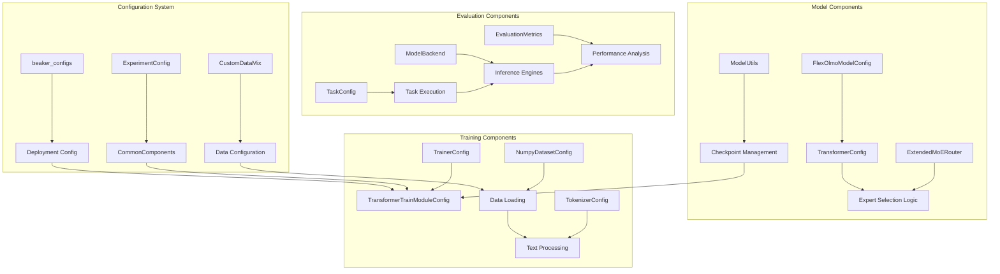
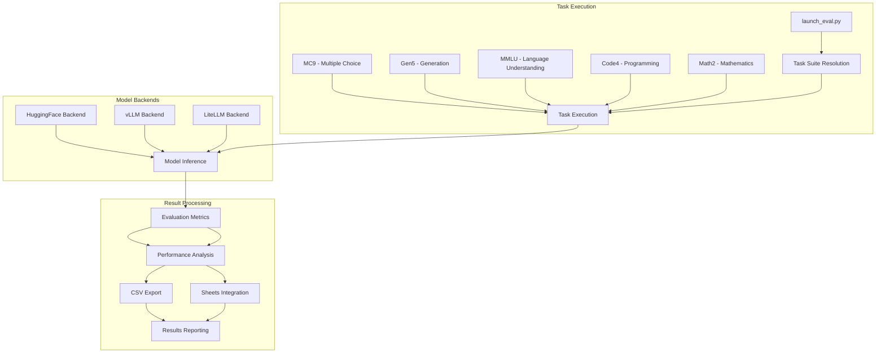

<!-- source: DeepWiki mcp.deepwiki.com · repo allenai/FlexOlmo · page 1 Overview · fetched 2026-10-26 -->

# Overview

<details>
<summary>Relevant source files</summary>

The following files were used as context for generating this wiki page:

- [README.md](README.md)
- [assets/FlexOlmo_Logo.png](assets/FlexOlmo_Logo.png)

</details>


## Purpose and Scope

FlexOlmo is a Mixture of Experts (MoE) language model system that enables data collaboration without requiring direct data sharing. The system allows data owners to contribute specialized expert models trained on their proprietary datasets while maintaining control over their data. This document provides a comprehensive overview of FlexOlmo's architecture, training pipeline, evaluation framework, and key components.

For detailed information about specific subsystems, see:
- Training processes: [Training Pipeline](#3)
- Evaluation framework: [Evaluation System](#4)
- Infrastructure deployment: [Infrastructure and Deployment](#6)

## System Architecture

FlexOlmo implements a sophisticated MoE architecture that combines multiple domain-specific expert models through an intelligent routing system. The system consists of three main layers: the training pipeline, the MoE model architecture, and the evaluation framework.

### FlexOlmo System Architecture

```mermaid
graph TB
    subgraph "Training Pipeline"
        A[train_public_model.sh] --> B["Dense 7B Public Model"]
        C[train_expert_model.sh] --> D["Domain Expert Models"]
        E[combine_experts.sh] --> F["FlexOlmo-7x7B Model"]
        G[router_training] --> H["FlexOlmo-7x7B-RT"]
    end
    
    subgraph "MoE Architecture"
        I["TransformerConfig"] --> J["Extended MoE Router"]
        K["Expert Networks"] --> L["Router System"]
        M["Domain Embeddings"] --> N["Expert Selection"]
    end
    
    subgraph "Evaluation Framework"
        O[launch_eval.py] --> P["Task Orchestration"]
        Q["Model Backends"] --> R["Evaluation Metrics"]
        S["Task Suites"] --> T["Results Aggregation"]
    end
    
    subgraph "Configuration Management"
        U["ExperimentConfig"] --> V["CommonComponents"]
        W["CustomDataMix"] --> X["Training Configuration"]
    end
    
    B --> F
    D --> F
    F --> H
    J --> L
    K --> L
    M --> N
    P --> R
    R --> T
    U --> X
    W --> X
```



**Sources:** [README.md:1-113](), [src/scripts/train/](), [src/scripts/eval/]()

## Core Components

The FlexOlmo system is built around several key components that handle model training, expert combination, routing, and evaluation.

### Core Component Architecture



**Sources:** [src/flexolmo/](), [src/scripts/](), [beaker_configs/]()

## Training Pipeline Overview

FlexOlmo employs a three-stage training approach that progresses from public model training to expert specialization and finally to model combination with router optimization.

| Stage | Component | Purpose | Output |
|-------|-----------|---------|--------|
| 1 | `train_public_model.sh` | Train base dense model on public data | `Flex-public-7B-1T` |
| 2 | `train_expert_model.sh` | Train domain-specific experts | Expert models (Math, Code, News, etc.) |
| 3 | `combine_experts.sh` | Combine experts into MoE model | `FlexOlmo-7x7B-1T` |
| 4 | Router Training | Optional router optimization | `FlexOlmo-7x7B-RT` |

The system supports training on multiple domains including:
- **Public Mix**: General knowledge from 1T tokens
- **Math**: Mathematical reasoning and computation
- **Code**: Programming and software development
- **News**: Current events and journalism
- **Academic**: Research papers and scholarly content
- **Creative Writing**: Literature and creative content
- **Reddit**: Social media and discussion content

**Sources:** [README.md:41-49](), [src/scripts/train/](), [scripts/]()

## Evaluation System Overview

FlexOlmo includes a comprehensive evaluation framework built on OLMES that supports multiple task types, model backends, and execution environments.

### Evaluation Pipeline Architecture



The evaluation system supports various task suites:
- **MC9**: 9 multiple choice tasks
- **Gen5**: 5 generation tasks  
- **MMLU**: Language understanding benchmarks
- **Code4**: 4 programming tasks
- **Math2**: 8 mathematics tasks
- **BBH**: Big Bench Hard tasks
- **AGI Eval**: General intelligence evaluation

**Sources:** [README.md:57-96](), [src/scripts/eval/](), [setup_eval_env.sh]()

## Key Features and Capabilities

### Data Collaboration Model
FlexOlmo enables a new paradigm of data collaboration where:
- Data owners contribute expert models without sharing raw data
- Contributors maintain control over when their data is active
- Data can be deactivated at any time
- Attribution is provided for inference usage

### Technical Architecture
- **33B Total Parameters**: Achieved through 7x7B MoE architecture
- **Flexible Routing**: Extended MoE router with expert bias and auxiliary-loss-free design
- **Multi-Backend Support**: Compatible with HuggingFace, vLLM, and LiteLLM
- **Distributed Training**: Beaker platform integration for scalable training

### Performance Characteristics
Based on evaluation results, FlexOlmo-7x7B-1T achieves:
- **70.4** on MC9 (Multiple Choice)
- **60.1** on Gen5 (Generation)
- **60.2** on MMLU (Language Understanding)
- **47.9** on Math2 (Mathematics)
- **52.0** overall average across all tasks

**Sources:** [README.md:22-24](), [README.md:81-95](), [assets/FlexOlmo_Logo.png]()

## Installation and Setup

FlexOlmo is built using OLMo-core and requires Python 3.10. The system supports multiple installation configurations:

```bash
# Basic installation
git clone https://github.com/allenai/FlexOlmo.git
cd FlexOlmo
conda create -n flexolmo python=3.10
conda activate flexolmo
pip install -e ".[train,beaker,wandb]"
```

The system includes Docker support through OLMo-core's published images and provides a custom Dockerfile for building specialized containers.

**Sources:** [README.md:25-40](), [src/Dockerfile](), [pyproject.toml]()

---

