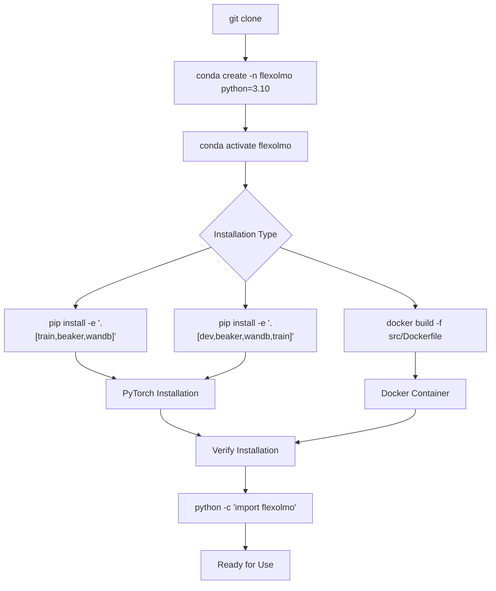
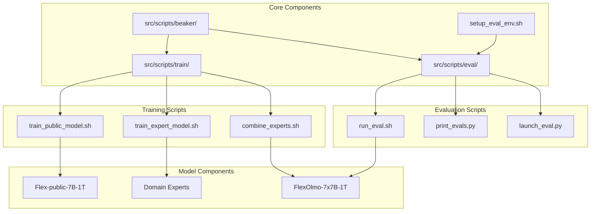
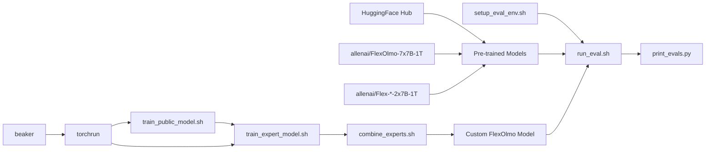

<!-- source: DeepWiki mcp.deepwiki.com · repo allenai/FlexOlmo · page 1.1 Getting Started · fetched 2026-10-26 -->

# Getting Started

<details>
<summary>Relevant source files</summary>

The following files were used as context for generating this wiki page:

- [.github/actions/setup-venv/action.yml](.github/actions/setup-venv/action.yml)
- [.github/workflows/docker.yml](.github/workflows/docker.yml)
- [README.md](README.md)
- [assets/FlexOlmo_Logo.png](assets/FlexOlmo_Logo.png)

</details>


This document provides installation instructions, basic setup, and first steps for using FlexOlmo. It covers environment setup, model usage, and running basic operations to get you up and running with the FlexOlmo system.

For detailed information about the system architecture and components, see [Architecture](#2). For comprehensive training procedures, see [Training Pipeline](#3). For evaluation workflows, see [Evaluation System](#4).

## Installation and Environment Setup

FlexOlmo requires Python 3.10 and is built on top of [OLMo-core](https://github.com/allenai/OLMo-core.git). The system supports multiple installation methods depending on your use case.

### Basic Installation

```bash
git clone https://github.com/allenai/FlexOlmo.git
cd FlexOlmo
conda create -n flexolmo python=3.10
conda activate flexolmo
pip install -e ".[train,beaker,wandb]"  # for training
```

### Installation Options

The system provides several installation configurations:

- **Training**: `pip install -e ".[train,beaker,wandb]"` - Includes all dependencies for model training
- **Evaluation**: `pip install -e ".[dev,beaker,wandb,train]"` - Includes evaluation capabilities
- **Development**: `pip install -e ".[dev,beaker,wandb,train]"` - Full development environment

### Docker-based Setup

FlexOlmo provides pre-built Docker images that contain all core and optional dependencies. You can use the provided `Dockerfile` or adapt it for your needs:

```bash
# Using the provided Dockerfile
docker build -f src/Dockerfile -t flexolmo .
```

The system also maintains Beaker images for distributed training and evaluation workloads.

**Installation Flow Diagram**



Sources: [README.md:25-39](), [.github/actions/setup-venv/action.yml:41-56](), [.github/workflows/docker.yml:45-51]()

## System Components and Usage Patterns

FlexOlmo is organized into several key components that work together to provide a flexible MoE system. Understanding these components helps you navigate the codebase and use the system effectively.

**Core System Components**



Sources: [README.md:51-54](), [README.md:57-77]()

## First Steps and Basic Operations

### Running Your First Evaluation

The quickest way to get started is to run an evaluation on a pre-trained FlexOlmo model:

```bash
# Set up evaluation environment
bash setup_eval_env.sh

# Run evaluation with 2 GPUs
NUM_GPUS=2
bash src/scripts/eval/run_eval.sh allenai/FlexOlmo-7x7B-1T mc9 eval_results/ ${NUM_GPUS}
```

### Viewing Evaluation Results

After running evaluations, you can aggregate and view results:

```bash
python src/scripts/eval/print_evals.py \
  --base-dir eval_results/ \
  --avg-core \
  --avg-gen \
  --avg-mmlu \
  --avg-mmlu-pro \
  --avg-agi-eval \
  --avg-sciriff \
  --avg-code
```

### Available Models

FlexOlmo provides several pre-trained models you can use immediately:

| Model Type | Model ID | Description |
|------------|----------|-------------|
| Combined MoE | `allenai/FlexOlmo-7x7B-1T` | 33B parameter MoE model |
| Public Base | `allenai/Flex-public-7B-1T` | 7B public data expert |
| Math Expert | `allenai/Flex-math-2x7B-1T` | Mathematics specialized expert |
| Code Expert | `allenai/Flex-code-2x7B-1T` | Programming specialized expert |
| News Expert | `allenai/Flex-news-2x7B-1T` | News content specialized expert |

### Training Your First Expert

To train a new expert model, you can use the training scripts:

```bash
# Training scripts are launched with torchrun
torchrun --nproc_per_node=8 src/scripts/train/train_expert_model.py \
  --config-path path/to/expert/config.yaml
```

**Basic Usage Flow**



Sources: [README.md:59-77](), [README.md:41-48]()

## Evaluation Task Suites

FlexOlmo supports multiple evaluation task suites that you can run immediately:

| Suite | Description | Tasks |
|-------|-------------|-------|
| `mc9` | Multiple Choice | 9 tasks |
| `gen5` | Generation | 5 tasks |
| `mmlu` | Language Understanding | MMLU benchmark |
| `code4` | Programming | 4 coding tasks |
| `math2` | Mathematics | 8 math tasks |
| `bbh` | Big Bench Hard | Reasoning tasks |

### Running Specific Task Suites

```bash
# Run multiple choice tasks
bash src/scripts/eval/run_eval.sh allenai/FlexOlmo-7x7B-1T mc9 results/ 2

# Run generation tasks
bash src/scripts/eval/run_eval.sh allenai/FlexOlmo-7x7B-1T gen5 results/ 2

# Run coding tasks
bash src/scripts/eval/run_eval.sh allenai/FlexOlmo-7x7B-1T code4 results/ 2
```

## Next Steps

Once you have FlexOlmo installed and running basic evaluations:

1. **Explore Training**: Learn about the three-stage training pipeline in [Training Pipeline](#3)
2. **Deep Dive into Evaluation**: Understand the comprehensive evaluation system in [Evaluation System](#4)
3. **Understand the Architecture**: Read about the MoE router system and model components in [Architecture](#2)
4. **Configure Data**: Learn about data management and domain embeddings in [Data Management](#5)
5. **Deploy at Scale**: Explore Beaker platform integration and infrastructure in [Infrastructure and Deployment](#6)

Sources: [README.md:1-113](), [README.md:81-96]()

---

