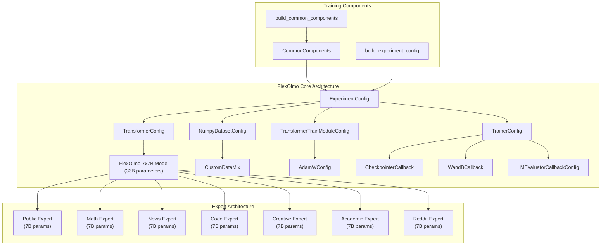
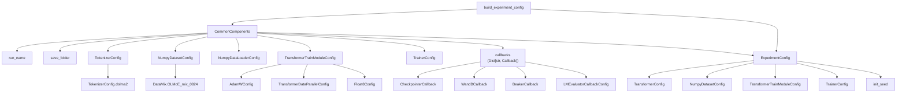
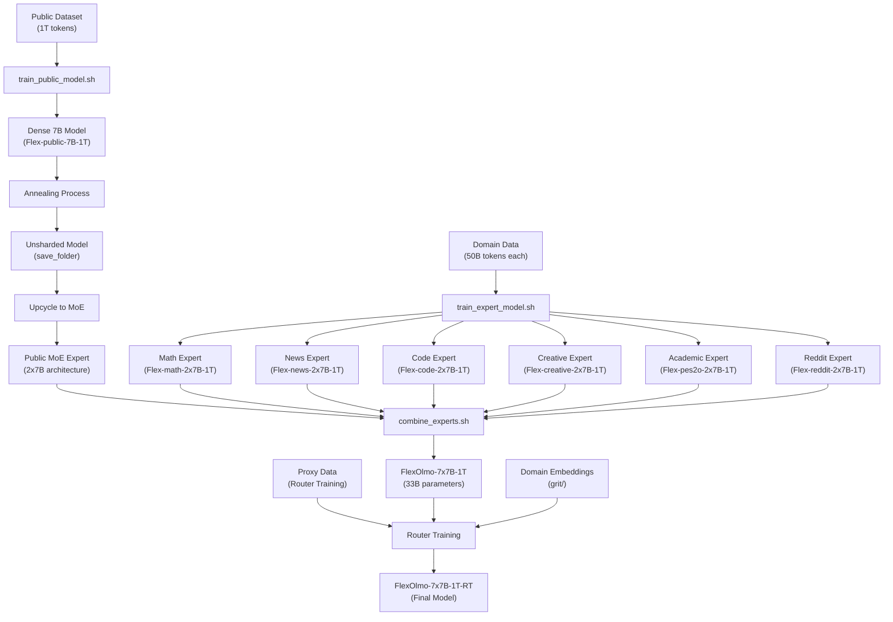
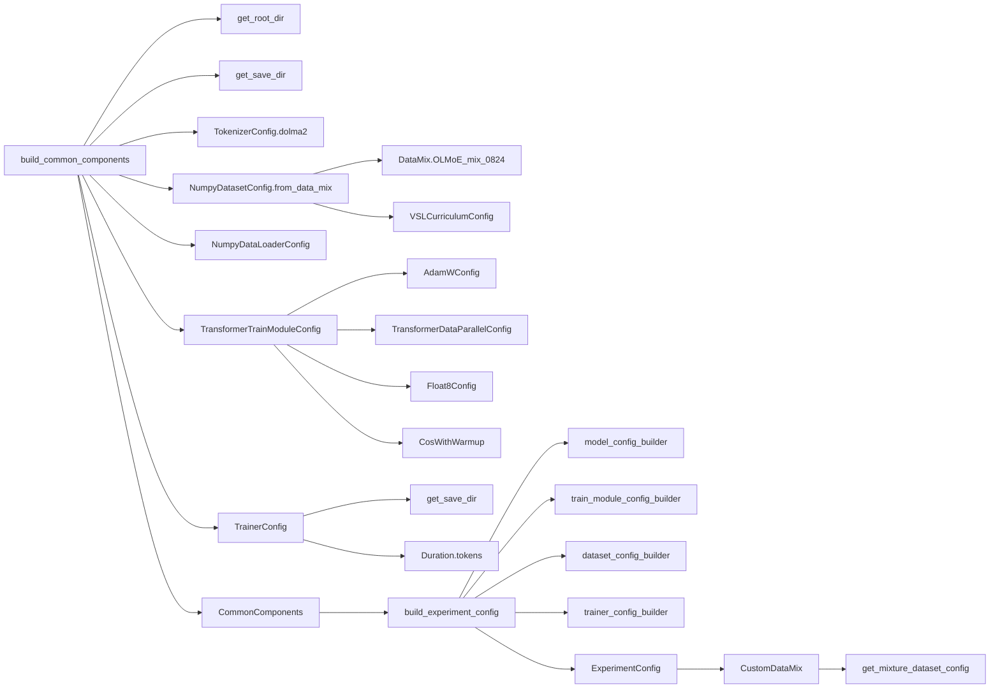
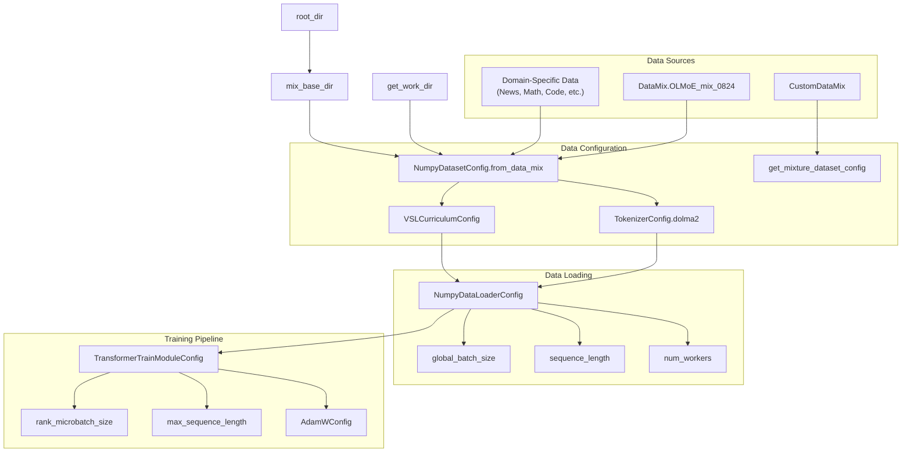

<!-- source: DeepWiki mcp.deepwiki.com · repo allenai/FlexOlmo · page 2 Architecture · fetched 2026-10-26 -->

# Architecture

Relevant source files

The following files were used as context for generating this wiki page:

- [README.md](README.md)
- [assets/FlexOlmo_Logo.png](assets/FlexOlmo_Logo.png)
- [src/flexolmo/internal/common.py](src/flexolmo/internal/common.py)

This document provides an overview of FlexOlmo's system architecture, covering the core components, their interactions, and the overall design principles that enable collaborative model development without direct data sharing. For detailed information about specific subsystems, see [MoE Router System](#2.1), [Model Components](#2.2), and [Configuration System](#2.3).

## System Overview

FlexOlmo implements a Mixture of Experts (MoE) architecture that enables independent training of domain-specific expert models, which are then combined into a unified model through an intelligent routing system. The system supports a three-stage training pipeline: public model training, expert specialization, and model combination with optional router training.

**Sources:** [README.md:22-49](), [src/flexolmo/internal/common.py:55-76]()

## Core Architecture Components

The FlexOlmo architecture is built around several key components that work together to enable flexible model composition and training:

### Configuration Hierarchy

**Sources:** [src/flexolmo/internal/common.py:94-244](), [src/flexolmo/internal/common.py:247-351]()

### Model Architecture Components

| Component | Class | Purpose |
|-----------|-------|---------|
| Model Configuration | `TransformerConfig` | Defines model architecture parameters |
| Data Configuration | `NumpyDatasetConfig` | Specifies dataset sources and preprocessing |
| Training Module | `TransformerTrainModuleConfig` | Configures optimization and training parameters |
| Data Loading | `NumpyDataLoaderConfig` | Manages data loading and batching |
| Training Control | `TrainerConfig` | Controls training lifecycle and checkpointing |

**Sources:** [src/flexolmo/internal/common.py:68-76]()

## Training Pipeline Architecture

The FlexOlmo training pipeline follows a three-stage architecture that enables independent expert development:

**Sources:** [README.md:42-49](), [README.md:51-55]()

## Configuration Architecture

The FlexOlmo configuration system uses a hierarchical approach to manage complex experimental setups:

**Sources:** [src/flexolmo/internal/common.py:94-159](), [src/flexolmo/internal/common.py:247-351]()

## Data Flow Architecture

The data flow architecture supports flexible data mixing and domain-specific training:

**Sources:** [src/flexolmo/internal/common.py:106-118](), [src/flexolmo/internal/common.py:120-122](), [src/flexolmo/internal/common.py:324-350]()

## System Integration Points

The architecture provides several key integration points that enable flexible model composition:

| Integration Point | Implementation | Purpose |
|-------------------|----------------|---------|
| Model Builders | `model_config_builder` | Customize model architecture |
| Data Builders | `dataset_config_builder` | Configure data sources |
| Training Builders | `train_module_config_builder` | Modify training parameters |
| Callback System | `callbacks: Dict[str, Callback]` | Extend training pipeline |
| Configuration Overrides | `config.merge(overrides)` | Runtime parameter modification |

The `build_experiment_config` function serves as the central orchestrator, accepting builder functions that customize each component while maintaining system coherence.

**Sources:** [src/flexolmo/internal/common.py:256-263](), [src/flexolmo/internal/common.py:275-297](), [src/flexolmo/internal/common.py:343]()

---

