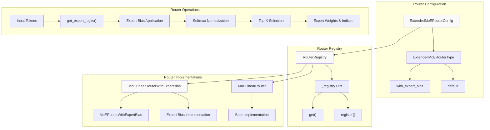
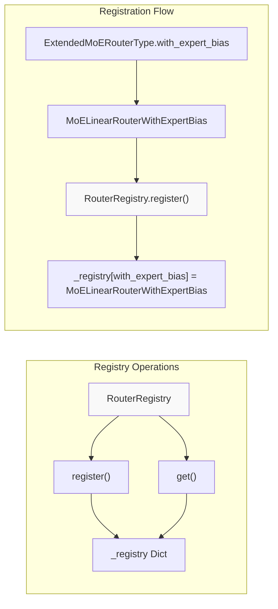
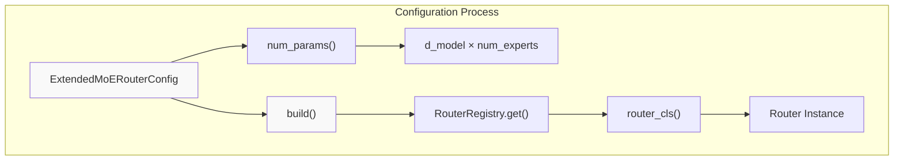
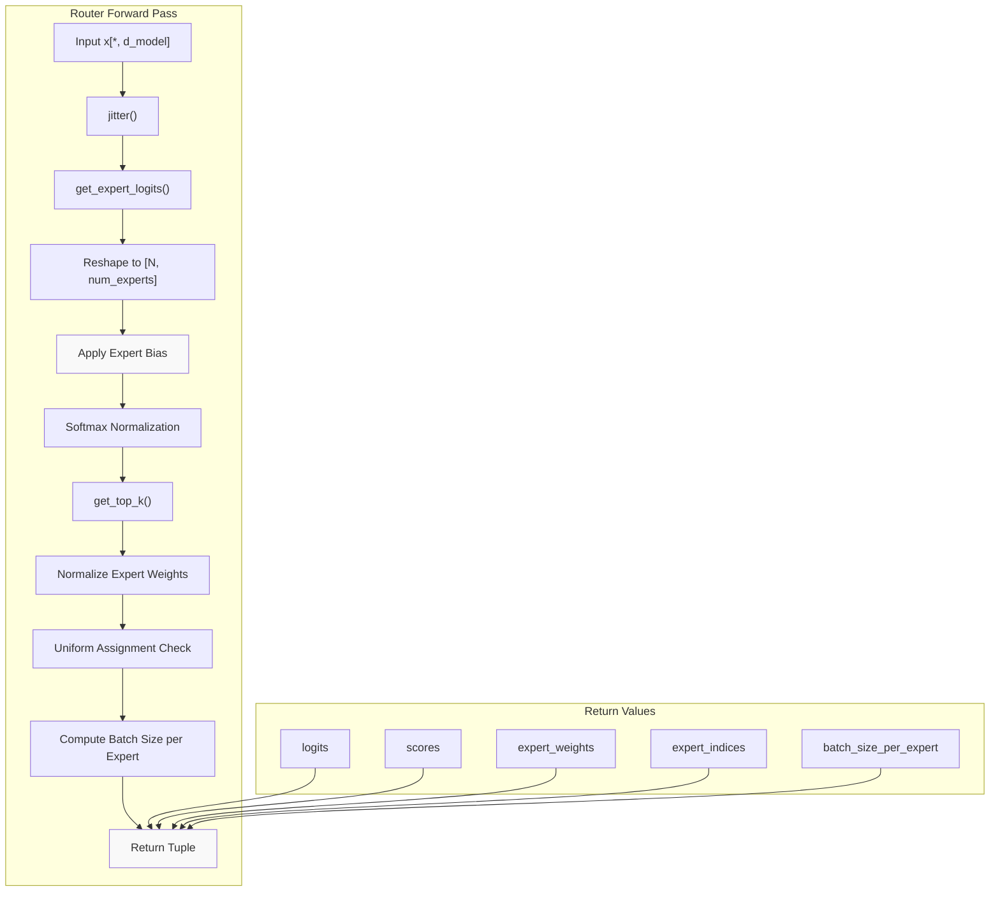
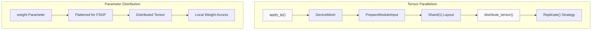

<!-- source: DeepWiki mcp.deepwiki.com · repo allenai/FlexOlmo · page 2.1 MoE Router System · fetched 2026-10-26 -->

# MoE Router System

<details>
<summary>Relevant source files</summary>

The following files were used as context for generating this wiki page:

- [src/flexolmo/nn/__init__.py](src/flexolmo/nn/__init__.py)
- [src/flexolmo/nn/moe/__init__.py](src/flexolmo/nn/moe/__init__.py)
- [src/flexolmo/nn/moe/router.py](src/flexolmo/nn/moe/router.py)

</details>


## Purpose and Scope

The MoE Router System is FlexOlmo's implementation of routing mechanisms for Mixture of Experts (MoE) models. It extends the base OLMo MoE router with additional features including expert bias for auxiliary-loss-free load balancing. The router determines which experts should process each input token and computes the corresponding weights for combining expert outputs.

For information about the overall MoE architecture and model components, see [Model Components](#2.2). For details about expert training and combination, see [Model Combination and Upcycling](#3.3).

## Router Architecture Overview

The router system follows a modular design with configurable router types, a registry pattern for extensibility, and support for distributed training.

### Router System Components



**Sources:** [src/flexolmo/nn/moe/router.py:28-47](), [src/flexolmo/nn/moe/router.py:48-62](), [src/flexolmo/nn/moe/router.py:211-257]()

## Router Types and Configuration

### ExtendedMoERouterType

The router system defines an enumeration of available router implementations:

| Router Type | Implementation | Description |
|-------------|---------------|-------------|
| `default` | `MoELinearRouter` | Standard linear router from OLMo core |
| `with_expert_bias` | `MoELinearRouterWithExpertBias` | Router with expert bias for load balancing |

### Router Registry Pattern



**Sources:** [src/flexolmo/nn/moe/router.py:48-62](), [src/flexolmo/nn/moe/router.py:259-260]()

### Configuration Building

The `ExtendedMoERouterConfig` provides parameter counting and router instantiation:



**Sources:** [src/flexolmo/nn/moe/router.py:64-101]()

## Expert Bias Mechanism

### Auxiliary-Loss-Free Load Balancing

The expert bias system implements the "auxiliary-loss-free load balancing" strategy from DeepSeek-v3, allowing for better expert utilization without requiring additional loss terms.


**Sources:** [src/flexolmo/nn/moe/router.py:142-177]()

### Expert Bias Parameters

The `MoERouterWithExpertBias` class manages expert bias through learnable parameters:

- **Expert Bias Shape**: `(num_experts - 1, 1)` - bias for all experts except the first
- **Bias Constraint**: Values are constrained to be ≤ 0 to prevent expert favoritism
- **Bias Application**: Applied to logits before softmax normalization

**Sources:** [src/flexolmo/nn/moe/router.py:103-150]()

## Router Implementation Details

### Forward Pass Pipeline



**Sources:** [src/flexolmo/nn/moe/router.py:154-208]()

### Linear Router Implementation

The `MoELinearRouterWithExpertBias` provides the concrete implementation:

- **Weight Parameter**: `(num_experts * d_model,)` flattened for FSDP compatibility
- **Weight Initialization**: Truncated normal with std=0.002
- **Expert Logits**: Computed via `F.linear()` with reshaped weights
- **Tensor Parallelism**: Supports distributed training via `apply_tp()`

**Sources:** [src/flexolmo/nn/moe/router.py:211-257]()

## Integration Points

### Model Integration

The router system integrates with the broader FlexOlmo architecture through:

- **Configuration System**: Uses `ExtendedMoERouterConfig` for declarative setup
- **Training Pipeline**: Supports distributed training with tensor parallelism
- **Expert Networks**: Routes tokens to domain-specific expert models

### Distributed Training Support



**Sources:** [src/flexolmo/nn/moe/router.py:242-256]()

## Usage Examples

### Router Configuration

```python
from flexolmo.nn.moe.router import ExtendedMoERouterConfig, ExtendedMoERouterType

# Standard router
router_config = ExtendedMoERouterConfig(
    name=ExtendedMoERouterType.default,
    top_k=2
)

# Router with expert bias
biased_router_config = ExtendedMoERouterConfig(
    name=ExtendedMoERouterType.with_expert_bias,
    top_k=2,
    bias_gamma=0.0001
)
```

### Router Building

```python
# Build router instance
router = router_config.build(
    d_model=4096,
    num_experts=7,
    dtype=torch.float32
)
```

**Sources:** [src/flexolmo/nn/moe/router.py:85-100]()

---

