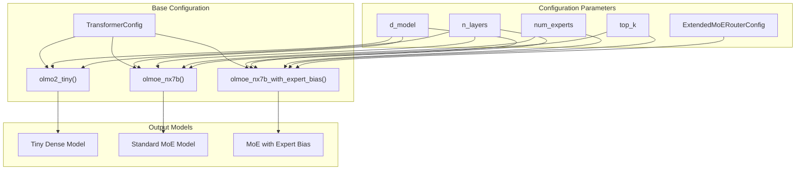
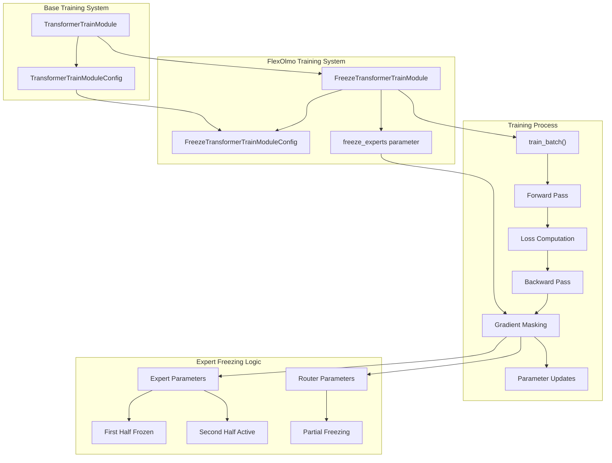
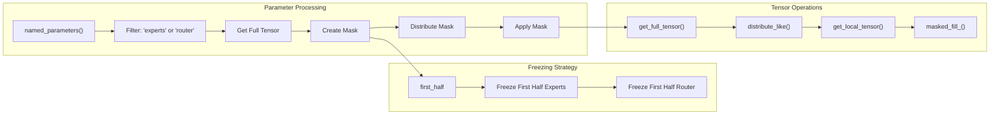
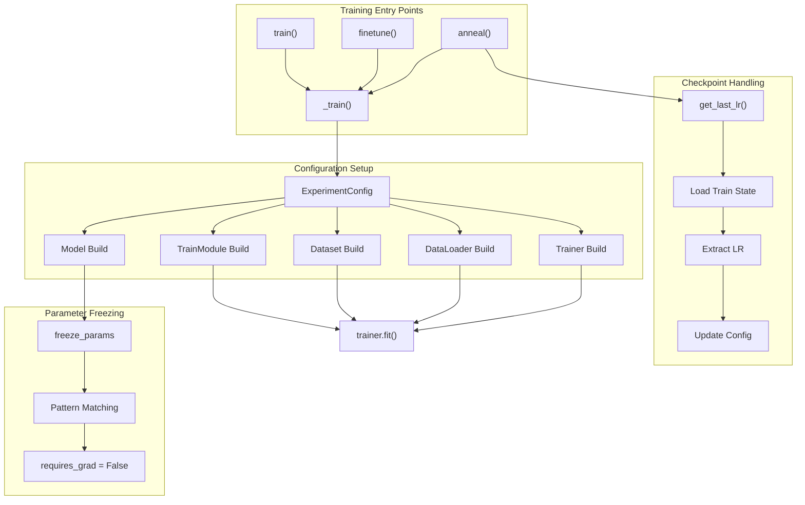
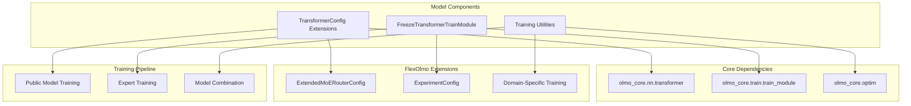

<!-- source: DeepWiki mcp.deepwiki.com · repo allenai/FlexOlmo · page 2.2 Model Components · fetched 2026-10-26 -->

# Model Components

Relevant source files

The following files were used as context for generating this wiki page:

- [src/flexolmo/internal/__init__.py](src/flexolmo/internal/__init__.py)
- [src/flexolmo/internal/model_utils.py](src/flexolmo/internal/model_utils.py)
- [src/flexolmo/internal/train_utils.py](src/flexolmo/internal/train_utils.py)
- [src/flexolmo/train/__init__.py](src/flexolmo/train/__init__.py)
- [src/flexolmo/train/train_module/__init__.py](src/flexolmo/train/train_module/__init__.py)
- [src/flexolmo/train/train_module/transformer.py](src/flexolmo/train/train_module/transformer.py)

This document covers the core model utilities, transformer configurations, and training modules that form the foundation of FlexOlmo's model architecture. These components provide the building blocks for creating, configuring, and training both dense and Mixture of Experts (MoE) transformer models.

For details about the MoE router implementation and expert bias mechanisms, see [MoE Router System](#2.1). For information about the broader configuration management system, see [Configuration System](#2.3).

## Model Configuration System

FlexOlmo extends the base `TransformerConfig` class with specialized configuration methods for different model architectures. These configurations are implemented as class methods that return pre-configured transformer instances.

### Configuration Methods

The system provides three main configuration methods:

| Method | Purpose | Key Features |
|--------|---------|--------------|
| `olmo2_tiny` | Tiny model for testing | 32 d_model, 1 layer, reordered norm |
| `olmoe_nx7b` | Standard MoE configuration | Configurable experts, top-k routing |
| `olmoe_nx7b_with_expert_bias` | MoE with expert bias | Extended router with bias support |

#### Model Architecture Configurations

Sources: [src/flexolmo/internal/model_utils.py:9-63]()

### MoE Configuration Details

The `olmoe_nx7b` configuration method provides comprehensive MoE setup with the following key parameters:

- **Expert Configuration**: Configurable number of experts (default 2) with 11008 hidden size
- **Routing**: Top-k routing with capacity factor and load balancing
- **Loss Components**: Load balancing loss weight (0.01) and z-loss weight (0.001)
- **Architectural Features**: Reordered normalization, QK normalization, RoPE theta scaling

The expert bias variant enhances the standard configuration by replacing the default router with an `ExtendedMoERouterConfig` that supports auxiliary-loss-free expert biasing.

Sources: [src/flexolmo/internal/model_utils.py:27-62]()

## Training Module System

The training system extends the base `TransformerTrainModule` with specialized capabilities for freezing expert parameters during training. This is essential for FlexOlmo's collaborative training approach where certain experts may need to remain frozen.

### Training Module Architecture

Sources: [src/flexolmo/train/train_module/transformer.py:34-260]()

### Gradient Masking Implementation

The `FreezeTransformerTrainModule` implements selective parameter freezing through gradient masking:

Sources: [src/flexolmo/train/train_module/transformer.py:178-221]()

The gradient masking logic operates on both expert and router parameters:

- **Expert Parameters**: Zeros gradients for the first half of expert parameters along the first dimension
- **Router Parameters**: Applies similar masking to router parameters, allowing selective training of routing components

## Training Utilities

The training utilities provide high-level orchestration functions and checkpoint management capabilities.

### Training Orchestration Functions

| Function | Purpose | Key Features |
|----------|---------|--------------|
| `train()` | Standard training | Full training from scratch |
| `finetune()` | Finetuning | Load checkpoint, continue with same LR |
| `anneal()` | Annealing | Load checkpoint, start from last LR |
| `get_last_lr()` | LR extraction | Extract final LR from checkpoint |

### Training Flow Architecture

Sources: [src/flexolmo/internal/train_utils.py:48-127]()

### Checkpoint Learning Rate Extraction

The `get_last_lr()` function provides checkpoint continuity by extracting the final learning rate from training state:

1. **State Loading**: Loads `rank0.pt` from checkpoint directory
2. **Configuration Analysis**: Parses `config.json` to extract optimizer and scheduler settings
3. **LR Calculation**: Uses `CosWithWarmup` scheduler to compute final learning rate based on global step

This enables seamless continuation of training with proper learning rate scheduling.

Sources: [src/flexolmo/internal/train_utils.py:23-45]()

## Integration with Core System

The model components integrate with FlexOlmo's broader architecture through several key interfaces:

### Component Integration

Sources: [src/flexolmo/internal/model_utils.py:1-7](), [src/flexolmo/train/train_module/transformer.py:1-21](), [src/flexolmo/internal/train_utils.py:1-19]()

The model components serve as the foundation layer that enables FlexOlmo's collaborative MoE training approach, providing the necessary abstractions for model configuration, selective parameter freezing, and training orchestration across the system's three-stage pipeline.

---

