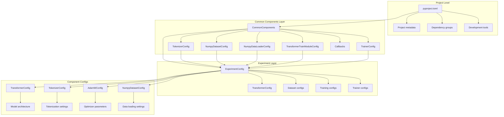
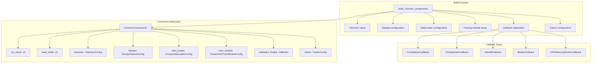
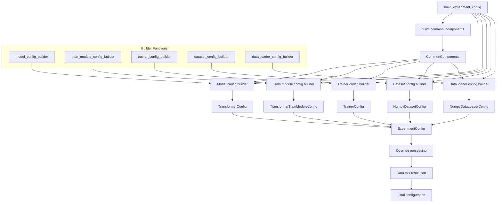

<!-- source: DeepWiki mcp.deepwiki.com · repo allenai/FlexOlmo · page 2.3 Configuration System · fetched 2026-10-26 -->

# Configuration System

Relevant source files

The following files were used as context for generating this wiki page:

- [pyproject.toml](pyproject.toml)
- [scripts/extraction_analysis.sh](scripts/extraction_analysis.sh)
- [src/flexolmo/internal/common.py](src/flexolmo/internal/common.py)
- [src/scripts/utils/extraction_analysis.py](src/scripts/utils/extraction_analysis.py)

The Configuration System in FlexOlmo provides a hierarchical approach to managing training experiments, model parameters, and system settings. It enables reproducible experimentation through structured configuration objects that can be easily modified and extended. The system supports multiple configuration levels from project-wide settings to experiment-specific parameters.

For information about model architecture configuration, see [Model Components](#2.2). For data configuration and mixes, see [Data Mixes and Configuration](#5.1).

## Configuration Hierarchy

FlexOlmo uses a multi-layered configuration system that separates concerns across different levels of abstraction:

### Configuration Architecture Overview

Sources: [src/flexolmo/internal/common.py:55-76](), [pyproject.toml:1-200]()

## Project Configuration

The project-level configuration is defined in `pyproject.toml` and establishes the foundation for the entire FlexOlmo system. This includes package metadata, dependencies, and development tool configurations.

### Dependency Groups

FlexOlmo organizes dependencies into functional groups that can be installed separately:

| Group | Purpose | Key Dependencies |
|-------|---------|------------------|
| `dev` | Development tools | ruff, mypy, black, pytest |
| `beaker` | Beaker platform integration | beaker-py, beaker-gantry |
| `wandb` | Experiment tracking | wandb |
| `train` | Training pipeline | ai2-olmo-core, torchao |
| `eval` | Evaluation system | ai2-olmes, s3fs |
| `embeddings` | Domain embeddings | gritlm, sentence_transformers |
| `extraction` | Data extraction analysis | transformers, accelerate |
| `all` | Complete installation | All above groups |

### Development Tool Configuration

The project configures several development tools through `pyproject.toml`:

- **Code formatting**: `black` with 100-character line length
- **Import sorting**: `isort` with black-compatible profile
- **Linting**: `ruff` with 115-character line length
- **Type checking**: `mypy` with specific overrides for test files
- **Testing**: `pytest` with GPU markers and warning filters

Sources: [pyproject.toml:32-96](), [pyproject.toml:112-200]()

## Common Components

The `CommonComponents` class provides shared configuration elements that are used across different experiments. This promotes consistency and reduces configuration duplication.

### CommonComponents Structure

Sources: [src/flexolmo/internal/common.py:55-65](), [src/flexolmo/internal/common.py:94-244]()

### Default Configuration Values

The `build_common_components` function establishes sensible defaults for common experiment settings:

- **Tokenizer**: Uses `TokenizerConfig.dolma2()` for consistent tokenization
- **Dataset**: Configures `DataMix.OLMoE_mix_0824` with VSL curriculum
- **Optimization**: AdamW with learning rate 9e-4, weight decay 0.1
- **Training**: Supports FSDP with bfloat16 precision and float8 configurations
- **Callbacks**: Includes checkpointing, monitoring, and experiment tracking

Sources: [src/flexolmo/internal/common.py:104-158](), [src/flexolmo/internal/common.py:160-188]()

## Experiment Configuration

The `ExperimentConfig` class represents a complete experiment configuration that combines model architecture, training parameters, and data settings.

### ExperimentConfig Components

| Component | Type | Purpose |
|-----------|------|---------|
| `run_name` | str | Unique identifier for the experiment |
| `model` | TransformerConfig | Model architecture specifications |
| `dataset` | NumpyDatasetConfig | Data loading and preprocessing |
| `data_loader` | NumpyDataLoaderConfig | Batch construction and sampling |
| `train_module` | TransformerTrainModuleConfig | Training loop configuration |
| `trainer` | TrainerConfig | Training orchestration and checkpointing |
| `init_seed` | int | Random seed for reproducibility |

Sources: [src/flexolmo/internal/common.py:67-76]()

## Configuration Building Process

The configuration system uses a builder pattern to construct experiment configurations from common components and custom specifications.

### Configuration Building Workflow

Sources: [src/flexolmo/internal/common.py:247-351]()

### Configuration Override System

The system supports runtime configuration overrides through string-based parameter paths:

1. **Override Processing**: Parses override strings in the format `"key=value"`
2. **Data Mix Handling**: Special handling for dataset mixture configurations
3. **Configuration Merging**: Applies overrides to the base configuration
4. **Data Mix Resolution**: Converts data mix strings to appropriate configuration objects

The override system allows dynamic modification of any configuration parameter without requiring code changes.

Sources: [src/flexolmo/internal/common.py:323-351]()

## Utility Functions

The configuration system provides several utility functions for directory management and configuration validation:

### Directory Management

- `get_root_dir(cluster: str)`: Returns appropriate root directory based on cluster type
- `get_save_dir(root_dir: str, run_name: str)`: Constructs save directory with user-specific paths
- `get_beaker_username()`: Retrieves Beaker username for directory organization

### Configuration Validation

- `print_model_params(config: ExperimentConfig)`: Displays model parameter counts
- `is_dry_run(arglist: List[str])`: Detects dry run mode from command line arguments

Sources: [src/flexolmo/internal/common.py:78-92](), [src/flexolmo/internal/common.py:354-364]()

## Configuration Customization

The system supports extensive customization through builder functions and configuration overrides. Users can:

1. **Custom Model Architectures**: Provide `model_config_builder` functions
2. **Training Modifications**: Override training parameters through `train_module_config_builder`
3. **Data Pipeline Changes**: Customize data loading through `dataset_config_builder`
4. **Callback Extensions**: Add custom callbacks through the trainer configuration
5. **Runtime Overrides**: Modify any parameter through the override system

This flexibility enables researchers to experiment with different configurations while maintaining reproducibility and consistency across runs.

Sources: [src/flexolmo/internal/common.py:247-263](), [src/flexolmo/internal/common.py:320-351]()

---

