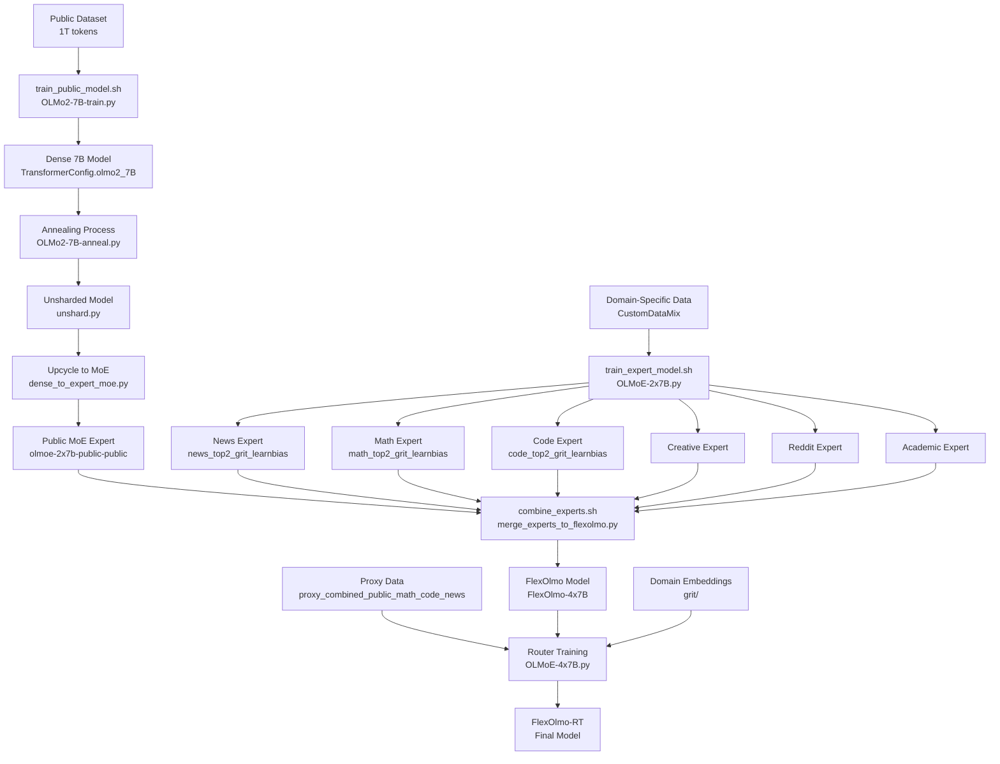
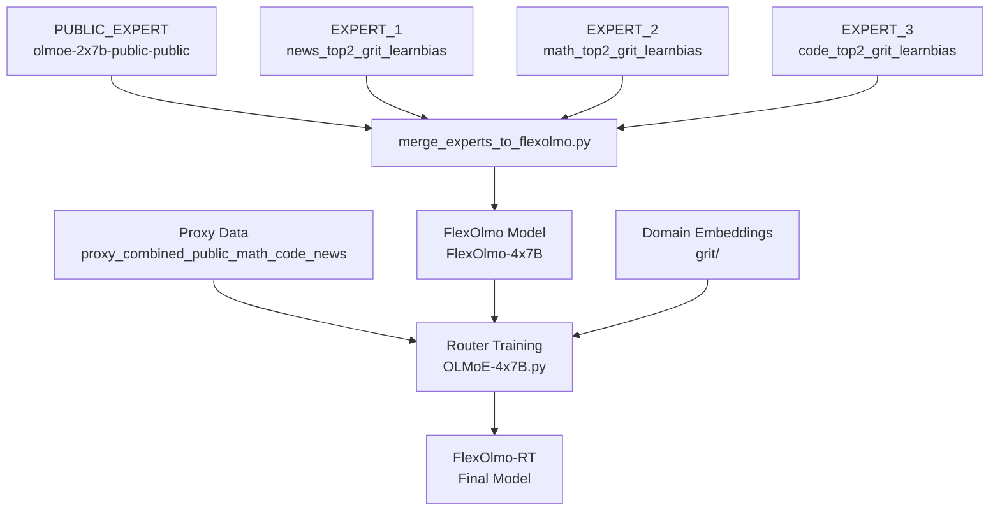

<!-- source: DeepWiki mcp.deepwiki.com · repo allenai/FlexOlmo · page 3 Training Pipeline · fetched 2026-10-26 -->

# Training Pipeline

<details>
<summary>Relevant source files</summary>

The following files were used as context for generating this wiki page:

- [scripts/README.md](scripts/README.md)
- [scripts/combine_experts.sh](scripts/combine_experts.sh)
- [scripts/train_public_model.sh](scripts/train_public_model.sh)
- [src/scripts/train/OLMo2-7B-train.py](src/scripts/train/OLMo2-7B-train.py)
- [src/scripts/train/OLMo2-tiny-train.py](src/scripts/train/OLMo2-tiny-train.py)

</details>


The training pipeline in FlexOlmo implements a three-stage process to create Mixture of Experts (MoE) models that enable data collaboration without direct data sharing. The pipeline consists of public model training, expert training, and model combination with optional router training.

This document covers the complete training workflow from initial model training through final FlexOlmo model creation. For information about the MoE router implementation details, see [MoE Router System](#2.1). For configuration management patterns, see [Configuration System](#2.3). For evaluation of trained models, see [Evaluation System](#4).

## Training Pipeline Overview

The FlexOlmo training pipeline follows a systematic approach to create specialized expert models and combine them into a flexible MoE architecture:

### Training Pipeline Architecture



Sources: [scripts/README.md:1-7](), [scripts/train_public_model.sh:1-34](), [scripts/combine_experts.sh:1-28]()

## Stage 1: Public Model Training

The first stage involves training a dense 7B model on publicly available data, followed by annealing and optional upcycling to MoE format.

### Public Model Training Process

```mermaid
flowchart LR
    A["`CustomDataMix.public_mix`"] --> B["`OLMo2-7B-train.py`"]
    B --> C["`TransformerConfig.olmo2_7B`"]
    C --> D["`TrainerConfig
    1T tokens`"]
    D --> E["`CosWithWarmup
    scheduler`"]
    E --> F["`AdamWConfig
    lr=9e-4`"]
    F --> G["`Dense Model
    Checkpoint`"]
    G --> H["`OLMo2-7B-anneal.py`"]
    H --> I["`Annealed Model
    50B tokens`"]
    I --> J["`unshard.py`"]
    J --> K["`Unsharded Model`"]
    K --> L["`dense_to_expert_moe.py`"]
    L --> M["`MoE Expert
    olmoe-2x7b-public-public`"]
```



Sources: [src/scripts/train/OLMo2-7B-train.py:42-67](), [scripts/train_public_model.sh:6-34]()

### Training Configuration

The public model training uses several key configuration builders:

| Component | Builder Function | Key Configuration |
|-----------|------------------|-------------------|
| Model | `build_model_config` | `TransformerConfig.olmo2_7B` with vocab size from tokenizer |
| Dataset | `build_dataset_config` | `CustomDataMix.public_mix` for public data |
| Trainer | `build_trainer_config` | Standard trainer configuration |
| Training Module | `build_train_module_config` | `rank_microbatch_size=2*SEQUENCE_LENGTH`, `lr=9e-4` |

The training script [src/scripts/train/OLMo2-7B-train.py:85-97]() builds the experiment configuration using `build_experiment_config` with these components.

### Training Parameters

Key training parameters are set through the `build_train_module_config` function:

- **Sequence Length**: 4096 tokens [src/scripts/train/OLMo2-7B-train.py:38]()
- **Microbatch Size**: `2 * SEQUENCE_LENGTH` [src/scripts/train/OLMo2-7B-train.py:62]()
- **Learning Rate**: 9e-4 [src/scripts/train/OLMo2-7B-train.py:66]()
- **Scheduler**: `CosWithWarmup` with 2000 warmup steps [src/scripts/train/OLMo2-7B-train.py:63]()
- **Global Batch Size**: `128 * SEQUENCE_LENGTH` [src/scripts/train/OLMo2-7B-train.py:90]()

Sources: [src/scripts/train/OLMo2-7B-train.py:60-67](), [src/scripts/train/OLMo2-7B-train.py:85-97]()

## Stage 2: Expert Training

The second stage involves training domain-specific experts using the public model as a seed. Each expert is trained on specialized data for its domain.

### Expert Training Configuration

Expert training uses the `train_expert_model.sh` script to launch domain-specific training. The process involves:

1. **Domain-Specific Data Loading**: Using `CustomDataMix` variants for each domain
2. **Expert Model Configuration**: 2x7B MoE architecture with domain-specific routing
3. **Checkpoint Initialization**: Loading from the public model checkpoint
4. **Domain-Specific Training**: Training on specialized datasets

### Expert Types and Data Sources

| Expert Type | Data Mix | Purpose |
|-------------|----------|---------|
| News Expert | `news_top2_grit_learnbias` | Current events and news content |
| Math Expert | `math_top2_grit_learnbias` | Mathematical reasoning and computation |
| Code Expert | `code_top2_grit_learnbias` | Programming and software development |
| Creative Expert | Domain-specific creative data | Creative writing and artistic content |
| Reddit Expert | Social media data | Conversational and social content |
| Academic Expert | Research papers and academic content | Scholarly and research materials |

Sources: [scripts/combine_experts.sh:7-10](), [scripts/README.md:6]()

## Stage 3: Model Combination and Router Training

The final stage combines trained experts into a unified FlexOlmo model and optionally performs router training on proxy data.

### Expert Combination Process



Sources: [scripts/combine_experts.sh:12-28]()

### Router Training Configuration

Router training is performed using the `OLMoE-4x7B.py` script with specific configuration:

- **Training Duration**: 5B tokens [scripts/combine_experts.sh:21-22]()
- **Router Top-K**: 4 experts [scripts/combine_experts.sh:24]()
- **Learning Rate**: 2e-3 [scripts/combine_experts.sh:27]()
- **Microbatch Size**: 4096 tokens [scripts/combine_experts.sh:25]()
- **Warmup Steps**: 100 [scripts/combine_experts.sh:26]()

The router training loads the combined FlexOlmo model and trains only the routing parameters using proxy data provided by data owners.

Sources: [scripts/combine_experts.sh:17-28]()

## Training Scripts and Utilities

### Core Training Scripts

| Script | Purpose | Key Features |
|--------|---------|--------------|
| `OLMo2-7B-train.py` | Main 7B model training | Public mix training, full configuration |
| `OLMo2-tiny-train.py` | Debugging and testing | Tiny model for development |
| `OLMo2-7B-anneal.py` | Model annealing | 50B token annealing phase |
| `OLMoE-4x7B.py` | MoE expert training | Domain-specific expert training |

### Shell Script Automation

The training pipeline provides shell scripts for complete workflow automation:

- **`train_public_model.sh`**: Automates public model training, annealing, unsharding, and upcycling
- **`train_expert_model.sh`**: Automates expert training for domain-specific models
- **`combine_experts.sh`**: Automates expert combination and router training

### Configuration Management

Training scripts use the `build_experiment_config` function with builder patterns:

```python
config = build_experiment_config(
    run_name,
    overrides,
    root_dir=get_root_dir(),
    sequence_length=SEQUENCE_LENGTH,
    global_batch_size=128 * SEQUENCE_LENGTH,
    include_default_evals=True,
    freeze_embeddings=False,
    model_config_builder=build_model_config,
    dataset_config_builder=build_dataset_config,
    trainer_config_builder=build_trainer_config,
    train_module_config_builder=build_train_module_config,
)
```

This pattern is used in both [src/scripts/train/OLMo2-7B-train.py:85-97]() and [src/scripts/train/OLMo2-tiny-train.py:96-108]().

### Environment Management

Training scripts handle environment setup and teardown:

- **Environment Preparation**: `prepare_training_environment()` [src/scripts/train/OLMo2-7B-train.py:82]()
- **Training Execution**: `train(config)` [src/scripts/train/OLMo2-7B-train.py:102]()
- **Environment Cleanup**: `teardown_training_environment()` [src/scripts/train/OLMo2-7B-train.py:104]()

Sources: [src/scripts/train/OLMo2-7B-train.py:82-104](), [src/scripts/train/OLMo2-tiny-train.py:93-115]()

## Data Configuration and Management

### Data Mix Configuration

The training pipeline uses `CustomDataMix` for different training phases:

- **Public Training**: `CustomDataMix.public_mix` [src/scripts/train/OLMo2-7B-train.py:50]()
- **Testing**: `CustomDataMix.test_mix` [src/scripts/train/OLMo2-tiny-train.py:58]()
- **Domain-Specific**: Various domain-specific mixes for expert training

### Dataset Configuration

Dataset configuration is handled through `NumpyDatasetConfig` with mix-specific settings:

```python
dataset_config = common.dataset
dataset_config.mix = CustomDataMix.public_mix
dataset_config.mix_base_dir = DATA_ROOT
```

The `mix_base_dir` is set to either local paths or remote endpoints like `http://flexolmo-data.org` [scripts/train_public_model.sh:3]().

Sources: [src/scripts/train/OLMo2-7B-train.py:46-51](), [scripts/train_public_model.sh:3](), [scripts/combine_experts.sh:3]()

---

