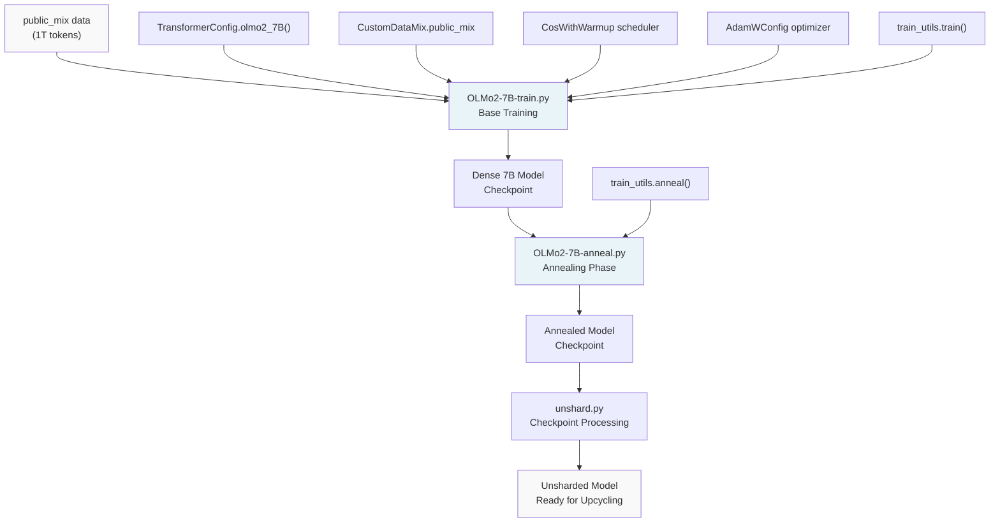
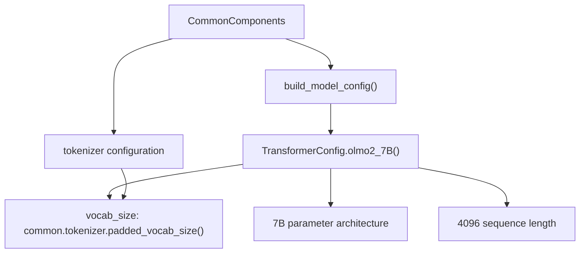
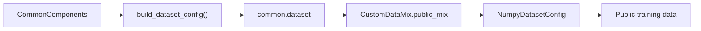
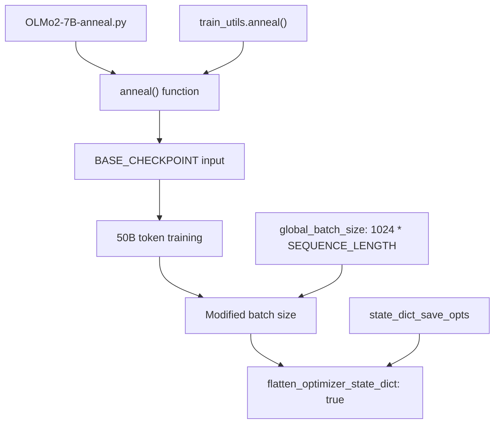
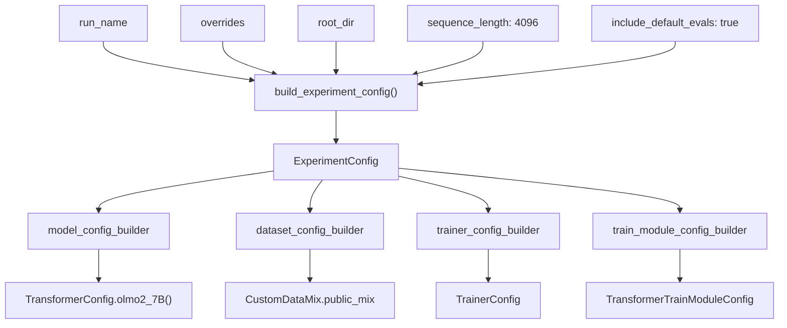
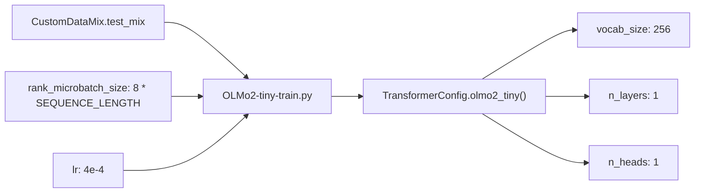
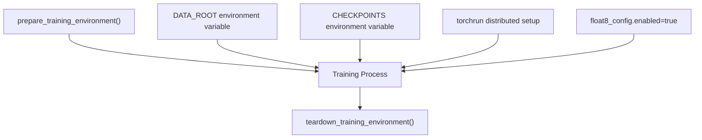

<!-- source: DeepWiki mcp.deepwiki.com · repo allenai/FlexOlmo · page 3.1 Public Model Training · fetched 2026-10-26 -->

# Public Model Training

<details>
<summary>Relevant source files</summary>

The following files were used as context for generating this wiki page:

- [scripts/README.md](scripts/README.md)
- [scripts/combine_experts.sh](scripts/combine_experts.sh)
- [scripts/train_public_model.sh](scripts/train_public_model.sh)
- [src/scripts/train/OLMo2-7B-anneal.py](src/scripts/train/OLMo2-7B-anneal.py)
- [src/scripts/train/OLMo2-7B-finetune.py](src/scripts/train/OLMo2-7B-finetune.py)
- [src/scripts/train/OLMo2-7B-train.py](src/scripts/train/OLMo2-7B-train.py)
- [src/scripts/train/OLMo2-tiny-train.py](src/scripts/train/OLMo2-tiny-train.py)

</details>


This document covers the first stage of the FlexOlmo training pipeline: training a base dense model on public data. This stage produces a foundation model that serves as the starting point for expert specialization and MoE construction. For information about training domain-specific experts, see [Expert Training](#3.2). For information about combining experts into FlexOlmo models, see [Model Combination and Upcycling](#3.3).

## Overview

Public model training involves three sequential steps:

1. **Base Training**: Train a dense 7B model on public data mix for 1T tokens
2. **Annealing**: Continue training the model for 50B tokens with modified parameters
3. **Unsharding**: Convert the distributed checkpoint to a single-file format for downstream use

This process creates a high-quality base model that can be upcycled to MoE architecture or used as a seed for expert training.

## Training Pipeline Architecture

The public model training pipeline follows a linear progression through three distinct phases:



**Sources:** [scripts/train_public_model.sh:1-34](), [src/scripts/train/OLMo2-7B-train.py:1-105](), [src/scripts/train/OLMo2-7B-anneal.py:1-108]()

## Base Training Configuration

The base training phase uses the `OLMo2-7B-train.py` script with specific configuration builders that define the model architecture, data sources, and training parameters.

### Model Configuration



**Sources:** [src/scripts/train/OLMo2-7B-train.py:42-43]()

### Data Configuration

The training uses `CustomDataMix.public_mix` as the data source, configured through the `build_dataset_config()` function:



**Sources:** [src/scripts/train/OLMo2-7B-train.py:46-51]()

### Training Parameters

The training module configuration defines optimization and scheduling parameters:

| Parameter | Value | Purpose |
|-----------|-------|---------|
| `rank_microbatch_size` | `2 * SEQUENCE_LENGTH` | Memory-efficient batching |
| `scheduler` | `CosWithWarmup(warmup_steps=2000)` | Learning rate scheduling |
| `optim.lr` | `9e-4` | Base learning rate |
| `global_batch_size` | `128 * SEQUENCE_LENGTH` | Total batch size across devices |

**Sources:** [src/scripts/train/OLMo2-7B-train.py:60-67]()

## Annealing Phase

The annealing phase continues training from the base model checkpoint using modified parameters to improve model quality before downstream use.

### Annealing Configuration



**Sources:** [src/scripts/train/OLMo2-7B-anneal.py:60-68](), [scripts/train_public_model.sh:17-26]()

### Key Differences from Base Training

| Aspect | Base Training | Annealing |
|--------|---------------|-----------|
| Function | `train()` | `anneal()` |
| Batch Size | 128 * SEQUENCE_LENGTH | 1024 * SEQUENCE_LENGTH |
| Duration | 1T tokens | 50B tokens |
| State Dict Options | Default | `flatten_optimizer_state_dict: true` |
| Input | Fresh initialization | Existing checkpoint |

**Sources:** [src/scripts/train/OLMo2-7B-train.py:85-102](), [src/scripts/train/OLMo2-7B-anneal.py:87-105]()

## Experiment Configuration System

Both training phases use the `build_experiment_config()` function to create consistent experiment configurations:



**Sources:** [src/scripts/train/OLMo2-7B-train.py:85-97](), [src/scripts/train/OLMo2-7B-anneal.py:88-100]()

## Execution Scripts

### Shell Script Orchestration

The `train_public_model.sh` script orchestrates the entire public model training process:

```bash
# Base training for 1T tokens
torchrun --nproc-per-node=8 ./src/scripts/train/OLMo2-7B-train.py OLMo2-7B-public-mix

# Annealing for 50B tokens
torchrun --nproc-per-node=8 ./src/scripts/train/OLMo2-7B-anneal.py OLMo2-7B-anneal-public-mix ${BASE_CHECKPOINT}

# Unshard checkpoint
python src/scripts/utils/unshard.py -i ${MODEL_PATH} -o ${MODEL_PATH}-unsharded
```

**Sources:** [scripts/train_public_model.sh:7-30]()

### Command Line Interface

Both training scripts follow a consistent command-line interface pattern:

```
torchrun [TORCH_OPTIONS] script.py [dry_run] run_name [checkpoint] [OVERRIDES...]
```

The scripts support:
- `dry_run` flag for configuration validation
- Dynamic configuration overrides
- Checkpoint resumption (for annealing)
- Distributed training via `torchrun`

**Sources:** [src/scripts/train/OLMo2-7B-train.py:70-84](), [src/scripts/train/OLMo2-7B-anneal.py:71-86]()

## Development and Debugging

### Tiny Model Training

For development and debugging, the system includes `OLMo2-tiny-train.py` which provides a minimal training setup:



**Sources:** [src/scripts/train/OLMo2-tiny-train.py:45-51](), [src/scripts/train/OLMo2-tiny-train.py:54-78]()

## Environment Setup

The training process requires proper environment initialization:



**Sources:** [src/scripts/train/OLMo2-7B-train.py:82-104](), [scripts/train_public_model.sh:3-4]()

---

