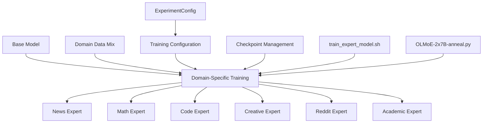
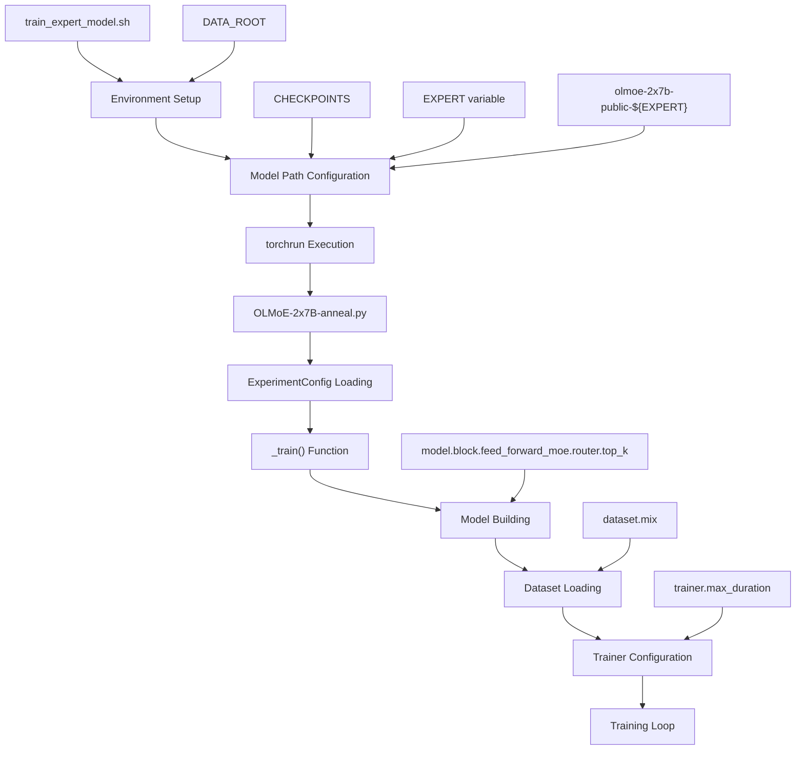
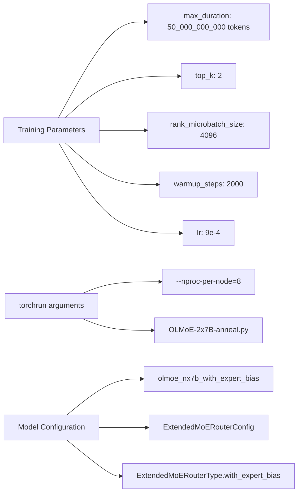
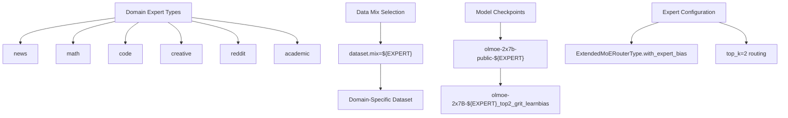
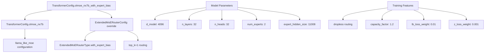
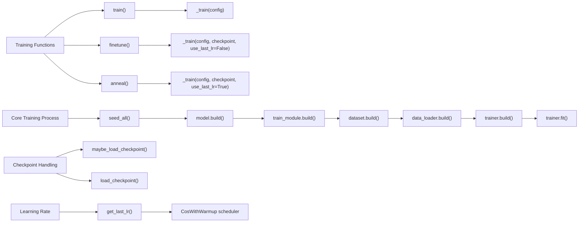
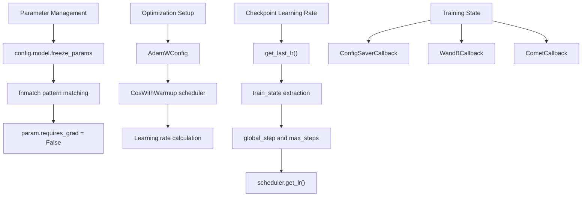
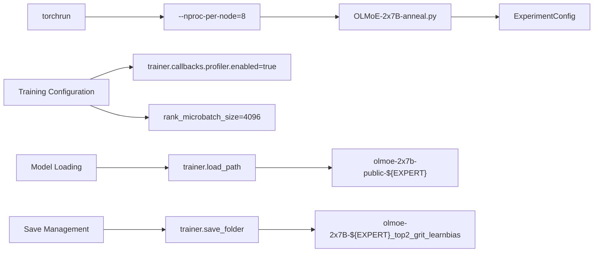

<!-- source: DeepWiki mcp.deepwiki.com · repo allenai/FlexOlmo · page 3.2 Expert Training · fetched 2026-10-26 -->

# Expert Training

Relevant source files

The following files were used as context for generating this wiki page:

- [scripts/train_expert_model.sh](scripts/train_expert_model.sh)
- [src/flexolmo/internal/__init__.py](src/flexolmo/internal/__init__.py)
- [src/flexolmo/internal/model_utils.py](src/flexolmo/internal/model_utils.py)
- [src/flexolmo/internal/train_utils.py](src/flexolmo/internal/train_utils.py)

This document covers the training of domain-specific expert models in the FlexOlmo system. Expert training is the second stage of the three-stage training pipeline, where specialized models are trained on domain-specific datasets to create experts for news, mathematics, code, creative writing, academic content, and social media. 

For information about the initial public model training, see [Public Model Training](#3.1). For information about combining trained experts into the final FlexOlmo model, see [Model Combination and Upcycling](#3.3).

## Expert Training Overview

Expert training transforms a base model into domain-specialized experts by continuing training on curated domain-specific datasets. Each expert learns to excel in its particular domain while maintaining general language capabilities from the base model.

The expert training process operates on models that have been either:
- Upcycled from dense models using domain embeddings
- Initialized from existing MoE checkpoints

Sources: [scripts/train_expert_model.sh:1-30](), [src/flexolmo/internal/train_utils.py:108-127]()

## Expert Training Workflow

### Training Script Execution

The main entry point for expert training is the `train_expert_model.sh` script, which orchestrates the entire training process:

Sources: [scripts/train_expert_model.sh:1-30](), [src/flexolmo/internal/train_utils.py:48-106]()

### Training Configuration Parameters

The expert training process uses specific configuration parameters optimized for domain specialization:

| Parameter | Value | Purpose |
|-----------|-------|---------|
| `max_duration` | 50B tokens | Training duration limit |
| `top_k` | 2 | Number of experts to route to |
| `rank_microbatch_size` | 4096 | Batch size per rank |
| `warmup_steps` | 2000 | Learning rate warmup |
| `lr` | 9e-4 | Learning rate |

Sources: [scripts/train_expert_model.sh:18-29](), [src/flexolmo/internal/model_utils.py:53-62]()

## Domain-Specific Expert Types

### Expert Specialization Areas

FlexOlmo supports training experts in multiple domains, each with specialized data mixes:

Sources: [scripts/train_expert_model.sh:6-29]()

### Model Architecture Configuration

Expert models use the `olmoe_nx7b_with_expert_bias` configuration, which extends the base MoE architecture with expert bias capabilities:

Sources: [src/flexolmo/internal/model_utils.py:53-62](), [src/flexolmo/internal/model_utils.py:27-50]()

## Training Utilities and Functions

### Core Training Functions

The `train_utils.py` module provides three main training functions for different training scenarios:

Sources: [src/flexolmo/internal/train_utils.py:108-127](), [src/flexolmo/internal/train_utils.py:48-106]()

### Parameter Freezing and Optimization

The training system supports selective parameter freezing through pattern matching:

Sources: [src/flexolmo/internal/train_utils.py:75-84](), [src/flexolmo/internal/train_utils.py:23-45]()

## Training Environment and Data

### Environment Configuration

Expert training requires specific environment setup and data access configuration:

| Environment Variable | Purpose | Default/Example |
|---------------------|---------|-----------------|
| `DATA_ROOT` | Data source location | `http://flexolmo-data.org` |
| `CHECKPOINTS` | Checkpoint storage path | `/path/to/checkpoints` |
| `EXPERT` | Expert type identifier | `news` |

The training process accesses domain-specific data through the `dataset.mix_base_dir` and `dataset.mix` configuration parameters, allowing flexible data source specification.

Sources: [scripts/train_expert_model.sh:3-6](), [scripts/train_expert_model.sh:20-21]()

### Distributed Training Setup

Expert training uses PyTorch's distributed training capabilities through `torchrun`:

Sources: [scripts/train_expert_model.sh:18-29]()

---

