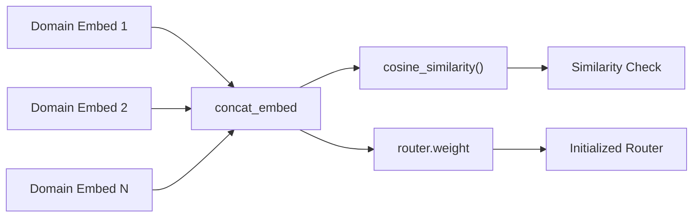
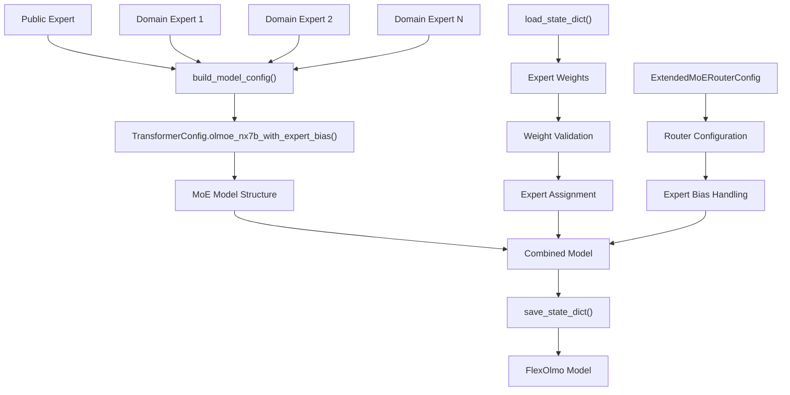
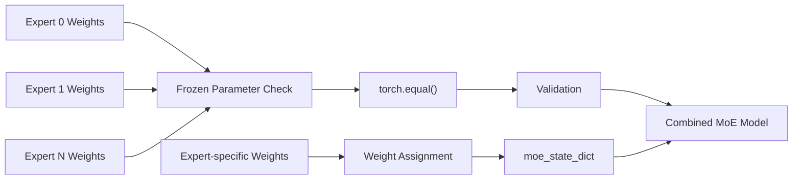
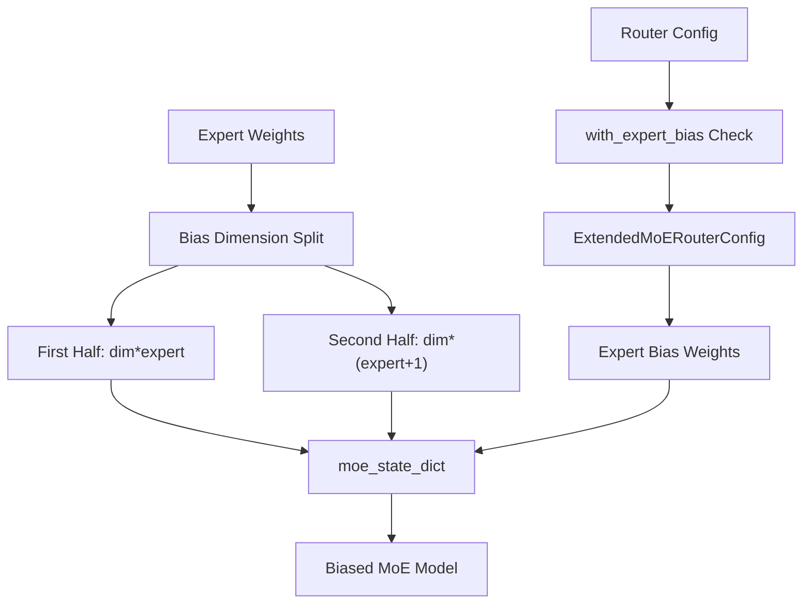
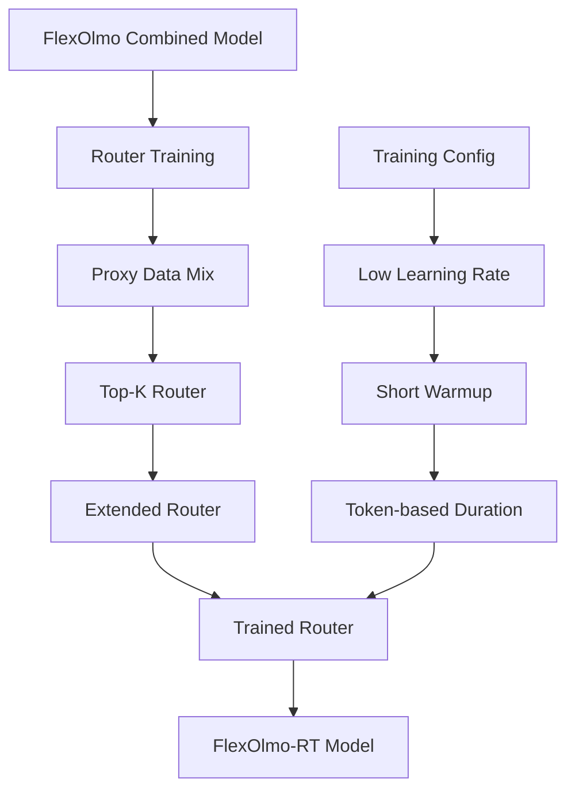
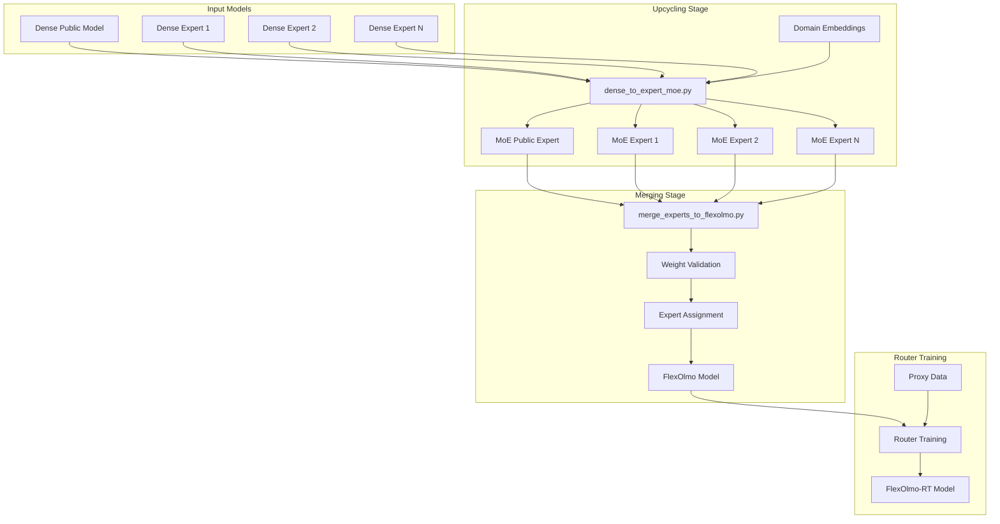

<!-- source: DeepWiki mcp.deepwiki.com · repo allenai/FlexOlmo · page 3.3 Model Combination and Upcycling · fetched 2026-10-26 -->

# Model Combination and Upcycling

Relevant source files

The following files were used as context for generating this wiki page:

- [scripts/README.md](scripts/README.md)
- [scripts/combine_experts.sh](scripts/combine_experts.sh)
- [scripts/train_public_model.sh](scripts/train_public_model.sh)
- [src/scripts/upcycle/dense_to_expert_moe.py](src/scripts/upcycle/dense_to_expert_moe.py)
- [src/scripts/upcycle/merge_experts_to_flexolmo.py](src/scripts/upcycle/merge_experts_to_flexolmo.py)

This page covers the third stage of the FlexOlmo training pipeline: combining individual expert models into a unified FlexOlmo MoE model and converting dense models to MoE format. This includes dense-to-MoE upcycling, expert merging, and optional router training on proxy data.

For information about training the initial public model, see [Public Model Training](#3.1). For information about training domain-specific experts, see [Expert Training](#3.2).

## Dense-to-MoE Upcycling

The upcycling process converts dense transformer models into Mixture of Experts (MoE) format by duplicating the feed-forward layers across multiple experts while preserving other model components.

### Upcycling Process

The `dense_to_expert_moe.py` script handles the conversion from dense models to MoE format:

```mermaid
flowchart TD
    A[Dense Model] --> B["build_model_config()"]
    B --> C["TransformerConfig.olmoe_nx7b()"]
    C --> D["MoE Model Structure"]
    
    E["load_state_dict()"] --> F["Dense Weights"]
    F --> G["Weight Mapping"]
    G --> H["Expert Weights"]
    
    I["Domain Embeddings"] --> J["Router Initialization"]
    J --> K["concat_embed"]
    K --> L["router.weight"]
    
    D --> M["Final MoE Model"]
    H --> M
    L --> M
    
    M --> N["save_state_dict()"]
    N --> O["Upcycled Model"]
```

**Dense to MoE Weight Mapping**

The script uses a mapping dictionary to convert dense model weights to MoE format:

| MoE Key | Dense Key |
|---------|-----------|
| `feed_forward_moe.experts.mlp.w1` | `feed_forward.w1.weight` |
| `feed_forward_moe.experts.mlp.w2` | `feed_forward.w2.weight` |
| `feed_forward_moe.experts.mlp.w3` | `feed_forward.w3.weight` |
| `attention.*` | `attention.*` (unchanged) |
| `embeddings.weight` | `embeddings.weight` (unchanged) |
| `lm_head.*` | `lm_head.*` (unchanged) |

**Sources:** [src/scripts/upcycle/dense_to_expert_moe.py:99-114]()

### Router Initialization

When domain embeddings are provided, the router weights are initialized using concatenated domain embeddings:

**Sources:** [src/scripts/upcycle/dense_to_expert_moe.py:120-140]()

## Expert Merging

Expert merging combines multiple separately trained expert models into a single FlexOlmo MoE model. This process handles models that were already trained in MoE format.

### Expert Merging Process

The `merge_experts_to_flexolmo.py` script combines expert models:

**Expert Weight Handling**

The merging process validates that frozen parameters match across experts and assigns expert-specific weights:

**Sources:** [src/scripts/upcycle/merge_experts_to_flexolmo.py:146-204]()

### Expert Bias Integration

The merging process handles expert bias through the `ExtendedMoERouterConfig`:

**Sources:** [src/scripts/upcycle/merge_experts_to_flexolmo.py:42-48](), [src/scripts/upcycle/merge_experts_to_flexolmo.py:172-186]()

## Router Training

After expert combination, the router can be optionally trained on proxy data to improve expert selection.

### Router Training Configuration

The router training process uses the combined FlexOlmo model as a starting point:

**Training Parameters**

| Parameter | Value | Purpose |
|-----------|-------|---------|
| `max_duration` | `5_000_000_000` tokens | Training duration |
| `top_k` | `4` | Number of experts per token |
| `lr` | `2e-3` | Learning rate |
| `warmup_steps` | `100` | Warmup steps |
| `rank_microbatch_size` | `4096` | Batch size |

**Sources:** [scripts/combine_experts.sh:17-28]()

## Complete Workflow

The complete model combination and upcycling workflow integrates all components:

**Workflow Script Integration**

The `combine_experts.sh` script orchestrates the complete workflow:

1. **Expert Merging**: Combines pre-trained experts using `merge_experts_to_flexolmo.py`
2. **Router Training**: Optionally trains the router on proxy data using the FlexOlmo training script
3. **Configuration**: Sets up data sources, checkpoint paths, and training parameters

**Sources:** [scripts/combine_experts.sh:1-28]()

### Key Configuration Components

The workflow relies on several configuration classes and functions:

| Component | Purpose | Location |
|-----------|---------|----------|
| `build_model_config()` | Creates MoE model configuration | [src/scripts/upcycle/merge_experts_to_flexolmo.py:18-29]() |
| `load_model_config()` | Loads existing model configurations | [src/scripts/upcycle/merge_experts_to_flexolmo.py:32-52]() |
| `TransformerConfig.olmoe_nx7b_with_expert_bias()` | MoE config with expert bias | [src/scripts/upcycle/merge_experts_to_flexolmo.py:20]() |
| `ExtendedMoERouterConfig` | Router configuration for expert bias | [src/scripts/upcycle/merge_experts_to_flexolmo.py:48]() |
| `save_state_dict()` | Saves combined model weights | [src/scripts/upcycle/merge_experts_to_flexolmo.py:206]() |

**Sources:** [src/scripts/upcycle/merge_experts_to_flexolmo.py:1-218](), [src/scripts/upcycle/dense_to_expert_moe.py:1-212](), [scripts/combine_experts.sh:1-28]()

---

