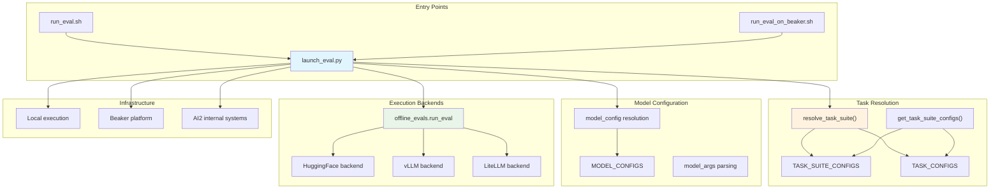
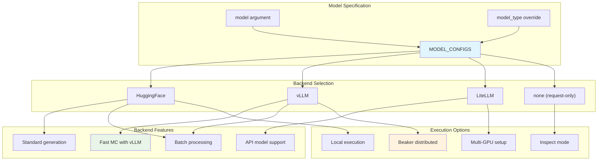

<!-- source: DeepWiki mcp.deepwiki.com · repo allenai/FlexOlmo · page 4 Evaluation System · fetched 2026-10-26 -->

# Evaluation System

Relevant source files

The following files were used as context for generating this wiki page:

- [src/scripts/beaker/run_eval_on_beaker.sh](src/scripts/beaker/run_eval_on_beaker.sh)
- [src/scripts/eval/launch_eval.py](src/scripts/eval/launch_eval.py)
- [src/scripts/eval/run_eval.sh](src/scripts/eval/run_eval.sh)
- [src/scripts/eval/setup_eval_env.sh](src/scripts/eval/setup_eval_env.sh)

The FlexOlmo evaluation system provides a comprehensive framework for benchmarking language models across multiple task types, model backends, and execution environments. It supports distributed evaluation on various platforms and provides standardized metrics for model comparison and analysis.

This document covers the high-level architecture and orchestration of the evaluation system. For detailed information on specific components, see [Evaluation Pipeline](#4.1) for task execution mechanics, [Task Configuration and Suites](#4.2) for task definitions, [Results Analysis and Reporting](#4.3) for metrics handling, and [Model Backends](#4.4) for model integration details.

## System Architecture

The evaluation system follows a modular architecture with clear separation between task orchestration, model backends, and result processing:

**Evaluation System Architecture**

Sources: [src/scripts/eval/run_eval.sh:1-80](), [src/scripts/eval/launch_eval.py:1-414](), [src/scripts/beaker/run_eval_on_beaker.sh:1-21]()

## Task Suite Organization

The evaluation system organizes tasks into predefined suites for systematic benchmarking across different domains:

**Task Suite Structure**

```mermaid
graph TB
    subgraph "Task Suites"
        A["mc9 suite"]
        B["gen5 suite"]
        C["mmlu suite"]
        D["math2 suite"]
        E["code4 suite"]
        F["bbh suite"]
        G["agi_eval suite"]
    end
    
    subgraph "MC9 Tasks"
        H["arc_easy:mc::olmes"]
        I["arc_challenge:mc::olmes"]
        J["boolq:mc::olmes"]
        K["csqa:mc::olmes"]
        L["hellaswag:mc::olmes"]
        M["openbookqa:mc::olmes"]
        N["piqa:mc::olmes"]
        O["socialiqa:mc::olmes"]
        P["winogrande:mc::olmes"]
    end
    
    subgraph "Gen5 Tasks"
        Q["coqa::olmes"]
        R["squad::olmes"]
        S["naturalqs::olmes"]
        T["triviaqa::olmes"]
        U["drop::olmes"]
    end
    
    subgraph "Math2 Tasks"
        V["gsm8k::olmes"]
        W["minerva_math_algebra::olmes"]
        X["minerva_math_geometry::olmes"]
        Y["minerva_math_number_theory::olmes"]
    end
    
    A --> H
    A --> I
    A --> J
    A --> K
    A --> L
    A --> M
    A --> N
    A --> O
    A --> P
    
    B --> Q
    B --> R
    B --> S
    B --> T
    B --> U
    
    D --> V
    D --> W
    D --> X
    D --> Y
    
    style A fill:#e1f5fe
    style B fill:#e8f5e8
    style D fill:#fff3e0
```

Sources: [src/scripts/eval/run_eval.sh:11-59]()

## Evaluation Workflow

The evaluation process follows a standardized pipeline from task specification to result aggregation:

**Evaluation Execution Flow**

```mermaid
flowchart TD
    A["CLI Arguments"] --> B["launch_eval()"]
    B --> C["Task Resolution"]
    C --> D["resolve_task_suite()"]
    D --> E["Individual Tasks"]
    
    B --> F["Model Configuration"]
    F --> G["MODEL_CONFIGS lookup"]
    G --> H["Model Backend Selection"]
    
    E --> I["Task Config Creation"]
    I --> J["Batch Processing"]
    J --> K["Backend Execution"]
    
    H --> L["HF Backend"]
    H --> M["vLLM Backend"]
    H --> N["LiteLLM Backend"]
    
    K --> L
    K --> M
    K --> N
    
    L --> O["run_eval_command"]
    M --> O
    N --> O
    
    O --> P["offline_evals.run_eval"]
    P --> Q["Results Output"]
    
    R["Internal Args"] --> S["process_internal_args()"]
    S --> T["Beaker Integration"]
    T --> U["launch_internal()"]
    
    B --> R
    U --> P
    
    style B fill:#e1f5fe
    style D fill:#fff3e0
    style P fill:#e8f5e8
```

Sources: [src/scripts/eval/launch_eval.py:198-398]()

## Configuration Management

The system uses hierarchical configuration management for models, tasks, and execution parameters:

| Configuration Type | Source | Purpose |
|-------------------|---------|---------|
| `MODEL_CONFIGS` | `oe_eval.configs.models` | Model-specific parameters and backends |
| `TASK_CONFIGS` | `get_task_configs()` | Individual task specifications |
| `TASK_SUITE_CONFIGS` | `get_task_suite_configs()` | Task suite definitions |
| CLI Arguments | `argparse` | Runtime parameter overrides |
| Internal Args | `process_internal_args()` | AI2 platform integration |

Sources: [src/scripts/eval/launch_eval.py:15-63](), [src/scripts/eval/launch_eval.py:264-283]()

## Backend Integration

The evaluation system supports multiple model backends with automatic selection based on model configuration:

**Model Backend Architecture**

Sources: [src/scripts/eval/launch_eval.py:264-283](), [src/scripts/eval/launch_eval.py:137-140]()

## Execution Environments

The system supports flexible execution across different computational environments:

### Local Execution
- Automatic GPU detection
- Configurable batch sizes and worker counts
- Environment setup via `setup_eval_env.sh`

### Beaker Platform Integration
- Distributed evaluation across multiple nodes
- Automatic resource management
- Integration with AI2 internal systems

### Development Features
- `--inspect` mode for rapid task debugging with small models
- `--dry-run` for command validation
- Task and model library listing utilities

Sources: [src/scripts/eval/launch_eval.py:254-259](), [src/scripts/beaker/run_eval_on_beaker.sh:1-21](), [src/scripts/eval/setup_eval_env.sh:1-5]()

## Key Components

### Main Entry Points
- `run_eval.sh` - Shell script for task suite execution
- `launch_eval.py` - Python orchestration with argument parsing
- `run_eval_on_beaker.sh` - Beaker platform integration

### Core Functions
- `launch_eval()` - Main evaluation orchestration function
- `resolve_task_suite()` - Recursive task suite resolution
- `make_cli_command()` - Command line generation for backends

### Configuration Resolution
- Model configuration lookup and override handling
- Task configuration merging with runtime parameters
- Backend-specific parameter adaptation

Sources: [src/scripts/eval/launch_eval.py:198-398](), [src/scripts/eval/launch_eval.py:187-196]()

---

