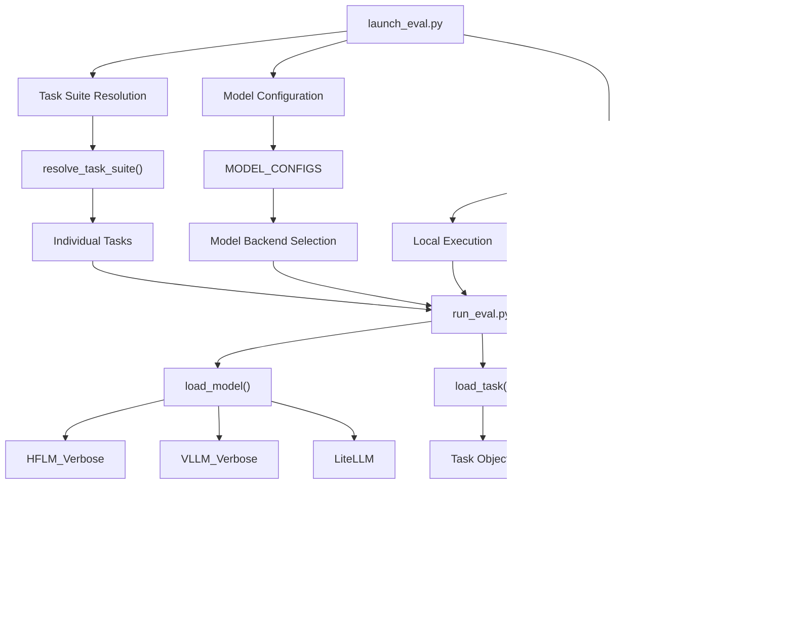
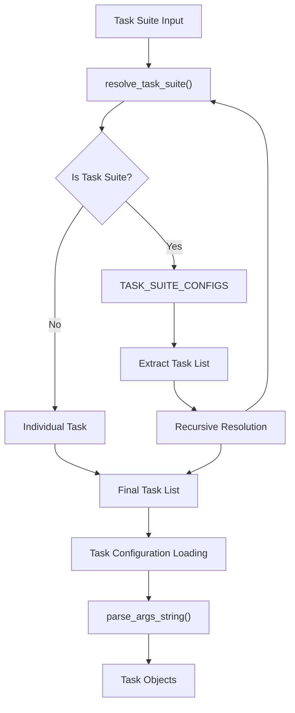
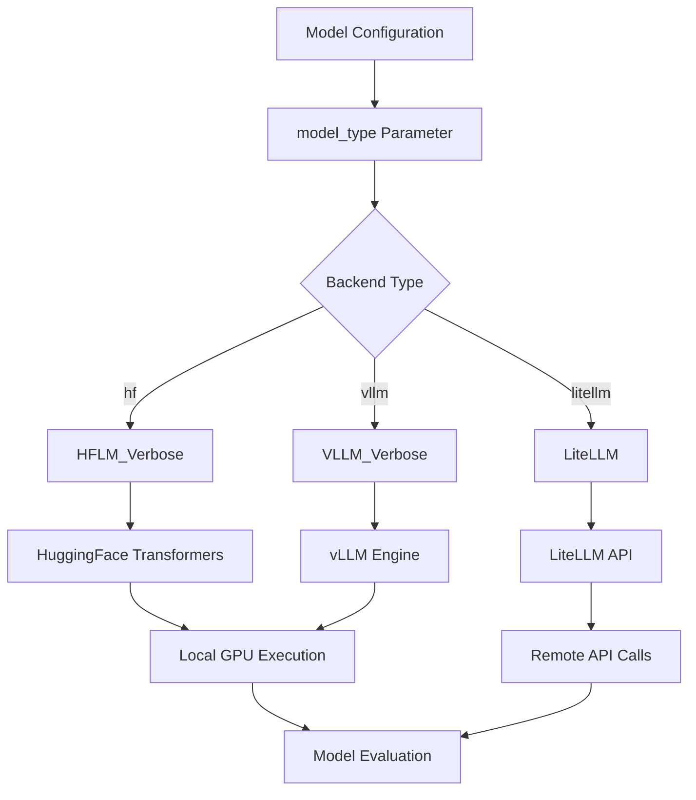
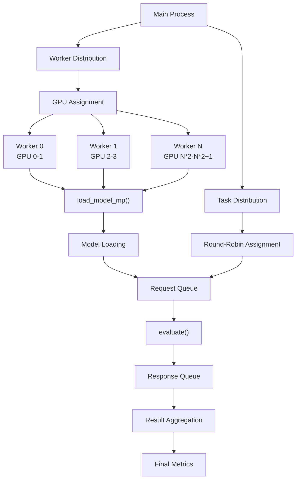
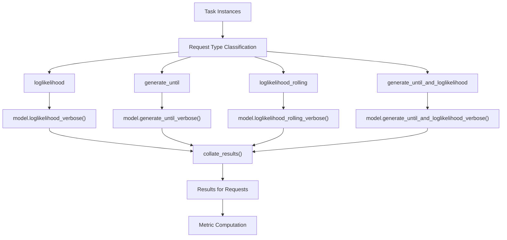
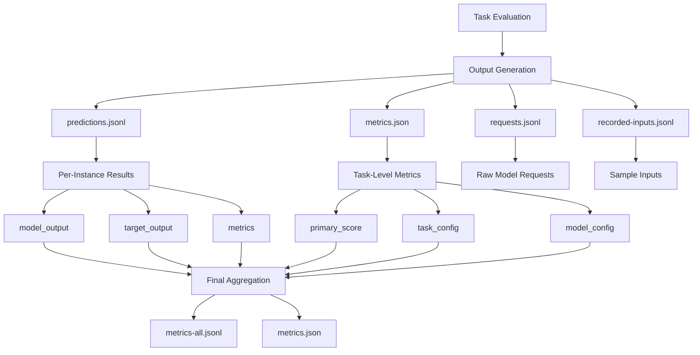
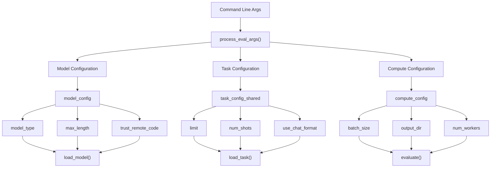
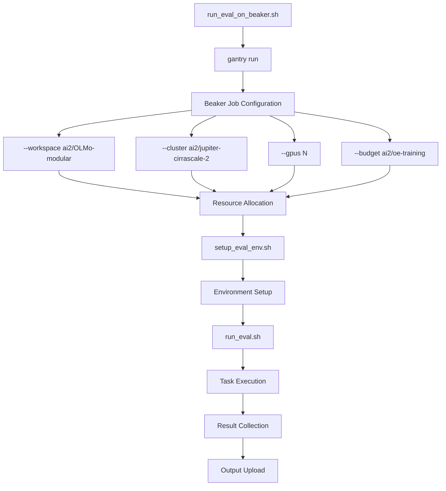

<!-- source: DeepWiki mcp.deepwiki.com · repo allenai/FlexOlmo · page 4.1 Evaluation Pipeline · fetched 2026-10-26 -->

# Evaluation Pipeline

<details>
<summary>Relevant source files</summary>

The following files were used as context for generating this wiki page:

- [src/offline_evals/run_eval.py](src/offline_evals/run_eval.py)
- [src/scripts/beaker/run_eval_on_beaker.sh](src/scripts/beaker/run_eval_on_beaker.sh)
- [src/scripts/eval/launch_eval.py](src/scripts/eval/launch_eval.py)
- [src/scripts/eval/run_eval.sh](src/scripts/eval/run_eval.sh)
- [src/scripts/eval/setup_eval_env.sh](src/scripts/eval/setup_eval_env.sh)
- [src/scripts/eval/task_suites.py](src/scripts/eval/task_suites.py)
- [src/scripts/eval/tasks.py](src/scripts/eval/tasks.py)

</details>


The evaluation pipeline provides a comprehensive framework for evaluating language models across multiple tasks, supporting various model backends and execution environments. It orchestrates the entire evaluation process from task configuration to result aggregation and reporting.

For information about specific task configurations and suites, see [Task Configuration and Suites](#4.2). For details about model backends, see [Model Backends](#4.4). For result analysis and reporting capabilities, see [Results Analysis and Reporting](#4.3).

## Core Architecture

The evaluation pipeline consists of three main components: the launch orchestrator, the evaluation runner, and the task execution system. The `launch_eval.py` script serves as the main entry point, resolving task suites and model configurations before delegating to the core evaluation runner.

### Evaluation Flow Overview



**Sources:** [src/scripts/eval/launch_eval.py:1-414](), [src/offline_evals/run_eval.py:1-986]()

## Task Suite Resolution

The pipeline supports predefined task suites that group related evaluation tasks. The `resolve_task_suite` function recursively expands task suites into individual tasks, handling nested suites and maintaining parent-child relationships.

### Task Suite Resolution Process



The system recognizes several predefined task suites:

| Task Suite | Tasks | Description |
|------------|-------|-------------|
| `mc9` | 9 multiple choice tasks | ARC, BoolQ, CommonsenseQA, HellaSwag, etc. |
| `gen5` | 5 generation tasks | CoQA, SQuAD, Natural Questions, TriviaQA, DROP |
| `math2` | 8 mathematics tasks | GSM8K, Minerva Math variants |
| `code4` | 4 coding tasks | HumanEval, MBPP variants |
| `mmlu` | MMLU benchmark | Massive Multitask Language Understanding |
| `bbh` | Big-Bench Hard | Chain-of-thought reasoning tasks |

**Sources:** [src/scripts/eval/launch_eval.py:187-196](), [src/scripts/eval/run_eval.sh:11-59](), [src/scripts/eval/task_suites.py:1-20]()

## Model Backend System

The evaluation pipeline supports multiple model backends to optimize performance for different types of tasks and deployment scenarios. Each backend implements the `TemplateLM` interface for consistent evaluation.

### Model Backend Selection



### Backend Configuration

Each model backend can be configured with specific parameters:

```python
# HuggingFace Backend
model_config = {
    "model_type": "hf",
    "trust_remote_code": True,
    "max_length": 4096
}

# vLLM Backend  
model_config = {
    "model_type": "vllm",
    "vllm_for_mc": True,  # Optimized MC scoring
    "tensor_parallel_size": 2
}

# LiteLLM Backend
model_config = {
    "model_type": "litellm",
    "api_base": "https://api.openai.com/v1"
}
```

**Sources:** [src/offline_evals/run_eval.py:405-424](), [src/offline_evals/run_eval.py:290-296]()

## Multi-GPU and Multi-Worker Execution

The evaluation system supports distributed execution across multiple GPUs and workers to accelerate evaluation of large models and task suites.

### Multi-Process Execution Architecture



The multi-worker system distributes evaluation instances across workers in round-robin fashion:

```python
# Worker distribution logic
instance_batches = [[] for _ in range(workers)]
for i, item in enumerate(task_instances):
    sublist_index = i % workers
    instance_batches[sublist_index].append(item)
```

**Sources:** [src/offline_evals/run_eval.py:591-624](), [src/offline_evals/run_eval.py:794-821]()

## Task Execution and Evaluation

The core evaluation process handles different types of model requests: loglikelihood scoring, text generation, and hybrid tasks. The `evaluate` function routes requests to appropriate model methods based on request type.

### Request Type Processing



### Chat Format Conversion

For chat-based models, the system converts structured chat messages to appropriate input strings:

```python
def convert_chat_instance(model, ins, chat_template=None):
    if not isinstance(ins.request.context, str):
        messages = ins.request.context["messages"]
        assistant_prefix = ins.request.context.get("assistant_prefix", "")
        
        if chat_template:
            context = CHAT_TEMPLATES[chat_template](messages, tokenizer=None)
        else:
            context = model.tokenizer.apply_chat_template(
                messages, tokenize=False, add_generation_prompt=True
            )
        
        ins.request.context = context + assistant_prefix
    return ins
```

**Sources:** [src/offline_evals/run_eval.py:230-266](), [src/offline_evals/run_eval.py:208-228]()

## Result Collection and Output

The evaluation pipeline produces multiple output formats for different use cases, including detailed predictions, aggregated metrics, and external reporting to Google Sheets and Weights & Biases.

### Output File Structure



### External Reporting Integration

The system supports multiple external reporting mechanisms:

| Output Type | Function | Description |
|-------------|----------|-------------|
| Google Sheets | `write_metrics_to_gsheet()` | Automated result reporting |
| HuggingFace Hub | `upload_to_hf()` | Dataset upload for sharing |
| Weights & Biases | `wandb_log_metrics()` | Experiment tracking |
| Remote Storage | `upload_directory()` | S3/remote backup |

**Sources:** [src/offline_evals/run_eval.py:880-897](), [src/offline_evals/run_eval.py:898-902](), [src/offline_evals/run_eval.py:941-979]()

## Configuration and Customization

The evaluation pipeline supports extensive configuration through command-line arguments and configuration files. Key configuration categories include model parameters, task parameters, and compute parameters.

### Configuration Processing



### Key Configuration Parameters

| Parameter | Purpose | Default |
|-----------|---------|---------|
| `--model` | Model name/path | Required |
| `--model-type` | Backend selection | `hf` |
| `--batch-size` | Evaluation batch size | `1` |
| `--limit` | Max instances per task | No limit |
| `--num-shots` | Few-shot examples | Task-specific |
| `--gpus` | Number of GPUs | `1` |
| `--num-workers` | Parallel workers | `1` |

**Sources:** [src/offline_evals/run_eval.py:268-348](), [src/scripts/eval/launch_eval.py:67-194]()

## Platform Integration

The evaluation pipeline integrates with the Beaker platform for distributed computing and supports both local and remote execution environments.

### Beaker Integration



The Beaker integration handles:
- GPU resource allocation
- Environment setup and dependencies
- Distributed job execution
- Result collection and storage

**Sources:** [src/scripts/beaker/run_eval_on_beaker.sh:1-21](), [src/scripts/eval/setup_eval_env.sh:1-5]()

---

