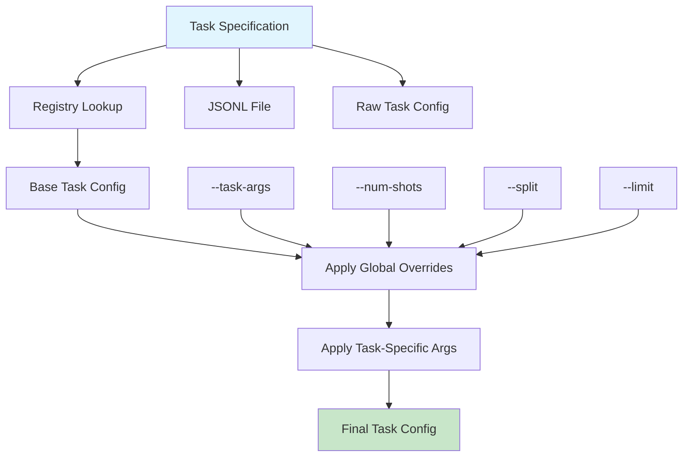
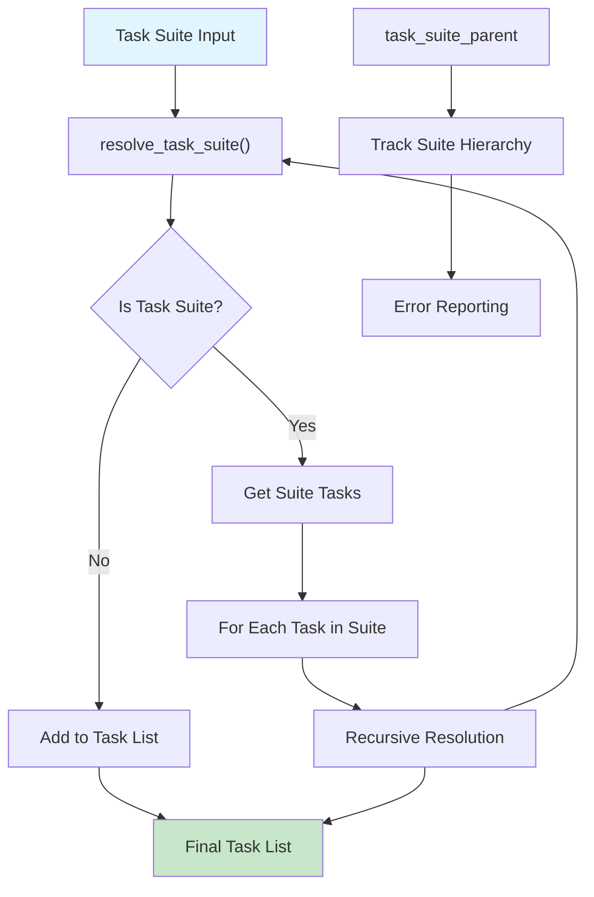
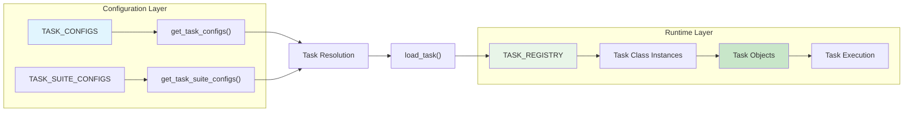
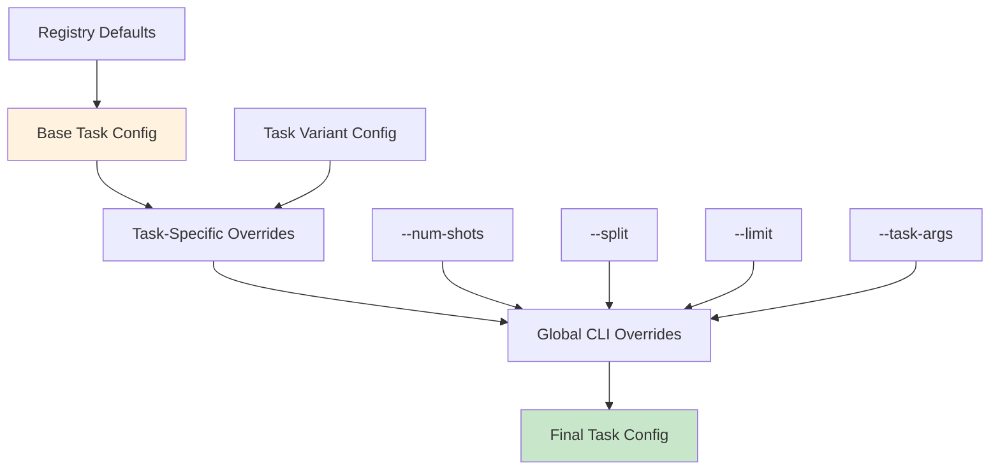
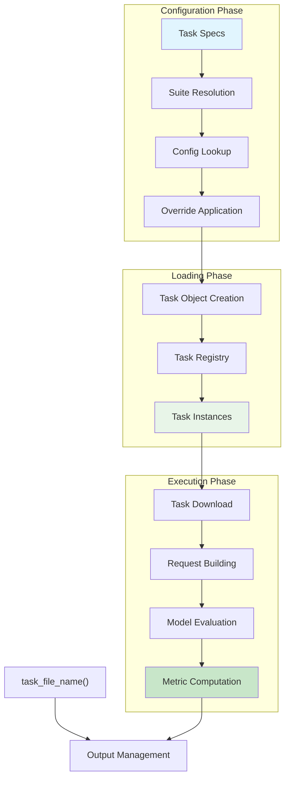

<!-- source: DeepWiki mcp.deepwiki.com · repo allenai/FlexOlmo · page 4.2 Task Configuration and Suites · fetched 2026-10-26 -->

# Task Configuration and Suites

<details>
<summary>Relevant source files</summary>

The following files were used as context for generating this wiki page:

- [src/offline_evals/run_eval.py](src/offline_evals/run_eval.py)
- [src/scripts/eval/launch_eval.py](src/scripts/eval/launch_eval.py)
- [src/scripts/eval/task_suites.py](src/scripts/eval/task_suites.py)
- [src/scripts/eval/tasks.py](src/scripts/eval/tasks.py)

</details>


This document covers the configuration and organization of evaluation tasks and task suites in FlexOlmo's evaluation system. It describes how individual tasks are configured, how they are grouped into task suites, and how these configurations are resolved and loaded during evaluation execution.

For information about the evaluation pipeline orchestration, see [Evaluation Pipeline](#4.1). For details about model backends used during evaluation, see [Model Backends](#4.4).

## Task Configuration Structure

Tasks in FlexOlmo are defined through structured configuration dictionaries that specify all aspects of task execution, from data loading to metric computation. Each task configuration contains several key components:

### Core Task Parameters

Every task configuration includes fundamental parameters that define the task's identity and basic execution parameters:

- `task_name`: The base task identifier used to locate the task in the registry
- `primary_metric`: The main metric used for evaluation scoring
- `num_shots`: Number of few-shot examples to include in prompts
- `split`: Dataset split to use for evaluation (e.g., "validation", "test")
- `limit`: Maximum number of instances to evaluate
- `use_chat_format`: Whether to format prompts using chat templates

### Configuration Parameter Categories

Task configurations are organized into several parameter categories that control different aspects of task execution:

| Parameter Category | Purpose | Example Parameters |
|-------------------|---------|-------------------|
| `context_kwargs` | Controls prompt construction and formatting | `prompt_variant`, `assistant_prefix`, `question_prefix` |
| `generation_kwargs` | Controls text generation parameters | `temperature`, `top_p`, `do_sample`, `stop_sequences`, `repeats` |
| `metric_kwargs` | Controls metric computation | `pass_at_ks`, `verbose_token_logits` |
| `metadata` | Task metadata and classification | `regimes`, `pass_at_ks` |

### Task Configuration Resolution

The system supports multiple ways to specify task configurations, with a hierarchical override system:



Sources: [src/scripts/eval/launch_eval.py:283-330](), [src/offline_evals/run_eval.py:298-316]()

## Task Suites

Task suites provide a way to group related tasks together for batch evaluation. They enable easy execution of standardized evaluation benchmarks and domain-specific task collections.

### Task Suite Structure

Task suites are defined in `TASK_SUITE_CONFIGS` with the following structure:

```python
{
    "suite_name": {
        "tasks": ["task1", "task2", "nested_suite"],
        "primary_metric": "macro"  # Optional aggregation metric
    }
}
```

### Task Suite Resolution Process

The `resolve_task_suite` function recursively expands task suites into individual tasks, supporting nested suites:



Sources: [src/scripts/eval/launch_eval.py:187-196](), [src/scripts/eval/launch_eval.py:284-288]()

### Example Task Suite Configuration

The system includes predefined task suites like `sciriff5`, which demonstrates the grouping of related scientific tasks:

```python
"sciriff5": {
    "tasks": [
        "sciriff_bioasq_factoid_qa",
        "sciriff_bioasq_general_qa", 
        "sciriff_bioasq_yesno_qa",
        "sciriff_covid_deepset_qa",
        "sciriff_pubmedqa_qa"
    ],
    "primary_metric": "macro"
}
```

Sources: [src/scripts/eval/task_suites.py:6-19]()

## Task Registry and Loading

The evaluation system uses a two-stage process for task management: configuration lookup and task object instantiation.

### Configuration Registries

The system maintains separate registries for tasks and task suites:



### Task Object Creation

The `load_task` function creates executable task objects from configurations:

```python
def load_task(task_config: dict, output_dir: Optional[str] = None) -> Task:
    task_args = copy.deepcopy(task_config)
    task_name = task_args.pop("task_name")
    
    if task_name in TASK_REGISTRY:
        task_obj = TASK_REGISTRY[task_name](task_name=task_name, task_config=task_args)
    elif task_name.startswith("eleuther"):
        task_obj = EleutherTask(task_name=task_name, task_config=task_args)
    else:
        raise ValueError(f"Task {task_name} not found in the task registry!")
```

Sources: [src/offline_evals/run_eval.py:454-485]()

## Task Configuration Examples

The system supports multiple configuration variants for the same base task, allowing for different evaluation scenarios:

### Code Generation Task Variants

Multiple variants of coding tasks demonstrate the flexibility of the configuration system:

| Task Variant | Chat Format | Temperature | Prompt Style | Use Case |
|-------------|-------------|-------------|--------------|----------|
| `mbpp::none` | False | 0.8 | Direct completion | Base evaluation |
| `mbpp::evalplus` | True | Default | Chat-formatted | Instruction-tuned models |
| `mbppplus::openinstruct` | True | 0.1 | OpenInstruct style | Low-temperature sampling |
| `mbppplus::deepseek` | True | Default | DeepSeek style | Alternative prompting |

### Configuration Parameter Inheritance

Task configurations support parameter inheritance and override patterns:



Sources: [src/scripts/eval/tasks.py:1-285](), [src/scripts/eval/launch_eval.py:314-330]()

## Task Processing Pipeline

The complete task processing pipeline integrates configuration resolution with task execution:



Sources: [src/offline_evals/run_eval.py:537-540](), [src/offline_evals/run_eval.py:645-685]()

---

