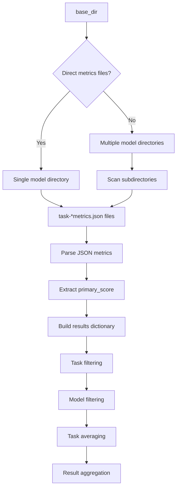
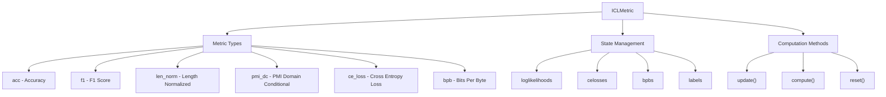
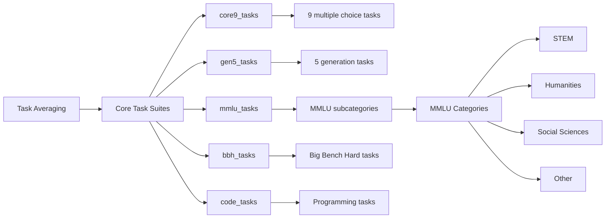
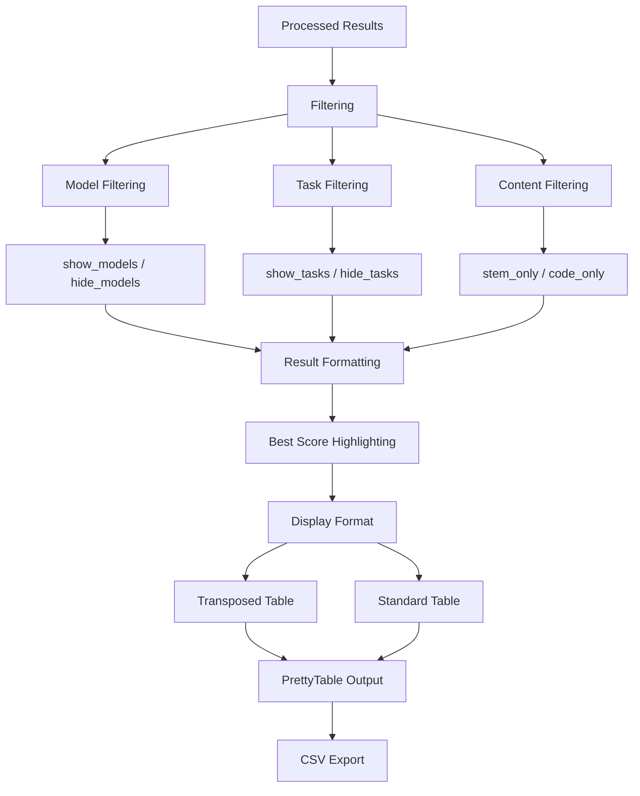
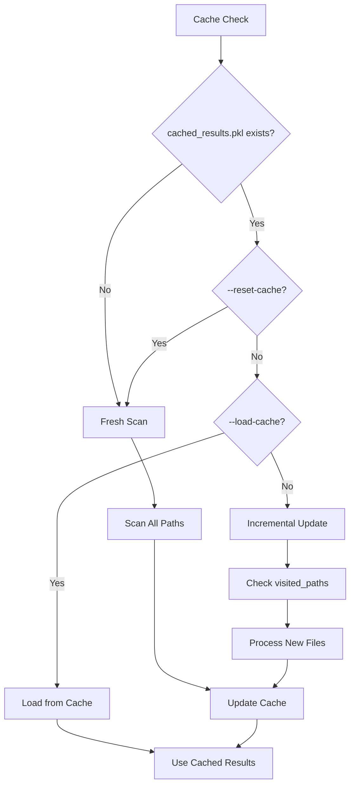
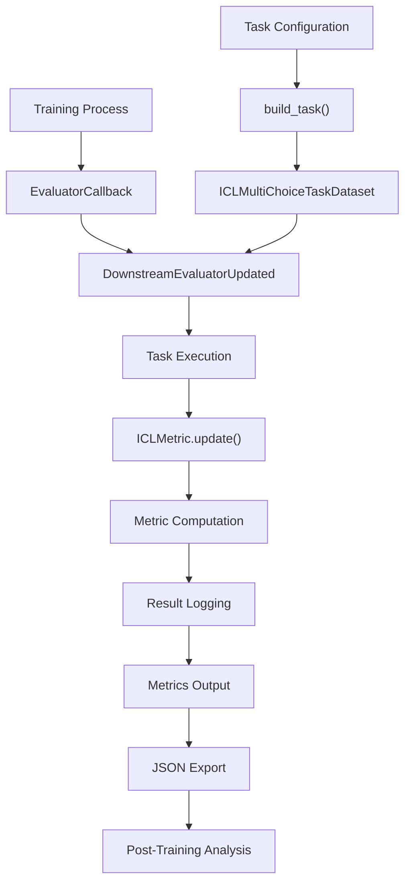

<!-- source: DeepWiki mcp.deepwiki.com · repo allenai/FlexOlmo · page 4.3 Results Analysis and Reporting · fetched 2026-10-26 -->

# Results Analysis and Reporting

<details>
<summary>Relevant source files</summary>

The following files were used as context for generating this wiki page:

- [src/flexolmo/eval/__init__.py](src/flexolmo/eval/__init__.py)
- [src/flexolmo/eval/evaluator_callback.py](src/flexolmo/eval/evaluator_callback.py)
- [src/flexolmo/eval/metrics.py](src/flexolmo/eval/metrics.py)
- [src/flexolmo/eval/tasks.py](src/flexolmo/eval/tasks.py)
- [src/scripts/eval/print_evals.py](src/scripts/eval/print_evals.py)

</details>


This document covers the evaluation result analysis and reporting capabilities in FlexOlmo. The system provides comprehensive tools for collecting, aggregating, analyzing, and visualizing evaluation results from trained models across multiple tasks and benchmarks.

For information about the evaluation pipeline execution and task configuration, see [Evaluation Pipeline](#4.1) and [Task Configuration and Suites](#4.2).

## Purpose and Scope

The results analysis and reporting system handles post-evaluation processing of model performance metrics. It supports:

- Collection of evaluation results from local and remote storage
- Aggregation and averaging across task suites
- Performance comparison between multiple models
- Flexible filtering and display options
- Export to multiple formats (tables, CSV, spreadsheets)

## Result Collection and Aggregation

The primary tool for result analysis is the `print_evals.py` script, which automatically discovers and processes evaluation results from structured directories.

### Result Discovery Flow



**Result File Structure**
```
evaluations/
├── model1/
│   ├── task-arc_easy_mc-metrics.json
│   ├── task-mmlu_biology_mc-metrics.json
│   └── task-gsm8k-metrics.json
├── model2/
│   ├── task-arc_easy_mc-metrics.json
│   └── task-hellaswag_mc-metrics.json
└── cached_results.pkl
```

Sources: [src/scripts/eval/print_evals.py:288-340]()

### Metrics JSON Format

Each evaluation produces a structured metrics file containing task metadata and performance scores:

```json
{
  "task_name": "arc_easy:mc",
  "metrics": {
    "primary_score": 0.825,
    "ce_loss": 0.412,
    "bpb": 1.203,
    "soft": 0.891,
    "soft_log": -0.234
  }
}
```

The `primary_score` field serves as the main performance metric for comparison and ranking.

Sources: [src/scripts/eval/print_evals.py:328-332]()

## Metric Computation System

The core metrics are computed by the `ICLMetric` class during evaluation and stored in the results files.

### ICLMetric Architecture



**Metric Computation Flow**
1. **Update Phase**: Collect logits and batch data during evaluation
2. **Aggregation Phase**: Synchronize across distributed processes
3. **Computation Phase**: Calculate final metrics from collected data

Sources: [src/flexolmo/eval/metrics.py:24-293]()

### Supported Metric Types

| Metric Type | Description | Use Case |
|-------------|-------------|----------|
| `acc` | Standard accuracy | Multiple choice tasks |
| `f1` | F1 score | Classification with class imbalance |
| `len_norm` | Length-normalized accuracy | Variable-length completions |
| `pmi_dc` | PMI domain conditional | Domain-specific evaluation |
| `ce_loss` | Cross-entropy loss | Generation quality |
| `bpb` | Bits per byte | Compression efficiency |

Sources: [src/flexolmo/eval/metrics.py:28-40]()

## Task Suite Aggregation

The system supports automatic aggregation of related tasks into higher-level suites for simplified analysis.

### Task Grouping System



**Core Task Suites**
- **Core9**: `arc_easy`, `arc_challenge`, `boolq`, `csqa`, `hellaswag`, `openbookqa`, `piqa`, `socialiqa`, `winogrande`
- **Gen5**: `coqa`, `squad`, `naturalqs_open`, `triviaqa`, `drop`
- **MMLU**: All MMLU subtasks grouped by category

Sources: [src/scripts/eval/print_evals.py:342-433]()

### Averaging Implementation

```python
def avg_tasks(results, label, task_names):
    """Average scores across multiple tasks into a single metric."""
    for model_name in results:
        if np.all([task_name in results[model_name] for task_name in task_names]):
            results[model_name][label] = np.mean(
                [results[model_name][task_name] for task_name in task_names]
            )
```

Sources: [src/scripts/eval/print_evals.py:237-247]()

## Result Display and Formatting

The system provides flexible display options for result visualization and comparison.

### Display Pipeline



**Table Formatting Options**
- **Standard**: Tasks as rows, models as columns
- **Transposed**: Models as rows, tasks as columns
- **Highlighting**: Best scores highlighted in red
- **Export**: CSV format for external analysis

Sources: [src/scripts/eval/print_evals.py:518-574]()

### Result Comparison Features

```python
def format_number(v, task_name):
    """Format score with best result highlighting."""
    is_best = np.abs(v - best_results[task_name]) < 0.001 if v is not None else False
    v = f"{v:.3f}" if v is not None else "-"
    return colored(v, "red") if is_best else v
```

The system automatically identifies and highlights the best performing model for each task.

Sources: [src/scripts/eval/print_evals.py:522-526]()

## Storage and Caching

The system implements intelligent caching to avoid reprocessing results across multiple analysis runs.

### Cache Management



**Cache Structure**
- **Results Dictionary**: `{model_name: {task_name: score}}`
- **Visited Paths**: Set of processed metric file paths
- **Persistence**: Pickle format for fast loading

Sources: [src/scripts/eval/print_evals.py:260-339]()

## Integration with Training Pipeline

The evaluation callback system integrates results reporting with the training process.

### Training Integration Flow



**Callback Configuration**
```python
@dataclass
class DownstreamEvaluatorUpdatedCallbackConfig(CallbackConfig):
    tasks: List[str]
    tokenizer: TokenizerConfig
    eval_interval: int = 1000
    eval_duration: Duration = field(default_factory=lambda: Duration.epochs(1))
    log_interval: int = 5
    enabled: bool = True
```

Sources: [src/flexolmo/eval/evaluator_callback.py:146-153]()

## Command Line Interface

The `print_evals.py` script provides a comprehensive CLI for result analysis.

### Key Command Options

| Option | Description | Example |
|--------|-------------|---------|
| `--base-dir` | Directory containing results | `./evaluations/` |
| `--transpose` | Transpose table layout | `-t` |
| `--export-csv` | Export to CSV file | `--export-csv results.csv` |
| `--avg-core` | Average core 9 tasks | `--avg-core` |
| `--avg-mmlu` | Average MMLU tasks | `--avg-mmlu` |
| `--show-models` | Filter models to show | `--show-models model1,model2` |
| `--hide-tasks` | Filter tasks to hide | `--hide-tasks arc,boolq` |

**Usage Examples**
```bash
# Basic results display
python print_evals.py --base-dir ./evaluations/

# Export with averaging
python print_evals.py --base-dir ./evaluations/ --avg-core --avg-mmlu --export-csv results.csv

# Filtered view
python print_evals.py --show-models flexolmo --hide-tasks code --transpose
```

Sources: [src/scripts/eval/print_evals.py:622-716]()

## Advanced Analysis Features

The system supports sophisticated analysis patterns for specialized evaluation scenarios.

### MMLU Category Analysis

```python
MMLU_CATEGORIES = {
    "physics": "STEM",
    "chemistry": "STEM", 
    "biology": "STEM",
    "computer science": "STEM",
    "math": "STEM",
    "engineering": "STEM",
    "history": "humanities",
    "philosophy": "humanities",
    "law": "humanities",
    "politics": "social sciences",
    "culture": "social sciences",
    "economics": "social sciences"
}
```

The system can automatically group MMLU tasks by academic categories for domain-specific analysis.

Sources: [src/scripts/eval/print_evals.py:103-121]()

### Code Task Identification

```python
def _is_code(task_name):
    return (
        "mbpp" in task_name
        or "bigcodebench" in task_name  
        or "codex" in task_name
        or "code_4tasks" in task_name
    )
```

Automatic identification and grouping of programming-related evaluation tasks.

Sources: [src/scripts/eval/print_evals.py:477-483]()

This comprehensive results analysis and reporting system enables detailed performance evaluation across FlexOlmo's diverse task suites while maintaining flexibility for custom analysis patterns and export formats.

---

