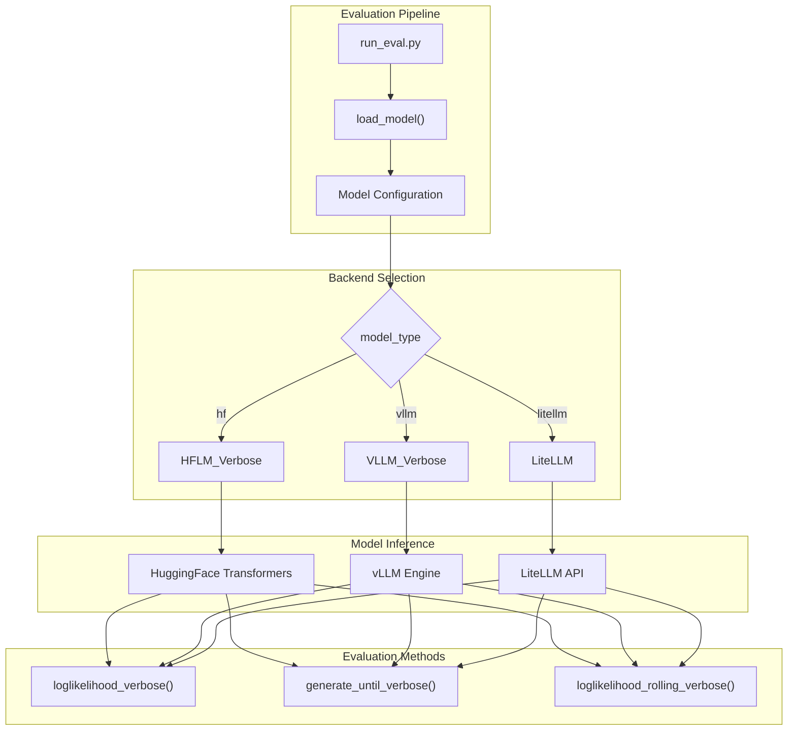
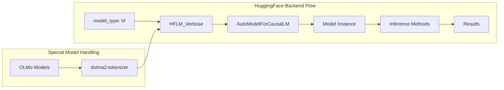
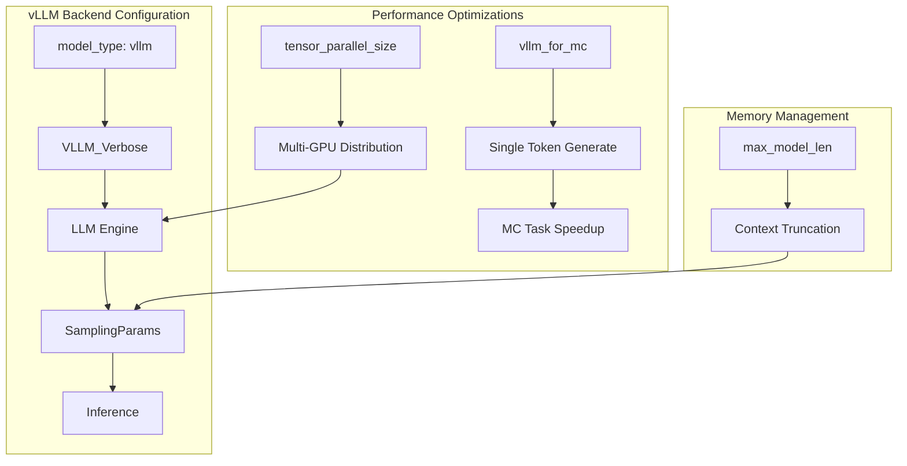
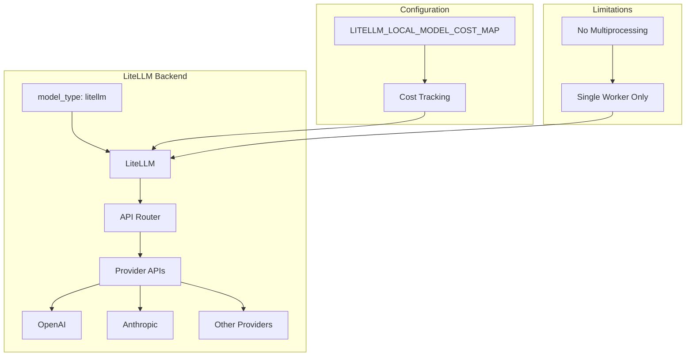
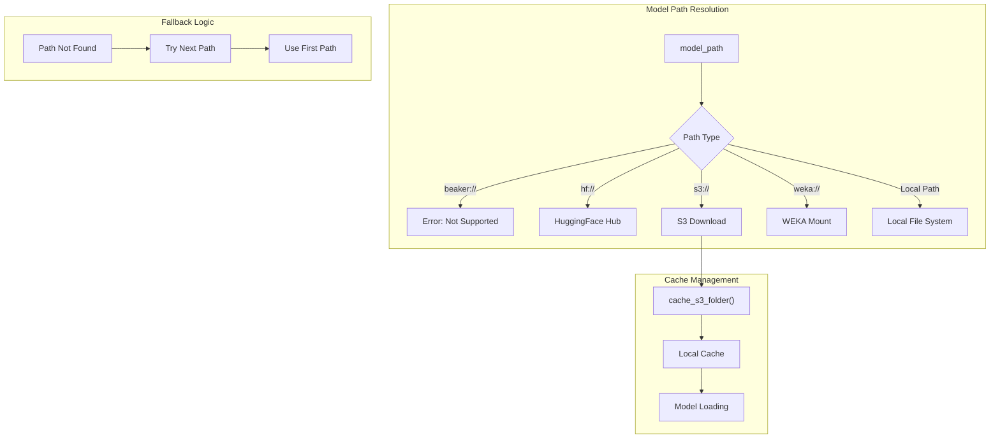
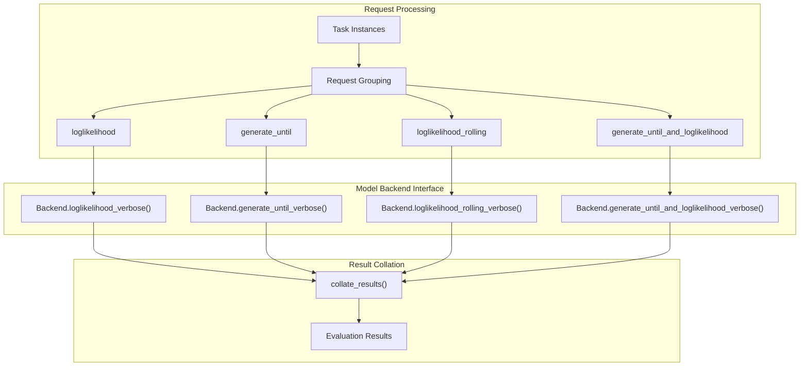
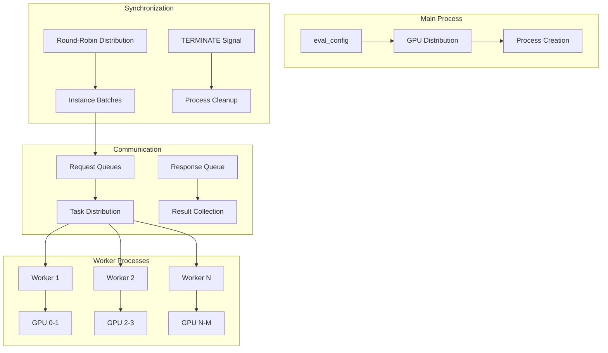
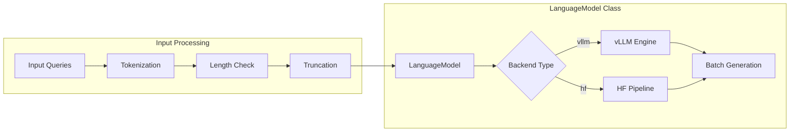

<!-- source: DeepWiki mcp.deepwiki.com · repo allenai/FlexOlmo · page 4.4 Model Backends · fetched 2026-10-26 -->

# Model Backends

Relevant source files

The following files were used as context for generating this wiki page:

- [src/offline_evals/metrics/llm.py](src/offline_evals/metrics/llm.py)
- [src/offline_evals/run_eval.py](src/offline_evals/run_eval.py)
- [src/scripts/eval/task_suites.py](src/scripts/eval/task_suites.py)
- [src/scripts/eval/tasks.py](src/scripts/eval/tasks.py)

This document describes the language model backends used in FlexOlmo's evaluation system. Model backends are the interface layer between the evaluation pipeline and the underlying language models, providing standardized APIs for model inference across different execution engines.

For information about the evaluation pipeline orchestration, see [Evaluation Pipeline](#4.1). For task configuration and execution, see [Task Configuration and Suites](#4.2).

## Overview

The FlexOlmo evaluation system supports three primary model backends, each optimized for different use cases and deployment scenarios. These backends provide a common interface for model inference while leveraging different underlying implementations for performance and compatibility.

## Model Backend Architecture

Sources: [src/offline_evals/run_eval.py:351-424]()

## HuggingFace Backend

The HuggingFace backend (`HFLM_Verbose`) provides compatibility with the extensive HuggingFace model ecosystem and supports local model loading with full control over model parameters.

### Key Features

- **Local Model Loading**: Supports loading models from local paths or HuggingFace Hub
- **Memory Management**: Handles model loading and GPU memory allocation
- **Tokenizer Integration**: Automatically configures tokenizers for specific models
- **Batch Processing**: Supports configurable batch sizes for efficient inference

### Configuration

The HuggingFace backend is selected by setting `model_type` to `"hf"` in the model configuration. Additional parameters include:

- `trust_remote_code`: Enable execution of remote code for custom models
- `max_length`: Maximum input sequence length
- `revision`: Specific model revision to load

Sources: [src/offline_evals/run_eval.py:405-406](), [src/offline_evals/run_eval.py:415-418]()

## vLLM Backend

The vLLM backend (`VLLM_Verbose`) provides high-performance inference optimized for large-scale model serving and evaluation workloads.

### Key Features

- **Optimized Inference**: PagedAttention and other optimizations for fast inference
- **Multi-GPU Support**: Automatic tensor parallelism across available GPUs
- **Memory Efficiency**: Efficient memory management for large models
- **Batch Processing**: Advanced batching strategies for throughput optimization

### Configuration

The vLLM backend is selected by setting `model_type` to `"vllm"`. Key configuration options include:

- `max_model_len`: Maximum context length for the model
- `tensor_parallel_size`: Number of GPUs for tensor parallelism
- `vllm_for_mc`: Enable optimized multiple-choice evaluation

### Multiple Choice Optimization

The vLLM backend includes specialized support for multiple-choice tasks through the `vllm_for_mc` flag, which enables faster scoring for single-token continuation tasks.

Sources: [src/offline_evals/run_eval.py:407-408](), [src/offline_evals/run_eval.py:291-296]()

## LiteLLM Backend

The LiteLLM backend provides access to external API-based language models, enabling evaluation of proprietary models without local deployment.

### Key Features

- **API Integration**: Supports multiple API providers (OpenAI, Anthropic, etc.)
- **Cost Management**: Built-in cost tracking and management
- **Rate Limiting**: Automatic handling of API rate limits
- **Standardized Interface**: Unified interface across different API providers

### Configuration

The LiteLLM backend is selected by setting `model_type` to `"litellm"`. The backend automatically handles API authentication and request formatting.

### Limitations

- **No Multiprocessing**: LiteLLM does not support multiprocessing evaluation
- **API Dependencies**: Requires network connectivity and API access
- **Cost Considerations**: Usage incurs API costs based on provider pricing

Sources: [src/offline_evals/run_eval.py:409-411](), [src/offline_evals/run_eval.py:394-395](), [src/offline_evals/run_eval.py:599-601]()

## Model Loading and Path Resolution

The evaluation system supports multiple model path formats for flexible model loading across different storage backends.

### Path Resolution Logic

Sources: [src/offline_evals/run_eval.py:354-390]()

## Integration with Evaluation Pipeline

Model backends integrate seamlessly with the evaluation pipeline through standardized inference methods that support different request types.

### Inference Methods

All backends implement the following core methods:

- `loglikelihood_verbose()`: Compute log-likelihood for context-continuation pairs
- `generate_until_verbose()`: Generate text until specified stop sequences
- `loglikelihood_rolling_verbose()`: Compute rolling log-likelihood for text
- `generate_until_and_loglikelihood_verbose()`: Combined generation and scoring

### Request Processing Flow

Sources: [src/offline_evals/run_eval.py:230-265]()

## Multiprocessing Support

The evaluation system supports multiprocessing across multiple GPUs for supported backends, enabling parallel evaluation for improved throughput.

### Multiprocessing Architecture

Sources: [src/offline_evals/run_eval.py:577-613](), [src/offline_evals/run_eval.py:792-820]()

## Alternative Backend: LanguageModel Class

The system also includes an alternative `LanguageModel` class that provides a simplified interface for model evaluation, primarily used in metric computation contexts.

### Features

- **Dual Backend Support**: Supports both vLLM and HuggingFace backends
- **Automatic Fallback**: Falls back to HuggingFace if vLLM is not available
- **Input Truncation**: Handles context length limits with automatic truncation
- **Batch Processing**: Supports configurable batch sizes

Sources: [src/offline_evals/metrics/llm.py:21-139]()

---

