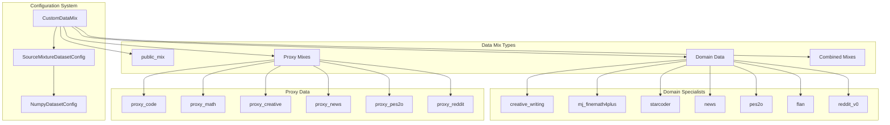
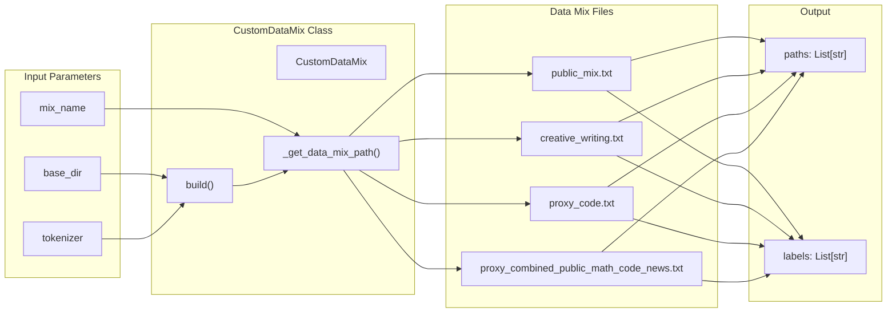
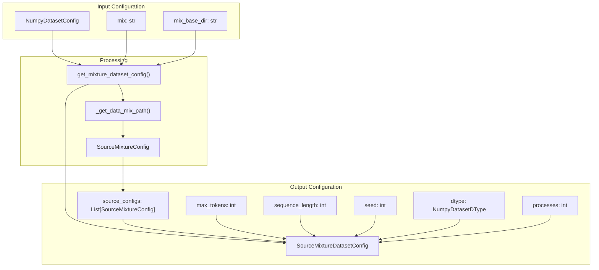
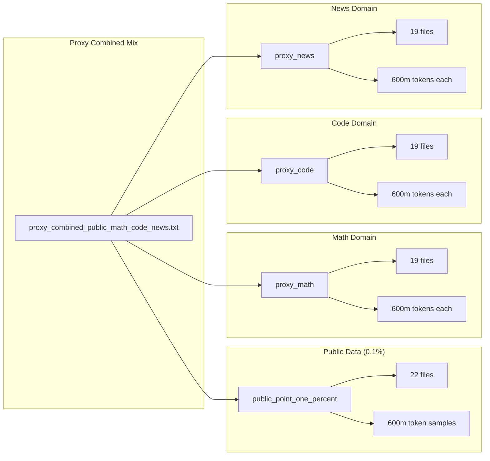

<!-- source: DeepWiki mcp.deepwiki.com · repo allenai/FlexOlmo · page 5.1 Data Mixes and Configuration · fetched 2026-10-26 -->

# Data Mixes and Configuration

<details>
<summary>Relevant source files</summary>

The following files were used as context for generating this wiki page:

- [src/flexolmo/data/mixes/__init__.py](src/flexolmo/data/mixes/__init__.py)
- [src/flexolmo/data/mixes/proxy_combined_public_math_code_news.txt](src/flexolmo/data/mixes/proxy_combined_public_math_code_news.txt)

</details>


This document covers the data mix system in FlexOlmo, which provides a flexible framework for combining different data sources during training and evaluation. The system supports public datasets, domain-specific expert data, and proxy datasets used for router training.

For information about domain embeddings used in router training, see [Domain Embeddings](#5.2). For details about the broader data management infrastructure, see [Data Management](#5).

## Data Mix Types and Organization

FlexOlmo organizes data into several categories to support its multi-stage training pipeline:

### Data Mix Categories

| Category | Purpose | Examples |
|----------|---------|----------|
| **Public Mix** | Base training data for public model | `public_mix` |
| **Domain Data** | Expert-specific training data | `creative_writing`, `mj_finemath4plus`, `starcoder`, `news`, `pes2o`, `flan`, `reddit_v0` |
| **Proxy Mixes** | Router training data | `proxy_code`, `proxy_math`, `proxy_creative`, `proxy_news` |
| **Combined Mixes** | Multi-domain proxy data | `proxy_combined_public_math_code_news` |
| **OLMo2 Setup** | Specialized configurations | `dolmino_minus_math`, `dolmino_minus_math_flan` |
| **Test Mixes** | Development and testing | `test_mix`, `anneal_test_mix` |

### Data Mix Architecture



Sources: [src/flexolmo/data/mixes/__init__.py:17-49]()

## CustomDataMix Class

The `CustomDataMix` class serves as the central registry for all data mix definitions in FlexOlmo. It inherits from `DataMixBase` and provides enumeration-style access to different data mixes.

### Core Functionality

The `CustomDataMix` class defines data mixes as class attributes and provides methods to build dataset configurations:



### Build Method Implementation

The `build()` method constructs data mixes by reading mix definition files and resolving paths:

1. **Path Resolution**: Combines `base_dir` with relative paths from mix files
2. **Tokenizer Substitution**: Replaces `{TOKENIZER}` placeholder with actual tokenizer ID
3. **Label Extraction**: Extracts data source labels for each file
4. **File Processing**: Skips comments and empty lines in mix definition files

Sources: [src/flexolmo/data/mixes/__init__.py:50-77]()

## Dataset Configuration System

The configuration system provides flexibility in combining multiple data sources through the `SourceMixtureDatasetConfig` framework.

### Configuration Flow



### Source Mixture Configuration

Each data source in a mixture is configured with:

| Parameter | Value | Purpose |
|-----------|-------|---------|
| `source_name` | Mix name (e.g., "public_mix") | Identifies the data source |
| `paths` | List of file paths | Points to tokenized data files |
| `max_repetition_ratio` | 3.0 | Handles smaller datasets like math data |
| `target_ratio` | 1.0 / len(names) | Equal weighting across sources |

The system uses hardcoded values for some parameters:
- `max_tokens`: 5,000,000,000 (5B tokens)
- `seed`: 2025
- `processes`: 8

Sources: [src/flexolmo/data/mixes/__init__.py:80-139]()

## Data Mix Definition Files

Data mixes are defined in text files with a simple comma-separated format. Each line contains a label and relative path to preprocessed data.

### File Format Structure

```
# Comments start with hash
label_name,relative/path/to/data.npy
label_name,relative/path/to/data2.npy
```

### Example: Proxy Combined Mix

The `proxy_combined_public_math_code_news.txt` file demonstrates multi-domain data mixing:



### Path Structure

Data files follow a consistent directory structure:
- `preprocessed/olmo_modular_data/public/600m/` - Public dataset samples
- `preprocessed/olmo_modular_data/proxy_domain_data/` - Domain-specific proxy data
- Filenames use pattern: `part-{:02d}-00000.npy`

Sources: [src/flexolmo/data/mixes/proxy_combined_public_math_code_news.txt:1-82]()

## Integration with Training Pipeline

The data mix system integrates with FlexOlmo's training stages:

1. **Public Model Training**: Uses `public_mix` for base model training
2. **Expert Training**: Uses domain-specific mixes (`creative_writing`, `mj_finemath4plus`, etc.)
3. **Router Training**: Uses proxy mixes for learning domain routing

### Configuration Usage Pattern

```python
# Example configuration usage
dataset_config.mix = "public_mix,mj_finemath4plus,pes2o,starcoder"
dataset_config.mix_base_dir = "/weka/oe-training-default/ai2-llm/"
dataset_config.source_mixture_config = get_mixture_dataset_config(dataset_config)
dataset_config.mix = None  # Clear after conversion
```

The system provides flexibility for combining arbitrary data sources while maintaining consistent configuration patterns across different training stages.

Sources: [src/flexolmo/data/mixes/__init__.py:84-91]()

---

