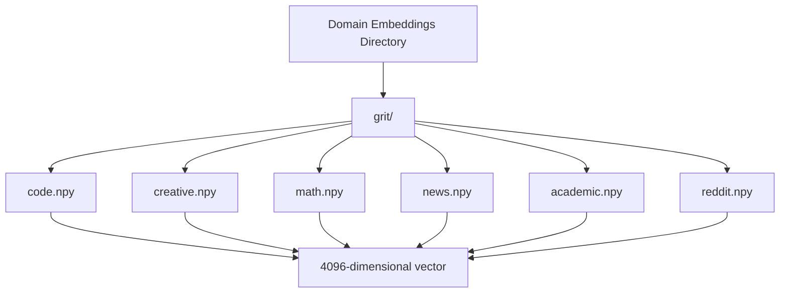
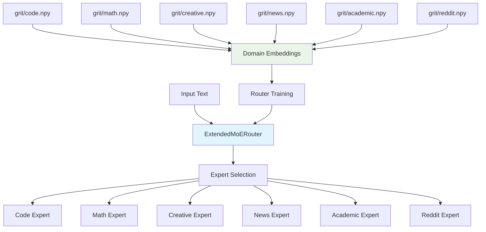

<!-- source: DeepWiki mcp.deepwiki.com · repo allenai/FlexOlmo · page 5.2 Domain Embeddings · fetched 2026-10-26 -->

# Domain Embeddings

Relevant source files

The following files were used as context for generating this wiki page:

- [src/data/domain_embeddings/grit/code.npy](src/data/domain_embeddings/grit/code.npy)
- [src/data/domain_embeddings/grit/creative.npy](src/data/domain_embeddings/grit/creative.npy)
- [src/data/domain_embeddings/grit/math.npy](src/data/domain_embeddings/grit/math.npy)
- [src/data/domain_embeddings/grit/news.npy](src/data/domain_embeddings/grit/news.npy)

This document covers the pre-computed domain embeddings used in FlexOlmo for router training and expert specialization. Domain embeddings provide semantic representations of different content domains that help the MoE router learn to route inputs to appropriate expert models.

For information about data mixing and dataset configuration, see [Data Mixes and Configuration](#5.1). For details on the router training process that uses these embeddings, see [Model Combination and Upcycling](#3.3).

## Overview

Domain embeddings in FlexOlmo are pre-computed vector representations that capture the semantic characteristics of different content domains. These embeddings serve as training signals for the MoE router, helping it learn to distinguish between different types of content and route them to the most appropriate expert models.

The embeddings are stored as NumPy arrays and are integrated into the router training pipeline to provide supervision for learning domain-specific routing decisions.

## File Structure and Storage

Domain embeddings are stored in the `src/data/domain_embeddings/grit/` directory as binary NumPy files:

**Domain Embedding Storage Architecture**

Each embedding file contains a single 4096-dimensional float32 vector that represents the semantic characteristics of its corresponding domain.

Sources: [src/data/domain_embeddings/grit/code.npy:1-2](), [src/data/domain_embeddings/grit/creative.npy:1-2](), [src/data/domain_embeddings/grit/math.npy:1-2](), [src/data/domain_embeddings/grit/news.npy:1-2]()

## Available Domain Embeddings

The following domain embeddings are available in the FlexOlmo system:

| Domain | File | Dimension | Description |
|--------|------|-----------|-------------|
| Code | `code.npy` | 4096 | Programming and software development content |
| Creative | `creative.npy` | 4096 | Creative writing, storytelling, and artistic content |
| Math | `math.npy` | 4096 | Mathematical reasoning and numerical content |
| News | `news.npy` | 4096 | Current events and journalistic content |
| Academic | `academic.npy` | 4096 | Research papers and scholarly content |
| Reddit | `reddit.npy` | 4096 | Social media and informal discussion content |

Each embedding is a dense vector representation learned from domain-specific text corpora, capturing the unique linguistic and semantic patterns of each content type.

Sources: [src/data/domain_embeddings/grit/code.npy:1](), [src/data/domain_embeddings/grit/creative.npy:1](), [src/data/domain_embeddings/grit/math.npy:1](), [src/data/domain_embeddings/grit/news.npy:1]()

## Integration with Router Training

Domain embeddings are incorporated into the FlexOlmo training pipeline during the router training phase. The embeddings provide supervision signals that help the router learn to associate input characteristics with appropriate expert models.

**Domain Embedding Integration in Router Training**

The router training process uses these embeddings to learn domain-specific routing patterns, enabling the model to automatically direct different types of content to the most suitable expert models.

Sources: Based on system architecture diagrams and training pipeline overview

## Technical Implementation

Domain embeddings are loaded and utilized during the router training phase of the FlexOlmo pipeline. The embeddings serve as auxiliary training signals that help the MoE router learn to distinguish between different content domains.

The embeddings are stored in a standardized format:
- **Data Type**: float32
- **Shape**: (4096,)
- **Format**: NumPy binary format (.npy)
- **Encoding**: Little-endian

This standardization ensures consistent loading and processing across different training environments and platforms.

## Usage in Training Pipeline

Domain embeddings are integrated into the FlexOlmo training workflow through the following process:

1. **Loading Phase**: Domain embeddings are loaded from the `grit/` directory during router training initialization
2. **Training Integration**: Embeddings are used as supervision signals during router training
3. **Expert Association**: Each embedding corresponds to a specific expert model in the MoE architecture
4. **Routing Decision**: The trained router uses learned domain representations to make routing decisions

The embeddings enable the router to learn nuanced distinctions between content types, improving the overall performance of the MoE system by ensuring inputs are routed to the most appropriate specialized expert models.

Sources: Based on training pipeline architecture and MoE router system design

---

