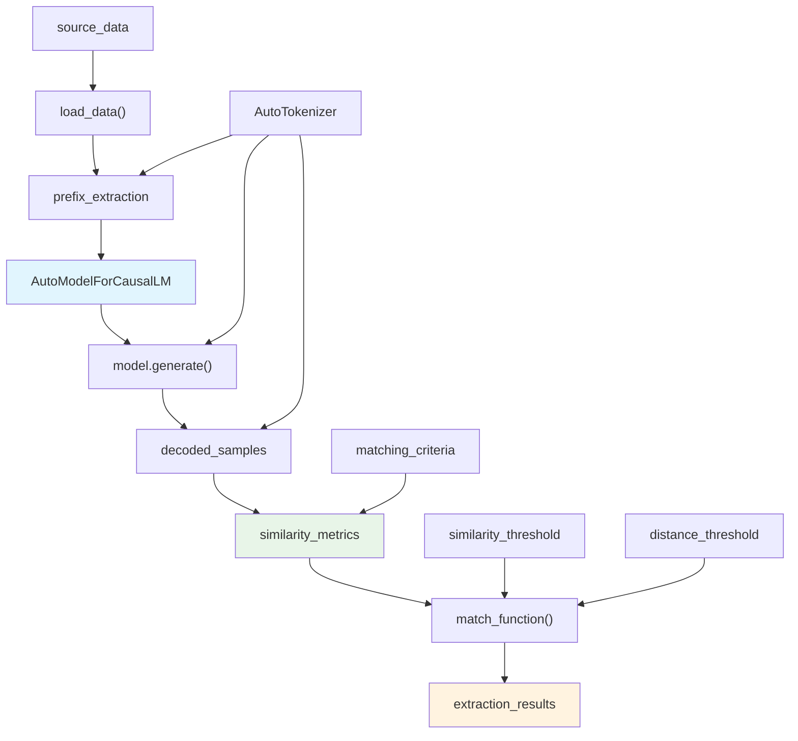
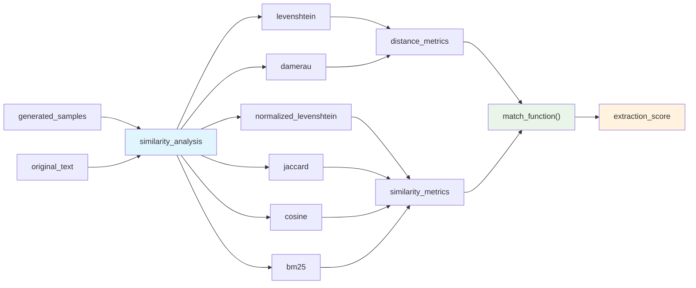
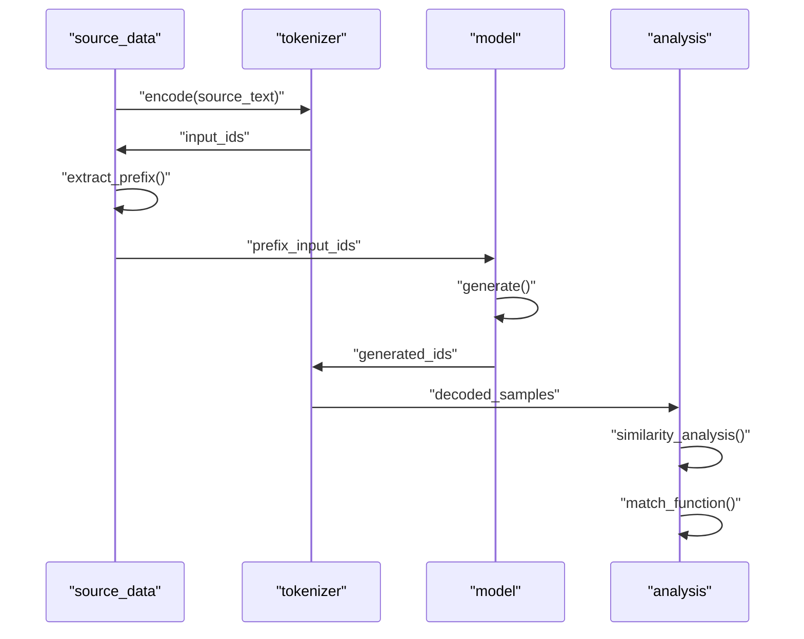

<!-- source: DeepWiki mcp.deepwiki.com · repo allenai/FlexOlmo · page 5.3 Data Extraction Analysis · fetched 2026-10-26 -->

# Data Extraction Analysis

<details>
<summary>Relevant source files</summary>

The following files were used as context for generating this wiki page:

- [pyproject.toml](pyproject.toml)
- [scripts/extraction_analysis.sh](scripts/extraction_analysis.sh)
- [src/scripts/utils/extraction_analysis.py](src/scripts/utils/extraction_analysis.py)

</details>


The data extraction analysis system provides tools for measuring how effectively language models can regenerate or extract content from their training data. This system evaluates potential memorization by generating text from model prefixes and comparing the outputs against known training data using various similarity metrics.

For information about general data management and preprocessing, see [Data Management](#5). For domain-specific data organization, see [Data Mixes and Configuration](#5.1).

## Purpose and Scope

The data extraction analysis system serves as a privacy and safety evaluation tool that:

- Measures model memorization capabilities by testing whether models can regenerate training data
- Provides multiple similarity metrics to assess the closeness between generated and original content
- Supports configurable generation parameters and matching criteria
- Enables systematic evaluation of data extraction risks across different model architectures

This system is particularly relevant for understanding potential privacy implications of language models and their ability to leak training data.

## System Architecture

The data extraction analysis system follows a generate-and-compare workflow:

**Data Extraction Analysis Workflow**


**Similarity Metrics System**


Sources: [src/scripts/utils/extraction_analysis.py:1-256](), [scripts/extraction_analysis.sh:1-21]()

## Core Components

### Data Loading and Preprocessing

The system loads source data using the `load_data()` function and prepares it for analysis:

| Component | Function | Configuration |
|-----------|----------|---------------|
| `load_data()` | Loads domain-specific training data | Takes domain, source_data path, and sampling parameters |
| `np.random.shuffle()` | Randomizes data order | Uses fixed seed (2025) for reproducibility |
| Prefix extraction | Extracts text prefixes for generation | Configurable prefix length |

The data loading process includes validation to ensure sufficient data is available for the requested number of prefixes [src/scripts/utils/extraction_analysis.py:44-49]().

### Model Integration

The system integrates with HuggingFace transformers for model loading and text generation:

```python
# Model loading
model = AutoModelForCausalLM.from_pretrained(args.model_name, device_map="auto")
tokenizer = AutoTokenizer.from_pretrained(args.model_name)

# Text generation
generated_samples = model.generate(
    prefix_input_ids.to(model.device),
    max_length=generation_length,
    do_sample=True,
    top_k=args.top_k,
    top_p=args.top_p,
    temperature=args.temperature,
    num_return_sequences=args.num_generations_per_prefix,
)
```

Sources: [src/scripts/utils/extraction_analysis.py:52-53](), [src/scripts/utils/extraction_analysis.py:147-155]()

### Similarity Metrics

The system implements multiple similarity and distance metrics for comparing generated and original text:

**Distance Metrics (Lower = More Similar)**
- **Levenshtein Distance**: Character-level edit distance
- **Damerau Distance**: Edit distance including transpositions

**Similarity Metrics (Higher = More Similar)**
- **Normalized Levenshtein**: Levenshtein distance normalized to [0,1]
- **Jaccard Similarity**: Set intersection over union
- **Cosine Similarity**: Vector-based similarity measure
- **BM25**: Information retrieval ranking function

The matching logic adapts threshold comparison based on metric type [src/scripts/utils/extraction_analysis.py:99-111]().

Sources: [src/scripts/utils/extraction_analysis.py:68-78](), [src/scripts/utils/extraction_analysis.py:84-96]()

## Generation and Analysis Process

### Text Generation Pipeline

The system extracts prefixes from training data and generates continuations:

**Generation Process Flow**


The generation process includes several key steps:

1. **Prefix Extraction**: Random selection of prefix positions within training texts
2. **Length Validation**: Ensuring sufficient text length for meaningful generation
3. **Generation**: Using configurable sampling parameters (top-k, top-p, temperature)
4. **Decoding**: Converting generated token IDs back to text

Sources: [src/scripts/utils/extraction_analysis.py:132-160]()

### Similarity Analysis

The `match_function()` evaluates whether generated samples match original training data:

| Metric Type | Matching Condition | Threshold Parameter |
|-------------|-------------------|-------------------|
| Distance (Levenshtein, Damerau) | `score <= distance_threshold` | `args.distance_threshold` |
| Similarity (Others) | `score >= similarity_threshold` | `args.similarity_threshold` |

The function returns aggregate statistics including average scores and maximum scores across all generated samples [src/scripts/utils/extraction_analysis.py:108-111]().

Sources: [src/scripts/utils/extraction_analysis.py:79-111]()

## Configuration and Parameters

### Command-Line Interface

The system provides extensive configuration through command-line arguments:

**Generation Parameters**
- `--prefix_length`: Number of tokens used as generation prefix (default: 10)
- `--generation_length`: Total tokens to generate (default: 256)
- `--num_generations_per_prefix`: Multiple samples per prefix (default: 1)
- `--num_prefixes`: Total number of prefixes to test (default: 5)

**Sampling Parameters**
- `--top_k`: Top-k sampling parameter (default: 50)
- `--top_p`: Nucleus sampling parameter (default: 0.95)
- `--temperature`: Sampling temperature (default: 1.0)

**Evaluation Parameters**
- `--matching_criteria`: Similarity metric choice
- `--similarity_threshold`: Threshold for similarity-based metrics (default: 0.8)
- `--distance_threshold`: Threshold for distance-based metrics (default: 10)

Sources: [src/scripts/utils/extraction_analysis.py:190-252]()

### Shell Script Wrapper

The `extraction_analysis.sh` script provides a convenient wrapper with predefined parameters:

```bash
NUM_PREFIXES=100
PREFIX_LENGTH=32
GENERATION_LENGTH=256
```

This wrapper uses normalized Levenshtein distance with a high similarity threshold (0.9) for conservative matching [scripts/extraction_analysis.sh:6-21]().

Sources: [scripts/extraction_analysis.sh:1-21]()

## Output and Results

### Data Collection

The system tracks several key metrics:

- **Total Samples**: Count of all generation attempts
- **Similar Samples**: Count of samples exceeding similarity thresholds
- **Average Scores**: Mean similarity/distance scores across all comparisons
- **Maximum Scores**: Peak similarity scores for each prefix

### Output Formats

When `--save_generated_samples` is enabled, the system saves detailed results in JSONL format:

```json
{
  "generated_samples": ["sample1", "sample2", ...],
  "prefix": "original_prefix_text",
  "original": "original_continuation_text"
}
```

The output file naming convention follows the pattern: `{num_prefixes}_{num_generations_per_prefix}_{prefix_length}_{generation_length}.jsonl` [src/scripts/utils/extraction_analysis.py:114]().

Sources: [src/scripts/utils/extraction_analysis.py:163-173](), [src/scripts/utils/extraction_analysis.py:181-185]()

## Dependencies and Environment

The data extraction analysis system requires the `extraction` dependency group from the project configuration:

```toml
extraction = [
    "transformers@git+https://github.com/swj0419/transformers",
    "accelerate",
    "rank_bm25",
    "s3fs",
    "smart-open",
    "strsimpy",
    "psutil",
    "platformdirs",
    "zstandard",
    "torchvision"
]
```

Key dependencies include:
- **transformers**: Modified version for model loading and generation
- **strsimpy**: String similarity and distance metrics
- **rank_bm25**: BM25 ranking implementation
- **accelerate**: Distributed computing support

Sources: [pyproject.toml:82-93]()

---

