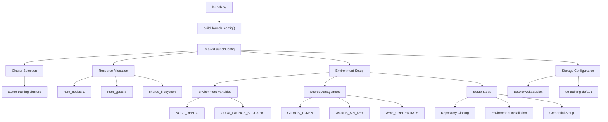
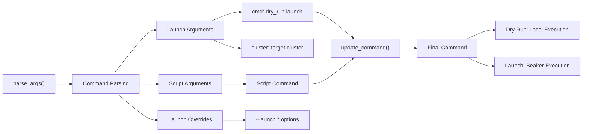
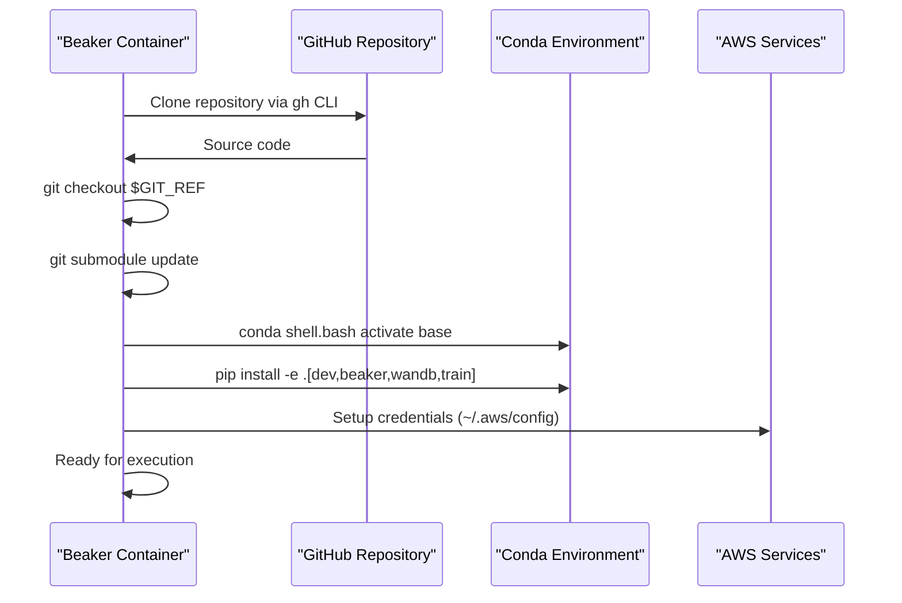
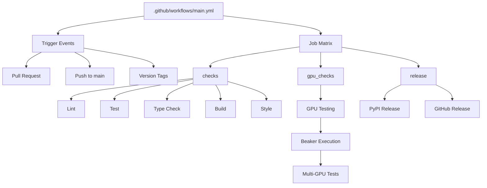
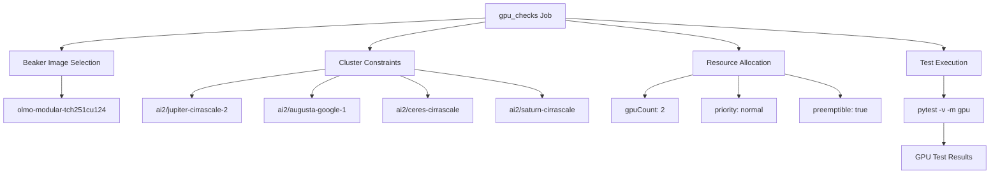
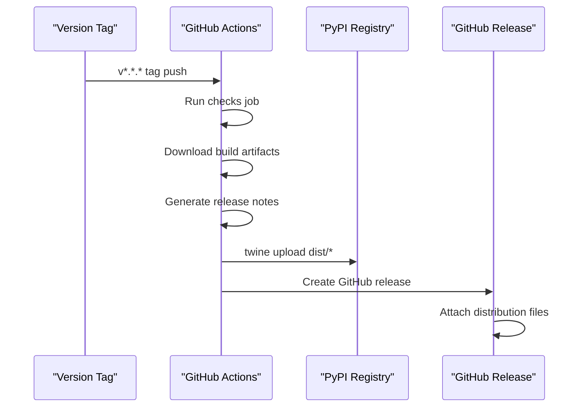
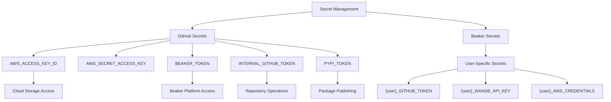

<!-- source: DeepWiki mcp.deepwiki.com · repo allenai/FlexOlmo · page 6 Infrastructure and Deployment · fetched 2026-10-26 -->

# Infrastructure and Deployment

Relevant source files

The following files were used as context for generating this wiki page:

- [.github/workflows/main.yml](.github/workflows/main.yml)
- [src/scripts/beaker/README.md](src/scripts/beaker/README.md)
- [src/scripts/beaker/launch.py](src/scripts/beaker/launch.py)

This page covers FlexOlmo's distributed computing infrastructure, platform deployment configurations, and continuous integration systems. The infrastructure enables scalable training and evaluation on the Beaker platform with automated testing and deployment pipelines.

For information about training pipeline execution, see [Training Pipeline](#3). For details about evaluation system backends, see [Model Backends](#4.4).

## Beaker Platform Integration

FlexOlmo uses the Beaker platform for distributed training and evaluation jobs. The integration provides automated cluster management, resource allocation, and job orchestration through the `BeakerLaunchConfig` system.

### Launch Configuration System

The core infrastructure component is the `build_launch_config()` function which creates standardized Beaker job configurations:

**Beaker Launch Configuration Components**

| Component | Configuration | Purpose |
|-----------|---------------|---------|
| **Budget** | `ai2/oe-training` | Resource allocation budget |
| **Workspace** | `ai2/OLMo-modular` | Beaker workspace context |
| **Image** | `petew/olmo-core-tch260cu124` | Base Docker image |
| **Resources** | 1 node, 8 GPUs | Default resource allocation |
| **Storage** | `/weka/oe-training-default` | Shared filesystem mount |

Sources: [src/scripts/beaker/launch.py:31-91]()

### Job Execution and Command Processing

The launch system supports both dry-run validation and actual job execution through the `parse_args()` and `update_command()` functions:

**Environment Variables and Secrets**

| Variable | Source | Purpose |
|----------|--------|---------|
| `NCCL_DEBUG` | Runtime configuration | Distributed training debugging |
| `GITHUB_TOKEN` | User-specific secret | Repository access |
| `WANDB_API_KEY` | User-specific secret | Experiment tracking |
| `AWS_CREDENTIALS` | User-specific secret | Cloud storage access |
| `BEAKER_TOKEN` | User-specific secret | Platform authentication |

Sources: [src/scripts/beaker/launch.py:93-147](), [src/scripts/beaker/launch.py:59-73]()

### Setup and Installation Process

The Beaker jobs follow a standardized setup process defined in the `setup_steps` configuration:

Sources: [src/scripts/beaker/launch.py:74-90]()

## CI/CD and Containerization

The continuous integration system uses GitHub Actions with multi-stage validation including CPU and GPU testing through Beaker integration.

### GitHub Actions Workflow

The main workflow defines comprehensive validation stages:

**CI/CD Matrix Configuration**

| Job Stage | Tasks | Runtime | Environment |
|-----------|-------|---------|-------------|
| **checks** | Lint, Test, Type check, Build, Style | 8 minutes | ubuntu-latest |
| **gpu_checks** | GPU tests | 15 minutes | Beaker clusters |
| **release** | PyPI, GitHub release | - | ubuntu-latest |

Sources: [.github/workflows/main.yml:26-51]()

### GPU Testing Infrastructure

GPU tests execute on Beaker clusters using the `beaker-run-action`:

**Beaker GPU Test Configuration**

| Parameter | Value | Purpose |
|-----------|-------|---------|
| **Image** | `olmo-modular-tch251cu124` | PyTorch 2.5.1 + CUDA 12.4 |
| **GPU Count** | 2 | Multi-GPU testing |
| **Clusters** | H100, A100 clusters | Hardware diversity |
| **Environment** | `CUBLAS_WORKSPACE_CONFIG=:16:8` | Deterministic operations |

Sources: [.github/workflows/main.yml:136-178]()

### Release Automation

The release workflow handles automated PyPI and GitHub releases:

**Release Process Components**

| Stage | Action | Trigger |
|-------|--------|---------|
| **Tag Detection** | `startsWith(github.ref, 'refs/tags/')` | Version tag push |
| **Artifact Download** | `actions/download-artifact@v4` | Build artifacts |
| **PyPI Publish** | `twine upload` | PYPI_TOKEN secret |
| **GitHub Release** | `softprops/action-gh-release@v2` | Automated release |

Sources: [.github/workflows/main.yml:180-226]()

### Environment and Secret Management

Both Beaker and GitHub Actions use centralized secret management:

Sources: [.github/workflows/main.yml:17-25](), [src/scripts/beaker/launch.py:63-73]()

---

