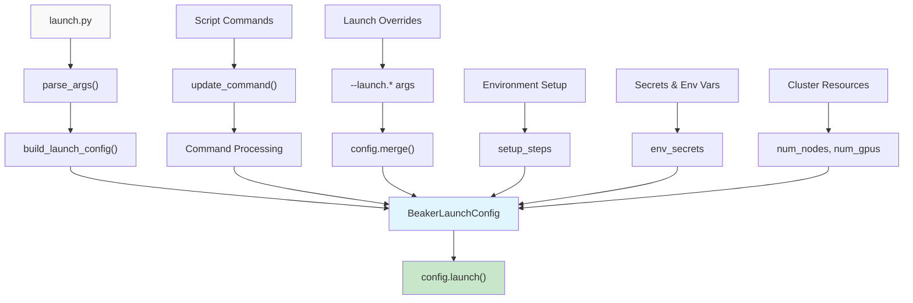
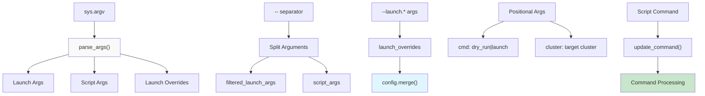
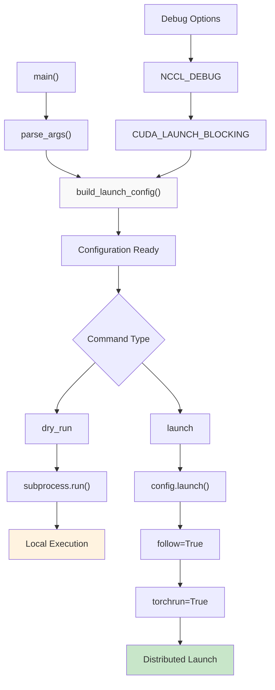

<!-- source: DeepWiki mcp.deepwiki.com · repo allenai/FlexOlmo · page 6.1 Beaker Platform Integration · fetched 2026-10-26 -->

# Beaker Platform Integration

<details>
<summary>Relevant source files</summary>

The following files were used as context for generating this wiki page:

- [src/scripts/beaker/README.md](src/scripts/beaker/README.md)
- [src/scripts/beaker/launch.py](src/scripts/beaker/launch.py)

</details>


This document covers FlexOlmo's integration with the Beaker distributed computing platform. The Beaker platform enables large-scale distributed training and evaluation jobs across compute clusters, providing the infrastructure foundation for FlexOlmo's training pipeline and evaluation system.

For information about CI/CD pipelines and containerization, see [CI/CD and Containerization](#6.2). For details about the training scripts that run on Beaker, see [Training Pipeline](#3).

## Overview

The Beaker platform integration provides a streamlined interface for launching FlexOlmo training and evaluation jobs on distributed compute clusters. The system replaces direct `torchrun` commands with Beaker-managed distributed execution, handling cluster resource allocation, environment setup, and job monitoring.

**Beaker Launch Architecture**



Sources: [src/scripts/beaker/launch.py:1-196]()

## Launch Configuration System

The `build_launch_config()` function creates a comprehensive `BeakerLaunchConfig` object that defines all aspects of the distributed job execution. The configuration system handles cluster-specific settings, resource allocation, and environment preparation.

**Configuration Components**

| Component | Purpose | Configuration Source |
|-----------|---------|---------------------|
| `BeakerLaunchConfig` | Main job configuration | [src/scripts/beaker/launch.py:46-90]() |
| `BeakerWekaBucket` | Shared filesystem access | [src/scripts/beaker/launch.py:40-42]() |
| `BeakerEnvVar` | Environment variables | [src/scripts/beaker/launch.py:59-62]() |
| `BeakerEnvSecret` | Secure credential management | [src/scripts/beaker/launch.py:63-73]() |

### Core Configuration Parameters

The launch configuration includes several key parameters:

- **Job Identity**: `name` with UUID suffix, `workspace="ai2/OLMo-modular"`, `budget="ai2/oe-training"`
- **Compute Resources**: `num_nodes=1`, `num_gpus=8`, cluster-specific allocation
- **Container Image**: `beaker_image="petew/olmo-core-tch260cu124"`
- **Filesystem Access**: Weka bucket mounting for shared storage

Sources: [src/scripts/beaker/launch.py:46-57]()

## Command Line Interface

The Beaker launch system provides a command-line interface that separates launch configuration from script execution parameters. The interface supports both dry-run testing and actual job launching.

**Command Structure and Parsing**



### Usage Pattern

The command line interface follows this pattern:
```bash
python src/scripts/beaker/launch.py [launch|dry_run] [cluster] \
    --launch.num_nodes=2 \
    --launch.workspace=workspace-name \
    --launch.priority=high -- script_path run_name [script_args...]
```

The `--` separator divides launch configuration from script execution parameters, enabling flexible job customization without modifying the underlying training scripts.

Sources: [src/scripts/beaker/launch.py:93-147](), [src/scripts/beaker/README.md:1-30]()

## Environment and Secrets Management

The Beaker integration handles comprehensive environment setup including secure credential management and development environment preparation.

### Secret Configuration

The system manages multiple credential types through `BeakerEnvSecret` objects:

- **Authentication**: `GITHUB_TOKEN`, `BEAKER_TOKEN`, `WANDB_API_KEY`, `COMET_API_KEY`
- **Storage Access**: `AWS_CONFIG`, `AWS_CREDENTIALS`, `R2_ENDPOINT_URL`, `WEKA_ENDPOINT_URL`
- **Monitoring**: `SLACK_WEBHOOK_URL`

All secrets follow the pattern `{beaker_user}_{SECRET_NAME}` for user-specific credential management.

### Environment Setup Steps

The `setup_steps` define the job initialization sequence:

1. **Repository Setup**: Clone private repository, checkout specific commit, initialize submodules
2. **Environment Preparation**: Activate conda environment, install dependencies
3. **Credential Configuration**: Configure AWS credentials from environment variables

Sources: [src/scripts/beaker/launch.py:63-89]()

## Job Execution Flow

The job execution system supports both dry-run testing and actual distributed launching with comprehensive monitoring and debugging capabilities.

**Execution Flow**



### Execution Modes

- **Dry Run**: Executes the script locally using `subprocess.run()` for testing configuration and command validity
- **Launch**: Submits the job to Beaker with `follow=True` for real-time monitoring and `torchrun=True` for distributed execution

### Debugging Configuration

The system provides debugging capabilities through environment variables:
- `NCCL_DEBUG`: Controls NCCL communication debugging (INFO/WARN)
- `CUDA_LAUNCH_BLOCKING`: Enables synchronous CUDA operations for debugging

Sources: [src/scripts/beaker/launch.py:149-181]()

## Integration with Training Pipeline

The Beaker platform integration seamlessly replaces local `torchrun` commands with distributed cluster execution, maintaining the same command-line interface while enabling large-scale training across multiple nodes and GPUs.

### Training Script Integration

Training scripts designed for local execution automatically benefit from distributed execution through the Beaker launch system:

```bash
# Local execution
torchrun src/scripts/train/OLMo2-7B-anneal.py anneal-run ${CHECKPOINT_PATH}

# Beaker execution  
python src/scripts/beaker/launch.py launch cluster-name -- \
    src/scripts/train/OLMo2-7B-anneal.py anneal-run ${CHECKPOINT_PATH}
```

The launch system preserves all script arguments and configuration overrides while providing cluster resource management and distributed execution capabilities.

Sources: [src/scripts/beaker/README.md:1-30]()

---

