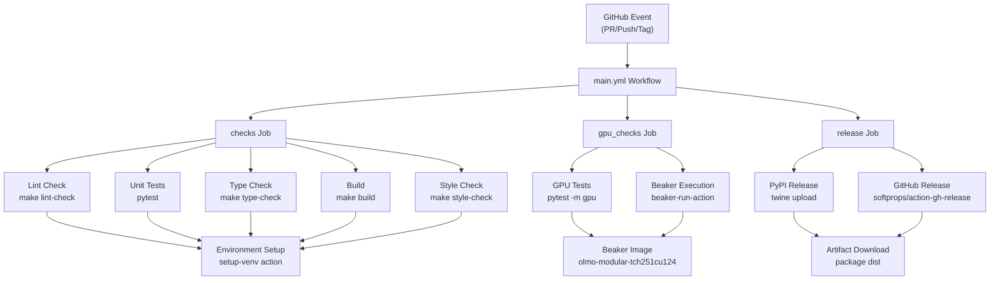
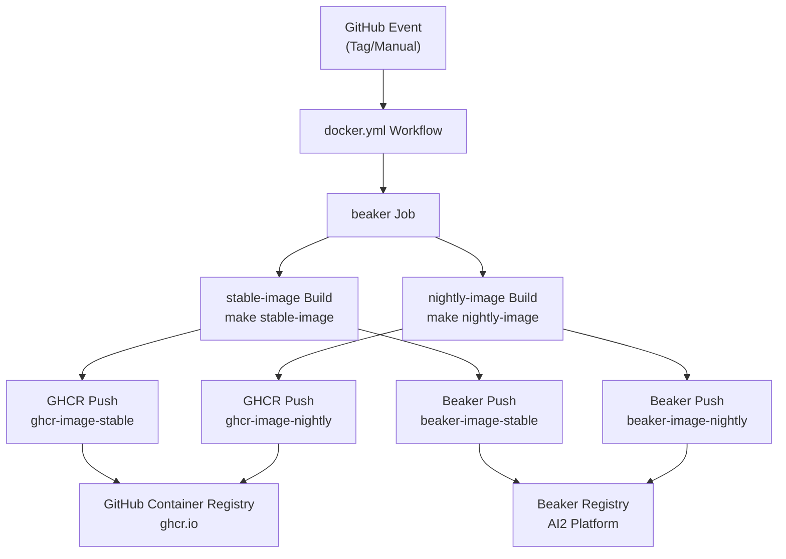
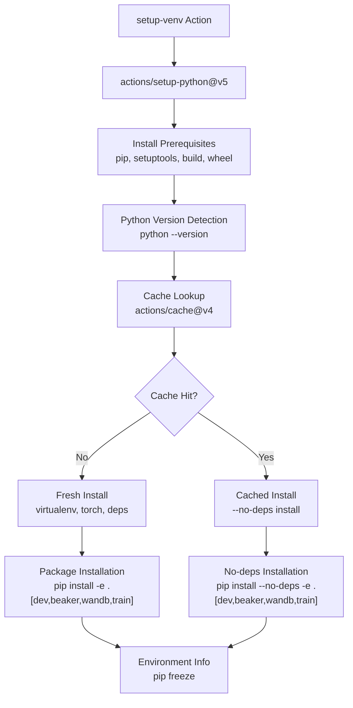
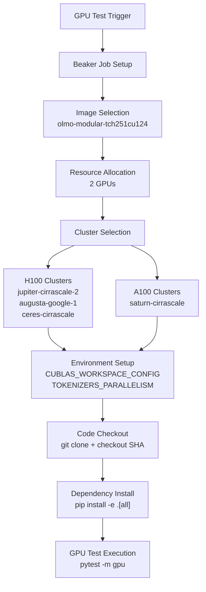
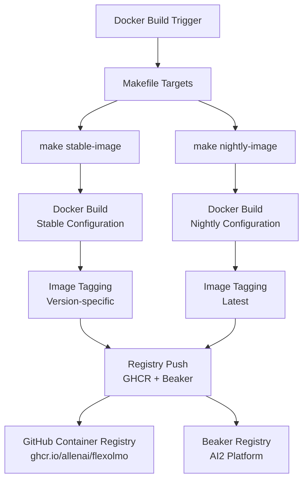
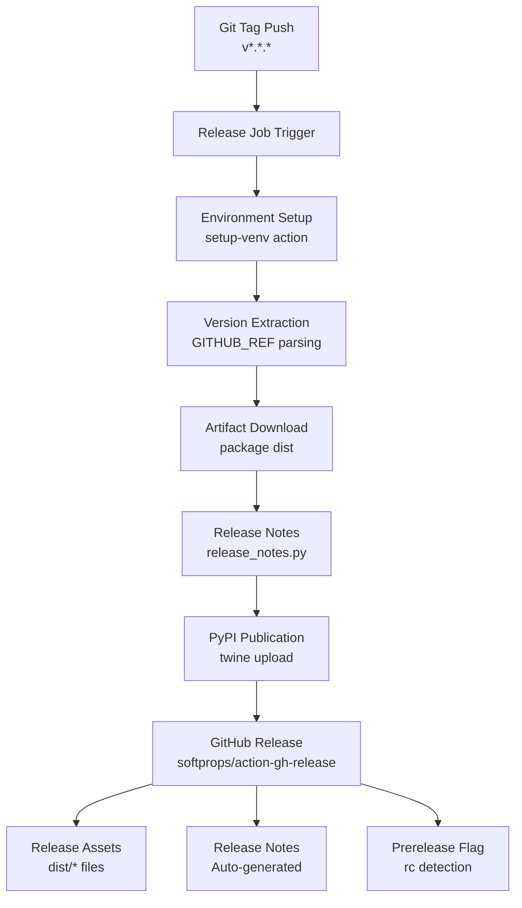

<!-- source: DeepWiki mcp.deepwiki.com · repo allenai/FlexOlmo · page 6.2 CI/CD and Containerization · fetched 2026-10-26 -->

# CI/CD and Containerization

Relevant source files

The following files were used as context for generating this wiki page:

- [.github/actions/setup-venv/action.yml](.github/actions/setup-venv/action.yml)
- [.github/workflows/docker.yml](.github/workflows/docker.yml)
- [.github/workflows/main.yml](.github/workflows/main.yml)

This document covers FlexOlmo's continuous integration and deployment (CI/CD) pipeline and containerization infrastructure. The CI/CD system automates code quality checks, testing, and releases, while the containerization system provides reproducible environments for both development and production workloads.

For information about Beaker platform deployment and distributed training, see [Beaker Platform Integration](#6.1).

## CI/CD Pipeline Overview

FlexOlmo uses GitHub Actions to implement a comprehensive CI/CD pipeline that ensures code quality, runs tests across multiple environments, and automates releases. The pipeline consists of two main workflows that handle different aspects of the development lifecycle.

### Main CI/CD Workflow

The primary CI/CD workflow orchestrates code quality checks, testing, and release processes through multiple jobs that run in parallel where possible.

Sources: [.github/workflows/main.yml:1-226]()

### Docker Build Workflow

The Docker workflow manages container image building and publishing for both development and production environments.

Sources: [.github/workflows/docker.yml:1-84]()

## GitHub Actions Configuration

### Environment Variables and Secrets

The CI/CD pipeline uses several environment variables and secrets to configure execution environments and authenticate with external services.

| Variable | Purpose | Source |
|----------|---------|---------|
| `CACHE_PREFIX` | Invalidates existing cache | [.github/workflows/main.yml:19]() |
| `PYTHONPATH` | Python module search path | [.github/workflows/main.yml:20]() |
| `AWS_ACCESS_KEY_ID` | AWS authentication | [.github/workflows/main.yml:21]() |
| `AWS_SECRET_ACCESS_KEY` | AWS authentication | [.github/workflows/main.yml:22]() |
| `BEAKER_TOKEN` | Beaker platform access | [.github/workflows/main.yml:23]() |
| `GITHUB_TOKEN` | GitHub API access | [.github/workflows/main.yml:24]() |

### Custom Actions

The pipeline includes a custom action for Python environment setup that optimizes dependency installation through caching.

Sources: [.github/actions/setup-venv/action.yml:1-64]()

## Testing Infrastructure

### CPU Testing

The standard testing pipeline runs on Ubuntu runners and includes comprehensive code quality checks.

| Check Type | Command | Purpose |
|------------|---------|---------|
| Lint | `make lint-check` | Code style and formatting |
| Test | `pytest -v --color=yes --durations=3 src/test/` | Unit and integration tests |
| Type Check | `make type-check` | Static type analysis |
| Build | `make build` | Package building |
| Style | `make style-check` | Code formatting verification |

### GPU Testing

GPU tests run on Beaker platform using specialized hardware configurations and container images.

Sources: [.github/workflows/main.yml:89-178]()

## Containerization Strategy

### Docker Image Types

FlexOlmo maintains two primary Docker image variants optimized for different use cases:

- **Stable Images**: Production-ready containers with pinned dependencies
- **Nightly Images**: Development containers with latest dependencies

### Build Process

The containerization process integrates with the project's Makefile targets to ensure consistency across environments.

### Registry Integration

The system publishes containers to multiple registries:

- **GitHub Container Registry (GHCR)**: Public access for external users
- **Beaker Registry**: Internal AI2 platform for distributed training

Sources: [.github/workflows/docker.yml:53-83]()

## Release Process

### Automated Release Pipeline

The release process triggers on Git tags and automates package distribution across multiple channels.

### Release Artifacts

The release process generates and publishes several artifacts:

| Artifact Type | Location | Purpose |
|---------------|----------|---------|
| Python Package | PyPI | Standard pip installation |
| GitHub Release | GitHub Releases | Source code snapshots |
| Docker Images | GHCR & Beaker | Container deployments |
| Distribution Files | GitHub Actions | Build artifacts |

Sources: [.github/workflows/main.yml:180-226]()

## Quality Assurance

### Cache Management

The CI/CD pipeline implements sophisticated caching strategies to optimize build times and resource usage.

- **Virtual Environment Cache**: Keyed by Python version, torch version, and dependency file hashes
- **MyPy Cache**: Separate cache for type checking to speed up static analysis
- **Dependency Cache**: Shared across jobs to minimize redundant installations

### Security and Authentication

The pipeline integrates with external services through secure token management:

- **PyPI Token**: Automated package publishing
- **Beaker Token**: Distributed computing platform access
- **GitHub Token**: Repository and registry access
- **AWS Credentials**: Cloud resource authentication

Sources: [.github/workflows/main.yml:17-25](), [.github/actions/setup-venv/action.yml:33-39]()

---

