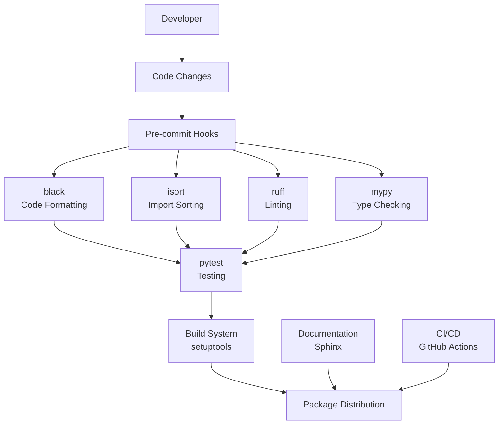
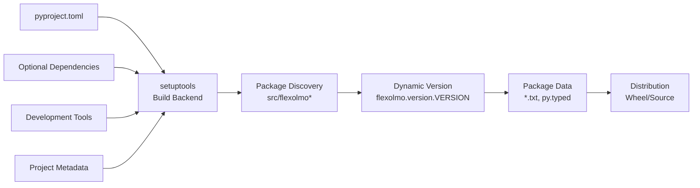
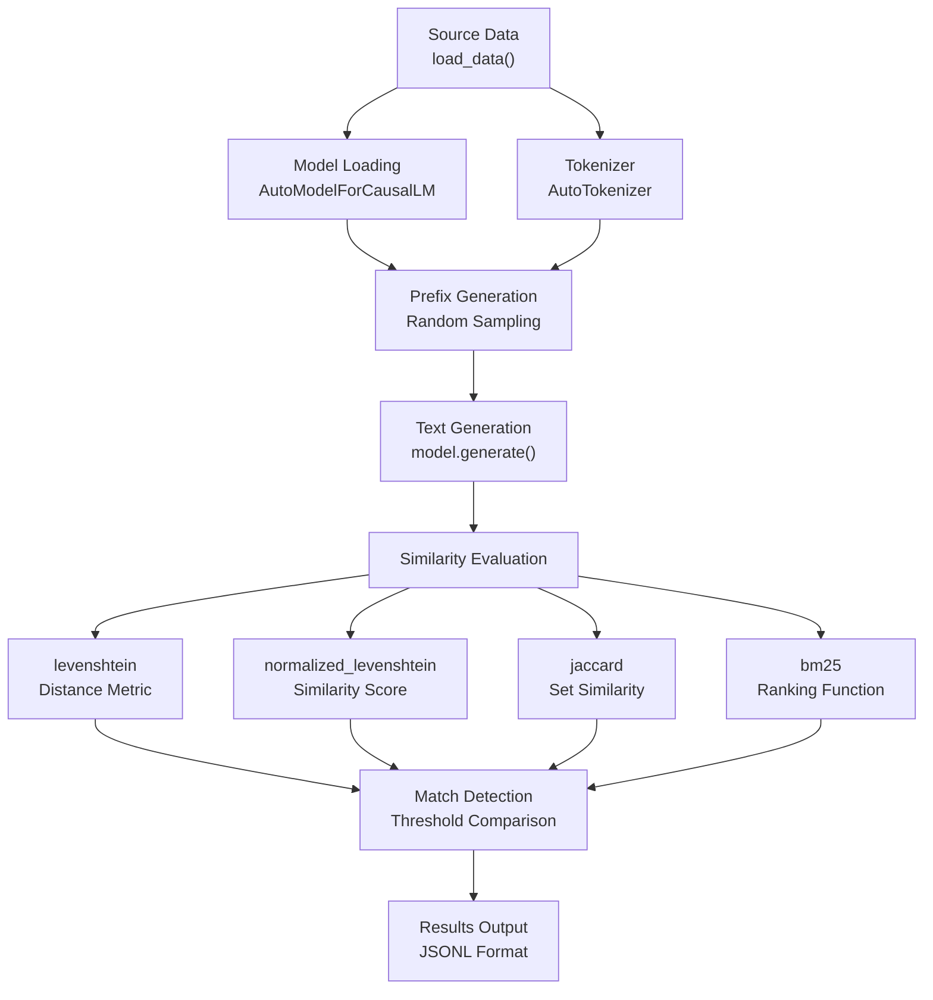
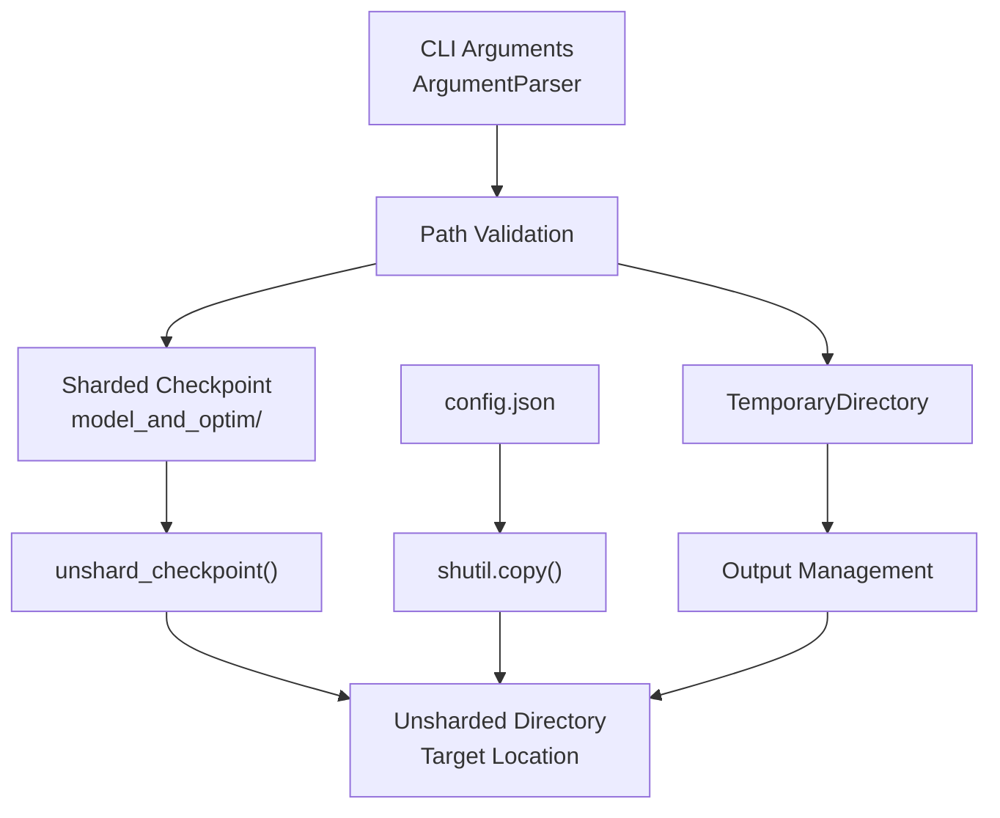
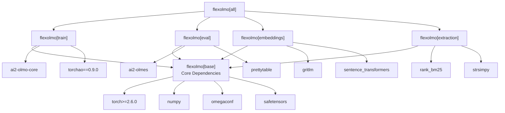

<!-- source: DeepWiki mcp.deepwiki.com · repo allenai/FlexOlmo · page 7 Development and Utilities · fetched 2026-10-26 -->

# Development and Utilities

Relevant source files

The following files were used as context for generating this wiki page:

- [pyproject.toml](pyproject.toml)
- [scripts/extraction_analysis.sh](scripts/extraction_analysis.sh)
- [src/scripts/utils/extraction_analysis.py](src/scripts/utils/extraction_analysis.py)
- [src/scripts/utils/unshard.py](src/scripts/utils/unshard.py)

This document covers the development tools, utilities, and project maintenance resources available in FlexOlmo. This includes the build system configuration, development environment setup, utility scripts for model and data analysis, and code quality tools.

For information about project-level configuration including dependencies and build system details, see [Project Configuration](#7.2). For command-line utilities for checkpoint management and model conversion, see [Utilities and Tools](#7.1). For third-party dependencies and licensing information, see [Attribution and Licensing](#7.3).

## Development Environment

FlexOlmo uses a comprehensive development environment configuration managed through `pyproject.toml`. The development setup includes code formatting, linting, type checking, testing, and documentation tools.

### Development Dependencies

The project defines several optional dependency groups to support different development workflows:

| Dependency Group | Purpose | Key Tools |
|------------------|---------|-----------|
| `dev` | Core development tools | `ruff`, `mypy`, `black`, `isort`, `pytest` |
| `beaker` | Distributed computing platform | `beaker-py`, `beaker-gantry` |
| `train` | Model training dependencies | `ai2-olmo-core`, `torchao` |
| `eval` | Model evaluation tools | `ai2-olmes`, `prettytable` |
| `embeddings` | Domain embedding utilities | `gritlm`, `sentence_transformers` |
| `extraction` | Data extraction analysis | `transformers`, `rank_bm25` |

**Development Tools Workflow**

Sources: [pyproject.toml:32-53](), [pyproject.toml:112-199]()

## Build System and Package Configuration

FlexOlmo uses `setuptools` as its build backend with dynamic versioning and comprehensive package configuration. The build system is configured to handle multiple optional dependency groups and maintain consistent code quality standards.

### Package Structure

The package is organized with source code in the `src/` directory and uses dynamic version resolution from `flexolmo.version.VERSION`. The build system includes package data and supports both development and production installations.

**Build System Configuration**

Sources: [pyproject.toml:1-31](), [pyproject.toml:98-111]()

## Utility Scripts

FlexOlmo provides several utility scripts for model analysis, checkpoint management, and data extraction evaluation. These tools support research workflows and model development tasks.

### Extraction Analysis Utility

The `extraction_analysis.py` script analyzes a model's data extraction capabilities and memorization patterns. It generates text samples from prefixes and evaluates their similarity to training data using various similarity metrics.

**Key Components:**
- **Model Loading**: Uses HuggingFace Transformers for model and tokenizer initialization
- **Similarity Metrics**: Supports multiple similarity measures including Levenshtein distance, Jaccard similarity, and BM25 scoring
- **Generation Parameters**: Configurable prefix length, generation length, and sampling parameters
- **Evaluation Criteria**: Threshold-based matching for determining memorization

**Extraction Analysis Workflow**

Sources: [src/scripts/utils/extraction_analysis.py:1-256](), [scripts/extraction_analysis.sh:1-21]()

### Checkpoint Unsharding Utility

The `unshard.py` script converts sharded model checkpoints into unsharded format, facilitating model deployment and analysis workflows.

**Unsharding Process:**
- **Input Validation**: Checks for sharded checkpoint directories
- **Checkpoint Processing**: Uses `olmo_core.distributed.checkpoint.unshard_checkpoint` for conversion
- **Configuration Copying**: Preserves model configuration files
- **Output Management**: Handles both temporary and persistent output directories

**Checkpoint Unsharding Flow**

Sources: [src/scripts/utils/unshard.py:1-44]()

## Code Quality and Testing

FlexOlmo maintains high code quality through automated formatting, linting, and testing. The configuration supports both local development and CI/CD workflows.

### Formatting and Linting Tools

| Tool | Purpose | Configuration |
|------|---------|---------------|
| `black` | Code formatting | Line length: 100, excludes build/cache directories |
| `isort` | Import sorting | Black-compatible profile, multi-line output |
| `ruff` | Fast linting | Line length: 115, ignores F403/F405/E501 |
| `mypy` | Type checking | Ignores missing imports, checks untyped defs |

### Testing Framework

The project uses `pytest` with the following configuration:
- **Test Discovery**: Automatically finds test classes following `Test*` or `*Test` patterns
- **Logging**: Configurable debug-level logging for test execution
- **Markers**: Support for GPU-specific tests
- **Warnings**: Filtered warnings for common third-party deprecations

**Code Quality Pipeline**

Sources: [pyproject.toml:112-199]()

## Dependency Management

FlexOlmo uses a modular dependency structure that allows users to install only the components they need. The base package requires minimal dependencies, while optional features are available through additional dependency groups.

### Core Dependencies

The base installation requires:
- `torch>=2.6.0` for deep learning functionality
- `numpy` for numerical computations
- `cached-path` for efficient file caching
- `omegaconf` for configuration management
- `safetensors` for secure model serialization

### Optional Feature Dependencies

Each optional dependency group enables specific functionality:
- **Training**: Includes `ai2-olmo-core` and optimization libraries
- **Evaluation**: Adds `ai2-olmes` evaluation framework
- **Embeddings**: Enables domain embedding computation with `gritlm`
- **Extraction**: Provides data extraction analysis tools
- **Beaker**: Supports distributed computing on AI2's platform

**Dependency Architecture**

Sources: [pyproject.toml:15-96]()

---

