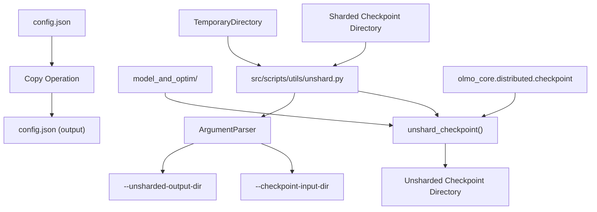
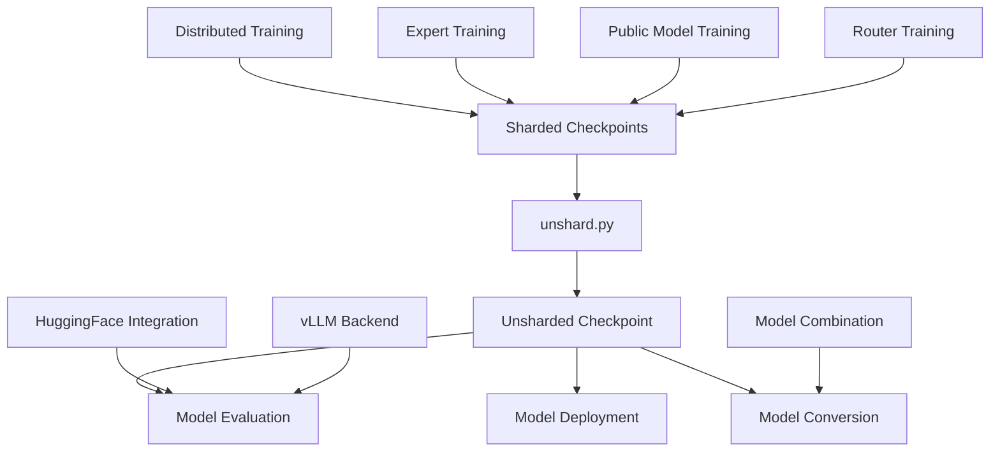
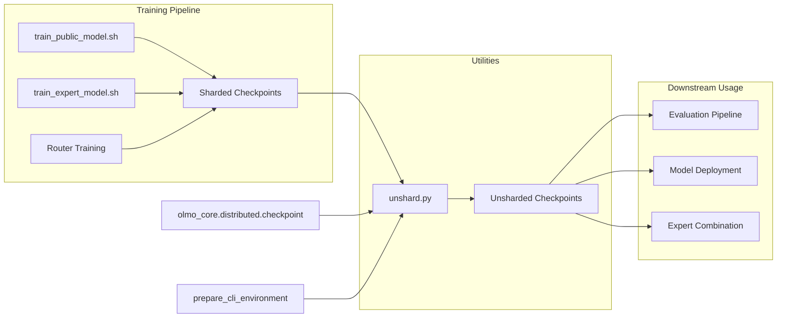

<!-- source: DeepWiki mcp.deepwiki.com · repo allenai/FlexOlmo · page 7.1 Utilities and Tools · fetched 2026-10-26 -->

# Utilities and Tools

Relevant source files

The following files were used as context for generating this wiki page:

- [src/scripts/utils/unshard.py](src/scripts/utils/unshard.py)

This document covers the command-line utilities and development tools provided by FlexOlmo for checkpoint management, model conversion, and development tasks. These utilities support the model training and deployment workflow by handling common operations like checkpoint format conversion and model artifact management.

For information about project-level configuration and dependencies, see [Project Configuration](#7.2). For infrastructure deployment tools, see [Infrastructure and Deployment](#6).

## Checkpoint Management Utilities

FlexOlmo provides utilities for managing model checkpoints and converting between different checkpoint formats, which is essential for the distributed training workflow and model deployment process.

### Checkpoint Unsharding

The `unshard.py` utility converts sharded model checkpoints (distributed across multiple files) into a single unsharded checkpoint format. This is typically needed when transitioning from distributed training to single-GPU inference or when preparing models for deployment.

The unsharding process involves several key steps:

| Step | Operation | Code Reference |
|------|-----------|----------------|
| 1 | Parse command-line arguments | [src/scripts/utils/unshard.py:13-18]() |
| 2 | Locate sharded checkpoint directory | [src/scripts/utils/unshard.py:28-29]() |
| 3 | Create output directory | [src/scripts/utils/unshard.py:31]() |
| 4 | Unshard model checkpoint | [src/scripts/utils/unshard.py:32]() |
| 5 | Copy configuration file | [src/scripts/utils/unshard.py:35]() |

The utility handles two main scenarios:
- **Sharded checkpoints**: When a `model_and_optim/` directory exists, it unshards the checkpoint using `unshard_checkpoint()` from `olmo_core.distributed.checkpoint`
- **Already unsharded**: When no sharded directory is found, it uses the input directory directly

### Usage Patterns

The unsharding utility is commonly used in the following workflow contexts:

**Command-line interface:**
- `-i, --checkpoint-input-dir`: Path to the sharded checkpoint directory
- `-o, -u, --unsharded-output-dir`: Path for the unsharded output (optional, uses temporary directory if not specified)

The utility integrates with FlexOlmo's logging system and uses `prepare_cli_environment()` to ensure proper environment setup for CLI operations.

Sources: [src/scripts/utils/unshard.py:1-44]()

## Integration with FlexOlmo Workflow

These utilities are designed to work seamlessly with FlexOlmo's training and evaluation pipeline, providing essential checkpoint management capabilities.

The utilities serve as bridge components between the distributed training environment and various downstream applications that require single-file checkpoint formats. This is particularly important for:

- **Model evaluation**: Evaluation backends often expect unsharded checkpoints
- **Expert combination**: The model combination process requires access to individual expert checkpoints
- **Deployment preparation**: Converting models for inference deployment
- **Development workflows**: Enabling easier model inspection and debugging

Sources: [src/scripts/utils/unshard.py:1-44]()

---

