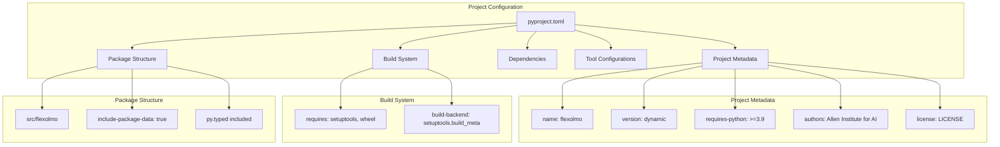
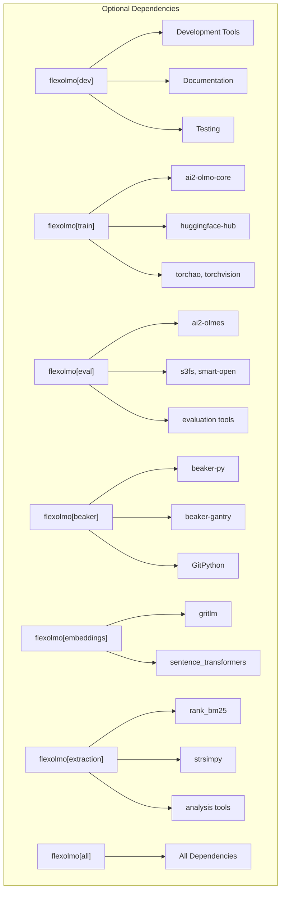
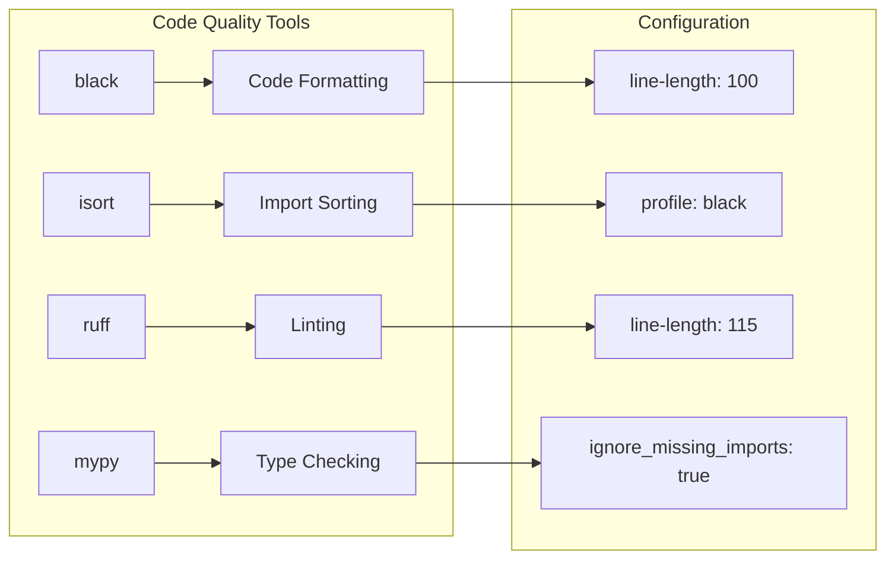
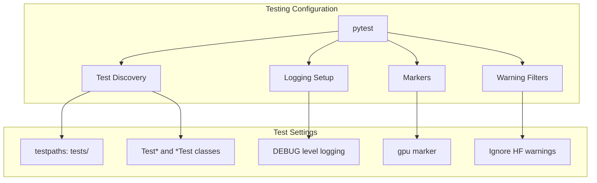
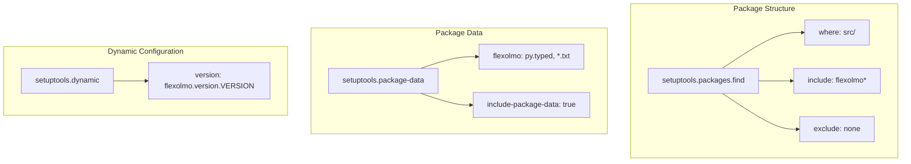

<!-- source: DeepWiki mcp.deepwiki.com · repo allenai/FlexOlmo · page 7.2 Project Configuration · fetched 2026-10-26 -->

# Project Configuration

<details>
<summary>Relevant source files</summary>

The following files were used as context for generating this wiki page:

- [pyproject.toml](pyproject.toml)
- [scripts/extraction_analysis.sh](scripts/extraction_analysis.sh)
- [src/scripts/utils/extraction_analysis.py](src/scripts/utils/extraction_analysis.py)

</details>


This document covers the project-level configuration for FlexOlmo, including build system setup, dependency management, development tools, and testing configuration. The primary configuration is defined in `pyproject.toml` which serves as the central configuration file for the entire project.

For information about experiment and training configuration, see [Configuration System](#2.3). For deployment and infrastructure setup, see [Infrastructure and Deployment](#6).

## Project Structure and Metadata

FlexOlmo is configured as a Python package with the following core structure:



The project metadata is defined in [pyproject.toml:5-31](), establishing FlexOlmo as a Python package with dynamic versioning sourced from `flexolmo.version.VERSION` [pyproject.toml:105](). The package structure follows the `src/` layout pattern with all package code located under `src/flexolmo/` [pyproject.toml:107-110]().

**Sources:** pyproject.toml

## Dependency Management

FlexOlmo uses a modular dependency structure with core dependencies and optional dependency groups for different use cases:

### Core Dependencies

The base installation includes essential dependencies [pyproject.toml:15-25]():

| Dependency | Purpose |
|------------|---------|
| `numpy` | Numerical computing |
| `torch>=2.6.0` | Deep learning framework |
| `cached-path` | File caching utilities |
| `requests` | HTTP requests |
| `packaging` | Package version utilities |
| `rich` | Terminal formatting |
| `omegaconf` | Configuration management |
| `safetensors` | Tensor serialization |
| `importlib_resources` | Resource loading |

### Optional Dependency Groups



The optional dependencies are organized by functional area [pyproject.toml:32-96]():

- **dev**: Development tools including linting, testing, and documentation
- **train**: Training pipeline dependencies including OLMo-core integration
- **eval**: Evaluation framework dependencies including OLMES
- **beaker**: Beaker platform integration for distributed computing
- **embeddings**: Domain embedding computation tools
- **extraction**: Data extraction analysis utilities
- **wandb**: Weights & Biases integration for experiment tracking
- **all**: Meta-package including all optional dependencies

**Sources:** pyproject.toml

## Development Tools Configuration

FlexOlmo integrates multiple development tools with standardized configurations:

### Code Formatting and Linting



- **Black**: Code formatter with 100-character line limit [pyproject.toml:112-127]()
- **isort**: Import sorter configured for black compatibility [pyproject.toml:129-131]()
- **Ruff**: Fast linter with 115-character line limit [pyproject.toml:133-165]()
- **mypy**: Type checker with relaxed missing import handling [pyproject.toml:170-179]()

### Testing Configuration

The testing setup uses pytest with specific markers and filtering [pyproject.toml:181-199]():



**Sources:** pyproject.toml

## Build and Packaging Configuration

The build system uses setuptools with specific package discovery and data inclusion rules:

### Package Discovery



Key configuration elements [pyproject.toml:98-110]():
- Package discovery from `src/` directory
- Inclusion of type information (`py.typed`)
- Dynamic version resolution from module attribute
- Automatic package data inclusion

### Version Management

The project uses dynamic versioning where the version is determined at build time from `flexolmo.version.VERSION` [pyproject.toml:105](). This allows for programmatic version management and ensures consistency across the codebase.

**Sources:** pyproject.toml

## Integration with Development Workflows

The project configuration supports multiple development and deployment scenarios:

### Local Development

For local development, the `dev` dependency group provides all necessary tools:
```bash
pip install -e ".[dev]"
```

### Training Workflows

Training scenarios require the `train` dependency group which includes OLMo-core integration [pyproject.toml:62-68]():
```bash
pip install -e ".[train]"
```

### Evaluation Workflows

Evaluation pipelines use the `eval` dependency group with OLMES integration [pyproject.toml:69-75]():
```bash
pip install -e ".[eval]"
```

### Complete Installation

The `all` meta-package provides comprehensive functionality [pyproject.toml:94-96]():
```bash
pip install -e ".[all]"
```

**Sources:** pyproject.toml, scripts/extraction_analysis.sh

---

