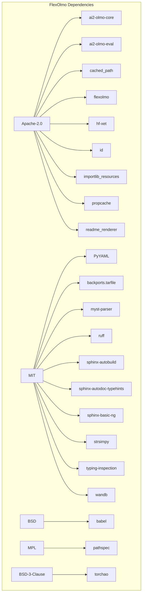
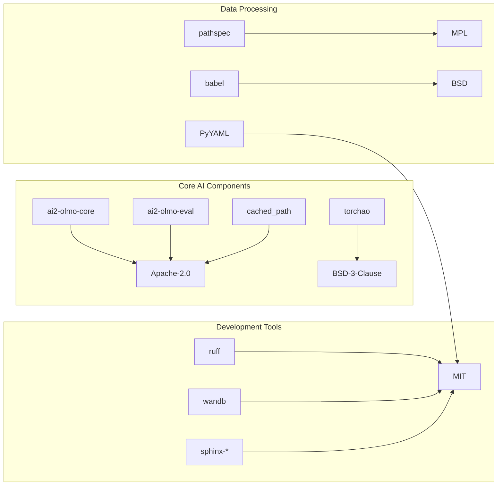
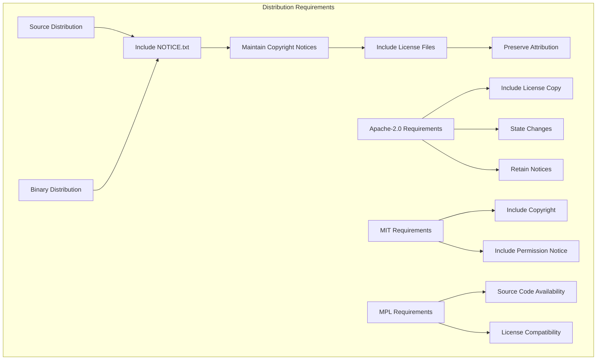
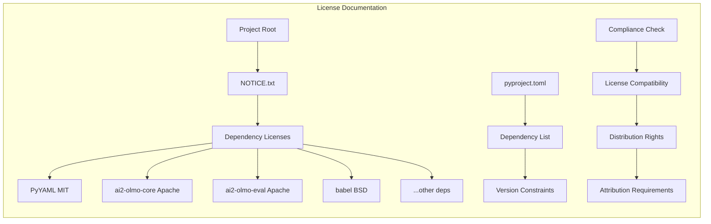

<!-- source: DeepWiki mcp.deepwiki.com · repo allenai/FlexOlmo · page 7.3 Attribution and Licensing · fetched 2026-10-26 -->

# Attribution and Licensing

Relevant source files

The following files were used as context for generating this wiki page:

- [NOTICE.txt](NOTICE.txt)

This document provides comprehensive information about the licensing and attribution requirements for the FlexOlmo project and its third-party dependencies. It covers the project's own licensing terms, third-party dependency licenses, and compliance requirements for users and distributors.

For information about project configuration and dependencies, see [Project Configuration](#7.2).

## FlexOlmo Project License

FlexOlmo is licensed under the Apache License 2.0. The project appears twice in the license notices with identical licensing terms, confirming its consistent Apache-2.0 licensing across all components.

**Sources:** [NOTICE.txt:721-925](), [NOTICE.txt:928-1132]()

## Third-Party Dependencies and Licenses

The FlexOlmo project incorporates material from multiple third-party libraries, each with their own licensing terms. These dependencies are essential for the project's functionality across training, evaluation, and infrastructure components.

### License Distribution Overview

**Sources:** [NOTICE.txt:1-2572]()

### Core AI/ML Dependencies

The project relies heavily on AI2's internal libraries and machine learning frameworks:

**Sources:** [NOTICE.txt:36-447](), [NOTICE.txt:2501-2515](), [NOTICE.txt:512-718]()

## License Categories and Compliance

### Apache-2.0 Licensed Components

The majority of dependencies use Apache-2.0 licensing, which is compatible with the project's main license:

| Component | Version | License | Primary Use |
|-----------|---------|---------|-------------|
| `ai2-olmo-core` | 2.0.1 | Apache-2.0 | Core model functionality |
| `ai2-olmo-eval` | 0.7.0 | Apache-2.0 | Evaluation framework |
| `cached_path` | 1.7.3 | Apache-2.0 | Path caching utilities |
| `flexolmo` | 0.1.0 | Apache-2.0 | Main project |
| `hf-xet` | 1.1.3 | Apache-2.0 | HuggingFace integration |
| `id` | 1.5.0 | Apache-2.0 | ID generation |
| `importlib_resources` | 6.5.2 | Apache-2.0 | Resource management |
| `propcache` | 0.3.1 | Apache-2.0 | Property caching |
| `readme_renderer` | 43 | Apache-2.0 | Documentation rendering |

**Sources:** [NOTICE.txt:36-240](), [NOTICE.txt:243-447](), [NOTICE.txt:512-718](), [NOTICE.txt:721-925](), [NOTICE.txt:1135-1341](), [NOTICE.txt:1344-1552](), [NOTICE.txt:1555-1763](), [NOTICE.txt:1954-2162](), [NOTICE.txt:2165-2373]()

### MIT Licensed Components

Several development and utility libraries use MIT licensing:

| Component | Version | License | Primary Use |
|-----------|---------|---------|-------------|
| `PyYAML` | 6.0.2 | MIT | Configuration parsing |
| `backports.tarfile` | 1.2.0 | MIT | Archive handling |
| `myst-parser` | 4.0.1 | MIT | Markdown parsing |
| `ruff` | 0.11.13 | MIT | Code linting |
| `sphinx-autobuild` | 2021.3.14 | MIT | Documentation building |
| `sphinx-autodoc-typehints` | 1.23.3 | MIT | Type hint documentation |
| `sphinx-basic-ng` | 1.0.0b2 | MIT | Documentation theming |
| `strsimpy` | 0.2.1 | MIT | String similarity |
| `typing-inspection` | 0.4.1 | MIT | Type inspection |
| `wandb` | 0.20.1 | MIT | Experiment tracking |

**Sources:** [NOTICE.txt:8-33](), [NOTICE.txt:485-509](), [NOTICE.txt:1766-1792](), [NOTICE.txt:2376-2400](), [NOTICE.txt:2403-2415](), [NOTICE.txt:2418-2444](), [NOTICE.txt:2447-2471](), [NOTICE.txt:2474-2498](), [NOTICE.txt:2518-2542](), [NOTICE.txt:2545-2569]()

### Other License Types

The project includes dependencies with specialized licensing:

- **Mozilla Public License (MPL)**: `pathspec` 0.12.1 for path specification matching
- **BSD**: `babel` 2.17.0 for internationalization
- **BSD-3-Clause**: `torchao` 0.9.0 for PyTorch optimization

**Sources:** [NOTICE.txt:450-482](), [NOTICE.txt:1795-1951](), [NOTICE.txt:2501-2515]()

## Attribution Requirements

### Notice File Compliance

The project maintains a comprehensive `NOTICE.txt` file that includes:

1. **Header**: Clear indication that the software incorporates third-party material
2. **Dependency Sections**: Each dependency with its version, license type, and full license text
3. **Separation**: Clear delineation between different dependencies using separator lines
4. **Copyright Information**: Proper attribution of copyright holders

**Sources:** [NOTICE.txt:1-6]()

### Distribution Requirements

When distributing FlexOlmo or derivative works, the following attribution requirements must be met:

**Sources:** [NOTICE.txt:1-2572]()

## License Documentation Structure

The licensing information is systematically organized within the project:

**Sources:** [NOTICE.txt:1-2572]()

### Automated License Management

The project structure suggests automated license collection and management:

1. **Centralized Notice File**: All third-party licenses consolidated in `NOTICE.txt`
2. **Consistent Formatting**: Standardized format with separator lines between dependencies
3. **Version Tracking**: Each dependency includes specific version numbers
4. **Full License Text**: Complete license texts included for compliance

**Sources:** [NOTICE.txt:1-2572]()

## Compliance Summary

FlexOlmo maintains comprehensive license compliance through:

- **Apache-2.0 Main License**: Permissive licensing for the core project
- **Compatible Dependencies**: All third-party licenses are compatible with distribution
- **Proper Attribution**: Complete attribution information provided
- **Documentation**: Clear documentation of all licensing requirements
- **Automated Management**: Systematic approach to license tracking and compliance

This licensing structure enables flexible use and distribution of FlexOlmo while ensuring proper attribution to all contributors and maintaining legal compliance across all incorporated components.

**Sources:** [NOTICE.txt:1-2572]()