# Page: Overview

# Overview

<details>
<summary>Relevant source files</summary>

The following files were used as context for generating this wiki page:

- [README.md](README.md)
- [assets/FlexOlmo_Logo.png](assets/FlexOlmo_Logo.png)

</details>


## Purpose and Scope

FlexOlmo is a Mixture of Experts (MoE) language model system that enables data collaboration without requiring direct data sharing. The system allows data owners to contribute specialized expert models trained on their proprietary datasets while maintaining control over their data. This document provides a comprehensive overview of FlexOlmo's architecture, training pipeline, evaluation framework, and key components.

For detailed information about specific subsystems, see:
- Training processes: [Training Pipeline](#3)
- Evaluation framework: [Evaluation System](#4)
- Infrastructure deployment: [Infrastructure and Deployment](#6)

## System Architecture

FlexOlmo implements a sophisticated MoE architecture that combines multiple domain-specific expert models through an intelligent routing system. The system consists of three main layers: the training pipeline, the MoE model architecture, and the evaluation framework.

### FlexOlmo System Architecture

```mermaid
graph TB
    subgraph "Training Pipeline"
        A[train_public_model.sh] --> B["Dense 7B Public Model"]
        C[train_expert_model.sh] --> D["Domain Expert Models"]
        E[combine_experts.sh] --> F["FlexOlmo-7x7B Model"]
        G[router_training] --> H["FlexOlmo-7x7B-RT"]
    end
    
    subgraph "MoE Architecture"
        I["TransformerConfig"] --> J["Extended MoE Router"]
        K["Expert Networks"] --> L["Router System"]
        M["Domain Embeddings"] --> N["Expert Selection"]
    end
    
    subgraph "Evaluation Framework"
        O[launch_eval.py] --> P["Task Orchestration"]
        Q["Model Backends"] --> R["Evaluation Metrics"]
        S["Task Suites"] --> T["Results Aggregation"]
    end
    
    subgraph "Configuration Management"
        U["ExperimentConfig"] --> V["CommonComponents"]
        W["CustomDataMix"] --> X["Training Configuration"]
    end
    
    B --> F
    D --> F
    F --> H
    J --> L
    K --> L
    M --> N
    P --> R
    R --> T
    U --> X
    W --> X
```

**Sources:** [README.md:1-113](), [src/scripts/train/](), [src/scripts/eval/]()

## Core Components

The FlexOlmo system is built around several key components that handle model training, expert combination, routing, and evaluation.

### Core Component Architecture

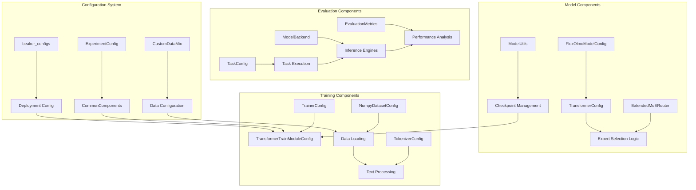

**Sources:** [src/flexolmo/](), [src/scripts/](), [beaker_configs/]()

## Training Pipeline Overview

FlexOlmo employs a three-stage training approach that progresses from public model training to expert specialization and finally to model combination with router optimization.

| Stage | Component | Purpose | Output |
|-------|-----------|---------|--------|
| 1 | `train_public_model.sh` | Train base dense model on public data | `Flex-public-7B-1T` |
| 2 | `train_expert_model.sh` | Train domain-specific experts | Expert models (Math, Code, News, etc.) |
| 3 | `combine_experts.sh` | Combine experts into MoE model | `FlexOlmo-7x7B-1T` |
| 4 | Router Training | Optional router optimization | `FlexOlmo-7x7B-RT` |

The system supports training on multiple domains including:
- **Public Mix**: General knowledge from 1T tokens
- **Math**: Mathematical reasoning and computation
- **Code**: Programming and software development
- **News**: Current events and journalism
- **Academic**: Research papers and scholarly content
- **Creative Writing**: Literature and creative content
- **Reddit**: Social media and discussion content

**Sources:** [README.md:41-49](), [src/scripts/train/](), [scripts/]()

## Evaluation System Overview

FlexOlmo includes a comprehensive evaluation framework built on OLMES that supports multiple task types, model backends, and execution environments.

### Evaluation Pipeline Architecture

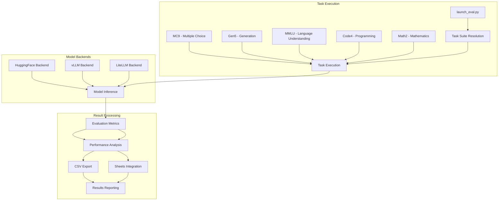

The evaluation system supports various task suites:
- **MC9**: 9 multiple choice tasks
- **Gen5**: 5 generation tasks  
- **MMLU**: Language understanding benchmarks
- **Code4**: 4 programming tasks
- **Math2**: 8 mathematics tasks
- **BBH**: Big Bench Hard tasks
- **AGI Eval**: General intelligence evaluation

**Sources:** [README.md:57-96](), [src/scripts/eval/](), [setup_eval_env.sh]()

## Key Features and Capabilities

### Data Collaboration Model
FlexOlmo enables a new paradigm of data collaboration where:
- Data owners contribute expert models without sharing raw data
- Contributors maintain control over when their data is active
- Data can be deactivated at any time
- Attribution is provided for inference usage

### Technical Architecture
- **33B Total Parameters**: Achieved through 7x7B MoE architecture
- **Flexible Routing**: Extended MoE router with expert bias and auxiliary-loss-free design
- **Multi-Backend Support**: Compatible with HuggingFace, vLLM, and LiteLLM
- **Distributed Training**: Beaker platform integration for scalable training

### Performance Characteristics
Based on evaluation results, FlexOlmo-7x7B-1T achieves:
- **70.4** on MC9 (Multiple Choice)
- **60.1** on Gen5 (Generation)
- **60.2** on MMLU (Language Understanding)
- **47.9** on Math2 (Mathematics)
- **52.0** overall average across all tasks

**Sources:** [README.md:22-24](), [README.md:81-95](), [assets/FlexOlmo_Logo.png]()

## Installation and Setup

FlexOlmo is built using OLMo-core and requires Python 3.10. The system supports multiple installation configurations:

```bash
# Basic installation
git clone https://github.com/allenai/FlexOlmo.git
cd FlexOlmo
conda create -n flexolmo python=3.10
conda activate flexolmo
pip install -e ".[train,beaker,wandb]"
```

The system includes Docker support through OLMo-core's published images and provides a custom Dockerfile for building specialized containers.

**Sources:** [README.md:25-40](), [src/Dockerfile](), [pyproject.toml]()

---

# Page: Getting Started

# Getting Started

<details>
<summary>Relevant source files</summary>

The following files were used as context for generating this wiki page:

- [.github/actions/setup-venv/action.yml](.github/actions/setup-venv/action.yml)
- [.github/workflows/docker.yml](.github/workflows/docker.yml)
- [README.md](README.md)
- [assets/FlexOlmo_Logo.png](assets/FlexOlmo_Logo.png)

</details>


This document provides installation instructions, basic setup, and first steps for using FlexOlmo. It covers environment setup, model usage, and running basic operations to get you up and running with the FlexOlmo system.

For detailed information about the system architecture and components, see [Architecture](#2). For comprehensive training procedures, see [Training Pipeline](#3). For evaluation workflows, see [Evaluation System](#4).

## Installation and Environment Setup

FlexOlmo requires Python 3.10 and is built on top of [OLMo-core](https://github.com/allenai/OLMo-core.git). The system supports multiple installation methods depending on your use case.

### Basic Installation

```bash
git clone https://github.com/allenai/FlexOlmo.git
cd FlexOlmo
conda create -n flexolmo python=3.10
conda activate flexolmo
pip install -e ".[train,beaker,wandb]"  # for training
```

### Installation Options

The system provides several installation configurations:

- **Training**: `pip install -e ".[train,beaker,wandb]"` - Includes all dependencies for model training
- **Evaluation**: `pip install -e ".[dev,beaker,wandb,train]"` - Includes evaluation capabilities
- **Development**: `pip install -e ".[dev,beaker,wandb,train]"` - Full development environment

### Docker-based Setup

FlexOlmo provides pre-built Docker images that contain all core and optional dependencies. You can use the provided `Dockerfile` or adapt it for your needs:

```bash
# Using the provided Dockerfile
docker build -f src/Dockerfile -t flexolmo .
```

The system also maintains Beaker images for distributed training and evaluation workloads.

**Installation Flow Diagram**

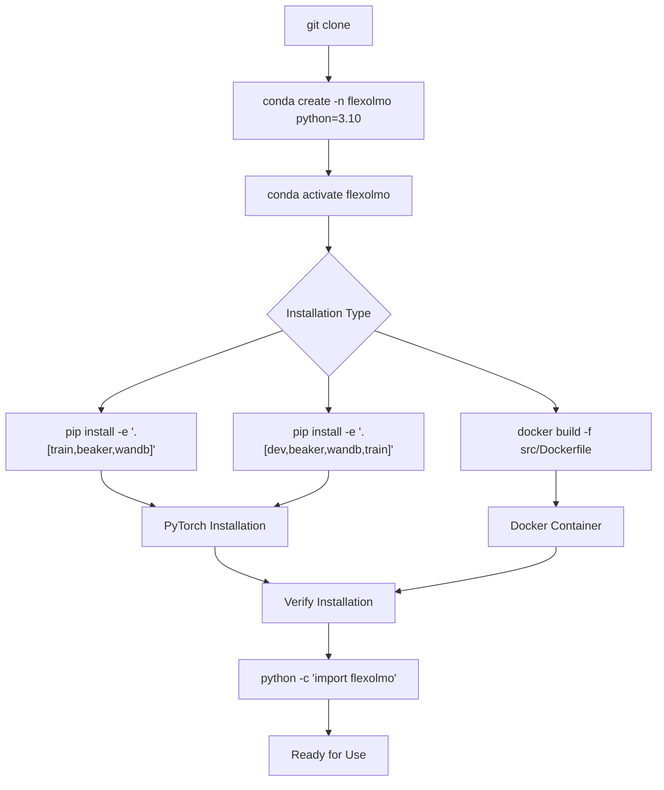

Sources: [README.md:25-39](), [.github/actions/setup-venv/action.yml:41-56](), [.github/workflows/docker.yml:45-51]()

## System Components and Usage Patterns

FlexOlmo is organized into several key components that work together to provide a flexible MoE system. Understanding these components helps you navigate the codebase and use the system effectively.

**Core System Components**

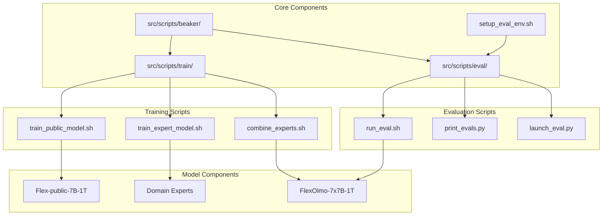

Sources: [README.md:51-54](), [README.md:57-77]()

## First Steps and Basic Operations

### Running Your First Evaluation

The quickest way to get started is to run an evaluation on a pre-trained FlexOlmo model:

```bash
# Set up evaluation environment
bash setup_eval_env.sh

# Run evaluation with 2 GPUs
NUM_GPUS=2
bash src/scripts/eval/run_eval.sh allenai/FlexOlmo-7x7B-1T mc9 eval_results/ ${NUM_GPUS}
```

### Viewing Evaluation Results

After running evaluations, you can aggregate and view results:

```bash
python src/scripts/eval/print_evals.py \
  --base-dir eval_results/ \
  --avg-core \
  --avg-gen \
  --avg-mmlu \
  --avg-mmlu-pro \
  --avg-agi-eval \
  --avg-sciriff \
  --avg-code
```

### Available Models

FlexOlmo provides several pre-trained models you can use immediately:

| Model Type | Model ID | Description |
|------------|----------|-------------|
| Combined MoE | `allenai/FlexOlmo-7x7B-1T` | 33B parameter MoE model |
| Public Base | `allenai/Flex-public-7B-1T` | 7B public data expert |
| Math Expert | `allenai/Flex-math-2x7B-1T` | Mathematics specialized expert |
| Code Expert | `allenai/Flex-code-2x7B-1T` | Programming specialized expert |
| News Expert | `allenai/Flex-news-2x7B-1T` | News content specialized expert |

### Training Your First Expert

To train a new expert model, you can use the training scripts:

```bash
# Training scripts are launched with torchrun
torchrun --nproc_per_node=8 src/scripts/train/train_expert_model.py \
  --config-path path/to/expert/config.yaml
```

**Basic Usage Flow**

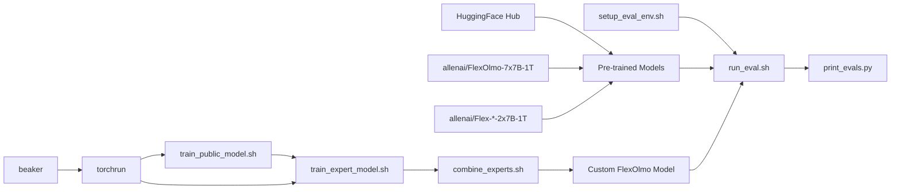

Sources: [README.md:59-77](), [README.md:41-48]()

## Evaluation Task Suites

FlexOlmo supports multiple evaluation task suites that you can run immediately:

| Suite | Description | Tasks |
|-------|-------------|-------|
| `mc9` | Multiple Choice | 9 tasks |
| `gen5` | Generation | 5 tasks |
| `mmlu` | Language Understanding | MMLU benchmark |
| `code4` | Programming | 4 coding tasks |
| `math2` | Mathematics | 8 math tasks |
| `bbh` | Big Bench Hard | Reasoning tasks |

### Running Specific Task Suites

```bash
# Run multiple choice tasks
bash src/scripts/eval/run_eval.sh allenai/FlexOlmo-7x7B-1T mc9 results/ 2

# Run generation tasks
bash src/scripts/eval/run_eval.sh allenai/FlexOlmo-7x7B-1T gen5 results/ 2

# Run coding tasks
bash src/scripts/eval/run_eval.sh allenai/FlexOlmo-7x7B-1T code4 results/ 2
```

## Next Steps

Once you have FlexOlmo installed and running basic evaluations:

1. **Explore Training**: Learn about the three-stage training pipeline in [Training Pipeline](#3)
2. **Deep Dive into Evaluation**: Understand the comprehensive evaluation system in [Evaluation System](#4)
3. **Understand the Architecture**: Read about the MoE router system and model components in [Architecture](#2)
4. **Configure Data**: Learn about data management and domain embeddings in [Data Management](#5)
5. **Deploy at Scale**: Explore Beaker platform integration and infrastructure in [Infrastructure and Deployment](#6)

Sources: [README.md:1-113](), [README.md:81-96]()

---

# Page: Architecture

# Architecture

<details>
<summary>Relevant source files</summary>

The following files were used as context for generating this wiki page:

- [README.md](README.md)
- [assets/FlexOlmo_Logo.png](assets/FlexOlmo_Logo.png)
- [src/flexolmo/internal/common.py](src/flexolmo/internal/common.py)

</details>


This document provides an overview of FlexOlmo's system architecture, covering the core components, their interactions, and the overall design principles that enable collaborative model development without direct data sharing. For detailed information about specific subsystems, see [MoE Router System](#2.1), [Model Components](#2.2), and [Configuration System](#2.3).

## System Overview

FlexOlmo implements a Mixture of Experts (MoE) architecture that enables independent training of domain-specific expert models, which are then combined into a unified model through an intelligent routing system. The system supports a three-stage training pipeline: public model training, expert specialization, and model combination with optional router training.

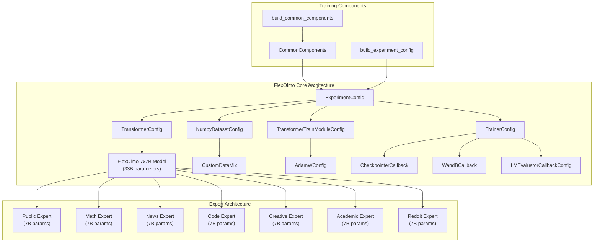

**Sources:** [README.md:22-49](), [src/flexolmo/internal/common.py:55-76]()

## Core Architecture Components

The FlexOlmo architecture is built around several key components that work together to enable flexible model composition and training:

### Configuration Hierarchy

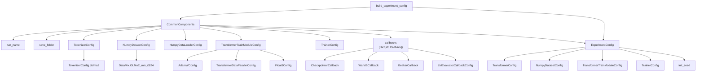

**Sources:** [src/flexolmo/internal/common.py:94-244](), [src/flexolmo/internal/common.py:247-351]()

### Model Architecture Components

| Component | Class | Purpose |
|-----------|-------|---------|
| Model Configuration | `TransformerConfig` | Defines model architecture parameters |
| Data Configuration | `NumpyDatasetConfig` | Specifies dataset sources and preprocessing |
| Training Module | `TransformerTrainModuleConfig` | Configures optimization and training parameters |
| Data Loading | `NumpyDataLoaderConfig` | Manages data loading and batching |
| Training Control | `TrainerConfig` | Controls training lifecycle and checkpointing |

**Sources:** [src/flexolmo/internal/common.py:68-76]()

## Training Pipeline Architecture

The FlexOlmo training pipeline follows a three-stage architecture that enables independent expert development:

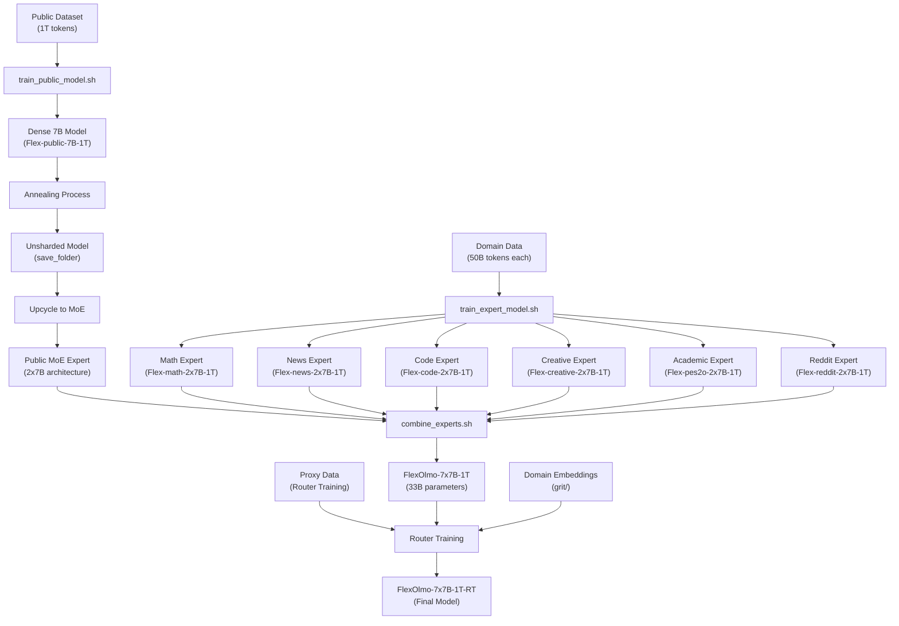

**Sources:** [README.md:42-49](), [README.md:51-55]()

## Configuration Architecture

The FlexOlmo configuration system uses a hierarchical approach to manage complex experimental setups:

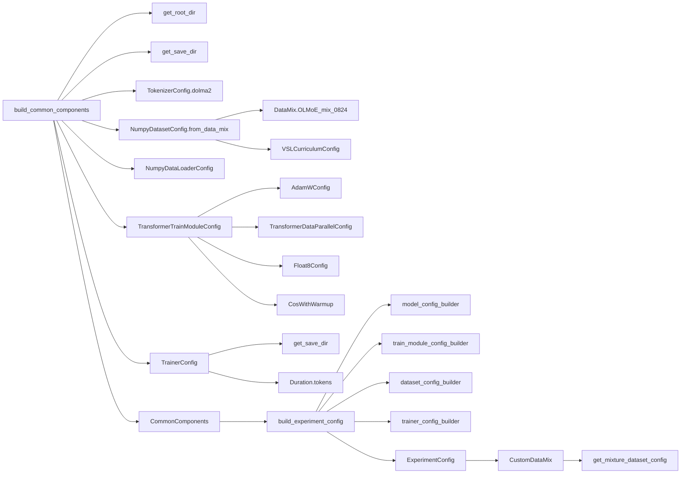

**Sources:** [src/flexolmo/internal/common.py:94-159](), [src/flexolmo/internal/common.py:247-351]()

## Data Flow Architecture

The data flow architecture supports flexible data mixing and domain-specific training:

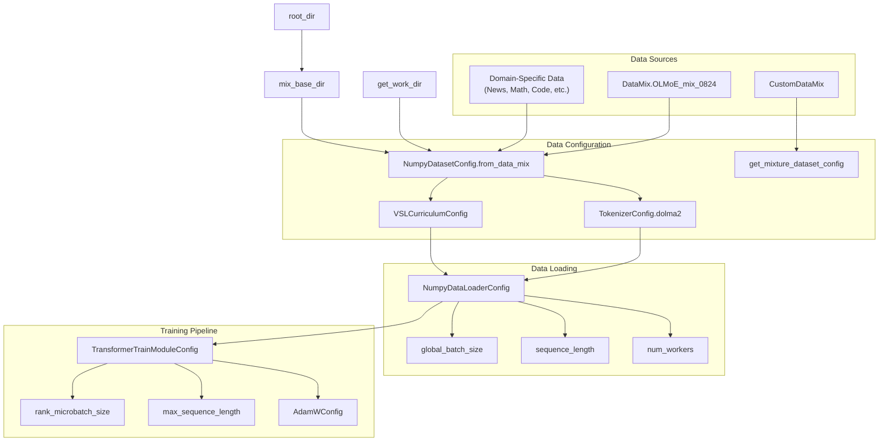

**Sources:** [src/flexolmo/internal/common.py:106-118](), [src/flexolmo/internal/common.py:120-122](), [src/flexolmo/internal/common.py:324-350]()

## System Integration Points

The architecture provides several key integration points that enable flexible model composition:

| Integration Point | Implementation | Purpose |
|-------------------|----------------|---------|
| Model Builders | `model_config_builder` | Customize model architecture |
| Data Builders | `dataset_config_builder` | Configure data sources |
| Training Builders | `train_module_config_builder` | Modify training parameters |
| Callback System | `callbacks: Dict[str, Callback]` | Extend training pipeline |
| Configuration Overrides | `config.merge(overrides)` | Runtime parameter modification |

The `build_experiment_config` function serves as the central orchestrator, accepting builder functions that customize each component while maintaining system coherence.

**Sources:** [src/flexolmo/internal/common.py:256-263](), [src/flexolmo/internal/common.py:275-297](), [src/flexolmo/internal/common.py:343]()

---

# Page: MoE Router System

# MoE Router System

<details>
<summary>Relevant source files</summary>

The following files were used as context for generating this wiki page:

- [src/flexolmo/nn/__init__.py](src/flexolmo/nn/__init__.py)
- [src/flexolmo/nn/moe/__init__.py](src/flexolmo/nn/moe/__init__.py)
- [src/flexolmo/nn/moe/router.py](src/flexolmo/nn/moe/router.py)

</details>


## Purpose and Scope

The MoE Router System is FlexOlmo's implementation of routing mechanisms for Mixture of Experts (MoE) models. It extends the base OLMo MoE router with additional features including expert bias for auxiliary-loss-free load balancing. The router determines which experts should process each input token and computes the corresponding weights for combining expert outputs.

For information about the overall MoE architecture and model components, see [Model Components](#2.2). For details about expert training and combination, see [Model Combination and Upcycling](#3.3).

## Router Architecture Overview

The router system follows a modular design with configurable router types, a registry pattern for extensibility, and support for distributed training.

### Router System Components

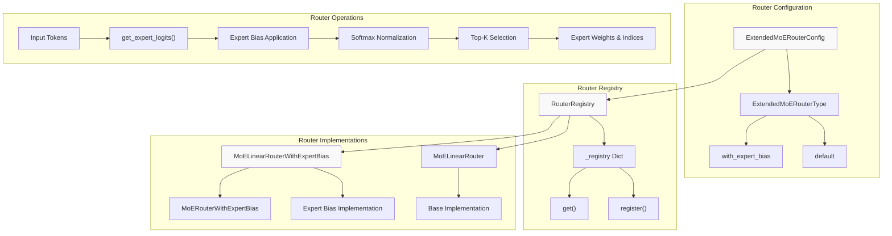

**Sources:** [src/flexolmo/nn/moe/router.py:28-47](), [src/flexolmo/nn/moe/router.py:48-62](), [src/flexolmo/nn/moe/router.py:211-257]()

## Router Types and Configuration

### ExtendedMoERouterType

The router system defines an enumeration of available router implementations:

| Router Type | Implementation | Description |
|-------------|---------------|-------------|
| `default` | `MoELinearRouter` | Standard linear router from OLMo core |
| `with_expert_bias` | `MoELinearRouterWithExpertBias` | Router with expert bias for load balancing |

### Router Registry Pattern

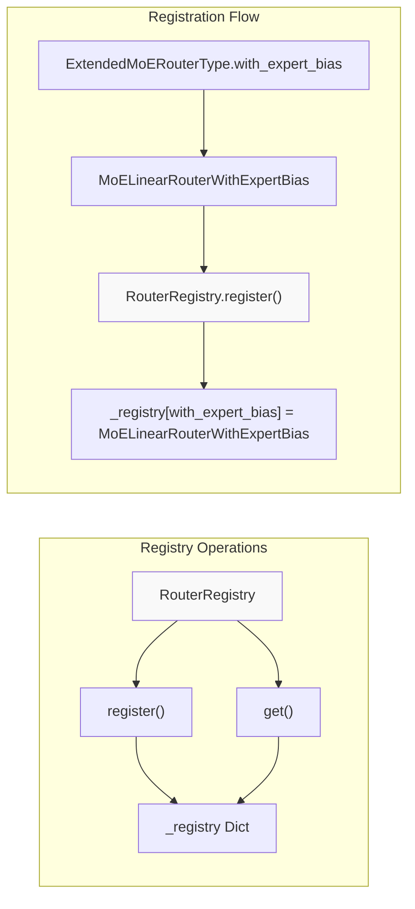

**Sources:** [src/flexolmo/nn/moe/router.py:48-62](), [src/flexolmo/nn/moe/router.py:259-260]()

### Configuration Building

The `ExtendedMoERouterConfig` provides parameter counting and router instantiation:

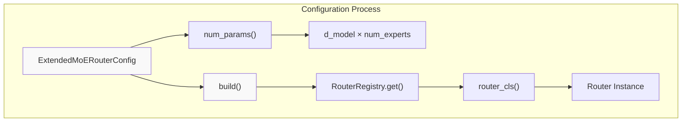

**Sources:** [src/flexolmo/nn/moe/router.py:64-101]()

## Expert Bias Mechanism

### Auxiliary-Loss-Free Load Balancing

The expert bias system implements the "auxiliary-loss-free load balancing" strategy from DeepSeek-v3, allowing for better expert utilization without requiring additional loss terms.


**Sources:** [src/flexolmo/nn/moe/router.py:142-177]()

### Expert Bias Parameters

The `MoERouterWithExpertBias` class manages expert bias through learnable parameters:

- **Expert Bias Shape**: `(num_experts - 1, 1)` - bias for all experts except the first
- **Bias Constraint**: Values are constrained to be ≤ 0 to prevent expert favoritism
- **Bias Application**: Applied to logits before softmax normalization

**Sources:** [src/flexolmo/nn/moe/router.py:103-150]()

## Router Implementation Details

### Forward Pass Pipeline

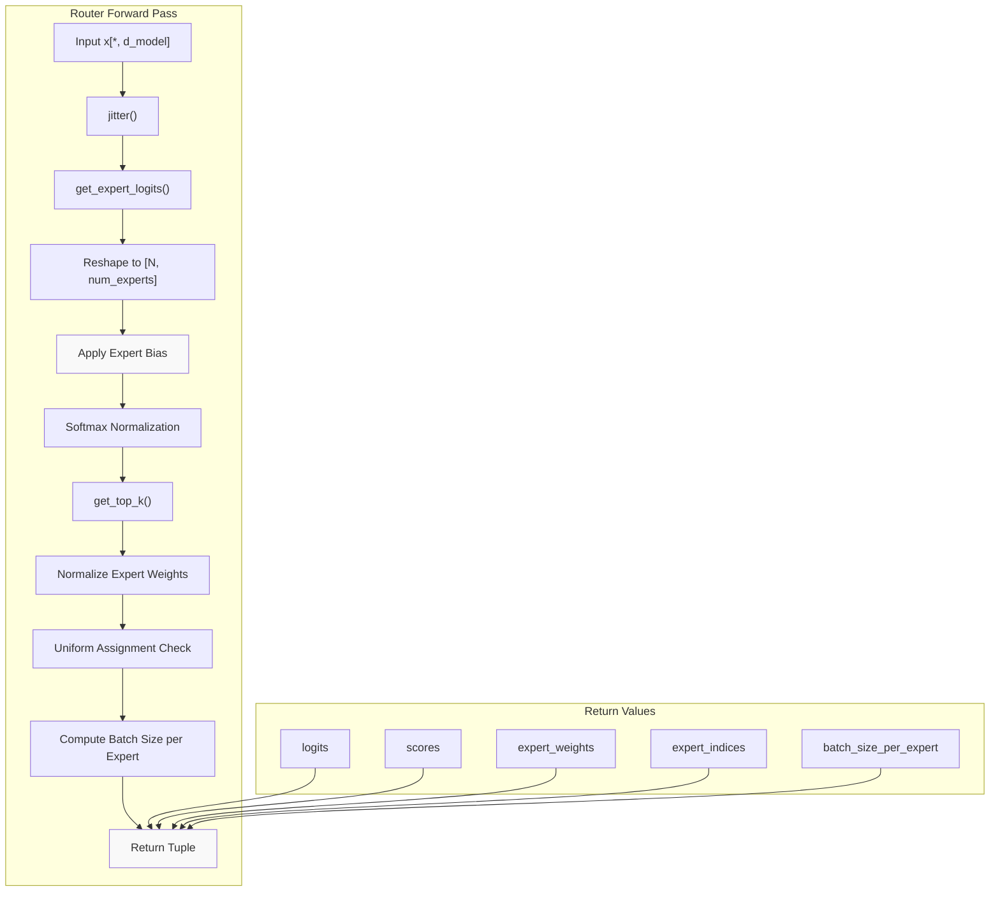

**Sources:** [src/flexolmo/nn/moe/router.py:154-208]()

### Linear Router Implementation

The `MoELinearRouterWithExpertBias` provides the concrete implementation:

- **Weight Parameter**: `(num_experts * d_model,)` flattened for FSDP compatibility
- **Weight Initialization**: Truncated normal with std=0.002
- **Expert Logits**: Computed via `F.linear()` with reshaped weights
- **Tensor Parallelism**: Supports distributed training via `apply_tp()`

**Sources:** [src/flexolmo/nn/moe/router.py:211-257]()

## Integration Points

### Model Integration

The router system integrates with the broader FlexOlmo architecture through:

- **Configuration System**: Uses `ExtendedMoERouterConfig` for declarative setup
- **Training Pipeline**: Supports distributed training with tensor parallelism
- **Expert Networks**: Routes tokens to domain-specific expert models

### Distributed Training Support

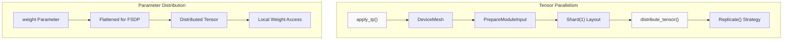

**Sources:** [src/flexolmo/nn/moe/router.py:242-256]()

## Usage Examples

### Router Configuration

```python
from flexolmo.nn.moe.router import ExtendedMoERouterConfig, ExtendedMoERouterType

# Standard router
router_config = ExtendedMoERouterConfig(
    name=ExtendedMoERouterType.default,
    top_k=2
)

# Router with expert bias
biased_router_config = ExtendedMoERouterConfig(
    name=ExtendedMoERouterType.with_expert_bias,
    top_k=2,
    bias_gamma=0.0001
)
```

### Router Building

```python
# Build router instance
router = router_config.build(
    d_model=4096,
    num_experts=7,
    dtype=torch.float32
)
```

**Sources:** [src/flexolmo/nn/moe/router.py:85-100]()

---

# Page: Model Components

# Model Components

<details>
<summary>Relevant source files</summary>

The following files were used as context for generating this wiki page:

- [src/flexolmo/internal/__init__.py](src/flexolmo/internal/__init__.py)
- [src/flexolmo/internal/model_utils.py](src/flexolmo/internal/model_utils.py)
- [src/flexolmo/internal/train_utils.py](src/flexolmo/internal/train_utils.py)
- [src/flexolmo/train/__init__.py](src/flexolmo/train/__init__.py)
- [src/flexolmo/train/train_module/__init__.py](src/flexolmo/train/train_module/__init__.py)
- [src/flexolmo/train/train_module/transformer.py](src/flexolmo/train/train_module/transformer.py)

</details>


This document covers the core model utilities, transformer configurations, and training modules that form the foundation of FlexOlmo's model architecture. These components provide the building blocks for creating, configuring, and training both dense and Mixture of Experts (MoE) transformer models.

For details about the MoE router implementation and expert bias mechanisms, see [MoE Router System](#2.1). For information about the broader configuration management system, see [Configuration System](#2.3).

## Model Configuration System

FlexOlmo extends the base `TransformerConfig` class with specialized configuration methods for different model architectures. These configurations are implemented as class methods that return pre-configured transformer instances.

### Configuration Methods

The system provides three main configuration methods:

| Method | Purpose | Key Features |
|--------|---------|--------------|
| `olmo2_tiny` | Tiny model for testing | 32 d_model, 1 layer, reordered norm |
| `olmoe_nx7b` | Standard MoE configuration | Configurable experts, top-k routing |
| `olmoe_nx7b_with_expert_bias` | MoE with expert bias | Extended router with bias support |

#### Model Architecture Configurations

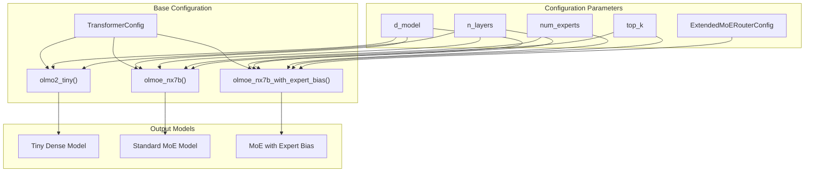

Sources: [src/flexolmo/internal/model_utils.py:9-63]()

### MoE Configuration Details

The `olmoe_nx7b` configuration method provides comprehensive MoE setup with the following key parameters:

- **Expert Configuration**: Configurable number of experts (default 2) with 11008 hidden size
- **Routing**: Top-k routing with capacity factor and load balancing
- **Loss Components**: Load balancing loss weight (0.01) and z-loss weight (0.001)
- **Architectural Features**: Reordered normalization, QK normalization, RoPE theta scaling

The expert bias variant enhances the standard configuration by replacing the default router with an `ExtendedMoERouterConfig` that supports auxiliary-loss-free expert biasing.

Sources: [src/flexolmo/internal/model_utils.py:27-62]()

## Training Module System

The training system extends the base `TransformerTrainModule` with specialized capabilities for freezing expert parameters during training. This is essential for FlexOlmo's collaborative training approach where certain experts may need to remain frozen.

### Training Module Architecture

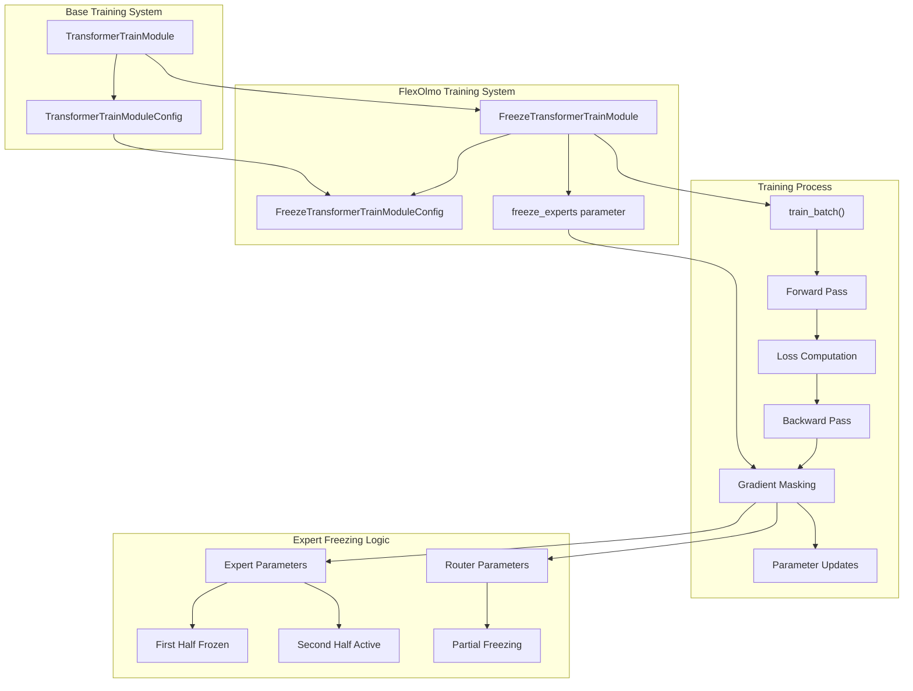

Sources: [src/flexolmo/train/train_module/transformer.py:34-260]()

### Gradient Masking Implementation

The `FreezeTransformerTrainModule` implements selective parameter freezing through gradient masking:

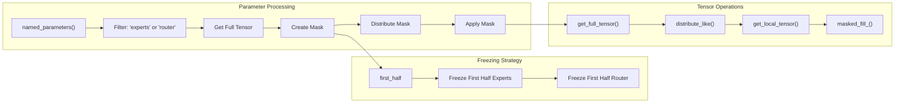

Sources: [src/flexolmo/train/train_module/transformer.py:178-221]()

The gradient masking logic operates on both expert and router parameters:

- **Expert Parameters**: Zeros gradients for the first half of expert parameters along the first dimension
- **Router Parameters**: Applies similar masking to router parameters, allowing selective training of routing components

## Training Utilities

The training utilities provide high-level orchestration functions and checkpoint management capabilities.

### Training Orchestration Functions

| Function | Purpose | Key Features |
|----------|---------|--------------|
| `train()` | Standard training | Full training from scratch |
| `finetune()` | Finetuning | Load checkpoint, continue with same LR |
| `anneal()` | Annealing | Load checkpoint, start from last LR |
| `get_last_lr()` | LR extraction | Extract final LR from checkpoint |

### Training Flow Architecture

```mermaid
graph TB
    subgraph "Training Entry Points"
        A["train()"] --> B["_train()"]
        C["finetune()"] --> B
        D["anneal()"] --> B
    end
    
    subgraph "Configuration Setup"
        E["ExperimentConfig"] --> F["Model Build"]
        E --> G["TrainModule Build"]
        E --> H["Dataset Build"]
        E --> I["DataLoader Build"]
        E --> J["Trainer Build"]
    end
    
    subgraph "Checkpoint Handling"
        K["get_last_lr()"] --> L["Load Train State"]
        L --> M["Extract LR"]
        M --> N["Update Config"]
    end
    
    subgraph "Parameter Freezing"
        O["freeze_params"] --> P["Pattern Matching"]
        P --> Q["requires_grad = False"]
    end
    
    B --> E
    D --> K
    F --> O
    G --> R["trainer.fit()"]
    H --> R
    I --> R
    J --> R
```

Sources: [src/flexolmo/internal/train_utils.py:48-127]()

### Checkpoint Learning Rate Extraction

The `get_last_lr()` function provides checkpoint continuity by extracting the final learning rate from training state:

1. **State Loading**: Loads `rank0.pt` from checkpoint directory
2. **Configuration Analysis**: Parses `config.json` to extract optimizer and scheduler settings
3. **LR Calculation**: Uses `CosWithWarmup` scheduler to compute final learning rate based on global step

This enables seamless continuation of training with proper learning rate scheduling.

Sources: [src/flexolmo/internal/train_utils.py:23-45]()

## Integration with Core System

The model components integrate with FlexOlmo's broader architecture through several key interfaces:

### Component Integration

```mermaid
graph TB
    subgraph "Model Components"
        A["TransformerConfig Extensions"]
        B["FreezeTransformerTrainModule"]
        C["Training Utilities"]
    end
    
    subgraph "Core Dependencies"
        D["olmo_core.nn.transformer"]
        E["olmo_core.train.train_module"]
        F["olmo_core.optim"]
    end
    
    subgraph "FlexOlmo Extensions"
        G["ExtendedMoERouterConfig"]
        H["ExperimentConfig"]
        I["Domain-Specific Training"]
    end
    
    subgraph "Training Pipeline"
        J["Public Model Training"]
        K["Expert Training"]
        L["Model Combination"]
    end
    
    A --> D
    B --> E
    C --> F
    
    A --> G
    B --> H
    C --> I
    
    A --> J
    B --> K
    C --> L
```

Sources: [src/flexolmo/internal/model_utils.py:1-7](), [src/flexolmo/train/train_module/transformer.py:1-21](), [src/flexolmo/internal/train_utils.py:1-19]()

The model components serve as the foundation layer that enables FlexOlmo's collaborative MoE training approach, providing the necessary abstractions for model configuration, selective parameter freezing, and training orchestration across the system's three-stage pipeline.

---

# Page: Configuration System

# Configuration System

<details>
<summary>Relevant source files</summary>

The following files were used as context for generating this wiki page:

- [pyproject.toml](pyproject.toml)
- [scripts/extraction_analysis.sh](scripts/extraction_analysis.sh)
- [src/flexolmo/internal/common.py](src/flexolmo/internal/common.py)
- [src/scripts/utils/extraction_analysis.py](src/scripts/utils/extraction_analysis.py)

</details>


The Configuration System in FlexOlmo provides a hierarchical approach to managing training experiments, model parameters, and system settings. It enables reproducible experimentation through structured configuration objects that can be easily modified and extended. The system supports multiple configuration levels from project-wide settings to experiment-specific parameters.

For information about model architecture configuration, see [Model Components](#2.2). For data configuration and mixes, see [Data Mixes and Configuration](#5.1).

## Configuration Hierarchy

FlexOlmo uses a multi-layered configuration system that separates concerns across different levels of abstraction:

### Configuration Architecture Overview

```mermaid
graph TB
    subgraph "Project Level"
        A[pyproject.toml] --> B["Project metadata"]
        A --> C["Dependency groups"]
        A --> D["Development tools"]
    end
    
    subgraph "Common Components Layer"
        E[CommonComponents] --> F["TokenizerConfig"]
        E --> G["NumpyDatasetConfig"]
        E --> H["NumpyDataLoaderConfig"]
        E --> I["TransformerTrainModuleConfig"]
        E --> J["TrainerConfig"]
        E --> K["Callbacks"]
    end
    
    subgraph "Experiment Layer"
        L[ExperimentConfig] --> M["TransformerConfig"]
        L --> N["Dataset configs"]
        L --> O["Training configs"]
        L --> P["Trainer configs"]
    end
    
    subgraph "Component Configs"
        Q[TransformerConfig] --> R["Model architecture"]
        S[TokenizerConfig] --> T["Tokenization settings"]
        U[AdamWConfig] --> V["Optimizer parameters"]
        W[NumpyDatasetConfig] --> X["Data loading settings"]
    end
    
    A --> E
    E --> L
    F --> L
    G --> L
    H --> L
    I --> L
    J --> L
    
    L --> Q
    L --> S
    L --> U
    L --> W
```

Sources: [src/flexolmo/internal/common.py:55-76](), [pyproject.toml:1-200]()

## Project Configuration

The project-level configuration is defined in `pyproject.toml` and establishes the foundation for the entire FlexOlmo system. This includes package metadata, dependencies, and development tool configurations.

### Dependency Groups

FlexOlmo organizes dependencies into functional groups that can be installed separately:

| Group | Purpose | Key Dependencies |
|-------|---------|------------------|
| `dev` | Development tools | ruff, mypy, black, pytest |
| `beaker` | Beaker platform integration | beaker-py, beaker-gantry |
| `wandb` | Experiment tracking | wandb |
| `train` | Training pipeline | ai2-olmo-core, torchao |
| `eval` | Evaluation system | ai2-olmes, s3fs |
| `embeddings` | Domain embeddings | gritlm, sentence_transformers |
| `extraction` | Data extraction analysis | transformers, accelerate |
| `all` | Complete installation | All above groups |

### Development Tool Configuration

The project configures several development tools through `pyproject.toml`:

- **Code formatting**: `black` with 100-character line length
- **Import sorting**: `isort` with black-compatible profile
- **Linting**: `ruff` with 115-character line length
- **Type checking**: `mypy` with specific overrides for test files
- **Testing**: `pytest` with GPU markers and warning filters

Sources: [pyproject.toml:32-96](), [pyproject.toml:112-200]()

## Common Components

The `CommonComponents` class provides shared configuration elements that are used across different experiments. This promotes consistency and reduces configuration duplication.

### CommonComponents Structure

```mermaid
graph TB
    subgraph "CommonComponents"
        A[CommonComponents] --> B["run_name: str"]
        A --> C["save_folder: str"]
        A --> D["tokenizer: TokenizerConfig"]
        A --> E["dataset: NumpyDatasetConfig"]
        A --> F["data_loader: NumpyDataLoaderConfig"]
        A --> G["train_module: TransformerTrainModuleConfig"]
        A --> H["callbacks: Dict[str, Callback]"]
        A --> I["trainer: TrainerConfig"]
    end
    
    subgraph "Build Function"
        J[build_common_components] --> K["Tokenizer setup"]
        J --> L["Dataset configuration"]
        J --> M["DataLoader configuration"]
        J --> N["Training module setup"]
        J --> O["Callback registration"]
        J --> P["Trainer configuration"]
    end
    
    J --> A
    
    subgraph "Callback Types"
        Q["ConfigSaverCallback"]
        R["CheckpointerCallback"]
        S["WandBCallback"]
        T["BeakerCallback"]
        U["GPUMemoryMonitorCallback"]
    end
    
    O --> Q
    O --> R
    O --> S
    O --> T
    O --> U
```

Sources: [src/flexolmo/internal/common.py:55-65](), [src/flexolmo/internal/common.py:94-244]()

### Default Configuration Values

The `build_common_components` function establishes sensible defaults for common experiment settings:

- **Tokenizer**: Uses `TokenizerConfig.dolma2()` for consistent tokenization
- **Dataset**: Configures `DataMix.OLMoE_mix_0824` with VSL curriculum
- **Optimization**: AdamW with learning rate 9e-4, weight decay 0.1
- **Training**: Supports FSDP with bfloat16 precision and float8 configurations
- **Callbacks**: Includes checkpointing, monitoring, and experiment tracking

Sources: [src/flexolmo/internal/common.py:104-158](), [src/flexolmo/internal/common.py:160-188]()

## Experiment Configuration

The `ExperimentConfig` class represents a complete experiment configuration that combines model architecture, training parameters, and data settings.

### ExperimentConfig Components

| Component | Type | Purpose |
|-----------|------|---------|
| `run_name` | str | Unique identifier for the experiment |
| `model` | TransformerConfig | Model architecture specifications |
| `dataset` | NumpyDatasetConfig | Data loading and preprocessing |
| `data_loader` | NumpyDataLoaderConfig | Batch construction and sampling |
| `train_module` | TransformerTrainModuleConfig | Training loop configuration |
| `trainer` | TrainerConfig | Training orchestration and checkpointing |
| `init_seed` | int | Random seed for reproducibility |

Sources: [src/flexolmo/internal/common.py:67-76]()

## Configuration Building Process

The configuration system uses a builder pattern to construct experiment configurations from common components and custom specifications.

### Configuration Building Workflow

```mermaid
flowchart TD
    A[build_experiment_config] --> B[build_common_components]
    B --> C[CommonComponents]
    
    A --> D["Model config builder"]
    A --> E["Train module config builder"]
    A --> F["Trainer config builder"]
    A --> G["Dataset config builder"]
    A --> H["Data loader config builder"]
    
    C --> D
    C --> E
    C --> F
    C --> G
    C --> H
    
    D --> I[TransformerConfig]
    E --> J[TransformerTrainModuleConfig]
    F --> K[TrainerConfig]
    G --> L[NumpyDatasetConfig]
    H --> M[NumpyDataLoaderConfig]
    
    I --> N[ExperimentConfig]
    J --> N
    K --> N
    L --> N
    M --> N
    
    N --> O["Override processing"]
    O --> P["Data mix resolution"]
    P --> Q["Final configuration"]
    
    subgraph "Builder Functions"
        R[model_config_builder]
        S[train_module_config_builder]
        T[trainer_config_builder]
        U[dataset_config_builder]
        V[data_loader_config_builder]
    end
    
    R --> D
    S --> E
    T --> F
    U --> G
    V --> H
```

Sources: [src/flexolmo/internal/common.py:247-351]()

### Configuration Override System

The system supports runtime configuration overrides through string-based parameter paths:

1. **Override Processing**: Parses override strings in the format `"key=value"`
2. **Data Mix Handling**: Special handling for dataset mixture configurations
3. **Configuration Merging**: Applies overrides to the base configuration
4. **Data Mix Resolution**: Converts data mix strings to appropriate configuration objects

The override system allows dynamic modification of any configuration parameter without requiring code changes.

Sources: [src/flexolmo/internal/common.py:323-351]()

## Utility Functions

The configuration system provides several utility functions for directory management and configuration validation:

### Directory Management

- `get_root_dir(cluster: str)`: Returns appropriate root directory based on cluster type
- `get_save_dir(root_dir: str, run_name: str)`: Constructs save directory with user-specific paths
- `get_beaker_username()`: Retrieves Beaker username for directory organization

### Configuration Validation

- `print_model_params(config: ExperimentConfig)`: Displays model parameter counts
- `is_dry_run(arglist: List[str])`: Detects dry run mode from command line arguments

Sources: [src/flexolmo/internal/common.py:78-92](), [src/flexolmo/internal/common.py:354-364]()

## Configuration Customization

The system supports extensive customization through builder functions and configuration overrides. Users can:

1. **Custom Model Architectures**: Provide `model_config_builder` functions
2. **Training Modifications**: Override training parameters through `train_module_config_builder`
3. **Data Pipeline Changes**: Customize data loading through `dataset_config_builder`
4. **Callback Extensions**: Add custom callbacks through the trainer configuration
5. **Runtime Overrides**: Modify any parameter through the override system

This flexibility enables researchers to experiment with different configurations while maintaining reproducibility and consistency across runs.

Sources: [src/flexolmo/internal/common.py:247-263](), [src/flexolmo/internal/common.py:320-351]()

---

# Page: Training Pipeline

# Training Pipeline

<details>
<summary>Relevant source files</summary>

The following files were used as context for generating this wiki page:

- [scripts/README.md](scripts/README.md)
- [scripts/combine_experts.sh](scripts/combine_experts.sh)
- [scripts/train_public_model.sh](scripts/train_public_model.sh)
- [src/scripts/train/OLMo2-7B-train.py](src/scripts/train/OLMo2-7B-train.py)
- [src/scripts/train/OLMo2-tiny-train.py](src/scripts/train/OLMo2-tiny-train.py)

</details>


The training pipeline in FlexOlmo implements a three-stage process to create Mixture of Experts (MoE) models that enable data collaboration without direct data sharing. The pipeline consists of public model training, expert training, and model combination with optional router training.

This document covers the complete training workflow from initial model training through final FlexOlmo model creation. For information about the MoE router implementation details, see [MoE Router System](#2.1). For configuration management patterns, see [Configuration System](#2.3). For evaluation of trained models, see [Evaluation System](#4).

## Training Pipeline Overview

The FlexOlmo training pipeline follows a systematic approach to create specialized expert models and combine them into a flexible MoE architecture:

### Training Pipeline Architecture

```mermaid
flowchart TD
    A["`Public Dataset
    1T tokens`"] --> B["`train_public_model.sh
    OLMo2-7B-train.py`"]
    B --> C["`Dense 7B Model
    TransformerConfig.olmo2_7B`"]
    C --> D["`Annealing Process
    OLMo2-7B-anneal.py`"]
    D --> E["`Unsharded Model
    unshard.py`"]
    E --> F["`Upcycle to MoE
    dense_to_expert_moe.py`"]
    F --> G["`Public MoE Expert
    olmoe-2x7b-public-public`"]
    
    H["`Domain-Specific Data
    CustomDataMix`"] --> I["`train_expert_model.sh
    OLMoE-2x7B.py`"]
    I --> J["`News Expert
    news_top2_grit_learnbias`"]
    I --> K["`Math Expert
    math_top2_grit_learnbias`"]
    I --> L["`Code Expert
    code_top2_grit_learnbias`"]
    I --> M["`Creative Expert`"]
    I --> N["`Reddit Expert`"]
    I --> O["`Academic Expert`"]
    
    G --> P["`combine_experts.sh
    merge_experts_to_flexolmo.py`"]
    J --> P
    K --> P
    L --> P
    M --> P
    N --> P
    O --> P
    
    P --> Q["`FlexOlmo Model
    FlexOlmo-4x7B`"]
    
    R["`Proxy Data
    proxy_combined_public_math_code_news`"] --> S["`Router Training
    OLMoE-4x7B.py`"]
    Q --> S
    S --> T["`FlexOlmo-RT
    Final Model`"]
    
    U["`Domain Embeddings
    grit/`"] --> S
```

Sources: [scripts/README.md:1-7](), [scripts/train_public_model.sh:1-34](), [scripts/combine_experts.sh:1-28]()

## Stage 1: Public Model Training

The first stage involves training a dense 7B model on publicly available data, followed by annealing and optional upcycling to MoE format.

### Public Model Training Process

```mermaid
flowchart LR
    A["`CustomDataMix.public_mix`"] --> B["`OLMo2-7B-train.py`"]
    B --> C["`TransformerConfig.olmo2_7B`"]
    C --> D["`TrainerConfig
    1T tokens`"]
    D --> E["`CosWithWarmup
    scheduler`"]
    E --> F["`AdamWConfig
    lr=9e-4`"]
    F --> G["`Dense Model
    Checkpoint`"]
    G --> H["`OLMo2-7B-anneal.py`"]
    H --> I["`Annealed Model
    50B tokens`"]
    I --> J["`unshard.py`"]
    J --> K["`Unsharded Model`"]
    K --> L["`dense_to_expert_moe.py`"]
    L --> M["`MoE Expert
    olmoe-2x7b-public-public`"]
```

Sources: [src/scripts/train/OLMo2-7B-train.py:42-67](), [scripts/train_public_model.sh:6-34]()

### Training Configuration

The public model training uses several key configuration builders:

| Component | Builder Function | Key Configuration |
|-----------|------------------|-------------------|
| Model | `build_model_config` | `TransformerConfig.olmo2_7B` with vocab size from tokenizer |
| Dataset | `build_dataset_config` | `CustomDataMix.public_mix` for public data |
| Trainer | `build_trainer_config` | Standard trainer configuration |
| Training Module | `build_train_module_config` | `rank_microbatch_size=2*SEQUENCE_LENGTH`, `lr=9e-4` |

The training script [src/scripts/train/OLMo2-7B-train.py:85-97]() builds the experiment configuration using `build_experiment_config` with these components.

### Training Parameters

Key training parameters are set through the `build_train_module_config` function:

- **Sequence Length**: 4096 tokens [src/scripts/train/OLMo2-7B-train.py:38]()
- **Microbatch Size**: `2 * SEQUENCE_LENGTH` [src/scripts/train/OLMo2-7B-train.py:62]()
- **Learning Rate**: 9e-4 [src/scripts/train/OLMo2-7B-train.py:66]()
- **Scheduler**: `CosWithWarmup` with 2000 warmup steps [src/scripts/train/OLMo2-7B-train.py:63]()
- **Global Batch Size**: `128 * SEQUENCE_LENGTH` [src/scripts/train/OLMo2-7B-train.py:90]()

Sources: [src/scripts/train/OLMo2-7B-train.py:60-67](), [src/scripts/train/OLMo2-7B-train.py:85-97]()

## Stage 2: Expert Training

The second stage involves training domain-specific experts using the public model as a seed. Each expert is trained on specialized data for its domain.

### Expert Training Configuration

Expert training uses the `train_expert_model.sh` script to launch domain-specific training. The process involves:

1. **Domain-Specific Data Loading**: Using `CustomDataMix` variants for each domain
2. **Expert Model Configuration**: 2x7B MoE architecture with domain-specific routing
3. **Checkpoint Initialization**: Loading from the public model checkpoint
4. **Domain-Specific Training**: Training on specialized datasets

### Expert Types and Data Sources

| Expert Type | Data Mix | Purpose |
|-------------|----------|---------|
| News Expert | `news_top2_grit_learnbias` | Current events and news content |
| Math Expert | `math_top2_grit_learnbias` | Mathematical reasoning and computation |
| Code Expert | `code_top2_grit_learnbias` | Programming and software development |
| Creative Expert | Domain-specific creative data | Creative writing and artistic content |
| Reddit Expert | Social media data | Conversational and social content |
| Academic Expert | Research papers and academic content | Scholarly and research materials |

Sources: [scripts/combine_experts.sh:7-10](), [scripts/README.md:6]()

## Stage 3: Model Combination and Router Training

The final stage combines trained experts into a unified FlexOlmo model and optionally performs router training on proxy data.

### Expert Combination Process

```mermaid
flowchart TD
    A["`PUBLIC_EXPERT
    olmoe-2x7b-public-public`"] --> E["`merge_experts_to_flexolmo.py`"]
    B["`EXPERT_1
    news_top2_grit_learnbias`"] --> E
    C["`EXPERT_2
    math_top2_grit_learnbias`"] --> E
    D["`EXPERT_3
    code_top2_grit_learnbias`"] --> E
    
    E --> F["`FlexOlmo Model
    FlexOlmo-4x7B`"]
    
    G["`Proxy Data
    proxy_combined_public_math_code_news`"] --> H["`Router Training
    OLMoE-4x7B.py`"]
    F --> H
    I["`Domain Embeddings
    grit/`"] --> H
    H --> J["`FlexOlmo-RT
    Final Model`"]
```

Sources: [scripts/combine_experts.sh:12-28]()

### Router Training Configuration

Router training is performed using the `OLMoE-4x7B.py` script with specific configuration:

- **Training Duration**: 5B tokens [scripts/combine_experts.sh:21-22]()
- **Router Top-K**: 4 experts [scripts/combine_experts.sh:24]()
- **Learning Rate**: 2e-3 [scripts/combine_experts.sh:27]()
- **Microbatch Size**: 4096 tokens [scripts/combine_experts.sh:25]()
- **Warmup Steps**: 100 [scripts/combine_experts.sh:26]()

The router training loads the combined FlexOlmo model and trains only the routing parameters using proxy data provided by data owners.

Sources: [scripts/combine_experts.sh:17-28]()

## Training Scripts and Utilities

### Core Training Scripts

| Script | Purpose | Key Features |
|--------|---------|--------------|
| `OLMo2-7B-train.py` | Main 7B model training | Public mix training, full configuration |
| `OLMo2-tiny-train.py` | Debugging and testing | Tiny model for development |
| `OLMo2-7B-anneal.py` | Model annealing | 50B token annealing phase |
| `OLMoE-4x7B.py` | MoE expert training | Domain-specific expert training |

### Shell Script Automation

The training pipeline provides shell scripts for complete workflow automation:

- **`train_public_model.sh`**: Automates public model training, annealing, unsharding, and upcycling
- **`train_expert_model.sh`**: Automates expert training for domain-specific models
- **`combine_experts.sh`**: Automates expert combination and router training

### Configuration Management

Training scripts use the `build_experiment_config` function with builder patterns:

```python
config = build_experiment_config(
    run_name,
    overrides,
    root_dir=get_root_dir(),
    sequence_length=SEQUENCE_LENGTH,
    global_batch_size=128 * SEQUENCE_LENGTH,
    include_default_evals=True,
    freeze_embeddings=False,
    model_config_builder=build_model_config,
    dataset_config_builder=build_dataset_config,
    trainer_config_builder=build_trainer_config,
    train_module_config_builder=build_train_module_config,
)
```

This pattern is used in both [src/scripts/train/OLMo2-7B-train.py:85-97]() and [src/scripts/train/OLMo2-tiny-train.py:96-108]().

### Environment Management

Training scripts handle environment setup and teardown:

- **Environment Preparation**: `prepare_training_environment()` [src/scripts/train/OLMo2-7B-train.py:82]()
- **Training Execution**: `train(config)` [src/scripts/train/OLMo2-7B-train.py:102]()
- **Environment Cleanup**: `teardown_training_environment()` [src/scripts/train/OLMo2-7B-train.py:104]()

Sources: [src/scripts/train/OLMo2-7B-train.py:82-104](), [src/scripts/train/OLMo2-tiny-train.py:93-115]()

## Data Configuration and Management

### Data Mix Configuration

The training pipeline uses `CustomDataMix` for different training phases:

- **Public Training**: `CustomDataMix.public_mix` [src/scripts/train/OLMo2-7B-train.py:50]()
- **Testing**: `CustomDataMix.test_mix` [src/scripts/train/OLMo2-tiny-train.py:58]()
- **Domain-Specific**: Various domain-specific mixes for expert training

### Dataset Configuration

Dataset configuration is handled through `NumpyDatasetConfig` with mix-specific settings:

```python
dataset_config = common.dataset
dataset_config.mix = CustomDataMix.public_mix
dataset_config.mix_base_dir = DATA_ROOT
```

The `mix_base_dir` is set to either local paths or remote endpoints like `http://flexolmo-data.org` [scripts/train_public_model.sh:3]().

Sources: [src/scripts/train/OLMo2-7B-train.py:46-51](), [scripts/train_public_model.sh:3](), [scripts/combine_experts.sh:3]()

---

# Page: Public Model Training

# Public Model Training

<details>
<summary>Relevant source files</summary>

The following files were used as context for generating this wiki page:

- [scripts/README.md](scripts/README.md)
- [scripts/combine_experts.sh](scripts/combine_experts.sh)
- [scripts/train_public_model.sh](scripts/train_public_model.sh)
- [src/scripts/train/OLMo2-7B-anneal.py](src/scripts/train/OLMo2-7B-anneal.py)
- [src/scripts/train/OLMo2-7B-finetune.py](src/scripts/train/OLMo2-7B-finetune.py)
- [src/scripts/train/OLMo2-7B-train.py](src/scripts/train/OLMo2-7B-train.py)
- [src/scripts/train/OLMo2-tiny-train.py](src/scripts/train/OLMo2-tiny-train.py)

</details>


This document covers the first stage of the FlexOlmo training pipeline: training a base dense model on public data. This stage produces a foundation model that serves as the starting point for expert specialization and MoE construction. For information about training domain-specific experts, see [Expert Training](#3.2). For information about combining experts into FlexOlmo models, see [Model Combination and Upcycling](#3.3).

## Overview

Public model training involves three sequential steps:

1. **Base Training**: Train a dense 7B model on public data mix for 1T tokens
2. **Annealing**: Continue training the model for 50B tokens with modified parameters
3. **Unsharding**: Convert the distributed checkpoint to a single-file format for downstream use

This process creates a high-quality base model that can be upcycled to MoE architecture or used as a seed for expert training.

## Training Pipeline Architecture

The public model training pipeline follows a linear progression through three distinct phases:

```mermaid
flowchart TD
    A["`public_mix data
    (1T tokens)`"] --> B["`OLMo2-7B-train.py
    Base Training`"]
    B --> C["`Dense 7B Model
    Checkpoint`"]
    C --> D["`OLMo2-7B-anneal.py
    Annealing Phase`"]
    D --> E["`Annealed Model
    Checkpoint`"]
    E --> F["`unshard.py
    Checkpoint Processing`"]
    F --> G["`Unsharded Model
    Ready for Upcycling`"]
    
    H["`TransformerConfig.olmo2_7B()`"] --> B
    I["`CustomDataMix.public_mix`"] --> B
    J["`CosWithWarmup scheduler`"] --> B
    K["`AdamWConfig optimizer`"] --> B
    
    L["`train_utils.train()`"] --> B
    M["`train_utils.anneal()`"] --> D
    
    style A fill:#f9f9f9
    style G fill:#f9f9f9
    style B fill:#e8f4f8
    style D fill:#e8f4f8
```

**Sources:** [scripts/train_public_model.sh:1-34](), [src/scripts/train/OLMo2-7B-train.py:1-105](), [src/scripts/train/OLMo2-7B-anneal.py:1-108]()

## Base Training Configuration

The base training phase uses the `OLMo2-7B-train.py` script with specific configuration builders that define the model architecture, data sources, and training parameters.

### Model Configuration

```mermaid
graph TB
    A["`build_model_config()`"] --> B["`TransformerConfig.olmo2_7B()`"]
    B --> C["`vocab_size: common.tokenizer.padded_vocab_size()`"]
    B --> D["`7B parameter architecture`"]
    B --> E["`4096 sequence length`"]
    
    F["`CommonComponents`"] --> A
    F --> G["`tokenizer configuration`"]
    G --> C
```

**Sources:** [src/scripts/train/OLMo2-7B-train.py:42-43]()

### Data Configuration

The training uses `CustomDataMix.public_mix` as the data source, configured through the `build_dataset_config()` function:

```mermaid
graph LR
    A["`build_dataset_config()`"] --> B["`common.dataset`"]
    B --> C["`CustomDataMix.public_mix`"]
    C --> D["`NumpyDatasetConfig`"]
    D --> E["`Public training data`"]
    
    F["`CommonComponents`"] --> A
```

**Sources:** [src/scripts/train/OLMo2-7B-train.py:46-51]()

### Training Parameters

The training module configuration defines optimization and scheduling parameters:

| Parameter | Value | Purpose |
|-----------|-------|---------|
| `rank_microbatch_size` | `2 * SEQUENCE_LENGTH` | Memory-efficient batching |
| `scheduler` | `CosWithWarmup(warmup_steps=2000)` | Learning rate scheduling |
| `optim.lr` | `9e-4` | Base learning rate |
| `global_batch_size` | `128 * SEQUENCE_LENGTH` | Total batch size across devices |

**Sources:** [src/scripts/train/OLMo2-7B-train.py:60-67]()

## Annealing Phase

The annealing phase continues training from the base model checkpoint using modified parameters to improve model quality before downstream use.

### Annealing Configuration

```mermaid
graph TB
    A["`OLMo2-7B-anneal.py`"] --> B["`anneal() function`"]
    B --> C["`BASE_CHECKPOINT input`"]
    C --> D["`50B token training`"]
    D --> E["`Modified batch size`"]
    E --> F["`flatten_optimizer_state_dict: true`"]
    
    G["`train_utils.anneal()`"] --> B
    H["`global_batch_size: 1024 * SEQUENCE_LENGTH`"] --> E
    I["`state_dict_save_opts`"] --> F
```

**Sources:** [src/scripts/train/OLMo2-7B-anneal.py:60-68](), [scripts/train_public_model.sh:17-26]()

### Key Differences from Base Training

| Aspect | Base Training | Annealing |
|--------|---------------|-----------|
| Function | `train()` | `anneal()` |
| Batch Size | 128 * SEQUENCE_LENGTH | 1024 * SEQUENCE_LENGTH |
| Duration | 1T tokens | 50B tokens |
| State Dict Options | Default | `flatten_optimizer_state_dict: true` |
| Input | Fresh initialization | Existing checkpoint |

**Sources:** [src/scripts/train/OLMo2-7B-train.py:85-102](), [src/scripts/train/OLMo2-7B-anneal.py:87-105]()

## Experiment Configuration System

Both training phases use the `build_experiment_config()` function to create consistent experiment configurations:

```mermaid
graph TB
    A["`build_experiment_config()`"] --> B["`ExperimentConfig`"]
    B --> C["`model_config_builder`"]
    B --> D["`dataset_config_builder`"]
    B --> E["`trainer_config_builder`"]
    B --> F["`train_module_config_builder`"]
    
    G["`run_name`"] --> A
    H["`overrides`"] --> A
    I["`root_dir`"] --> A
    J["`sequence_length: 4096`"] --> A
    K["`include_default_evals: true`"] --> A
    
    C --> L["`TransformerConfig.olmo2_7B()`"]
    D --> M["`CustomDataMix.public_mix`"]
    E --> N["`TrainerConfig`"]
    F --> O["`TransformerTrainModuleConfig`"]
```

**Sources:** [src/scripts/train/OLMo2-7B-train.py:85-97](), [src/scripts/train/OLMo2-7B-anneal.py:88-100]()

## Execution Scripts

### Shell Script Orchestration

The `train_public_model.sh` script orchestrates the entire public model training process:

```bash
# Base training for 1T tokens
torchrun --nproc-per-node=8 ./src/scripts/train/OLMo2-7B-train.py OLMo2-7B-public-mix

# Annealing for 50B tokens
torchrun --nproc-per-node=8 ./src/scripts/train/OLMo2-7B-anneal.py OLMo2-7B-anneal-public-mix ${BASE_CHECKPOINT}

# Unshard checkpoint
python src/scripts/utils/unshard.py -i ${MODEL_PATH} -o ${MODEL_PATH}-unsharded
```

**Sources:** [scripts/train_public_model.sh:7-30]()

### Command Line Interface

Both training scripts follow a consistent command-line interface pattern:

```
torchrun [TORCH_OPTIONS] script.py [dry_run] run_name [checkpoint] [OVERRIDES...]
```

The scripts support:
- `dry_run` flag for configuration validation
- Dynamic configuration overrides
- Checkpoint resumption (for annealing)
- Distributed training via `torchrun`

**Sources:** [src/scripts/train/OLMo2-7B-train.py:70-84](), [src/scripts/train/OLMo2-7B-anneal.py:71-86]()

## Development and Debugging

### Tiny Model Training

For development and debugging, the system includes `OLMo2-tiny-train.py` which provides a minimal training setup:

```mermaid
graph LR
    A["`OLMo2-tiny-train.py`"] --> B["`TransformerConfig.olmo2_tiny()`"]
    B --> C["`vocab_size: 256`"]
    B --> D["`n_layers: 1`"]
    B --> E["`n_heads: 1`"]
    
    F["`CustomDataMix.test_mix`"] --> A
    G["`rank_microbatch_size: 8 * SEQUENCE_LENGTH`"] --> A
    H["`lr: 4e-4`"] --> A
```

**Sources:** [src/scripts/train/OLMo2-tiny-train.py:45-51](), [src/scripts/train/OLMo2-tiny-train.py:54-78]()

## Environment Setup

The training process requires proper environment initialization:

```mermaid
graph TB
    A["`prepare_training_environment()`"] --> B["`Training Process`"]
    B --> C["`teardown_training_environment()`"]
    
    D["`DATA_ROOT environment variable`"] --> B
    E["`CHECKPOINTS environment variable`"] --> B
    
    F["`torchrun distributed setup`"] --> B
    G["`float8_config.enabled=true`"] --> B
```

**Sources:** [src/scripts/train/OLMo2-7B-train.py:82-104](), [scripts/train_public_model.sh:3-4]()

---

# Page: Expert Training

# Expert Training

<details>
<summary>Relevant source files</summary>

The following files were used as context for generating this wiki page:

- [scripts/train_expert_model.sh](scripts/train_expert_model.sh)
- [src/flexolmo/internal/__init__.py](src/flexolmo/internal/__init__.py)
- [src/flexolmo/internal/model_utils.py](src/flexolmo/internal/model_utils.py)
- [src/flexolmo/internal/train_utils.py](src/flexolmo/internal/train_utils.py)

</details>


This document covers the training of domain-specific expert models in the FlexOlmo system. Expert training is the second stage of the three-stage training pipeline, where specialized models are trained on domain-specific datasets to create experts for news, mathematics, code, creative writing, academic content, and social media. 

For information about the initial public model training, see [Public Model Training](#3.1). For information about combining trained experts into the final FlexOlmo model, see [Model Combination and Upcycling](#3.3).

## Expert Training Overview

Expert training transforms a base model into domain-specialized experts by continuing training on curated domain-specific datasets. Each expert learns to excel in its particular domain while maintaining general language capabilities from the base model.

The expert training process operates on models that have been either:
- Upcycled from dense models using domain embeddings
- Initialized from existing MoE checkpoints

```mermaid
graph TD
    A["Base Model"] --> B["Domain-Specific Training"]
    B --> C["News Expert"]
    B --> D["Math Expert"]
    B --> E["Code Expert"]
    B --> F["Creative Expert"]
    B --> G["Reddit Expert"]
    B --> H["Academic Expert"]
    
    I["Domain Data Mix"] --> B
    J["Training Configuration"] --> B
    K["Checkpoint Management"] --> B
    
    L["train_expert_model.sh"] --> B
    M["OLMoE-2x7B-anneal.py"] --> B
    N["ExperimentConfig"] --> J
```

Sources: [scripts/train_expert_model.sh:1-30](), [src/flexolmo/internal/train_utils.py:108-127]()

## Expert Training Workflow

### Training Script Execution

The main entry point for expert training is the `train_expert_model.sh` script, which orchestrates the entire training process:

```mermaid
flowchart TD
    A["train_expert_model.sh"] --> B["Environment Setup"]
    B --> C["Model Path Configuration"]
    C --> D["torchrun Execution"]
    D --> E["OLMoE-2x7B-anneal.py"]
    
    E --> F["ExperimentConfig Loading"]
    F --> G["_train() Function"]
    G --> H["Model Building"]
    H --> I["Dataset Loading"]
    I --> J["Trainer Configuration"]
    J --> K["Training Loop"]
    
    L["DATA_ROOT"] --> B
    M["CHECKPOINTS"] --> C
    N["EXPERT variable"] --> C
    O["olmoe-2x7b-public-${EXPERT}"] --> C
    
    P["dataset.mix"] --> I
    Q["trainer.max_duration"] --> J
    R["model.block.feed_forward_moe.router.top_k"] --> H
```

Sources: [scripts/train_expert_model.sh:1-30](), [src/flexolmo/internal/train_utils.py:48-106]()

### Training Configuration Parameters

The expert training process uses specific configuration parameters optimized for domain specialization:

| Parameter | Value | Purpose |
|-----------|-------|---------|
| `max_duration` | 50B tokens | Training duration limit |
| `top_k` | 2 | Number of experts to route to |
| `rank_microbatch_size` | 4096 | Batch size per rank |
| `warmup_steps` | 2000 | Learning rate warmup |
| `lr` | 9e-4 | Learning rate |

```mermaid
graph LR
    A["Training Parameters"] --> B["max_duration: 50_000_000_000 tokens"]
    A --> C["top_k: 2"]
    A --> D["rank_microbatch_size: 4096"]
    A --> E["warmup_steps: 2000"]
    A --> F["lr: 9e-4"]
    
    G["torchrun arguments"] --> H["--nproc-per-node=8"]
    G --> I["OLMoE-2x7B-anneal.py"]
    
    J["Model Configuration"] --> K["olmoe_nx7b_with_expert_bias"]
    J --> L["ExtendedMoERouterConfig"]
    J --> M["ExtendedMoERouterType.with_expert_bias"]
```

Sources: [scripts/train_expert_model.sh:18-29](), [src/flexolmo/internal/model_utils.py:53-62]()

## Domain-Specific Expert Types

### Expert Specialization Areas

FlexOlmo supports training experts in multiple domains, each with specialized data mixes:

```mermaid
graph TB
    A["Domain Expert Types"] --> B["news"]
    A --> C["math"]
    A --> D["code"]
    A --> E["creative"]
    A --> F["reddit"]
    A --> G["academic"]
    
    H["Data Mix Selection"] --> I["dataset.mix=${EXPERT}"]
    I --> J["Domain-Specific Dataset"]
    
    K["Model Checkpoints"] --> L["olmoe-2x7b-public-${EXPERT}"]
    L --> M["olmoe-2x7B-${EXPERT}_top2_grit_learnbias"]
    
    N["Expert Configuration"] --> O["ExtendedMoERouterType.with_expert_bias"]
    N --> P["top_k=2 routing"]
```

Sources: [scripts/train_expert_model.sh:6-29]()

### Model Architecture Configuration

Expert models use the `olmoe_nx7b_with_expert_bias` configuration, which extends the base MoE architecture with expert bias capabilities:

```mermaid
graph TD
    A["TransformerConfig.olmoe_nx7b_with_expert_bias"] --> B["TransformerConfig.olmoe_nx7b"]
    B --> C["llama_like_moe configuration"]
    
    A --> D["ExtendedMoERouterConfig override"]
    D --> E["ExtendedMoERouterType.with_expert_bias"]
    D --> F["top_k=1 routing"]
    
    G["Model Parameters"] --> H["d_model: 4096"]
    G --> I["n_layers: 32"]
    G --> J["n_heads: 32"]
    G --> K["num_experts: 2"]
    G --> L["expert_hidden_size: 11008"]
    
    M["Training Features"] --> N["dropless routing"]
    M --> O["capacity_factor: 1.2"]
    M --> P["lb_loss_weight: 0.01"]
    M --> Q["z_loss_weight: 0.001"]
```

Sources: [src/flexolmo/internal/model_utils.py:53-62](), [src/flexolmo/internal/model_utils.py:27-50]()

## Training Utilities and Functions

### Core Training Functions

The `train_utils.py` module provides three main training functions for different training scenarios:

```mermaid
graph LR
    A["Training Functions"] --> B["train()"]
    A --> C["finetune()"]
    A --> D["anneal()"]
    
    B --> E["_train(config)"]
    C --> F["_train(config, checkpoint, use_last_lr=False)"]
    D --> G["_train(config, checkpoint, use_last_lr=True)"]
    
    H["Core Training Process"] --> I["seed_all()"]
    I --> J["model.build()"]
    J --> K["train_module.build()"]
    K --> L["dataset.build()"]
    L --> M["data_loader.build()"]
    M --> N["trainer.build()"]
    N --> O["trainer.fit()"]
    
    P["Checkpoint Handling"] --> Q["maybe_load_checkpoint()"]
    P --> R["load_checkpoint()"]
    
    S["Learning Rate"] --> T["get_last_lr()"]
    T --> U["CosWithWarmup scheduler"]
```

Sources: [src/flexolmo/internal/train_utils.py:108-127](), [src/flexolmo/internal/train_utils.py:48-106]()

### Parameter Freezing and Optimization

The training system supports selective parameter freezing through pattern matching:

```mermaid
graph TD
    A["Parameter Management"] --> B["config.model.freeze_params"]
    B --> C["fnmatch pattern matching"]
    C --> D["param.requires_grad = False"]
    
    E["Optimization Setup"] --> F["AdamWConfig"]
    F --> G["CosWithWarmup scheduler"]
    G --> H["Learning rate calculation"]
    
    I["Checkpoint Learning Rate"] --> J["get_last_lr()"]
    J --> K["train_state extraction"]
    K --> L["global_step and max_steps"]
    L --> M["scheduler.get_lr()"]
    
    N["Training State"] --> O["ConfigSaverCallback"]
    N --> P["WandBCallback"]
    N --> Q["CometCallback"]
```

Sources: [src/flexolmo/internal/train_utils.py:75-84](), [src/flexolmo/internal/train_utils.py:23-45]()

## Training Environment and Data

### Environment Configuration

Expert training requires specific environment setup and data access configuration:

| Environment Variable | Purpose | Default/Example |
|---------------------|---------|-----------------|
| `DATA_ROOT` | Data source location | `http://flexolmo-data.org` |
| `CHECKPOINTS` | Checkpoint storage path | `/path/to/checkpoints` |
| `EXPERT` | Expert type identifier | `news` |

The training process accesses domain-specific data through the `dataset.mix_base_dir` and `dataset.mix` configuration parameters, allowing flexible data source specification.

Sources: [scripts/train_expert_model.sh:3-6](), [scripts/train_expert_model.sh:20-21]()

### Distributed Training Setup

Expert training uses PyTorch's distributed training capabilities through `torchrun`:

```mermaid
graph LR
    A["torchrun"] --> B["--nproc-per-node=8"]
    B --> C["OLMoE-2x7B-anneal.py"]
    C --> D["ExperimentConfig"]
    
    E["Training Configuration"] --> F["trainer.callbacks.profiler.enabled=true"]
    E --> G["rank_microbatch_size=4096"]
    
    H["Model Loading"] --> I["trainer.load_path"]
    I --> J["olmoe-2x7b-public-${EXPERT}"]
    
    K["Save Management"] --> L["trainer.save_folder"]
    L --> M["olmoe-2x7B-${EXPERT}_top2_grit_learnbias"]
```

Sources: [scripts/train_expert_model.sh:18-29]()

---

# Page: Model Combination and Upcycling

# Model Combination and Upcycling

<details>
<summary>Relevant source files</summary>

The following files were used as context for generating this wiki page:

- [scripts/README.md](scripts/README.md)
- [scripts/combine_experts.sh](scripts/combine_experts.sh)
- [scripts/train_public_model.sh](scripts/train_public_model.sh)
- [src/scripts/upcycle/dense_to_expert_moe.py](src/scripts/upcycle/dense_to_expert_moe.py)
- [src/scripts/upcycle/merge_experts_to_flexolmo.py](src/scripts/upcycle/merge_experts_to_flexolmo.py)

</details>


This page covers the third stage of the FlexOlmo training pipeline: combining individual expert models into a unified FlexOlmo MoE model and converting dense models to MoE format. This includes dense-to-MoE upcycling, expert merging, and optional router training on proxy data.

For information about training the initial public model, see [Public Model Training](#3.1). For information about training domain-specific experts, see [Expert Training](#3.2).

## Dense-to-MoE Upcycling

The upcycling process converts dense transformer models into Mixture of Experts (MoE) format by duplicating the feed-forward layers across multiple experts while preserving other model components.

### Upcycling Process

The `dense_to_expert_moe.py` script handles the conversion from dense models to MoE format:

```mermaid
flowchart TD
    A[Dense Model] --> B["build_model_config()"]
    B --> C["TransformerConfig.olmoe_nx7b()"]
    C --> D["MoE Model Structure"]
    
    E["load_state_dict()"] --> F["Dense Weights"]
    F --> G["Weight Mapping"]
    G --> H["Expert Weights"]
    
    I["Domain Embeddings"] --> J["Router Initialization"]
    J --> K["concat_embed"]
    K --> L["router.weight"]
    
    D --> M["Final MoE Model"]
    H --> M
    L --> M
    
    M --> N["save_state_dict()"]
    N --> O["Upcycled Model"]
```

**Dense to MoE Weight Mapping**

The script uses a mapping dictionary to convert dense model weights to MoE format:

| MoE Key | Dense Key |
|---------|-----------|
| `feed_forward_moe.experts.mlp.w1` | `feed_forward.w1.weight` |
| `feed_forward_moe.experts.mlp.w2` | `feed_forward.w2.weight` |
| `feed_forward_moe.experts.mlp.w3` | `feed_forward.w3.weight` |
| `attention.*` | `attention.*` (unchanged) |
| `embeddings.weight` | `embeddings.weight` (unchanged) |
| `lm_head.*` | `lm_head.*` (unchanged) |

**Sources:** [src/scripts/upcycle/dense_to_expert_moe.py:99-114]()

### Router Initialization

When domain embeddings are provided, the router weights are initialized using concatenated domain embeddings:

```mermaid
flowchart LR
    A["Domain Embed 1"] --> D["concat_embed"]
    B["Domain Embed 2"] --> D
    C["Domain Embed N"] --> D
    
    D --> E["cosine_similarity()"]
    E --> F["Similarity Check"]
    
    D --> G["router.weight"]
    G --> H["Initialized Router"]
```

**Sources:** [src/scripts/upcycle/dense_to_expert_moe.py:120-140]()

## Expert Merging

Expert merging combines multiple separately trained expert models into a single FlexOlmo MoE model. This process handles models that were already trained in MoE format.

### Expert Merging Process

The `merge_experts_to_flexolmo.py` script combines expert models:

```mermaid
flowchart TD
    A["Public Expert"] --> E["build_model_config()"]
    B["Domain Expert 1"] --> E
    C["Domain Expert 2"] --> E
    D["Domain Expert N"] --> E
    
    E --> F["TransformerConfig.olmoe_nx7b_with_expert_bias()"]
    F --> G["MoE Model Structure"]
    
    H["load_state_dict()"] --> I["Expert Weights"]
    I --> J["Weight Validation"]
    J --> K["Expert Assignment"]
    
    L["ExtendedMoERouterConfig"] --> M["Router Configuration"]
    M --> N["Expert Bias Handling"]
    
    G --> O["Combined Model"]
    K --> O
    N --> O
    
    O --> P["save_state_dict()"]
    P --> Q["FlexOlmo Model"]
```

**Expert Weight Handling**

The merging process validates that frozen parameters match across experts and assigns expert-specific weights:

```mermaid
flowchart LR
    A["Expert 0 Weights"] --> D["Frozen Parameter Check"]
    B["Expert 1 Weights"] --> D
    C["Expert N Weights"] --> D
    
    D --> E["torch.equal()"]
    E --> F["Validation"]
    
    G["Expert-specific Weights"] --> H["Weight Assignment"]
    H --> I["moe_state_dict"]
    
    F --> J["Combined MoE Model"]
    I --> J
```

**Sources:** [src/scripts/upcycle/merge_experts_to_flexolmo.py:146-204]()

### Expert Bias Integration

The merging process handles expert bias through the `ExtendedMoERouterConfig`:

```mermaid
flowchart TD
    A["Router Config"] --> B["with_expert_bias Check"]
    B --> C["ExtendedMoERouterConfig"]
    C --> D["Expert Bias Weights"]
    
    E["Expert Weights"] --> F["Bias Dimension Split"]
    F --> G["First Half: dim*expert"]
    F --> H["Second Half: dim*(expert+1)"]
    
    G --> I["moe_state_dict"]
    H --> I
    D --> I
    
    I --> J["Biased MoE Model"]
```

**Sources:** [src/scripts/upcycle/merge_experts_to_flexolmo.py:42-48](), [src/scripts/upcycle/merge_experts_to_flexolmo.py:172-186]()

## Router Training

After expert combination, the router can be optionally trained on proxy data to improve expert selection.

### Router Training Configuration

The router training process uses the combined FlexOlmo model as a starting point:

```mermaid
flowchart TD
    A["FlexOlmo Combined Model"] --> B["Router Training"]
    B --> C["Proxy Data Mix"]
    C --> D["Top-K Router"]
    D --> E["Extended Router"]
    
    F["Training Config"] --> G["Low Learning Rate"]
    G --> H["Short Warmup"]
    H --> I["Token-based Duration"]
    
    E --> J["Trained Router"]
    I --> J
    
    J --> K["FlexOlmo-RT Model"]
```

**Training Parameters**

| Parameter | Value | Purpose |
|-----------|-------|---------|
| `max_duration` | `5_000_000_000` tokens | Training duration |
| `top_k` | `4` | Number of experts per token |
| `lr` | `2e-3` | Learning rate |
| `warmup_steps` | `100` | Warmup steps |
| `rank_microbatch_size` | `4096` | Batch size |

**Sources:** [scripts/combine_experts.sh:17-28]()

## Complete Workflow

The complete model combination and upcycling workflow integrates all components:

```mermaid
flowchart TD
    subgraph "Input Models"
        A["Dense Public Model"]
        B["Dense Expert 1"]
        C["Dense Expert 2"]
        D["Dense Expert N"]
    end
    
    subgraph "Upcycling Stage"
        E["dense_to_expert_moe.py"]
        F["Domain Embeddings"]
        G["MoE Public Expert"]
        H["MoE Expert 1"]
        I["MoE Expert 2"]
        J["MoE Expert N"]
    end
    
    subgraph "Merging Stage"
        K["merge_experts_to_flexolmo.py"]
        L["Weight Validation"]
        M["Expert Assignment"]
        N["FlexOlmo Model"]
    end
    
    subgraph "Router Training"
        O["Proxy Data"]
        P["Router Training"]
        Q["FlexOlmo-RT Model"]
    end
    
    A --> E
    B --> E
    C --> E
    D --> E
    F --> E
    
    E --> G
    E --> H
    E --> I
    E --> J
    
    G --> K
    H --> K
    I --> K
    J --> K
    
    K --> L
    L --> M
    M --> N
    
    N --> P
    O --> P
    P --> Q
```

**Workflow Script Integration**

The `combine_experts.sh` script orchestrates the complete workflow:

1. **Expert Merging**: Combines pre-trained experts using `merge_experts_to_flexolmo.py`
2. **Router Training**: Optionally trains the router on proxy data using the FlexOlmo training script
3. **Configuration**: Sets up data sources, checkpoint paths, and training parameters

**Sources:** [scripts/combine_experts.sh:1-28]()

### Key Configuration Components

The workflow relies on several configuration classes and functions:

| Component | Purpose | Location |
|-----------|---------|----------|
| `build_model_config()` | Creates MoE model configuration | [src/scripts/upcycle/merge_experts_to_flexolmo.py:18-29]() |
| `load_model_config()` | Loads existing model configurations | [src/scripts/upcycle/merge_experts_to_flexolmo.py:32-52]() |
| `TransformerConfig.olmoe_nx7b_with_expert_bias()` | MoE config with expert bias | [src/scripts/upcycle/merge_experts_to_flexolmo.py:20]() |
| `ExtendedMoERouterConfig` | Router configuration for expert bias | [src/scripts/upcycle/merge_experts_to_flexolmo.py:48]() |
| `save_state_dict()` | Saves combined model weights | [src/scripts/upcycle/merge_experts_to_flexolmo.py:206]() |

**Sources:** [src/scripts/upcycle/merge_experts_to_flexolmo.py:1-218](), [src/scripts/upcycle/dense_to_expert_moe.py:1-212](), [scripts/combine_experts.sh:1-28]()

---

# Page: Evaluation System

# Evaluation System

<details>
<summary>Relevant source files</summary>

The following files were used as context for generating this wiki page:

- [src/scripts/beaker/run_eval_on_beaker.sh](src/scripts/beaker/run_eval_on_beaker.sh)
- [src/scripts/eval/launch_eval.py](src/scripts/eval/launch_eval.py)
- [src/scripts/eval/run_eval.sh](src/scripts/eval/run_eval.sh)
- [src/scripts/eval/setup_eval_env.sh](src/scripts/eval/setup_eval_env.sh)

</details>


The FlexOlmo evaluation system provides a comprehensive framework for benchmarking language models across multiple task types, model backends, and execution environments. It supports distributed evaluation on various platforms and provides standardized metrics for model comparison and analysis.

This document covers the high-level architecture and orchestration of the evaluation system. For detailed information on specific components, see [Evaluation Pipeline](#4.1) for task execution mechanics, [Task Configuration and Suites](#4.2) for task definitions, [Results Analysis and Reporting](#4.3) for metrics handling, and [Model Backends](#4.4) for model integration details.

## System Architecture

The evaluation system follows a modular architecture with clear separation between task orchestration, model backends, and result processing:

**Evaluation System Architecture**
```mermaid
graph TB
    subgraph "Entry Points"
        A["run_eval.sh"]
        B["launch_eval.py"]
        C["run_eval_on_beaker.sh"]
    end
    
    subgraph "Task Resolution"
        D["resolve_task_suite()"]
        E["TASK_SUITE_CONFIGS"]
        F["TASK_CONFIGS"]
        G["get_task_suite_configs()"]
    end
    
    subgraph "Model Configuration"
        H["MODEL_CONFIGS"]
        I["model_config resolution"]
        J["model_args parsing"]
    end
    
    subgraph "Execution Backends"
        K["HuggingFace backend"]
        L["vLLM backend"]
        M["LiteLLM backend"]
        N["offline_evals.run_eval"]
    end
    
    subgraph "Infrastructure"
        O["Local execution"]
        P["Beaker platform"]
        Q["AI2 internal systems"]
    end
    
    A --> B
    C --> B
    B --> D
    B --> I
    D --> E
    D --> F
    G --> E
    G --> F
    I --> H
    B --> N
    N --> K
    N --> L
    N --> M
    B --> O
    B --> P
    B --> Q
    
    style B fill:#e1f5fe
    style N fill:#e8f5e8
    style D fill:#fff3e0
```

Sources: [src/scripts/eval/run_eval.sh:1-80](), [src/scripts/eval/launch_eval.py:1-414](), [src/scripts/beaker/run_eval_on_beaker.sh:1-21]()

## Task Suite Organization

The evaluation system organizes tasks into predefined suites for systematic benchmarking across different domains:

**Task Suite Structure**
```mermaid
graph TB
    subgraph "Task Suites"
        A["mc9 suite"]
        B["gen5 suite"]
        C["mmlu suite"]
        D["math2 suite"]
        E["code4 suite"]
        F["bbh suite"]
        G["agi_eval suite"]
    end
    
    subgraph "MC9 Tasks"
        H["arc_easy:mc::olmes"]
        I["arc_challenge:mc::olmes"]
        J["boolq:mc::olmes"]
        K["csqa:mc::olmes"]
        L["hellaswag:mc::olmes"]
        M["openbookqa:mc::olmes"]
        N["piqa:mc::olmes"]
        O["socialiqa:mc::olmes"]
        P["winogrande:mc::olmes"]
    end
    
    subgraph "Gen5 Tasks"
        Q["coqa::olmes"]
        R["squad::olmes"]
        S["naturalqs::olmes"]
        T["triviaqa::olmes"]
        U["drop::olmes"]
    end
    
    subgraph "Math2 Tasks"
        V["gsm8k::olmes"]
        W["minerva_math_algebra::olmes"]
        X["minerva_math_geometry::olmes"]
        Y["minerva_math_number_theory::olmes"]
    end
    
    A --> H
    A --> I
    A --> J
    A --> K
    A --> L
    A --> M
    A --> N
    A --> O
    A --> P
    
    B --> Q
    B --> R
    B --> S
    B --> T
    B --> U
    
    D --> V
    D --> W
    D --> X
    D --> Y
    
    style A fill:#e1f5fe
    style B fill:#e8f5e8
    style D fill:#fff3e0
```

Sources: [src/scripts/eval/run_eval.sh:11-59]()

## Evaluation Workflow

The evaluation process follows a standardized pipeline from task specification to result aggregation:

**Evaluation Execution Flow**
```mermaid
flowchart TD
    A["CLI Arguments"] --> B["launch_eval()"]
    B --> C["Task Resolution"]
    C --> D["resolve_task_suite()"]
    D --> E["Individual Tasks"]
    
    B --> F["Model Configuration"]
    F --> G["MODEL_CONFIGS lookup"]
    G --> H["Model Backend Selection"]
    
    E --> I["Task Config Creation"]
    I --> J["Batch Processing"]
    J --> K["Backend Execution"]
    
    H --> L["HF Backend"]
    H --> M["vLLM Backend"]
    H --> N["LiteLLM Backend"]
    
    K --> L
    K --> M
    K --> N
    
    L --> O["run_eval_command"]
    M --> O
    N --> O
    
    O --> P["offline_evals.run_eval"]
    P --> Q["Results Output"]
    
    R["Internal Args"] --> S["process_internal_args()"]
    S --> T["Beaker Integration"]
    T --> U["launch_internal()"]
    
    B --> R
    U --> P
    
    style B fill:#e1f5fe
    style D fill:#fff3e0
    style P fill:#e8f5e8
```

Sources: [src/scripts/eval/launch_eval.py:198-398]()

## Configuration Management

The system uses hierarchical configuration management for models, tasks, and execution parameters:

| Configuration Type | Source | Purpose |
|-------------------|---------|---------|
| `MODEL_CONFIGS` | `oe_eval.configs.models` | Model-specific parameters and backends |
| `TASK_CONFIGS` | `get_task_configs()` | Individual task specifications |
| `TASK_SUITE_CONFIGS` | `get_task_suite_configs()` | Task suite definitions |
| CLI Arguments | `argparse` | Runtime parameter overrides |
| Internal Args | `process_internal_args()` | AI2 platform integration |

Sources: [src/scripts/eval/launch_eval.py:15-63](), [src/scripts/eval/launch_eval.py:264-283]()

## Backend Integration

The evaluation system supports multiple model backends with automatic selection based on model configuration:

**Model Backend Architecture**
```mermaid
graph TB
    subgraph "Model Specification"
        A["model argument"]
        B["model_type override"]
        C["MODEL_CONFIGS"]
    end
    
    subgraph "Backend Selection"
        D["HuggingFace"]
        E["vLLM"]
        F["LiteLLM"]
        G["none (request-only)"]
    end
    
    subgraph "Backend Features"
        H["Standard generation"]
        I["Fast MC with vLLM"]
        J["API model support"]
        K["Batch processing"]
    end
    
    subgraph "Execution Options"
        L["Local execution"]
        M["Beaker distributed"]
        N["Multi-GPU setup"]
        O["Inspect mode"]
    end
    
    A --> C
    B --> C
    C --> D
    C --> E
    C --> F
    C --> G
    
    D --> H
    E --> I
    F --> J
    D --> K
    E --> K
    
    D --> L
    E --> M
    F --> N
    G --> O
    
    style C fill:#e1f5fe
    style I fill:#e8f5e8
    style M fill:#fff3e0
```

Sources: [src/scripts/eval/launch_eval.py:264-283](), [src/scripts/eval/launch_eval.py:137-140]()

## Execution Environments

The system supports flexible execution across different computational environments:

### Local Execution
- Automatic GPU detection
- Configurable batch sizes and worker counts
- Environment setup via `setup_eval_env.sh`

### Beaker Platform Integration
- Distributed evaluation across multiple nodes
- Automatic resource management
- Integration with AI2 internal systems

### Development Features
- `--inspect` mode for rapid task debugging with small models
- `--dry-run` for command validation
- Task and model library listing utilities

Sources: [src/scripts/eval/launch_eval.py:254-259](), [src/scripts/beaker/run_eval_on_beaker.sh:1-21](), [src/scripts/eval/setup_eval_env.sh:1-5]()

## Key Components

### Main Entry Points
- `run_eval.sh` - Shell script for task suite execution
- `launch_eval.py` - Python orchestration with argument parsing
- `run_eval_on_beaker.sh` - Beaker platform integration

### Core Functions
- `launch_eval()` - Main evaluation orchestration function
- `resolve_task_suite()` - Recursive task suite resolution
- `make_cli_command()` - Command line generation for backends

### Configuration Resolution
- Model configuration lookup and override handling
- Task configuration merging with runtime parameters
- Backend-specific parameter adaptation

Sources: [src/scripts/eval/launch_eval.py:198-398](), [src/scripts/eval/launch_eval.py:187-196]()

---

# Page: Evaluation Pipeline

# Evaluation Pipeline

<details>
<summary>Relevant source files</summary>

The following files were used as context for generating this wiki page:

- [src/offline_evals/run_eval.py](src/offline_evals/run_eval.py)
- [src/scripts/beaker/run_eval_on_beaker.sh](src/scripts/beaker/run_eval_on_beaker.sh)
- [src/scripts/eval/launch_eval.py](src/scripts/eval/launch_eval.py)
- [src/scripts/eval/run_eval.sh](src/scripts/eval/run_eval.sh)
- [src/scripts/eval/setup_eval_env.sh](src/scripts/eval/setup_eval_env.sh)
- [src/scripts/eval/task_suites.py](src/scripts/eval/task_suites.py)
- [src/scripts/eval/tasks.py](src/scripts/eval/tasks.py)

</details>


The evaluation pipeline provides a comprehensive framework for evaluating language models across multiple tasks, supporting various model backends and execution environments. It orchestrates the entire evaluation process from task configuration to result aggregation and reporting.

For information about specific task configurations and suites, see [Task Configuration and Suites](#4.2). For details about model backends, see [Model Backends](#4.4). For result analysis and reporting capabilities, see [Results Analysis and Reporting](#4.3).

## Core Architecture

The evaluation pipeline consists of three main components: the launch orchestrator, the evaluation runner, and the task execution system. The `launch_eval.py` script serves as the main entry point, resolving task suites and model configurations before delegating to the core evaluation runner.

### Evaluation Flow Overview

```mermaid
graph TD
    A["launch_eval.py"] --> B["Task Suite Resolution"]
    A --> C["Model Configuration"]
    A --> D["Environment Setup"]
    
    B --> E["resolve_task_suite()"]
    E --> F["Individual Tasks"]
    
    C --> G["MODEL_CONFIGS"]
    G --> H["Model Backend Selection"]
    
    D --> I["Local Execution"]
    D --> J["Beaker Platform"]
    
    F --> K["run_eval.py"]
    H --> K
    I --> K
    J --> K
    
    K --> L["load_model()"]
    K --> M["load_task()"]
    K --> N["evaluate()"]
    
    L --> O["HFLM_Verbose"]
    L --> P["VLLM_Verbose"]
    L --> Q["LiteLLM"]
    
    M --> R["Task Objects"]
    N --> S["Results Collection"]
    
    S --> T["Metric Computation"]
    T --> U["Output Files"]
    T --> V["External Reporting"]
```

**Sources:** [src/scripts/eval/launch_eval.py:1-414](), [src/offline_evals/run_eval.py:1-986]()

## Task Suite Resolution

The pipeline supports predefined task suites that group related evaluation tasks. The `resolve_task_suite` function recursively expands task suites into individual tasks, handling nested suites and maintaining parent-child relationships.

### Task Suite Resolution Process

```mermaid
graph TD
    A["Task Suite Input"] --> B["resolve_task_suite()"]
    B --> C{"Is Task Suite?"}
    C -->|Yes| D["TASK_SUITE_CONFIGS"]
    C -->|No| E["Individual Task"]
    
    D --> F["Extract Task List"]
    F --> G["Recursive Resolution"]
    G --> B
    
    E --> H["Final Task List"]
    G --> H
    
    H --> I["Task Configuration Loading"]
    I --> J["parse_args_string()"]
    J --> K["Task Objects"]
```

The system recognizes several predefined task suites:

| Task Suite | Tasks | Description |
|------------|-------|-------------|
| `mc9` | 9 multiple choice tasks | ARC, BoolQ, CommonsenseQA, HellaSwag, etc. |
| `gen5` | 5 generation tasks | CoQA, SQuAD, Natural Questions, TriviaQA, DROP |
| `math2` | 8 mathematics tasks | GSM8K, Minerva Math variants |
| `code4` | 4 coding tasks | HumanEval, MBPP variants |
| `mmlu` | MMLU benchmark | Massive Multitask Language Understanding |
| `bbh` | Big-Bench Hard | Chain-of-thought reasoning tasks |

**Sources:** [src/scripts/eval/launch_eval.py:187-196](), [src/scripts/eval/run_eval.sh:11-59](), [src/scripts/eval/task_suites.py:1-20]()

## Model Backend System

The evaluation pipeline supports multiple model backends to optimize performance for different types of tasks and deployment scenarios. Each backend implements the `TemplateLM` interface for consistent evaluation.

### Model Backend Selection

```mermaid
graph TD
    A["Model Configuration"] --> B["model_type Parameter"]
    B --> C{"Backend Type"}
    
    C -->|"hf"| D["HFLM_Verbose"]
    C -->|"vllm"| E["VLLM_Verbose"]
    C -->|"litellm"| F["LiteLLM"]
    
    D --> G["HuggingFace Transformers"]
    E --> H["vLLM Engine"]
    F --> I["LiteLLM API"]
    
    G --> J["Local GPU Execution"]
    H --> J
    I --> K["Remote API Calls"]
    
    J --> L["Model Evaluation"]
    K --> L
```

### Backend Configuration

Each model backend can be configured with specific parameters:

```python
# HuggingFace Backend
model_config = {
    "model_type": "hf",
    "trust_remote_code": True,
    "max_length": 4096
}

# vLLM Backend  
model_config = {
    "model_type": "vllm",
    "vllm_for_mc": True,  # Optimized MC scoring
    "tensor_parallel_size": 2
}

# LiteLLM Backend
model_config = {
    "model_type": "litellm",
    "api_base": "https://api.openai.com/v1"
}
```

**Sources:** [src/offline_evals/run_eval.py:405-424](), [src/offline_evals/run_eval.py:290-296]()

## Multi-GPU and Multi-Worker Execution

The evaluation system supports distributed execution across multiple GPUs and workers to accelerate evaluation of large models and task suites.

### Multi-Process Execution Architecture

```mermaid
graph TD
    A["Main Process"] --> B["Worker Distribution"]
    B --> C["GPU Assignment"]
    
    C --> D["Worker 0<br/>GPU 0-1"]
    C --> E["Worker 1<br/>GPU 2-3"]
    C --> F["Worker N<br/>GPU N*2-N*2+1"]
    
    D --> G["load_model_mp()"]
    E --> G
    F --> G
    
    G --> H["Model Loading"]
    H --> I["Request Queue"]
    I --> J["evaluate()"]
    
    J --> K["Response Queue"]
    K --> L["Result Aggregation"]
    L --> M["Final Metrics"]
    
    A --> N["Task Distribution"]
    N --> O["Round-Robin Assignment"]
    O --> I
```

The multi-worker system distributes evaluation instances across workers in round-robin fashion:

```python
# Worker distribution logic
instance_batches = [[] for _ in range(workers)]
for i, item in enumerate(task_instances):
    sublist_index = i % workers
    instance_batches[sublist_index].append(item)
```

**Sources:** [src/offline_evals/run_eval.py:591-624](), [src/offline_evals/run_eval.py:794-821]()

## Task Execution and Evaluation

The core evaluation process handles different types of model requests: loglikelihood scoring, text generation, and hybrid tasks. The `evaluate` function routes requests to appropriate model methods based on request type.

### Request Type Processing

```mermaid
graph TD
    A["Task Instances"] --> B["Request Type Classification"]
    
    B --> C["loglikelihood"]
    B --> D["generate_until"]
    B --> E["loglikelihood_rolling"]
    B --> F["generate_until_and_loglikelihood"]
    
    C --> G["model.loglikelihood_verbose()"]
    D --> H["model.generate_until_verbose()"]
    E --> I["model.loglikelihood_rolling_verbose()"]
    F --> J["model.generate_until_and_loglikelihood_verbose()"]
    
    G --> K["collate_results()"]
    H --> K
    I --> K
    J --> K
    
    K --> L["Results for Requests"]
    L --> M["Metric Computation"]
```

### Chat Format Conversion

For chat-based models, the system converts structured chat messages to appropriate input strings:

```python
def convert_chat_instance(model, ins, chat_template=None):
    if not isinstance(ins.request.context, str):
        messages = ins.request.context["messages"]
        assistant_prefix = ins.request.context.get("assistant_prefix", "")
        
        if chat_template:
            context = CHAT_TEMPLATES[chat_template](messages, tokenizer=None)
        else:
            context = model.tokenizer.apply_chat_template(
                messages, tokenize=False, add_generation_prompt=True
            )
        
        ins.request.context = context + assistant_prefix
    return ins
```

**Sources:** [src/offline_evals/run_eval.py:230-266](), [src/offline_evals/run_eval.py:208-228]()

## Result Collection and Output

The evaluation pipeline produces multiple output formats for different use cases, including detailed predictions, aggregated metrics, and external reporting to Google Sheets and Weights & Biases.

### Output File Structure

```mermaid
graph TD
    A["Task Evaluation"] --> B["Output Generation"]
    
    B --> C["predictions.jsonl"]
    B --> D["metrics.json"]
    B --> E["requests.jsonl"]
    B --> F["recorded-inputs.jsonl"]
    
    C --> G["Per-Instance Results"]
    D --> H["Task-Level Metrics"]
    E --> I["Raw Model Requests"]
    F --> J["Sample Inputs"]
    
    G --> K["model_output"]
    G --> L["target_output"]
    G --> M["metrics"]
    
    H --> N["primary_score"]
    H --> O["task_config"]
    H --> P["model_config"]
    
    K --> Q["Final Aggregation"]
    L --> Q
    M --> Q
    N --> Q
    O --> Q
    P --> Q
    
    Q --> R["metrics-all.jsonl"]
    Q --> S["metrics.json"]
```

### External Reporting Integration

The system supports multiple external reporting mechanisms:

| Output Type | Function | Description |
|-------------|----------|-------------|
| Google Sheets | `write_metrics_to_gsheet()` | Automated result reporting |
| HuggingFace Hub | `upload_to_hf()` | Dataset upload for sharing |
| Weights & Biases | `wandb_log_metrics()` | Experiment tracking |
| Remote Storage | `upload_directory()` | S3/remote backup |

**Sources:** [src/offline_evals/run_eval.py:880-897](), [src/offline_evals/run_eval.py:898-902](), [src/offline_evals/run_eval.py:941-979]()

## Configuration and Customization

The evaluation pipeline supports extensive configuration through command-line arguments and configuration files. Key configuration categories include model parameters, task parameters, and compute parameters.

### Configuration Processing

```mermaid
graph TD
    A["Command Line Args"] --> B["process_eval_args()"]
    B --> C["Model Configuration"]
    B --> D["Task Configuration"]
    B --> E["Compute Configuration"]
    
    C --> F["model_config"]
    F --> G["model_type"]
    F --> H["max_length"]
    F --> I["trust_remote_code"]
    
    D --> J["task_config_shared"]
    J --> K["limit"]
    J --> L["num_shots"]
    J --> M["use_chat_format"]
    
    E --> N["compute_config"]
    N --> O["batch_size"]
    N --> P["output_dir"]
    N --> Q["num_workers"]
    
    G --> R["load_model()"]
    H --> R
    I --> R
    
    K --> S["load_task()"]
    L --> S
    M --> S
    
    O --> T["evaluate()"]
    P --> T
    Q --> T
```

### Key Configuration Parameters

| Parameter | Purpose | Default |
|-----------|---------|---------|
| `--model` | Model name/path | Required |
| `--model-type` | Backend selection | `hf` |
| `--batch-size` | Evaluation batch size | `1` |
| `--limit` | Max instances per task | No limit |
| `--num-shots` | Few-shot examples | Task-specific |
| `--gpus` | Number of GPUs | `1` |
| `--num-workers` | Parallel workers | `1` |

**Sources:** [src/offline_evals/run_eval.py:268-348](), [src/scripts/eval/launch_eval.py:67-194]()

## Platform Integration

The evaluation pipeline integrates with the Beaker platform for distributed computing and supports both local and remote execution environments.

### Beaker Integration

```mermaid
graph TD
    A["run_eval_on_beaker.sh"] --> B["gantry run"]
    B --> C["Beaker Job Configuration"]
    
    C --> D["--workspace ai2/OLMo-modular"]
    C --> E["--cluster ai2/jupiter-cirrascale-2"]
    C --> F["--gpus N"]
    C --> G["--budget ai2/oe-training"]
    
    D --> H["Resource Allocation"]
    E --> H
    F --> H
    G --> H
    
    H --> I["setup_eval_env.sh"]
    I --> J["Environment Setup"]
    J --> K["run_eval.sh"]
    
    K --> L["Task Execution"]
    L --> M["Result Collection"]
    M --> N["Output Upload"]
```

The Beaker integration handles:
- GPU resource allocation
- Environment setup and dependencies
- Distributed job execution
- Result collection and storage

**Sources:** [src/scripts/beaker/run_eval_on_beaker.sh:1-21](), [src/scripts/eval/setup_eval_env.sh:1-5]()

---

# Page: Task Configuration and Suites

# Task Configuration and Suites

<details>
<summary>Relevant source files</summary>

The following files were used as context for generating this wiki page:

- [src/offline_evals/run_eval.py](src/offline_evals/run_eval.py)
- [src/scripts/eval/launch_eval.py](src/scripts/eval/launch_eval.py)
- [src/scripts/eval/task_suites.py](src/scripts/eval/task_suites.py)
- [src/scripts/eval/tasks.py](src/scripts/eval/tasks.py)

</details>


This document covers the configuration and organization of evaluation tasks and task suites in FlexOlmo's evaluation system. It describes how individual tasks are configured, how they are grouped into task suites, and how these configurations are resolved and loaded during evaluation execution.

For information about the evaluation pipeline orchestration, see [Evaluation Pipeline](#4.1). For details about model backends used during evaluation, see [Model Backends](#4.4).

## Task Configuration Structure

Tasks in FlexOlmo are defined through structured configuration dictionaries that specify all aspects of task execution, from data loading to metric computation. Each task configuration contains several key components:

### Core Task Parameters

Every task configuration includes fundamental parameters that define the task's identity and basic execution parameters:

- `task_name`: The base task identifier used to locate the task in the registry
- `primary_metric`: The main metric used for evaluation scoring
- `num_shots`: Number of few-shot examples to include in prompts
- `split`: Dataset split to use for evaluation (e.g., "validation", "test")
- `limit`: Maximum number of instances to evaluate
- `use_chat_format`: Whether to format prompts using chat templates

### Configuration Parameter Categories

Task configurations are organized into several parameter categories that control different aspects of task execution:

| Parameter Category | Purpose | Example Parameters |
|-------------------|---------|-------------------|
| `context_kwargs` | Controls prompt construction and formatting | `prompt_variant`, `assistant_prefix`, `question_prefix` |
| `generation_kwargs` | Controls text generation parameters | `temperature`, `top_p`, `do_sample`, `stop_sequences`, `repeats` |
| `metric_kwargs` | Controls metric computation | `pass_at_ks`, `verbose_token_logits` |
| `metadata` | Task metadata and classification | `regimes`, `pass_at_ks` |

### Task Configuration Resolution

The system supports multiple ways to specify task configurations, with a hierarchical override system:

```mermaid
graph TD
    A["Task Specification"] --> B["Registry Lookup"]
    A --> C["JSONL File"]
    A --> D["Raw Task Config"]
    
    B --> E["Base Task Config"]
    E --> F["Apply Global Overrides"]
    F --> G["Apply Task-Specific Args"]
    G --> H["Final Task Config"]
    
    I["--task-args"] --> F
    J["--num-shots"] --> F
    K["--split"] --> F
    L["--limit"] --> F
    
    style A fill:#e1f5fe
    style H fill:#c8e6c9
```

Sources: [src/scripts/eval/launch_eval.py:283-330](), [src/offline_evals/run_eval.py:298-316]()

## Task Suites

Task suites provide a way to group related tasks together for batch evaluation. They enable easy execution of standardized evaluation benchmarks and domain-specific task collections.

### Task Suite Structure

Task suites are defined in `TASK_SUITE_CONFIGS` with the following structure:

```python
{
    "suite_name": {
        "tasks": ["task1", "task2", "nested_suite"],
        "primary_metric": "macro"  # Optional aggregation metric
    }
}
```

### Task Suite Resolution Process

The `resolve_task_suite` function recursively expands task suites into individual tasks, supporting nested suites:

```mermaid
graph TB
    A["Task Suite Input"] --> B["resolve_task_suite()"]
    B --> C{"Is Task Suite?"}
    C -->|Yes| D["Get Suite Tasks"]
    C -->|No| E["Add to Task List"]
    D --> F["For Each Task in Suite"]
    F --> G["Recursive Resolution"]
    G --> B
    E --> H["Final Task List"]
    G --> H
    
    I["task_suite_parent"] --> J["Track Suite Hierarchy"]
    J --> K["Error Reporting"]
    
    style A fill:#e1f5fe
    style H fill:#c8e6c9
```

Sources: [src/scripts/eval/launch_eval.py:187-196](), [src/scripts/eval/launch_eval.py:284-288]()

### Example Task Suite Configuration

The system includes predefined task suites like `sciriff5`, which demonstrates the grouping of related scientific tasks:

```python
"sciriff5": {
    "tasks": [
        "sciriff_bioasq_factoid_qa",
        "sciriff_bioasq_general_qa", 
        "sciriff_bioasq_yesno_qa",
        "sciriff_covid_deepset_qa",
        "sciriff_pubmedqa_qa"
    ],
    "primary_metric": "macro"
}
```

Sources: [src/scripts/eval/task_suites.py:6-19]()

## Task Registry and Loading

The evaluation system uses a two-stage process for task management: configuration lookup and task object instantiation.

### Configuration Registries

The system maintains separate registries for tasks and task suites:

```mermaid
graph LR
    subgraph "Configuration Layer"
        A["TASK_CONFIGS"] --> B["get_task_configs()"]
        C["TASK_SUITE_CONFIGS"] --> D["get_task_suite_configs()"]
    end
    
    subgraph "Runtime Layer"
        E["TASK_REGISTRY"] --> F["Task Class Instances"]
        G["Task Objects"] --> H["Task Execution"]
    end
    
    B --> I["Task Resolution"]
    D --> I
    I --> J["load_task()"]
    J --> E
    F --> G
    
    style A fill:#e1f5fe
    style E fill:#e8f5e8
    style G fill:#c8e6c9
```

### Task Object Creation

The `load_task` function creates executable task objects from configurations:

```python
def load_task(task_config: dict, output_dir: Optional[str] = None) -> Task:
    task_args = copy.deepcopy(task_config)
    task_name = task_args.pop("task_name")
    
    if task_name in TASK_REGISTRY:
        task_obj = TASK_REGISTRY[task_name](task_name=task_name, task_config=task_args)
    elif task_name.startswith("eleuther"):
        task_obj = EleutherTask(task_name=task_name, task_config=task_args)
    else:
        raise ValueError(f"Task {task_name} not found in the task registry!")
```

Sources: [src/offline_evals/run_eval.py:454-485]()

## Task Configuration Examples

The system supports multiple configuration variants for the same base task, allowing for different evaluation scenarios:

### Code Generation Task Variants

Multiple variants of coding tasks demonstrate the flexibility of the configuration system:

| Task Variant | Chat Format | Temperature | Prompt Style | Use Case |
|-------------|-------------|-------------|--------------|----------|
| `mbpp::none` | False | 0.8 | Direct completion | Base evaluation |
| `mbpp::evalplus` | True | Default | Chat-formatted | Instruction-tuned models |
| `mbppplus::openinstruct` | True | 0.1 | OpenInstruct style | Low-temperature sampling |
| `mbppplus::deepseek` | True | Default | DeepSeek style | Alternative prompting |

### Configuration Parameter Inheritance

Task configurations support parameter inheritance and override patterns:

```mermaid
graph TB
    A["Base Task Config"] --> B["Task-Specific Overrides"]
    B --> C["Global CLI Overrides"]
    C --> D["Final Task Config"]
    
    E["--num-shots"] --> C
    F["--split"] --> C
    G["--limit"] --> C
    H["--task-args"] --> C
    
    I["Registry Defaults"] --> A
    J["Task Variant Config"] --> B
    
    style A fill:#fff3e0
    style D fill:#c8e6c9
```

Sources: [src/scripts/eval/tasks.py:1-285](), [src/scripts/eval/launch_eval.py:314-330]()

## Task Processing Pipeline

The complete task processing pipeline integrates configuration resolution with task execution:

```mermaid
graph TB
    subgraph "Configuration Phase"
        A["Task Specs"] --> B["Suite Resolution"]
        B --> C["Config Lookup"]
        C --> D["Override Application"]
    end
    
    subgraph "Loading Phase"
        D --> E["Task Object Creation"]
        E --> F["Task Registry"]
        F --> G["Task Instances"]
    end
    
    subgraph "Execution Phase"
        G --> H["Task Download"]
        H --> I["Request Building"]
        I --> J["Model Evaluation"]
        J --> K["Metric Computation"]
    end
    
    L["task_file_name()"] --> M["Output Management"]
    K --> M
    
    style A fill:#e1f5fe
    style G fill:#e8f5e8
    style K fill:#c8e6c9
```

Sources: [src/offline_evals/run_eval.py:537-540](), [src/offline_evals/run_eval.py:645-685]()

---

# Page: Results Analysis and Reporting

# Results Analysis and Reporting

<details>
<summary>Relevant source files</summary>

The following files were used as context for generating this wiki page:

- [src/flexolmo/eval/__init__.py](src/flexolmo/eval/__init__.py)
- [src/flexolmo/eval/evaluator_callback.py](src/flexolmo/eval/evaluator_callback.py)
- [src/flexolmo/eval/metrics.py](src/flexolmo/eval/metrics.py)
- [src/flexolmo/eval/tasks.py](src/flexolmo/eval/tasks.py)
- [src/scripts/eval/print_evals.py](src/scripts/eval/print_evals.py)

</details>


This document covers the evaluation result analysis and reporting capabilities in FlexOlmo. The system provides comprehensive tools for collecting, aggregating, analyzing, and visualizing evaluation results from trained models across multiple tasks and benchmarks.

For information about the evaluation pipeline execution and task configuration, see [Evaluation Pipeline](#4.1) and [Task Configuration and Suites](#4.2).

## Purpose and Scope

The results analysis and reporting system handles post-evaluation processing of model performance metrics. It supports:

- Collection of evaluation results from local and remote storage
- Aggregation and averaging across task suites
- Performance comparison between multiple models
- Flexible filtering and display options
- Export to multiple formats (tables, CSV, spreadsheets)

## Result Collection and Aggregation

The primary tool for result analysis is the `print_evals.py` script, which automatically discovers and processes evaluation results from structured directories.

### Result Discovery Flow

```mermaid
flowchart TD
    A[base_dir] --> B{"Direct metrics files?"}
    B -->|Yes| C["Single model directory"]
    B -->|No| D["Multiple model directories"]
    
    C --> E["task-*metrics.json files"]
    D --> F["Scan subdirectories"]
    F --> E
    
    E --> G["Parse JSON metrics"]
    G --> H["Extract primary_score"]
    H --> I["Build results dictionary"]
    
    I --> J["Task filtering"]
    J --> K["Model filtering"]
    K --> L["Task averaging"]
    L --> M["Result aggregation"]
```

**Result File Structure**
```
evaluations/
├── model1/
│   ├── task-arc_easy_mc-metrics.json
│   ├── task-mmlu_biology_mc-metrics.json
│   └── task-gsm8k-metrics.json
├── model2/
│   ├── task-arc_easy_mc-metrics.json
│   └── task-hellaswag_mc-metrics.json
└── cached_results.pkl
```

Sources: [src/scripts/eval/print_evals.py:288-340]()

### Metrics JSON Format

Each evaluation produces a structured metrics file containing task metadata and performance scores:

```json
{
  "task_name": "arc_easy:mc",
  "metrics": {
    "primary_score": 0.825,
    "ce_loss": 0.412,
    "bpb": 1.203,
    "soft": 0.891,
    "soft_log": -0.234
  }
}
```

The `primary_score` field serves as the main performance metric for comparison and ranking.

Sources: [src/scripts/eval/print_evals.py:328-332]()

## Metric Computation System

The core metrics are computed by the `ICLMetric` class during evaluation and stored in the results files.

### ICLMetric Architecture

```mermaid
graph TB
    A["ICLMetric"] --> B["Metric Types"]
    B --> C["acc - Accuracy"]
    B --> D["f1 - F1 Score"]
    B --> E["len_norm - Length Normalized"]
    B --> F["pmi_dc - PMI Domain Conditional"]
    B --> G["ce_loss - Cross Entropy Loss"]
    B --> H["bpb - Bits Per Byte"]
    
    A --> I["State Management"]
    I --> J["loglikelihoods"]
    I --> K["celosses"]
    I --> L["bpbs"]
    I --> M["labels"]
    
    A --> N["Computation Methods"]
    N --> O["update()"]
    N --> P["compute()"]
    N --> Q["reset()"]
```

**Metric Computation Flow**
1. **Update Phase**: Collect logits and batch data during evaluation
2. **Aggregation Phase**: Synchronize across distributed processes
3. **Computation Phase**: Calculate final metrics from collected data

Sources: [src/flexolmo/eval/metrics.py:24-293]()

### Supported Metric Types

| Metric Type | Description | Use Case |
|-------------|-------------|----------|
| `acc` | Standard accuracy | Multiple choice tasks |
| `f1` | F1 score | Classification with class imbalance |
| `len_norm` | Length-normalized accuracy | Variable-length completions |
| `pmi_dc` | PMI domain conditional | Domain-specific evaluation |
| `ce_loss` | Cross-entropy loss | Generation quality |
| `bpb` | Bits per byte | Compression efficiency |

Sources: [src/flexolmo/eval/metrics.py:28-40]()

## Task Suite Aggregation

The system supports automatic aggregation of related tasks into higher-level suites for simplified analysis.

### Task Grouping System

```mermaid
graph LR
    A["Task Averaging"] --> B["Core Task Suites"]
    B --> C["core9_tasks"]
    B --> D["gen5_tasks"]
    B --> E["mmlu_tasks"]
    B --> F["bbh_tasks"]
    B --> G["code_tasks"]
    
    C --> H["9 multiple choice tasks"]
    D --> I["5 generation tasks"]
    E --> J["MMLU subcategories"]
    F --> K["Big Bench Hard tasks"]
    G --> L["Programming tasks"]
    
    J --> M["MMLU Categories"]
    M --> N["STEM"]
    M --> O["Humanities"]
    M --> P["Social Sciences"]
    M --> Q["Other"]
```

**Core Task Suites**
- **Core9**: `arc_easy`, `arc_challenge`, `boolq`, `csqa`, `hellaswag`, `openbookqa`, `piqa`, `socialiqa`, `winogrande`
- **Gen5**: `coqa`, `squad`, `naturalqs_open`, `triviaqa`, `drop`
- **MMLU**: All MMLU subtasks grouped by category

Sources: [src/scripts/eval/print_evals.py:342-433]()

### Averaging Implementation

```python
def avg_tasks(results, label, task_names):
    """Average scores across multiple tasks into a single metric."""
    for model_name in results:
        if np.all([task_name in results[model_name] for task_name in task_names]):
            results[model_name][label] = np.mean(
                [results[model_name][task_name] for task_name in task_names]
            )
```

Sources: [src/scripts/eval/print_evals.py:237-247]()

## Result Display and Formatting

The system provides flexible display options for result visualization and comparison.

### Display Pipeline

```mermaid
flowchart TD
    A["Processed Results"] --> B["Filtering"]
    B --> C["Model Filtering"]
    B --> D["Task Filtering"]
    B --> E["Content Filtering"]
    
    C --> F["show_models / hide_models"]
    D --> G["show_tasks / hide_tasks"]
    E --> H["stem_only / code_only"]
    
    F --> I["Result Formatting"]
    G --> I
    H --> I
    
    I --> J["Best Score Highlighting"]
    J --> K["Display Format"]
    K --> L["Transposed Table"]
    K --> M["Standard Table"]
    
    L --> N["PrettyTable Output"]
    M --> N
    N --> O["CSV Export"]
```

**Table Formatting Options**
- **Standard**: Tasks as rows, models as columns
- **Transposed**: Models as rows, tasks as columns
- **Highlighting**: Best scores highlighted in red
- **Export**: CSV format for external analysis

Sources: [src/scripts/eval/print_evals.py:518-574]()

### Result Comparison Features

```python
def format_number(v, task_name):
    """Format score with best result highlighting."""
    is_best = np.abs(v - best_results[task_name]) < 0.001 if v is not None else False
    v = f"{v:.3f}" if v is not None else "-"
    return colored(v, "red") if is_best else v
```

The system automatically identifies and highlights the best performing model for each task.

Sources: [src/scripts/eval/print_evals.py:522-526]()

## Storage and Caching

The system implements intelligent caching to avoid reprocessing results across multiple analysis runs.

### Cache Management

```mermaid
graph TD
    A["Cache Check"] --> B{"cached_results.pkl exists?"}
    B -->|No| C["Fresh Scan"]
    B -->|Yes| D{"--reset-cache?"}
    D -->|Yes| C
    D -->|No| E{"--load-cache?"}
    E -->|Yes| F["Load from Cache"]
    E -->|No| G["Incremental Update"]
    
    C --> H["Scan All Paths"]
    G --> I["Check visited_paths"]
    I --> J["Process New Files"]
    
    H --> K["Update Cache"]
    J --> K
    F --> L["Use Cached Results"]
    K --> L
```

**Cache Structure**
- **Results Dictionary**: `{model_name: {task_name: score}}`
- **Visited Paths**: Set of processed metric file paths
- **Persistence**: Pickle format for fast loading

Sources: [src/scripts/eval/print_evals.py:260-339]()

## Integration with Training Pipeline

The evaluation callback system integrates results reporting with the training process.

### Training Integration Flow

```mermaid
graph TB
    A["Training Process"] --> B["EvaluatorCallback"]
    B --> C["DownstreamEvaluatorUpdated"]
    C --> D["Task Execution"]
    D --> E["ICLMetric.update()"]
    E --> F["Metric Computation"]
    F --> G["Result Logging"]
    
    H["Task Configuration"] --> I["build_task()"]
    I --> J["ICLMultiChoiceTaskDataset"]
    J --> C
    
    G --> K["Metrics Output"]
    K --> L["JSON Export"]
    L --> M["Post-Training Analysis"]
```

**Callback Configuration**
```python
@dataclass
class DownstreamEvaluatorUpdatedCallbackConfig(CallbackConfig):
    tasks: List[str]
    tokenizer: TokenizerConfig
    eval_interval: int = 1000
    eval_duration: Duration = field(default_factory=lambda: Duration.epochs(1))
    log_interval: int = 5
    enabled: bool = True
```

Sources: [src/flexolmo/eval/evaluator_callback.py:146-153]()

## Command Line Interface

The `print_evals.py` script provides a comprehensive CLI for result analysis.

### Key Command Options

| Option | Description | Example |
|--------|-------------|---------|
| `--base-dir` | Directory containing results | `./evaluations/` |
| `--transpose` | Transpose table layout | `-t` |
| `--export-csv` | Export to CSV file | `--export-csv results.csv` |
| `--avg-core` | Average core 9 tasks | `--avg-core` |
| `--avg-mmlu` | Average MMLU tasks | `--avg-mmlu` |
| `--show-models` | Filter models to show | `--show-models model1,model2` |
| `--hide-tasks` | Filter tasks to hide | `--hide-tasks arc,boolq` |

**Usage Examples**
```bash
# Basic results display
python print_evals.py --base-dir ./evaluations/

# Export with averaging
python print_evals.py --base-dir ./evaluations/ --avg-core --avg-mmlu --export-csv results.csv

# Filtered view
python print_evals.py --show-models flexolmo --hide-tasks code --transpose
```

Sources: [src/scripts/eval/print_evals.py:622-716]()

## Advanced Analysis Features

The system supports sophisticated analysis patterns for specialized evaluation scenarios.

### MMLU Category Analysis

```python
MMLU_CATEGORIES = {
    "physics": "STEM",
    "chemistry": "STEM", 
    "biology": "STEM",
    "computer science": "STEM",
    "math": "STEM",
    "engineering": "STEM",
    "history": "humanities",
    "philosophy": "humanities",
    "law": "humanities",
    "politics": "social sciences",
    "culture": "social sciences",
    "economics": "social sciences"
}
```

The system can automatically group MMLU tasks by academic categories for domain-specific analysis.

Sources: [src/scripts/eval/print_evals.py:103-121]()

### Code Task Identification

```python
def _is_code(task_name):
    return (
        "mbpp" in task_name
        or "bigcodebench" in task_name  
        or "codex" in task_name
        or "code_4tasks" in task_name
    )
```

Automatic identification and grouping of programming-related evaluation tasks.

Sources: [src/scripts/eval/print_evals.py:477-483]()

This comprehensive results analysis and reporting system enables detailed performance evaluation across FlexOlmo's diverse task suites while maintaining flexibility for custom analysis patterns and export formats.

---

# Page: Model Backends

# Model Backends

<details>
<summary>Relevant source files</summary>

The following files were used as context for generating this wiki page:

- [src/offline_evals/metrics/llm.py](src/offline_evals/metrics/llm.py)
- [src/offline_evals/run_eval.py](src/offline_evals/run_eval.py)
- [src/scripts/eval/task_suites.py](src/scripts/eval/task_suites.py)
- [src/scripts/eval/tasks.py](src/scripts/eval/tasks.py)

</details>


This document describes the language model backends used in FlexOlmo's evaluation system. Model backends are the interface layer between the evaluation pipeline and the underlying language models, providing standardized APIs for model inference across different execution engines.

For information about the evaluation pipeline orchestration, see [Evaluation Pipeline](#4.1). For task configuration and execution, see [Task Configuration and Suites](#4.2).

## Overview

The FlexOlmo evaluation system supports three primary model backends, each optimized for different use cases and deployment scenarios. These backends provide a common interface for model inference while leveraging different underlying implementations for performance and compatibility.

## Model Backend Architecture

```mermaid
graph TB
    subgraph "Evaluation Pipeline"
        A[run_eval.py] --> B["load_model()"]
        B --> C["Model Configuration"]
    end
    
    subgraph "Backend Selection"
        C --> D{model_type}
        D -->|"hf"| E[HFLM_Verbose]
        D -->|"vllm"| F[VLLM_Verbose]
        D -->|"litellm"| G[LiteLLM]
    end
    
    subgraph "Model Inference"
        E --> H["HuggingFace Transformers"]
        F --> I["vLLM Engine"]
        G --> J["LiteLLM API"]
    end
    
    subgraph "Evaluation Methods"
        H --> K["loglikelihood_verbose()"]
        I --> K
        J --> K
        H --> L["generate_until_verbose()"]
        I --> L
        J --> L
        H --> M["loglikelihood_rolling_verbose()"]
        I --> M
        J --> M
    end
```

Sources: [src/offline_evals/run_eval.py:351-424]()

## HuggingFace Backend

The HuggingFace backend (`HFLM_Verbose`) provides compatibility with the extensive HuggingFace model ecosystem and supports local model loading with full control over model parameters.

### Key Features

- **Local Model Loading**: Supports loading models from local paths or HuggingFace Hub
- **Memory Management**: Handles model loading and GPU memory allocation
- **Tokenizer Integration**: Automatically configures tokenizers for specific models
- **Batch Processing**: Supports configurable batch sizes for efficient inference

### Configuration

The HuggingFace backend is selected by setting `model_type` to `"hf"` in the model configuration. Additional parameters include:

- `trust_remote_code`: Enable execution of remote code for custom models
- `max_length`: Maximum input sequence length
- `revision`: Specific model revision to load

```mermaid
graph LR
    subgraph "HuggingFace Backend Flow"
        A["model_type: hf"] --> B[HFLM_Verbose]
        B --> C["AutoModelForCausalLM"]
        C --> D["Model Instance"]
        D --> E["Inference Methods"]
        E --> F["Results"]
    end
    
    subgraph "Special Model Handling"
        G["OLMo Models"] --> H["dolma2-tokenizer"]
        H --> B
    end
```

Sources: [src/offline_evals/run_eval.py:405-406](), [src/offline_evals/run_eval.py:415-418]()

## vLLM Backend

The vLLM backend (`VLLM_Verbose`) provides high-performance inference optimized for large-scale model serving and evaluation workloads.

### Key Features

- **Optimized Inference**: PagedAttention and other optimizations for fast inference
- **Multi-GPU Support**: Automatic tensor parallelism across available GPUs
- **Memory Efficiency**: Efficient memory management for large models
- **Batch Processing**: Advanced batching strategies for throughput optimization

### Configuration

The vLLM backend is selected by setting `model_type` to `"vllm"`. Key configuration options include:

- `max_model_len`: Maximum context length for the model
- `tensor_parallel_size`: Number of GPUs for tensor parallelism
- `vllm_for_mc`: Enable optimized multiple-choice evaluation

### Multiple Choice Optimization

The vLLM backend includes specialized support for multiple-choice tasks through the `vllm_for_mc` flag, which enables faster scoring for single-token continuation tasks.

```mermaid
graph TB
    subgraph "vLLM Backend Configuration"
        A["model_type: vllm"] --> B[VLLM_Verbose]
        B --> C["LLM Engine"]
        C --> D["SamplingParams"]
        D --> E["Inference"]
    end
    
    subgraph "Performance Optimizations"
        F["vllm_for_mc"] --> G["Single Token Generate"]
        G --> H["MC Task Speedup"]
        I["tensor_parallel_size"] --> J["Multi-GPU Distribution"]
        J --> C
    end
    
    subgraph "Memory Management"
        K["max_model_len"] --> L["Context Truncation"]
        L --> D
    end
```

Sources: [src/offline_evals/run_eval.py:407-408](), [src/offline_evals/run_eval.py:291-296]()

## LiteLLM Backend

The LiteLLM backend provides access to external API-based language models, enabling evaluation of proprietary models without local deployment.

### Key Features

- **API Integration**: Supports multiple API providers (OpenAI, Anthropic, etc.)
- **Cost Management**: Built-in cost tracking and management
- **Rate Limiting**: Automatic handling of API rate limits
- **Standardized Interface**: Unified interface across different API providers

### Configuration

The LiteLLM backend is selected by setting `model_type` to `"litellm"`. The backend automatically handles API authentication and request formatting.

### Limitations

- **No Multiprocessing**: LiteLLM does not support multiprocessing evaluation
- **API Dependencies**: Requires network connectivity and API access
- **Cost Considerations**: Usage incurs API costs based on provider pricing

```mermaid
graph TB
    subgraph "LiteLLM Backend"
        A["model_type: litellm"] --> B[LiteLLM]
        B --> C["API Router"]
        C --> D["Provider APIs"]
        D --> E["OpenAI"]
        D --> F["Anthropic"]
        D --> G["Other Providers"]
    end
    
    subgraph "Configuration"
        H["LITELLM_LOCAL_MODEL_COST_MAP"] --> I["Cost Tracking"]
        I --> B
    end
    
    subgraph "Limitations"
        J["No Multiprocessing"] --> K["Single Worker Only"]
        K --> B
    end
```

Sources: [src/offline_evals/run_eval.py:409-411](), [src/offline_evals/run_eval.py:394-395](), [src/offline_evals/run_eval.py:599-601]()

## Model Loading and Path Resolution

The evaluation system supports multiple model path formats for flexible model loading across different storage backends.

### Path Resolution Logic

```mermaid
graph TD
    subgraph "Model Path Resolution"
        A["model_path"] --> B{Path Type}
        B -->|"beaker://"| C["Error: Not Supported"]
        B -->|"hf://"| D["HuggingFace Hub"]
        B -->|"s3://"| E["S3 Download"]
        B -->|"weka://"| F["WEKA Mount"]
        B -->|"Local Path"| G["Local File System"]
    end
    
    subgraph "Cache Management"
        E --> H["cache_s3_folder()"]
        H --> I["Local Cache"]
        I --> J["Model Loading"]
    end
    
    subgraph "Fallback Logic"
        K["Path Not Found"] --> L["Try Next Path"]
        L --> M["Use First Path"]
    end
```

Sources: [src/offline_evals/run_eval.py:354-390]()

## Integration with Evaluation Pipeline

Model backends integrate seamlessly with the evaluation pipeline through standardized inference methods that support different request types.

### Inference Methods

All backends implement the following core methods:

- `loglikelihood_verbose()`: Compute log-likelihood for context-continuation pairs
- `generate_until_verbose()`: Generate text until specified stop sequences
- `loglikelihood_rolling_verbose()`: Compute rolling log-likelihood for text
- `generate_until_and_loglikelihood_verbose()`: Combined generation and scoring

### Request Processing Flow

```mermaid
graph TB
    subgraph "Request Processing"
        A["Task Instances"] --> B["Request Grouping"]
        B --> C["loglikelihood"]
        B --> D["generate_until"]
        B --> E["loglikelihood_rolling"]
        B --> F["generate_until_and_loglikelihood"]
    end
    
    subgraph "Model Backend Interface"
        C --> G["Backend.loglikelihood_verbose()"]
        D --> H["Backend.generate_until_verbose()"]
        E --> I["Backend.loglikelihood_rolling_verbose()"]
        F --> J["Backend.generate_until_and_loglikelihood_verbose()"]
    end
    
    subgraph "Result Collation"
        G --> K["collate_results()"]
        H --> K
        I --> K
        J --> K
        K --> L["Evaluation Results"]
    end
```

Sources: [src/offline_evals/run_eval.py:230-265]()

## Multiprocessing Support

The evaluation system supports multiprocessing across multiple GPUs for supported backends, enabling parallel evaluation for improved throughput.

### Multiprocessing Architecture

```mermaid
graph TB
    subgraph "Main Process"
        A["eval_config"] --> B["GPU Distribution"]
        B --> C["Process Creation"]
    end
    
    subgraph "Worker Processes"
        D["Worker 1"] --> E["GPU 0-1"]
        F["Worker 2"] --> G["GPU 2-3"]
        H["Worker N"] --> I["GPU N-M"]
    end
    
    subgraph "Communication"
        J["Request Queues"] --> K["Task Distribution"]
        K --> D
        K --> F
        K --> H
        L["Response Queue"] --> M["Result Collection"]
    end
    
    subgraph "Synchronization"
        N["Round-Robin Distribution"] --> O["Instance Batches"]
        O --> J
        P["TERMINATE Signal"] --> Q["Process Cleanup"]
    end
```

Sources: [src/offline_evals/run_eval.py:577-613](), [src/offline_evals/run_eval.py:792-820]()

## Alternative Backend: LanguageModel Class

The system also includes an alternative `LanguageModel` class that provides a simplified interface for model evaluation, primarily used in metric computation contexts.

### Features

- **Dual Backend Support**: Supports both vLLM and HuggingFace backends
- **Automatic Fallback**: Falls back to HuggingFace if vLLM is not available
- **Input Truncation**: Handles context length limits with automatic truncation
- **Batch Processing**: Supports configurable batch sizes

```mermaid
graph LR
    subgraph "LanguageModel Class"
        A["LanguageModel"] --> B{Backend Type}
        B -->|"vllm"| C["vLLM Engine"]
        B -->|"hf"| D["HF Pipeline"]
        C --> E["Batch Generation"]
        D --> E
    end
    
    subgraph "Input Processing"
        F["Input Queries"] --> G["Tokenization"]
        G --> H["Length Check"]
        H --> I["Truncation"]
        I --> A
    end
```

Sources: [src/offline_evals/metrics/llm.py:21-139]()

---

# Page: Data Management

# Data Management

<details>
<summary>Relevant source files</summary>

The following files were used as context for generating this wiki page:

- [src/data/part-01-00000-tiny.npy](src/data/part-01-00000-tiny.npy)
- [src/data/part-02-00000-tiny.npy](src/data/part-02-00000-tiny.npy)
- [src/flexolmo/data/mixes/__init__.py](src/flexolmo/data/mixes/__init__.py)
- [src/flexolmo/data/mixes/proxy_combined_public_math_code_news.txt](src/flexolmo/data/mixes/proxy_combined_public_math_code_news.txt)

</details>


The data management system in FlexOlmo handles the organization, preprocessing, and configuration of training data across multiple domains and sources. This system supports the flexible combination of public datasets, domain-specific expert data, and proxy datasets used for router training. The data management components enable collaborative model development by allowing different data sources to be combined without direct data sharing.

For information about domain embeddings used in router training, see [Domain Embeddings](#5.2). For data extraction analysis tools, see [Data Extraction Analysis](#5.3).

## Data Mix Architecture

FlexOlmo's data management is built around the concept of data mixes, which are named collections of data sources that can be dynamically combined during training. The system provides a flexible framework for organizing and accessing different types of training data.

### Data Mix System Overview

```mermaid
graph TB
    subgraph "Data Mix Types"
        A["`CustomDataMix`"]
        B["`public_mix`"]
        C["`Domain Data`<br/>creative_writing<br/>mj_finemath4plus<br/>starcoder<br/>news<br/>pes2o<br/>flan<br/>reddit_v0"]
        D["`Proxy Mixes`<br/>proxy_code<br/>proxy_math<br/>proxy_creative<br/>proxy_news<br/>proxy_pes2o<br/>proxy_reddit"]
        E["`Test Mixes`<br/>test_mix<br/>anneal_test_mix"]
    end
    
    subgraph "Data Mix Files"
        F["`*.txt files`<br/>Label,Path pairs"]
        G["`_get_data_mix_path()`"]
        H["`importlib_resources`"]
    end
    
    subgraph "Configuration System"
        I["`NumpyDatasetConfig`"]
        J["`SourceMixtureDatasetConfig`"]
        K["`SourceMixtureConfig`"]
        L["`get_mixture_dataset_config()`"]
    end
    
    subgraph "Data Loading"
        M["`build() method`"]
        N["`Tokenized Data Files`<br/>*.npy"]
        O["`Base Directory`<br/>s3://ai2-llm or local"]
    end
    
    A --> B
    A --> C
    A --> D
    A --> E
    
    A --> M
    M --> G
    G --> F
    G --> H
    
    I --> L
    L --> J
    J --> K
    
    M --> N
    N --> O
    
    F --> N
```

Sources: [src/flexolmo/data/mixes/__init__.py:1-155]()

## CustomDataMix Class

The `CustomDataMix` class serves as the central registry for all available data mixes in FlexOlmo. It inherits from `DataMixBase` and provides enumeration-style access to different data sources.

### Available Data Mix Types

| Category | Mix Names | Purpose |
|----------|-----------|---------|
| **Public Data** | `public_mix` | General public training data (~1T tokens) |
| **Domain Data** | `creative_writing`, `mj_finemath4plus`, `starcoder`, `news`, `pes2o`, `flan`, `reddit_v0` | Domain-specific expert training data |
| **Proxy Data** | `proxy_code`, `proxy_math`, `proxy_creative`, `proxy_news`, `proxy_pes2o`, `proxy_reddit` | Smaller datasets for router training |
| **Combined Proxy** | `proxy_combined_public_math_code_news` | Multi-domain proxy mix |
| **OLMo2 Setup** | `dolmino_minus_math`, `dolmino_minus_math_flan` | Specialized configurations |
| **Test Data** | `test_mix`, `anneal_test_mix` | Development and testing |

### Data Mix File Structure

Data mix files are stored as text files with a simple format:
```
label,path/to/data/file.npy
label,path/to/data/file.npy
```

The `build()` method processes these files to construct file paths and labels:

```mermaid
graph LR
    subgraph "build() Method Flow"
        A["`Input Parameters`<br/>base_dir<br/>tokenizer"]
        B["`_get_data_mix_path()`"]
        C["`Parse .txt file`<br/>Skip comments (#)<br/>Split label,path"]
        D["`Process Paths`<br/>Replace {TOKENIZER}<br/>Prepend base_dir"]
        E["`Return`<br/>List[paths]<br/>List[labels]"]
    end
    
    A --> B
    B --> C
    C --> D
    D --> E
```

Sources: [src/flexolmo/data/mixes/__init__.py:50-77](), [src/flexolmo/data/mixes/proxy_combined_public_math_code_news.txt:1-82]()

## Data Source Configuration

The system supports flexible configuration of data sources through the `SourceMixtureDatasetConfig` framework, which allows combining multiple data mixes with different target ratios.

### Mixture Dataset Configuration

The `get_mixture_dataset_config()` function converts a comma-separated list of data mixes into a structured configuration:

```mermaid
graph TD
    subgraph "Configuration Process"
        A["`NumpyDatasetConfig`<br/>mix: 'public_mix,math,code'<br/>mix_base_dir: '/path/to/data'"]
        B["`Split mix names`<br/>Parse comma-separated list"]
        C["`Process each mix`<br/>Read .txt files<br/>Build paths list"]
        D["`Create SourceMixtureConfig`<br/>source_name<br/>paths<br/>target_ratio"]
        E["`SourceMixtureDatasetConfig`<br/>source_configs<br/>max_tokens<br/>sequence_length"]
    end
    
    A --> B
    B --> C
    C --> D
    D --> E
    
    F["`Configuration Parameters`"]
    F --> G["`max_repetition_ratio: 3`<br/>For smaller datasets"]
    F --> H["`target_ratio: 1.0/len(names)`<br/>Equal weighting"]
    F --> I["`max_tokens: 5B`<br/>Data preparation limit"]
    F --> J["`seed: 2025`<br/>Reproducibility"]
    F --> K["`processes: 8`<br/>Parallel processing"]
    
    G --> E
    H --> E
    I --> E
    J --> E
    K --> E
```

### Key Configuration Parameters

| Parameter | Value | Purpose |
|-----------|-------|---------|
| `max_repetition_ratio` | 3 | Allows smaller datasets like `mj_finemath4plus` to be repeated |
| `target_ratio` | `1.0/len(names)` | Equal weighting across all mixes by default |
| `max_tokens` | 5,000,000,000 | Upper limit for data preparation (5B tokens) |
| `seed` | 2025 | Ensures reproducible data sampling |
| `processes` | 8 | Number of parallel processes for data loading |

Sources: [src/flexolmo/data/mixes/__init__.py:80-139]()

## Data File Organization

### File Path Structure

Data files are organized in a hierarchical structure under a base directory:

```
base_dir/
├── preprocessed/olmo_modular_data/
│   ├── public/
│   │   └── 600m/
│   │       └── part-XX-00000.npy
│   ├── proxy_domain_data/
│   │   ├── math_600m_tokens/
│   │   ├── code_600m_tokens/
│   │   └── news/
│   └── domain_specific/
│       ├── creative_writing/
│       ├── starcoder/
│       └── pes2o/
```

### Tokenizer Integration

The system supports dynamic tokenizer replacement in file paths using the `{TOKENIZER}` placeholder, allowing the same data mix definitions to work with different tokenizers.

```mermaid
graph LR
    subgraph "Path Resolution"
        A["`Raw Path`<br/>data/{TOKENIZER}/file.npy"]
        B["`Tokenizer ID`<br/>e.g., 'gpt2'"]
        C["`Base Directory`<br/>s3://ai2-llm/"]
        D["`Final Path`<br/>s3://ai2-llm/data/gpt2/file.npy"]
    end
    
    A --> D
    B --> D
    C --> D
```

Sources: [src/flexolmo/data/mixes/__init__.py:74-75]()

## Data Loading Integration

The data management system integrates with the broader FlexOlmo training pipeline through the configuration system:

### Integration Flow

```mermaid
graph TD
    subgraph "Training Pipeline Integration"
        A["`ExperimentConfig`"]
        B["`NumpyDatasetConfig`<br/>mix specification"]
        C["`get_mixture_dataset_config()`"]
        D["`SourceMixtureDatasetConfig`"]
        E["`Data Loading`<br/>During training"]
    end
    
    subgraph "Configuration Update"
        F["`dataset_config.mix`<br/>Comma-separated mix names"]
        G["`dataset_config.mix_base_dir`<br/>Data storage location"]
        H["`dataset_config.source_mixture_config`<br/>Structured configuration"]
        I["`dataset_config.mix = None`<br/>Clear original mix field"]
    end
    
    A --> B
    B --> F
    B --> G
    F --> C
    G --> C
    C --> D
    D --> H
    H --> I
    D --> E
```

### Usage Example

The typical usage pattern involves:

1. Setting `dataset_config.mix` to a comma-separated list of mix names
2. Setting `dataset_config.mix_base_dir` to the data storage location
3. Calling `get_mixture_dataset_config()` to create the structured configuration
4. Clearing the original mix field and using the structured configuration

Sources: [src/flexolmo/data/mixes/__init__.py:84-90]()

## Resource Management

The system uses `importlib_resources` for accessing data mix definition files, ensuring proper resource management across different deployment environments:

```mermaid
graph TB
    subgraph "Resource Access"
        A["`_get_data_mix_path()`<br/>Context manager"]
        B["`importlib_resources`<br/>Cross-platform access"]
        C["`flexolmo/data/mixes/`<br/>Package resources"]
        D["`{mix_name}.txt`<br/>Mix definition files"]
        E["`Automatic cleanup`<br/>Context manager pattern"]
    end
    
    A --> B
    B --> C
    C --> D
    A --> E
```

This approach ensures that data mix definitions are properly packaged with the FlexOlmo installation and accessible regardless of the deployment environment.

Sources: [src/flexolmo/data/mixes/__init__.py:142-154]()

---

# Page: Data Mixes and Configuration

# Data Mixes and Configuration

<details>
<summary>Relevant source files</summary>

The following files were used as context for generating this wiki page:

- [src/flexolmo/data/mixes/__init__.py](src/flexolmo/data/mixes/__init__.py)
- [src/flexolmo/data/mixes/proxy_combined_public_math_code_news.txt](src/flexolmo/data/mixes/proxy_combined_public_math_code_news.txt)

</details>


This document covers the data mix system in FlexOlmo, which provides a flexible framework for combining different data sources during training and evaluation. The system supports public datasets, domain-specific expert data, and proxy datasets used for router training.

For information about domain embeddings used in router training, see [Domain Embeddings](#5.2). For details about the broader data management infrastructure, see [Data Management](#5).

## Data Mix Types and Organization

FlexOlmo organizes data into several categories to support its multi-stage training pipeline:

### Data Mix Categories

| Category | Purpose | Examples |
|----------|---------|----------|
| **Public Mix** | Base training data for public model | `public_mix` |
| **Domain Data** | Expert-specific training data | `creative_writing`, `mj_finemath4plus`, `starcoder`, `news`, `pes2o`, `flan`, `reddit_v0` |
| **Proxy Mixes** | Router training data | `proxy_code`, `proxy_math`, `proxy_creative`, `proxy_news` |
| **Combined Mixes** | Multi-domain proxy data | `proxy_combined_public_math_code_news` |
| **OLMo2 Setup** | Specialized configurations | `dolmino_minus_math`, `dolmino_minus_math_flan` |
| **Test Mixes** | Development and testing | `test_mix`, `anneal_test_mix` |

### Data Mix Architecture

```mermaid
graph TD
    subgraph "Data Mix Types"
        A["public_mix"]
        B["Domain Data"]
        C["Proxy Mixes"]
        D["Combined Mixes"]
    end
    
    subgraph "Domain Specialists"
        E["creative_writing"]
        F["mj_finemath4plus"] 
        G["starcoder"]
        H["news"]
        I["pes2o"]
        J["flan"]
        K["reddit_v0"]
    end
    
    subgraph "Proxy Data"
        L["proxy_code"]
        M["proxy_math"]
        N["proxy_creative"]
        O["proxy_news"]
        P["proxy_pes2o"]
        Q["proxy_reddit"]
    end
    
    subgraph "Configuration System"
        R["CustomDataMix"]
        S["SourceMixtureDatasetConfig"]
        T["NumpyDatasetConfig"]
    end
    
    B --> E
    B --> F
    B --> G
    B --> H
    B --> I
    B --> J
    B --> K
    
    C --> L
    C --> M
    C --> N
    C --> O
    C --> P
    C --> Q
    
    R --> A
    R --> B
    R --> C
    R --> D
    
    S --> T
    R --> S
```

Sources: [src/flexolmo/data/mixes/__init__.py:17-49]()

## CustomDataMix Class

The `CustomDataMix` class serves as the central registry for all data mix definitions in FlexOlmo. It inherits from `DataMixBase` and provides enumeration-style access to different data mixes.

### Core Functionality

The `CustomDataMix` class defines data mixes as class attributes and provides methods to build dataset configurations:

```mermaid
graph LR
    subgraph "CustomDataMix Class"
        A["CustomDataMix"]
        B["build()"]
        C["_get_data_mix_path()"]
    end
    
    subgraph "Input Parameters"
        D["base_dir"]
        E["tokenizer"]
        F["mix_name"]
    end
    
    subgraph "Data Mix Files"
        G["public_mix.txt"]
        H["creative_writing.txt"]
        I["proxy_code.txt"]
        J["proxy_combined_public_math_code_news.txt"]
    end
    
    subgraph "Output"
        K["paths: List[str]"]
        L["labels: List[str]"]
    end
    
    D --> B
    E --> B
    F --> C
    
    B --> C
    C --> G
    C --> H
    C --> I
    C --> J
    
    G --> K
    H --> K
    I --> K
    J --> K
    
    G --> L
    H --> L
    I --> L
    J --> L
```

### Build Method Implementation

The `build()` method constructs data mixes by reading mix definition files and resolving paths:

1. **Path Resolution**: Combines `base_dir` with relative paths from mix files
2. **Tokenizer Substitution**: Replaces `{TOKENIZER}` placeholder with actual tokenizer ID
3. **Label Extraction**: Extracts data source labels for each file
4. **File Processing**: Skips comments and empty lines in mix definition files

Sources: [src/flexolmo/data/mixes/__init__.py:50-77]()

## Dataset Configuration System

The configuration system provides flexibility in combining multiple data sources through the `SourceMixtureDatasetConfig` framework.

### Configuration Flow

```mermaid
graph TD
    subgraph "Input Configuration"
        A["NumpyDatasetConfig"]
        B["mix: str"]
        C["mix_base_dir: str"]
    end
    
    subgraph "Processing"
        D["get_mixture_dataset_config()"]
        E["_get_data_mix_path()"]
        F["SourceMixtureConfig"]
    end
    
    subgraph "Output Configuration"
        G["SourceMixtureDatasetConfig"]
        H["source_configs: List[SourceMixtureConfig]"]
        I["max_tokens: int"]
        J["sequence_length: int"]
        K["seed: int"]
        L["dtype: NumpyDatasetDType"]
        M["processes: int"]
    end
    
    A --> D
    B --> D
    C --> D
    
    D --> E
    E --> F
    F --> H
    
    D --> G
    H --> G
    I --> G
    J --> G
    K --> G
    L --> G
    M --> G
```

### Source Mixture Configuration

Each data source in a mixture is configured with:

| Parameter | Value | Purpose |
|-----------|-------|---------|
| `source_name` | Mix name (e.g., "public_mix") | Identifies the data source |
| `paths` | List of file paths | Points to tokenized data files |
| `max_repetition_ratio` | 3.0 | Handles smaller datasets like math data |
| `target_ratio` | 1.0 / len(names) | Equal weighting across sources |

The system uses hardcoded values for some parameters:
- `max_tokens`: 5,000,000,000 (5B tokens)
- `seed`: 2025
- `processes`: 8

Sources: [src/flexolmo/data/mixes/__init__.py:80-139]()

## Data Mix Definition Files

Data mixes are defined in text files with a simple comma-separated format. Each line contains a label and relative path to preprocessed data.

### File Format Structure

```
# Comments start with hash
label_name,relative/path/to/data.npy
label_name,relative/path/to/data2.npy
```

### Example: Proxy Combined Mix

The `proxy_combined_public_math_code_news.txt` file demonstrates multi-domain data mixing:

```mermaid
graph LR
    subgraph "Proxy Combined Mix"
        A["proxy_combined_public_math_code_news.txt"]
    end
    
    subgraph "Public Data (0.1%)"
        B["public_point_one_percent"]
        C["22 files"]
        D["600m token samples"]
    end
    
    subgraph "Math Domain"
        E["proxy_math"]
        F["19 files"]
        G["600m tokens each"]
    end
    
    subgraph "Code Domain"
        H["proxy_code"]
        I["19 files"]
        J["600m tokens each"]
    end
    
    subgraph "News Domain"
        K["proxy_news"]
        L["19 files"]
        M["600m tokens each"]
    end
    
    A --> B
    A --> E
    A --> H
    A --> K
    
    B --> C
    B --> D
    E --> F
    E --> G
    H --> I
    H --> J
    K --> L
    K --> M
```

### Path Structure

Data files follow a consistent directory structure:
- `preprocessed/olmo_modular_data/public/600m/` - Public dataset samples
- `preprocessed/olmo_modular_data/proxy_domain_data/` - Domain-specific proxy data
- Filenames use pattern: `part-{:02d}-00000.npy`

Sources: [src/flexolmo/data/mixes/proxy_combined_public_math_code_news.txt:1-82]()

## Integration with Training Pipeline

The data mix system integrates with FlexOlmo's training stages:

1. **Public Model Training**: Uses `public_mix` for base model training
2. **Expert Training**: Uses domain-specific mixes (`creative_writing`, `mj_finemath4plus`, etc.)
3. **Router Training**: Uses proxy mixes for learning domain routing

### Configuration Usage Pattern

```python
# Example configuration usage
dataset_config.mix = "public_mix,mj_finemath4plus,pes2o,starcoder"
dataset_config.mix_base_dir = "/weka/oe-training-default/ai2-llm/"
dataset_config.source_mixture_config = get_mixture_dataset_config(dataset_config)
dataset_config.mix = None  # Clear after conversion
```

The system provides flexibility for combining arbitrary data sources while maintaining consistent configuration patterns across different training stages.

Sources: [src/flexolmo/data/mixes/__init__.py:84-91]()

---

# Page: Domain Embeddings

# Domain Embeddings

<details>
<summary>Relevant source files</summary>

The following files were used as context for generating this wiki page:

- [src/data/domain_embeddings/grit/code.npy](src/data/domain_embeddings/grit/code.npy)
- [src/data/domain_embeddings/grit/creative.npy](src/data/domain_embeddings/grit/creative.npy)
- [src/data/domain_embeddings/grit/math.npy](src/data/domain_embeddings/grit/math.npy)
- [src/data/domain_embeddings/grit/news.npy](src/data/domain_embeddings/grit/news.npy)

</details>


This document covers the pre-computed domain embeddings used in FlexOlmo for router training and expert specialization. Domain embeddings provide semantic representations of different content domains that help the MoE router learn to route inputs to appropriate expert models.

For information about data mixing and dataset configuration, see [Data Mixes and Configuration](#5.1). For details on the router training process that uses these embeddings, see [Model Combination and Upcycling](#3.3).

## Overview

Domain embeddings in FlexOlmo are pre-computed vector representations that capture the semantic characteristics of different content domains. These embeddings serve as training signals for the MoE router, helping it learn to distinguish between different types of content and route them to the most appropriate expert models.

The embeddings are stored as NumPy arrays and are integrated into the router training pipeline to provide supervision for learning domain-specific routing decisions.

## File Structure and Storage

Domain embeddings are stored in the `src/data/domain_embeddings/grit/` directory as binary NumPy files:

```mermaid
graph TD
    A["Domain Embeddings Directory"] --> B["grit/"]
    B --> C["code.npy"]
    B --> D["creative.npy"] 
    B --> E["math.npy"]
    B --> F["news.npy"]
    B --> G["academic.npy"]
    B --> H["reddit.npy"]
    
    C --> I["4096-dimensional vector"]
    D --> I
    E --> I
    F --> I
    G --> I
    H --> I
```

**Domain Embedding Storage Architecture**

Each embedding file contains a single 4096-dimensional float32 vector that represents the semantic characteristics of its corresponding domain.

Sources: [src/data/domain_embeddings/grit/code.npy:1-2](), [src/data/domain_embeddings/grit/creative.npy:1-2](), [src/data/domain_embeddings/grit/math.npy:1-2](), [src/data/domain_embeddings/grit/news.npy:1-2]()

## Available Domain Embeddings

The following domain embeddings are available in the FlexOlmo system:

| Domain | File | Dimension | Description |
|--------|------|-----------|-------------|
| Code | `code.npy` | 4096 | Programming and software development content |
| Creative | `creative.npy` | 4096 | Creative writing, storytelling, and artistic content |
| Math | `math.npy` | 4096 | Mathematical reasoning and numerical content |
| News | `news.npy` | 4096 | Current events and journalistic content |
| Academic | `academic.npy` | 4096 | Research papers and scholarly content |
| Reddit | `reddit.npy` | 4096 | Social media and informal discussion content |

Each embedding is a dense vector representation learned from domain-specific text corpora, capturing the unique linguistic and semantic patterns of each content type.

Sources: [src/data/domain_embeddings/grit/code.npy:1](), [src/data/domain_embeddings/grit/creative.npy:1](), [src/data/domain_embeddings/grit/math.npy:1](), [src/data/domain_embeddings/grit/news.npy:1]()

## Integration with Router Training

Domain embeddings are incorporated into the FlexOlmo training pipeline during the router training phase. The embeddings provide supervision signals that help the router learn to associate input characteristics with appropriate expert models.

```mermaid
graph TD
    A["Input Text"] --> B["ExtendedMoERouter"]
    C["Domain Embeddings"] --> D["Router Training"]
    E["grit/code.npy"] --> C
    F["grit/math.npy"] --> C
    G["grit/creative.npy"] --> C
    H["grit/news.npy"] --> C
    I["grit/academic.npy"] --> C
    J["grit/reddit.npy"] --> C
    
    B --> K["Expert Selection"]
    D --> B
    K --> L["Code Expert"]
    K --> M["Math Expert"]
    K --> N["Creative Expert"]
    K --> O["News Expert"]
    K --> P["Academic Expert"]
    K --> Q["Reddit Expert"]
    
    style B fill:#e1f5fe
    style C fill:#e8f5e8
```

**Domain Embedding Integration in Router Training**

The router training process uses these embeddings to learn domain-specific routing patterns, enabling the model to automatically direct different types of content to the most suitable expert models.

Sources: Based on system architecture diagrams and training pipeline overview

## Technical Implementation

Domain embeddings are loaded and utilized during the router training phase of the FlexOlmo pipeline. The embeddings serve as auxiliary training signals that help the MoE router learn to distinguish between different content domains.

The embeddings are stored in a standardized format:
- **Data Type**: float32
- **Shape**: (4096,)
- **Format**: NumPy binary format (.npy)
- **Encoding**: Little-endian

This standardization ensures consistent loading and processing across different training environments and platforms.

## Usage in Training Pipeline

Domain embeddings are integrated into the FlexOlmo training workflow through the following process:

1. **Loading Phase**: Domain embeddings are loaded from the `grit/` directory during router training initialization
2. **Training Integration**: Embeddings are used as supervision signals during router training
3. **Expert Association**: Each embedding corresponds to a specific expert model in the MoE architecture
4. **Routing Decision**: The trained router uses learned domain representations to make routing decisions

The embeddings enable the router to learn nuanced distinctions between content types, improving the overall performance of the MoE system by ensuring inputs are routed to the most appropriate specialized expert models.

Sources: Based on training pipeline architecture and MoE router system design

---

# Page: Data Extraction Analysis

# Data Extraction Analysis

<details>
<summary>Relevant source files</summary>

The following files were used as context for generating this wiki page:

- [pyproject.toml](pyproject.toml)
- [scripts/extraction_analysis.sh](scripts/extraction_analysis.sh)
- [src/scripts/utils/extraction_analysis.py](src/scripts/utils/extraction_analysis.py)

</details>


The data extraction analysis system provides tools for measuring how effectively language models can regenerate or extract content from their training data. This system evaluates potential memorization by generating text from model prefixes and comparing the outputs against known training data using various similarity metrics.

For information about general data management and preprocessing, see [Data Management](#5). For domain-specific data organization, see [Data Mixes and Configuration](#5.1).

## Purpose and Scope

The data extraction analysis system serves as a privacy and safety evaluation tool that:

- Measures model memorization capabilities by testing whether models can regenerate training data
- Provides multiple similarity metrics to assess the closeness between generated and original content
- Supports configurable generation parameters and matching criteria
- Enables systematic evaluation of data extraction risks across different model architectures

This system is particularly relevant for understanding potential privacy implications of language models and their ability to leak training data.

## System Architecture

The data extraction analysis system follows a generate-and-compare workflow:

**Data Extraction Analysis Workflow**
```mermaid
flowchart TD
    A["source_data"] --> B["load_data()"]
    B --> C["prefix_extraction"]
    C --> D["AutoModelForCausalLM"]
    D --> E["model.generate()"]
    E --> F["decoded_samples"]
    F --> G["similarity_metrics"]
    G --> H["match_function()"]
    H --> I["extraction_results"]
    
    J["AutoTokenizer"] --> C
    J --> E
    J --> F
    
    K["matching_criteria"] --> G
    L["similarity_threshold"] --> H
    M["distance_threshold"] --> H
    
    style D fill:#e1f5fe
    style G fill:#e8f5e8
    style I fill:#fff3e0
```

**Similarity Metrics System**
```mermaid
flowchart LR
    A["generated_samples"] --> B["similarity_analysis"]
    C["original_text"] --> B
    
    B --> D["levenshtein"]
    B --> E["normalized_levenshtein"]
    B --> F["jaccard"]
    B --> G["damerau"]
    B --> H["cosine"]
    B --> I["bm25"]
    
    D --> J["distance_metrics"]
    G --> J
    
    E --> K["similarity_metrics"]
    F --> K
    H --> K
    I --> K
    
    J --> L["match_function()"]
    K --> L
    
    L --> M["extraction_score"]
    
    style B fill:#e1f5fe
    style L fill:#e8f5e8
    style M fill:#fff3e0
```

Sources: [src/scripts/utils/extraction_analysis.py:1-256](), [scripts/extraction_analysis.sh:1-21]()

## Core Components

### Data Loading and Preprocessing

The system loads source data using the `load_data()` function and prepares it for analysis:

| Component | Function | Configuration |
|-----------|----------|---------------|
| `load_data()` | Loads domain-specific training data | Takes domain, source_data path, and sampling parameters |
| `np.random.shuffle()` | Randomizes data order | Uses fixed seed (2025) for reproducibility |
| Prefix extraction | Extracts text prefixes for generation | Configurable prefix length |

The data loading process includes validation to ensure sufficient data is available for the requested number of prefixes [src/scripts/utils/extraction_analysis.py:44-49]().

### Model Integration

The system integrates with HuggingFace transformers for model loading and text generation:

```python
# Model loading
model = AutoModelForCausalLM.from_pretrained(args.model_name, device_map="auto")
tokenizer = AutoTokenizer.from_pretrained(args.model_name)

# Text generation
generated_samples = model.generate(
    prefix_input_ids.to(model.device),
    max_length=generation_length,
    do_sample=True,
    top_k=args.top_k,
    top_p=args.top_p,
    temperature=args.temperature,
    num_return_sequences=args.num_generations_per_prefix,
)
```

Sources: [src/scripts/utils/extraction_analysis.py:52-53](), [src/scripts/utils/extraction_analysis.py:147-155]()

### Similarity Metrics

The system implements multiple similarity and distance metrics for comparing generated and original text:

**Distance Metrics (Lower = More Similar)**
- **Levenshtein Distance**: Character-level edit distance
- **Damerau Distance**: Edit distance including transpositions

**Similarity Metrics (Higher = More Similar)**
- **Normalized Levenshtein**: Levenshtein distance normalized to [0,1]
- **Jaccard Similarity**: Set intersection over union
- **Cosine Similarity**: Vector-based similarity measure
- **BM25**: Information retrieval ranking function

The matching logic adapts threshold comparison based on metric type [src/scripts/utils/extraction_analysis.py:99-111]().

Sources: [src/scripts/utils/extraction_analysis.py:68-78](), [src/scripts/utils/extraction_analysis.py:84-96]()

## Generation and Analysis Process

### Text Generation Pipeline

The system extracts prefixes from training data and generates continuations:

**Generation Process Flow**
```mermaid
sequenceDiagram
    participant SD as "source_data"
    participant T as "tokenizer"
    participant M as "model"
    participant A as "analysis"
    
    SD->>T: "encode(source_text)"
    T->>SD: "input_ids"
    SD->>SD: "extract_prefix()"
    SD->>M: "prefix_input_ids"
    M->>M: "generate()"
    M->>T: "generated_ids"
    T->>A: "decoded_samples"
    A->>A: "similarity_analysis()"
    A->>A: "match_function()"
```

The generation process includes several key steps:

1. **Prefix Extraction**: Random selection of prefix positions within training texts
2. **Length Validation**: Ensuring sufficient text length for meaningful generation
3. **Generation**: Using configurable sampling parameters (top-k, top-p, temperature)
4. **Decoding**: Converting generated token IDs back to text

Sources: [src/scripts/utils/extraction_analysis.py:132-160]()

### Similarity Analysis

The `match_function()` evaluates whether generated samples match original training data:

| Metric Type | Matching Condition | Threshold Parameter |
|-------------|-------------------|-------------------|
| Distance (Levenshtein, Damerau) | `score <= distance_threshold` | `args.distance_threshold` |
| Similarity (Others) | `score >= similarity_threshold` | `args.similarity_threshold` |

The function returns aggregate statistics including average scores and maximum scores across all generated samples [src/scripts/utils/extraction_analysis.py:108-111]().

Sources: [src/scripts/utils/extraction_analysis.py:79-111]()

## Configuration and Parameters

### Command-Line Interface

The system provides extensive configuration through command-line arguments:

**Generation Parameters**
- `--prefix_length`: Number of tokens used as generation prefix (default: 10)
- `--generation_length`: Total tokens to generate (default: 256)
- `--num_generations_per_prefix`: Multiple samples per prefix (default: 1)
- `--num_prefixes`: Total number of prefixes to test (default: 5)

**Sampling Parameters**
- `--top_k`: Top-k sampling parameter (default: 50)
- `--top_p`: Nucleus sampling parameter (default: 0.95)
- `--temperature`: Sampling temperature (default: 1.0)

**Evaluation Parameters**
- `--matching_criteria`: Similarity metric choice
- `--similarity_threshold`: Threshold for similarity-based metrics (default: 0.8)
- `--distance_threshold`: Threshold for distance-based metrics (default: 10)

Sources: [src/scripts/utils/extraction_analysis.py:190-252]()

### Shell Script Wrapper

The `extraction_analysis.sh` script provides a convenient wrapper with predefined parameters:

```bash
NUM_PREFIXES=100
PREFIX_LENGTH=32
GENERATION_LENGTH=256
```

This wrapper uses normalized Levenshtein distance with a high similarity threshold (0.9) for conservative matching [scripts/extraction_analysis.sh:6-21]().

Sources: [scripts/extraction_analysis.sh:1-21]()

## Output and Results

### Data Collection

The system tracks several key metrics:

- **Total Samples**: Count of all generation attempts
- **Similar Samples**: Count of samples exceeding similarity thresholds
- **Average Scores**: Mean similarity/distance scores across all comparisons
- **Maximum Scores**: Peak similarity scores for each prefix

### Output Formats

When `--save_generated_samples` is enabled, the system saves detailed results in JSONL format:

```json
{
  "generated_samples": ["sample1", "sample2", ...],
  "prefix": "original_prefix_text",
  "original": "original_continuation_text"
}
```

The output file naming convention follows the pattern: `{num_prefixes}_{num_generations_per_prefix}_{prefix_length}_{generation_length}.jsonl` [src/scripts/utils/extraction_analysis.py:114]().

Sources: [src/scripts/utils/extraction_analysis.py:163-173](), [src/scripts/utils/extraction_analysis.py:181-185]()

## Dependencies and Environment

The data extraction analysis system requires the `extraction` dependency group from the project configuration:

```toml
extraction = [
    "transformers@git+https://github.com/swj0419/transformers",
    "accelerate",
    "rank_bm25",
    "s3fs",
    "smart-open",
    "strsimpy",
    "psutil",
    "platformdirs",
    "zstandard",
    "torchvision"
]
```

Key dependencies include:
- **transformers**: Modified version for model loading and generation
- **strsimpy**: String similarity and distance metrics
- **rank_bm25**: BM25 ranking implementation
- **accelerate**: Distributed computing support

Sources: [pyproject.toml:82-93]()

---

# Page: Infrastructure and Deployment

# Infrastructure and Deployment

<details>
<summary>Relevant source files</summary>

The following files were used as context for generating this wiki page:

- [.github/workflows/main.yml](.github/workflows/main.yml)
- [src/scripts/beaker/README.md](src/scripts/beaker/README.md)
- [src/scripts/beaker/launch.py](src/scripts/beaker/launch.py)

</details>


This page covers FlexOlmo's distributed computing infrastructure, platform deployment configurations, and continuous integration systems. The infrastructure enables scalable training and evaluation on the Beaker platform with automated testing and deployment pipelines.

For information about training pipeline execution, see [Training Pipeline](#3). For details about evaluation system backends, see [Model Backends](#4.4).

## Beaker Platform Integration

FlexOlmo uses the Beaker platform for distributed training and evaluation jobs. The integration provides automated cluster management, resource allocation, and job orchestration through the `BeakerLaunchConfig` system.

### Launch Configuration System

The core infrastructure component is the `build_launch_config()` function which creates standardized Beaker job configurations:

```mermaid
graph TB
    A[launch.py] --> B["build_launch_config()"]
    B --> C["BeakerLaunchConfig"]
    C --> D["Cluster Selection"]
    C --> E["Resource Allocation"]
    C --> F["Environment Setup"]
    C --> G["Storage Configuration"]
    
    D --> H["ai2/oe-training clusters"]
    E --> I["num_nodes: 1"]
    E --> J["num_gpus: 8"]
    E --> K["shared_filesystem"]
    
    F --> L["Environment Variables"]
    F --> M["Secret Management"]
    F --> N["Setup Steps"]
    
    G --> O["BeakerWekaBucket"]
    G --> P["oe-training-default"]
    
    L --> Q["NCCL_DEBUG"]
    L --> R["CUDA_LAUNCH_BLOCKING"]
    
    M --> S["GITHUB_TOKEN"]
    M --> T["WANDB_API_KEY"]
    M --> U["AWS_CREDENTIALS"]
    
    N --> V["Repository Cloning"]
    N --> W["Environment Installation"]
    N --> X["Credential Setup"]
```

**Beaker Launch Configuration Components**

| Component | Configuration | Purpose |
|-----------|---------------|---------|
| **Budget** | `ai2/oe-training` | Resource allocation budget |
| **Workspace** | `ai2/OLMo-modular` | Beaker workspace context |
| **Image** | `petew/olmo-core-tch260cu124` | Base Docker image |
| **Resources** | 1 node, 8 GPUs | Default resource allocation |
| **Storage** | `/weka/oe-training-default` | Shared filesystem mount |

Sources: [src/scripts/beaker/launch.py:31-91]()

### Job Execution and Command Processing

The launch system supports both dry-run validation and actual job execution through the `parse_args()` and `update_command()` functions:

```mermaid
graph LR
    A["parse_args()"] --> B["Command Parsing"]
    B --> C["Launch Arguments"]
    B --> D["Script Arguments"]
    B --> E["Launch Overrides"]
    
    C --> F["cmd: dry_run|launch"]
    C --> G["cluster: target cluster"]
    
    D --> H["Script Command"]
    E --> I["--launch.* options"]
    
    F --> J["update_command()"]
    H --> J
    J --> K["Final Command"]
    
    K --> L["Dry Run: Local Execution"]
    K --> M["Launch: Beaker Execution"]
```

**Environment Variables and Secrets**

| Variable | Source | Purpose |
|----------|--------|---------|
| `NCCL_DEBUG` | Runtime configuration | Distributed training debugging |
| `GITHUB_TOKEN` | User-specific secret | Repository access |
| `WANDB_API_KEY` | User-specific secret | Experiment tracking |
| `AWS_CREDENTIALS` | User-specific secret | Cloud storage access |
| `BEAKER_TOKEN` | User-specific secret | Platform authentication |

Sources: [src/scripts/beaker/launch.py:93-147](), [src/scripts/beaker/launch.py:59-73]()

### Setup and Installation Process

The Beaker jobs follow a standardized setup process defined in the `setup_steps` configuration:

```mermaid
sequenceDiagram
    participant Container as "Beaker Container"
    participant GitHub as "GitHub Repository"
    participant Conda as "Conda Environment"
    participant AWS as "AWS Services"
    
    Container->>GitHub: Clone repository via gh CLI
    GitHub->>Container: Source code
    Container->>Container: git checkout $GIT_REF
    Container->>Container: git submodule update
    Container->>Conda: conda shell.bash activate base
    Container->>Conda: pip install -e .[dev,beaker,wandb,train]
    Container->>AWS: Setup credentials (~/.aws/config)
    Container->>Container: Ready for execution
```

Sources: [src/scripts/beaker/launch.py:74-90]()

## CI/CD and Containerization

The continuous integration system uses GitHub Actions with multi-stage validation including CPU and GPU testing through Beaker integration.

### GitHub Actions Workflow

The main workflow defines comprehensive validation stages:

```mermaid
graph TB
    A[".github/workflows/main.yml"] --> B["Trigger Events"]
    B --> C["Pull Request"]
    B --> D["Push to main"]
    B --> E["Version Tags"]
    
    A --> F["Job Matrix"]
    F --> G["checks"]
    F --> H["gpu_checks"]
    F --> I["release"]
    
    G --> J["Lint"]
    G --> K["Test"]
    G --> L["Type Check"]
    G --> M["Build"]
    G --> N["Style"]
    
    H --> O["GPU Testing"]
    O --> P["Beaker Execution"]
    P --> Q["Multi-GPU Tests"]
    
    I --> R["PyPI Release"]
    I --> S["GitHub Release"]
```

**CI/CD Matrix Configuration**

| Job Stage | Tasks | Runtime | Environment |
|-----------|-------|---------|-------------|
| **checks** | Lint, Test, Type check, Build, Style | 8 minutes | ubuntu-latest |
| **gpu_checks** | GPU tests | 15 minutes | Beaker clusters |
| **release** | PyPI, GitHub release | - | ubuntu-latest |

Sources: [.github/workflows/main.yml:26-51]()

### GPU Testing Infrastructure

GPU tests execute on Beaker clusters using the `beaker-run-action`:

```mermaid
graph TB
    A["gpu_checks Job"] --> B["Beaker Image Selection"]
    B --> C["olmo-modular-tch251cu124"]
    
    A --> D["Cluster Constraints"]
    D --> E["ai2/jupiter-cirrascale-2"]
    D --> F["ai2/augusta-google-1"]
    D --> G["ai2/ceres-cirrascale"]
    D --> H["ai2/saturn-cirrascale"]
    
    A --> I["Resource Allocation"]
    I --> J["gpuCount: 2"]
    I --> K["priority: normal"]
    I --> L["preemptible: true"]
    
    A --> M["Test Execution"]
    M --> N["pytest -v -m gpu"]
    N --> O["GPU Test Results"]
```

**Beaker GPU Test Configuration**

| Parameter | Value | Purpose |
|-----------|-------|---------|
| **Image** | `olmo-modular-tch251cu124` | PyTorch 2.5.1 + CUDA 12.4 |
| **GPU Count** | 2 | Multi-GPU testing |
| **Clusters** | H100, A100 clusters | Hardware diversity |
| **Environment** | `CUBLAS_WORKSPACE_CONFIG=:16:8` | Deterministic operations |

Sources: [.github/workflows/main.yml:136-178]()

### Release Automation

The release workflow handles automated PyPI and GitHub releases:

```mermaid
sequenceDiagram
    participant Tag as "Version Tag"
    participant GitHub as "GitHub Actions"
    participant PyPI as "PyPI Registry"
    participant Release as "GitHub Release"
    
    Tag->>GitHub: v*.*.* tag push
    GitHub->>GitHub: Run checks job
    GitHub->>GitHub: Download build artifacts
    GitHub->>GitHub: Generate release notes
    GitHub->>PyPI: twine upload dist/*
    GitHub->>Release: Create GitHub release
    Release->>Release: Attach distribution files
```

**Release Process Components**

| Stage | Action | Trigger |
|-------|--------|---------|
| **Tag Detection** | `startsWith(github.ref, 'refs/tags/')` | Version tag push |
| **Artifact Download** | `actions/download-artifact@v4` | Build artifacts |
| **PyPI Publish** | `twine upload` | PYPI_TOKEN secret |
| **GitHub Release** | `softprops/action-gh-release@v2` | Automated release |

Sources: [.github/workflows/main.yml:180-226]()

### Environment and Secret Management

Both Beaker and GitHub Actions use centralized secret management:

```mermaid
graph TB
    A["Secret Management"] --> B["GitHub Secrets"]
    A --> C["Beaker Secrets"]
    
    B --> D["AWS_ACCESS_KEY_ID"]
    B --> E["AWS_SECRET_ACCESS_KEY"]
    B --> F["BEAKER_TOKEN"]
    B --> G["INTERNAL_GITHUB_TOKEN"]
    B --> H["PYPI_TOKEN"]
    
    C --> I["User-Specific Secrets"]
    I --> J["{user}_GITHUB_TOKEN"]
    I --> K["{user}_WANDB_API_KEY"]
    I --> L["{user}_AWS_CREDENTIALS"]
    
    D --> M["Cloud Storage Access"]
    F --> N["Beaker Platform Access"]
    G --> O["Repository Operations"]
    H --> P["Package Publishing"]
```

Sources: [.github/workflows/main.yml:17-25](), [src/scripts/beaker/launch.py:63-73]()

---

# Page: Beaker Platform Integration

# Beaker Platform Integration

<details>
<summary>Relevant source files</summary>

The following files were used as context for generating this wiki page:

- [src/scripts/beaker/README.md](src/scripts/beaker/README.md)
- [src/scripts/beaker/launch.py](src/scripts/beaker/launch.py)

</details>


This document covers FlexOlmo's integration with the Beaker distributed computing platform. The Beaker platform enables large-scale distributed training and evaluation jobs across compute clusters, providing the infrastructure foundation for FlexOlmo's training pipeline and evaluation system.

For information about CI/CD pipelines and containerization, see [CI/CD and Containerization](#6.2). For details about the training scripts that run on Beaker, see [Training Pipeline](#3).

## Overview

The Beaker platform integration provides a streamlined interface for launching FlexOlmo training and evaluation jobs on distributed compute clusters. The system replaces direct `torchrun` commands with Beaker-managed distributed execution, handling cluster resource allocation, environment setup, and job monitoring.

**Beaker Launch Architecture**

```mermaid
graph TD
    A["launch.py"] --> B["parse_args()"]
    B --> C["build_launch_config()"]
    C --> D["BeakerLaunchConfig"]
    D --> E["config.launch()"]
    
    F["Script Commands"] --> G["update_command()"]
    G --> H["Command Processing"]
    H --> D
    
    I["Launch Overrides"] --> J["--launch.* args"]
    J --> K["config.merge()"]
    K --> D
    
    L["Environment Setup"] --> M["setup_steps"]
    M --> D
    
    N["Secrets & Env Vars"] --> O["env_secrets"]
    O --> D
    
    P["Cluster Resources"] --> Q["num_nodes, num_gpus"]
    Q --> D
    
    style A fill:#f9f9f9
    style D fill:#e1f5fe
    style E fill:#c8e6c9
```

Sources: [src/scripts/beaker/launch.py:1-196]()

## Launch Configuration System

The `build_launch_config()` function creates a comprehensive `BeakerLaunchConfig` object that defines all aspects of the distributed job execution. The configuration system handles cluster-specific settings, resource allocation, and environment preparation.

**Configuration Components**

| Component | Purpose | Configuration Source |
|-----------|---------|---------------------|
| `BeakerLaunchConfig` | Main job configuration | [src/scripts/beaker/launch.py:46-90]() |
| `BeakerWekaBucket` | Shared filesystem access | [src/scripts/beaker/launch.py:40-42]() |
| `BeakerEnvVar` | Environment variables | [src/scripts/beaker/launch.py:59-62]() |
| `BeakerEnvSecret` | Secure credential management | [src/scripts/beaker/launch.py:63-73]() |

### Core Configuration Parameters

The launch configuration includes several key parameters:

- **Job Identity**: `name` with UUID suffix, `workspace="ai2/OLMo-modular"`, `budget="ai2/oe-training"`
- **Compute Resources**: `num_nodes=1`, `num_gpus=8`, cluster-specific allocation
- **Container Image**: `beaker_image="petew/olmo-core-tch260cu124"`
- **Filesystem Access**: Weka bucket mounting for shared storage

Sources: [src/scripts/beaker/launch.py:46-57]()

## Command Line Interface

The Beaker launch system provides a command-line interface that separates launch configuration from script execution parameters. The interface supports both dry-run testing and actual job launching.

**Command Structure and Parsing**

```mermaid
graph TB
    A["sys.argv"] --> B["parse_args()"]
    B --> C["Launch Args"]
    B --> D["Script Args"]
    B --> E["Launch Overrides"]
    
    F["-- separator"] --> G["Split Arguments"]
    G --> H["filtered_launch_args"]
    G --> I["script_args"]
    
    J["--launch.* args"] --> K["launch_overrides"]
    K --> L["config.merge()"]
    
    M["Positional Args"] --> N["cmd: dry_run|launch"]
    M --> O["cluster: target cluster"]
    
    P["Script Command"] --> Q["update_command()"]
    Q --> R["Command Processing"]
    
    style B fill:#f9f9f9
    style L fill:#e1f5fe
    style R fill:#c8e6c9
```

### Usage Pattern

The command line interface follows this pattern:
```bash
python src/scripts/beaker/launch.py [launch|dry_run] [cluster] \
    --launch.num_nodes=2 \
    --launch.workspace=workspace-name \
    --launch.priority=high -- script_path run_name [script_args...]
```

The `--` separator divides launch configuration from script execution parameters, enabling flexible job customization without modifying the underlying training scripts.

Sources: [src/scripts/beaker/launch.py:93-147](), [src/scripts/beaker/README.md:1-30]()

## Environment and Secrets Management

The Beaker integration handles comprehensive environment setup including secure credential management and development environment preparation.

### Secret Configuration

The system manages multiple credential types through `BeakerEnvSecret` objects:

- **Authentication**: `GITHUB_TOKEN`, `BEAKER_TOKEN`, `WANDB_API_KEY`, `COMET_API_KEY`
- **Storage Access**: `AWS_CONFIG`, `AWS_CREDENTIALS`, `R2_ENDPOINT_URL`, `WEKA_ENDPOINT_URL`
- **Monitoring**: `SLACK_WEBHOOK_URL`

All secrets follow the pattern `{beaker_user}_{SECRET_NAME}` for user-specific credential management.

### Environment Setup Steps

The `setup_steps` define the job initialization sequence:

1. **Repository Setup**: Clone private repository, checkout specific commit, initialize submodules
2. **Environment Preparation**: Activate conda environment, install dependencies
3. **Credential Configuration**: Configure AWS credentials from environment variables

Sources: [src/scripts/beaker/launch.py:63-89]()

## Job Execution Flow

The job execution system supports both dry-run testing and actual distributed launching with comprehensive monitoring and debugging capabilities.

**Execution Flow**

```mermaid
graph TD
    A["main()"] --> B["parse_args()"]
    B --> C["build_launch_config()"]
    C --> D["Configuration Ready"]
    
    E["dry_run"] --> F["subprocess.run()"]
    F --> G["Local Execution"]
    
    H["launch"] --> I["config.launch()"]
    I --> J["follow=True"]
    J --> K["torchrun=True"]
    K --> L["Distributed Launch"]
    
    D --> M{"Command Type"}
    M --> E
    M --> H
    
    N["Debug Options"] --> O["NCCL_DEBUG"]
    O --> P["CUDA_LAUNCH_BLOCKING"]
    P --> C
    
    style C fill:#f9f9f9
    style G fill:#fff3e0
    style L fill:#c8e6c9
```

### Execution Modes

- **Dry Run**: Executes the script locally using `subprocess.run()` for testing configuration and command validity
- **Launch**: Submits the job to Beaker with `follow=True` for real-time monitoring and `torchrun=True` for distributed execution

### Debugging Configuration

The system provides debugging capabilities through environment variables:
- `NCCL_DEBUG`: Controls NCCL communication debugging (INFO/WARN)
- `CUDA_LAUNCH_BLOCKING`: Enables synchronous CUDA operations for debugging

Sources: [src/scripts/beaker/launch.py:149-181]()

## Integration with Training Pipeline

The Beaker platform integration seamlessly replaces local `torchrun` commands with distributed cluster execution, maintaining the same command-line interface while enabling large-scale training across multiple nodes and GPUs.

### Training Script Integration

Training scripts designed for local execution automatically benefit from distributed execution through the Beaker launch system:

```bash
# Local execution
torchrun src/scripts/train/OLMo2-7B-anneal.py anneal-run ${CHECKPOINT_PATH}

# Beaker execution  
python src/scripts/beaker/launch.py launch cluster-name -- \
    src/scripts/train/OLMo2-7B-anneal.py anneal-run ${CHECKPOINT_PATH}
```

The launch system preserves all script arguments and configuration overrides while providing cluster resource management and distributed execution capabilities.

Sources: [src/scripts/beaker/README.md:1-30]()

---

# Page: CI/CD and Containerization

# CI/CD and Containerization

<details>
<summary>Relevant source files</summary>

The following files were used as context for generating this wiki page:

- [.github/actions/setup-venv/action.yml](.github/actions/setup-venv/action.yml)
- [.github/workflows/docker.yml](.github/workflows/docker.yml)
- [.github/workflows/main.yml](.github/workflows/main.yml)

</details>


This document covers FlexOlmo's continuous integration and deployment (CI/CD) pipeline and containerization infrastructure. The CI/CD system automates code quality checks, testing, and releases, while the containerization system provides reproducible environments for both development and production workloads.

For information about Beaker platform deployment and distributed training, see [Beaker Platform Integration](#6.1).

## CI/CD Pipeline Overview

FlexOlmo uses GitHub Actions to implement a comprehensive CI/CD pipeline that ensures code quality, runs tests across multiple environments, and automates releases. The pipeline consists of two main workflows that handle different aspects of the development lifecycle.

### Main CI/CD Workflow

The primary CI/CD workflow orchestrates code quality checks, testing, and release processes through multiple jobs that run in parallel where possible.

```mermaid
flowchart TD
    A["GitHub Event<br/>(PR/Push/Tag)"] --> B["main.yml Workflow"]
    B --> C["checks Job"]
    B --> D["gpu_checks Job"]
    B --> E["release Job"]
    
    C --> F["Lint Check<br/>make lint-check"]
    C --> G["Unit Tests<br/>pytest"]
    C --> H["Type Check<br/>make type-check"]
    C --> I["Build<br/>make build"]
    C --> J["Style Check<br/>make style-check"]
    
    D --> K["GPU Tests<br/>pytest -m gpu"]
    D --> L["Beaker Execution<br/>beaker-run-action"]
    
    E --> M["PyPI Release<br/>twine upload"]
    E --> N["GitHub Release<br/>softprops/action-gh-release"]
    
    F --> O["Environment Setup<br/>setup-venv action"]
    G --> O
    H --> O
    I --> O
    J --> O
    
    K --> P["Beaker Image<br/>olmo-modular-tch251cu124"]
    L --> P
    
    M --> Q["Artifact Download<br/>package dist"]
    N --> Q
```

Sources: [.github/workflows/main.yml:1-226]()

### Docker Build Workflow

The Docker workflow manages container image building and publishing for both development and production environments.

```mermaid
flowchart TD
    A["GitHub Event<br/>(Tag/Manual)"] --> B["docker.yml Workflow"]
    B --> C["beaker Job"]
    
    C --> D["stable-image Build<br/>make stable-image"]
    C --> E["nightly-image Build<br/>make nightly-image"]
    
    D --> F["GHCR Push<br/>ghcr-image-stable"]
    D --> G["Beaker Push<br/>beaker-image-stable"]
    
    E --> H["GHCR Push<br/>ghcr-image-nightly"]
    E --> I["Beaker Push<br/>beaker-image-nightly"]
    
    F --> J["GitHub Container Registry<br/>ghcr.io"]
    G --> K["Beaker Registry<br/>AI2 Platform"]
    H --> J
    I --> K
```

Sources: [.github/workflows/docker.yml:1-84]()

## GitHub Actions Configuration

### Environment Variables and Secrets

The CI/CD pipeline uses several environment variables and secrets to configure execution environments and authenticate with external services.

| Variable | Purpose | Source |
|----------|---------|---------|
| `CACHE_PREFIX` | Invalidates existing cache | [.github/workflows/main.yml:19]() |
| `PYTHONPATH` | Python module search path | [.github/workflows/main.yml:20]() |
| `AWS_ACCESS_KEY_ID` | AWS authentication | [.github/workflows/main.yml:21]() |
| `AWS_SECRET_ACCESS_KEY` | AWS authentication | [.github/workflows/main.yml:22]() |
| `BEAKER_TOKEN` | Beaker platform access | [.github/workflows/main.yml:23]() |
| `GITHUB_TOKEN` | GitHub API access | [.github/workflows/main.yml:24]() |

### Custom Actions

The pipeline includes a custom action for Python environment setup that optimizes dependency installation through caching.

```mermaid
flowchart TD
    A["setup-venv Action"] --> B["actions/setup-python@v5"]
    B --> C["Install Prerequisites<br/>pip, setuptools, build, wheel"]
    C --> D["Python Version Detection<br/>python --version"]
    D --> E["Cache Lookup<br/>actions/cache@v4"]
    
    E --> F{"Cache Hit?"}
    F -->|No| G["Fresh Install<br/>virtualenv, torch, deps"]
    F -->|Yes| H["Cached Install<br/>--no-deps install"]
    
    G --> I["Package Installation<br/>pip install -e .[dev,beaker,wandb,train]"]
    H --> J["No-deps Installation<br/>pip install --no-deps -e .[dev,beaker,wandb,train]"]
    
    I --> K["Environment Info<br/>pip freeze"]
    J --> K
```

Sources: [.github/actions/setup-venv/action.yml:1-64]()

## Testing Infrastructure

### CPU Testing

The standard testing pipeline runs on Ubuntu runners and includes comprehensive code quality checks.

| Check Type | Command | Purpose |
|------------|---------|---------|
| Lint | `make lint-check` | Code style and formatting |
| Test | `pytest -v --color=yes --durations=3 src/test/` | Unit and integration tests |
| Type Check | `make type-check` | Static type analysis |
| Build | `make build` | Package building |
| Style | `make style-check` | Code formatting verification |

### GPU Testing

GPU tests run on Beaker platform using specialized hardware configurations and container images.

```mermaid
flowchart TD
    A["GPU Test Trigger"] --> B["Beaker Job Setup"]
    B --> C["Image Selection<br/>olmo-modular-tch251cu124"]
    C --> D["Resource Allocation<br/>2 GPUs"]
    D --> E["Cluster Selection"]
    
    E --> F["H100 Clusters<br/>jupiter-cirrascale-2<br/>augusta-google-1<br/>ceres-cirrascale"]
    E --> G["A100 Clusters<br/>saturn-cirrascale"]
    
    F --> H["Environment Setup<br/>CUBLAS_WORKSPACE_CONFIG<br/>TOKENIZERS_PARALLELISM"]
    G --> H
    
    H --> I["Code Checkout<br/>git clone + checkout SHA"]
    I --> J["Dependency Install<br/>pip install -e .[all]"]
    J --> K["GPU Test Execution<br/>pytest -m gpu"]
```

Sources: [.github/workflows/main.yml:89-178]()

## Containerization Strategy

### Docker Image Types

FlexOlmo maintains two primary Docker image variants optimized for different use cases:

- **Stable Images**: Production-ready containers with pinned dependencies
- **Nightly Images**: Development containers with latest dependencies

### Build Process

The containerization process integrates with the project's Makefile targets to ensure consistency across environments.

```mermaid
flowchart TD
    A["Docker Build Trigger"] --> B["Makefile Targets"]
    B --> C["make stable-image"]
    B --> D["make nightly-image"]
    
    C --> E["Docker Build<br/>Stable Configuration"]
    D --> F["Docker Build<br/>Nightly Configuration"]
    
    E --> G["Image Tagging<br/>Version-specific"]
    F --> H["Image Tagging<br/>Latest"]
    
    G --> I["Registry Push<br/>GHCR + Beaker"]
    H --> I
    
    I --> J["GitHub Container Registry<br/>ghcr.io/allenai/flexolmo"]
    I --> K["Beaker Registry<br/>AI2 Platform"]
```

### Registry Integration

The system publishes containers to multiple registries:

- **GitHub Container Registry (GHCR)**: Public access for external users
- **Beaker Registry**: Internal AI2 platform for distributed training

Sources: [.github/workflows/docker.yml:53-83]()

## Release Process

### Automated Release Pipeline

The release process triggers on Git tags and automates package distribution across multiple channels.

```mermaid
flowchart TD
    A["Git Tag Push<br/>v*.*.*"] --> B["Release Job Trigger"]
    B --> C["Environment Setup<br/>setup-venv action"]
    C --> D["Version Extraction<br/>GITHUB_REF parsing"]
    D --> E["Artifact Download<br/>package dist"]
    
    E --> F["Release Notes<br/>release_notes.py"]
    F --> G["PyPI Publication<br/>twine upload"]
    G --> H["GitHub Release<br/>softprops/action-gh-release"]
    
    H --> I["Release Assets<br/>dist/* files"]
    H --> J["Release Notes<br/>Auto-generated"]
    H --> K["Prerelease Flag<br/>rc detection"]
```

### Release Artifacts

The release process generates and publishes several artifacts:

| Artifact Type | Location | Purpose |
|---------------|----------|---------|
| Python Package | PyPI | Standard pip installation |
| GitHub Release | GitHub Releases | Source code snapshots |
| Docker Images | GHCR & Beaker | Container deployments |
| Distribution Files | GitHub Actions | Build artifacts |

Sources: [.github/workflows/main.yml:180-226]()

## Quality Assurance

### Cache Management

The CI/CD pipeline implements sophisticated caching strategies to optimize build times and resource usage.

- **Virtual Environment Cache**: Keyed by Python version, torch version, and dependency file hashes
- **MyPy Cache**: Separate cache for type checking to speed up static analysis
- **Dependency Cache**: Shared across jobs to minimize redundant installations

### Security and Authentication

The pipeline integrates with external services through secure token management:

- **PyPI Token**: Automated package publishing
- **Beaker Token**: Distributed computing platform access
- **GitHub Token**: Repository and registry access
- **AWS Credentials**: Cloud resource authentication

Sources: [.github/workflows/main.yml:17-25](), [.github/actions/setup-venv/action.yml:33-39]()

---

# Page: Development and Utilities

# Development and Utilities

<details>
<summary>Relevant source files</summary>

The following files were used as context for generating this wiki page:

- [pyproject.toml](pyproject.toml)
- [scripts/extraction_analysis.sh](scripts/extraction_analysis.sh)
- [src/scripts/utils/extraction_analysis.py](src/scripts/utils/extraction_analysis.py)
- [src/scripts/utils/unshard.py](src/scripts/utils/unshard.py)

</details>


This document covers the development tools, utilities, and project maintenance resources available in FlexOlmo. This includes the build system configuration, development environment setup, utility scripts for model and data analysis, and code quality tools.

For information about project-level configuration including dependencies and build system details, see [Project Configuration](#7.2). For command-line utilities for checkpoint management and model conversion, see [Utilities and Tools](#7.1). For third-party dependencies and licensing information, see [Attribution and Licensing](#7.3).

## Development Environment

FlexOlmo uses a comprehensive development environment configuration managed through `pyproject.toml`. The development setup includes code formatting, linting, type checking, testing, and documentation tools.

### Development Dependencies

The project defines several optional dependency groups to support different development workflows:

| Dependency Group | Purpose | Key Tools |
|------------------|---------|-----------|
| `dev` | Core development tools | `ruff`, `mypy`, `black`, `isort`, `pytest` |
| `beaker` | Distributed computing platform | `beaker-py`, `beaker-gantry` |
| `train` | Model training dependencies | `ai2-olmo-core`, `torchao` |
| `eval` | Model evaluation tools | `ai2-olmes`, `prettytable` |
| `embeddings` | Domain embedding utilities | `gritlm`, `sentence_transformers` |
| `extraction` | Data extraction analysis | `transformers`, `rank_bm25` |

**Development Tools Workflow**
```mermaid
flowchart TB
    A[Developer] --> B["Code Changes"]
    B --> C["Pre-commit Hooks"]
    
    C --> D["black<br/>Code Formatting"]
    C --> E["isort<br/>Import Sorting"]
    C --> F["ruff<br/>Linting"]
    C --> G["mypy<br/>Type Checking"]
    
    D --> H["pytest<br/>Testing"]
    E --> H
    F --> H
    G --> H
    
    H --> I["Build System<br/>setuptools"]
    I --> J["Package Distribution"]
    
    K["Documentation<br/>Sphinx"] --> J
    L["CI/CD<br/>GitHub Actions"] --> J
```

Sources: [pyproject.toml:32-53](), [pyproject.toml:112-199]()

## Build System and Package Configuration

FlexOlmo uses `setuptools` as its build backend with dynamic versioning and comprehensive package configuration. The build system is configured to handle multiple optional dependency groups and maintain consistent code quality standards.

### Package Structure

The package is organized with source code in the `src/` directory and uses dynamic version resolution from `flexolmo.version.VERSION`. The build system includes package data and supports both development and production installations.

**Build System Configuration**
```mermaid
flowchart LR
    A["pyproject.toml"] --> B["setuptools<br/>Build Backend"]
    B --> C["Package Discovery<br/>src/flexolmo*"]
    C --> D["Dynamic Version<br/>flexolmo.version.VERSION"]
    D --> E["Package Data<br/>*.txt, py.typed"]
    E --> F["Distribution<br/>Wheel/Source"]
    
    G["Optional Dependencies"] --> B
    H["Development Tools"] --> B
    I["Project Metadata"] --> B
```

Sources: [pyproject.toml:1-31](), [pyproject.toml:98-111]()

## Utility Scripts

FlexOlmo provides several utility scripts for model analysis, checkpoint management, and data extraction evaluation. These tools support research workflows and model development tasks.

### Extraction Analysis Utility

The `extraction_analysis.py` script analyzes a model's data extraction capabilities and memorization patterns. It generates text samples from prefixes and evaluates their similarity to training data using various similarity metrics.

**Key Components:**
- **Model Loading**: Uses HuggingFace Transformers for model and tokenizer initialization
- **Similarity Metrics**: Supports multiple similarity measures including Levenshtein distance, Jaccard similarity, and BM25 scoring
- **Generation Parameters**: Configurable prefix length, generation length, and sampling parameters
- **Evaluation Criteria**: Threshold-based matching for determining memorization

**Extraction Analysis Workflow**
```mermaid
flowchart TD
    A["Source Data<br/>load_data()"] --> B["Model Loading<br/>AutoModelForCausalLM"]
    A --> C["Tokenizer<br/>AutoTokenizer"]
    
    B --> D["Prefix Generation<br/>Random Sampling"]
    C --> D
    
    D --> E["Text Generation<br/>model.generate()"]
    E --> F["Similarity Evaluation"]
    
    F --> G["levenshtein<br/>Distance Metric"]
    F --> H["normalized_levenshtein<br/>Similarity Score"]
    F --> I["jaccard<br/>Set Similarity"]
    F --> J["bm25<br/>Ranking Function"]
    
    G --> K["Match Detection<br/>Threshold Comparison"]
    H --> K
    I --> K
    J --> K
    
    K --> L["Results Output<br/>JSONL Format"]
```

Sources: [src/scripts/utils/extraction_analysis.py:1-256](), [scripts/extraction_analysis.sh:1-21]()

### Checkpoint Unsharding Utility

The `unshard.py` script converts sharded model checkpoints into unsharded format, facilitating model deployment and analysis workflows.

**Unsharding Process:**
- **Input Validation**: Checks for sharded checkpoint directories
- **Checkpoint Processing**: Uses `olmo_core.distributed.checkpoint.unshard_checkpoint` for conversion
- **Configuration Copying**: Preserves model configuration files
- **Output Management**: Handles both temporary and persistent output directories

**Checkpoint Unsharding Flow**
```mermaid
flowchart TB
    A["Sharded Checkpoint<br/>model_and_optim/"] --> B["unshard_checkpoint()"]
    B --> C["Unsharded Directory<br/>Target Location"]
    
    D["config.json"] --> E["shutil.copy()"]
    E --> C
    
    F["TemporaryDirectory"] --> G["Output Management"]
    G --> C
    
    H["CLI Arguments<br/>ArgumentParser"] --> I["Path Validation"]
    I --> A
    I --> F
```

Sources: [src/scripts/utils/unshard.py:1-44]()

## Code Quality and Testing

FlexOlmo maintains high code quality through automated formatting, linting, and testing. The configuration supports both local development and CI/CD workflows.

### Formatting and Linting Tools

| Tool | Purpose | Configuration |
|------|---------|---------------|
| `black` | Code formatting | Line length: 100, excludes build/cache directories |
| `isort` | Import sorting | Black-compatible profile, multi-line output |
| `ruff` | Fast linting | Line length: 115, ignores F403/F405/E501 |
| `mypy` | Type checking | Ignores missing imports, checks untyped defs |

### Testing Framework

The project uses `pytest` with the following configuration:
- **Test Discovery**: Automatically finds test classes following `Test*` or `*Test` patterns
- **Logging**: Configurable debug-level logging for test execution
- **Markers**: Support for GPU-specific tests
- **Warnings**: Filtered warnings for common third-party deprecations

**Code Quality Pipeline**
```mermaid
flowchart LR
    A["Source Code"] --> B["black<br/>Formatting"]
    B --> C["isort<br/>Import Sorting"]
    C --> D["ruff<br/>Linting"]
    D --> E["mypy<br/>Type Checking"]
    E --> F["pytest<br/>Testing"]
    F --> G["Quality Gate<br/>Pass/Fail"]
```

Sources: [pyproject.toml:112-199]()

## Dependency Management

FlexOlmo uses a modular dependency structure that allows users to install only the components they need. The base package requires minimal dependencies, while optional features are available through additional dependency groups.

### Core Dependencies

The base installation requires:
- `torch>=2.6.0` for deep learning functionality
- `numpy` for numerical computations
- `cached-path` for efficient file caching
- `omegaconf` for configuration management
- `safetensors` for secure model serialization

### Optional Feature Dependencies

Each optional dependency group enables specific functionality:
- **Training**: Includes `ai2-olmo-core` and optimization libraries
- **Evaluation**: Adds `ai2-olmes` evaluation framework
- **Embeddings**: Enables domain embedding computation with `gritlm`
- **Extraction**: Provides data extraction analysis tools
- **Beaker**: Supports distributed computing on AI2's platform

**Dependency Architecture**
```mermaid
flowchart TB
    A["flexolmo[base]<br/>Core Dependencies"] --> B["torch>=2.6.0"]
    A --> C["numpy"]
    A --> D["omegaconf"]
    A --> E["safetensors"]
    
    F["flexolmo[train]"] --> A
    F --> G["ai2-olmo-core"]
    F --> H["torchao==0.9.0"]
    
    I["flexolmo[eval]"] --> A
    I --> J["ai2-olmes"]
    I --> K["prettytable"]
    
    L["flexolmo[embeddings]"] --> A
    L --> M["gritlm"]
    L --> N["sentence_transformers"]
    
    O["flexolmo[extraction]"] --> A
    O --> P["rank_bm25"]
    O --> Q["strsimpy"]
    
    R["flexolmo[all]"] --> F
    R --> I
    R --> L
    R --> O
```

Sources: [pyproject.toml:15-96]()

---

# Page: Utilities and Tools

# Utilities and Tools

<details>
<summary>Relevant source files</summary>

The following files were used as context for generating this wiki page:

- [src/scripts/utils/unshard.py](src/scripts/utils/unshard.py)

</details>


This document covers the command-line utilities and development tools provided by FlexOlmo for checkpoint management, model conversion, and development tasks. These utilities support the model training and deployment workflow by handling common operations like checkpoint format conversion and model artifact management.

For information about project-level configuration and dependencies, see [Project Configuration](#7.2). For infrastructure deployment tools, see [Infrastructure and Deployment](#6).

## Checkpoint Management Utilities

FlexOlmo provides utilities for managing model checkpoints and converting between different checkpoint formats, which is essential for the distributed training workflow and model deployment process.

### Checkpoint Unsharding

The `unshard.py` utility converts sharded model checkpoints (distributed across multiple files) into a single unsharded checkpoint format. This is typically needed when transitioning from distributed training to single-GPU inference or when preparing models for deployment.

```mermaid
flowchart TD
    A["Sharded Checkpoint Directory"] --> B["src/scripts/utils/unshard.py"]
    B --> C["unshard_checkpoint()"]
    C --> D["Unsharded Checkpoint Directory"]
    
    E["model_and_optim/"] --> C
    F["config.json"] --> G["Copy Operation"]
    G --> H["config.json (output)"]
    
    B --> I["ArgumentParser"]
    I --> J["--checkpoint-input-dir"]
    I --> K["--unsharded-output-dir"]
    
    L["olmo_core.distributed.checkpoint"] --> C
    M["TemporaryDirectory"] --> B
```

The unsharding process involves several key steps:

| Step | Operation | Code Reference |
|------|-----------|----------------|
| 1 | Parse command-line arguments | [src/scripts/utils/unshard.py:13-18]() |
| 2 | Locate sharded checkpoint directory | [src/scripts/utils/unshard.py:28-29]() |
| 3 | Create output directory | [src/scripts/utils/unshard.py:31]() |
| 4 | Unshard model checkpoint | [src/scripts/utils/unshard.py:32]() |
| 5 | Copy configuration file | [src/scripts/utils/unshard.py:35]() |

The utility handles two main scenarios:
- **Sharded checkpoints**: When a `model_and_optim/` directory exists, it unshards the checkpoint using `unshard_checkpoint()` from `olmo_core.distributed.checkpoint`
- **Already unsharded**: When no sharded directory is found, it uses the input directory directly

### Usage Patterns

The unsharding utility is commonly used in the following workflow contexts:

```mermaid
graph TB
    A["Distributed Training"] --> B["Sharded Checkpoints"]
    B --> C["unshard.py"]
    C --> D["Unsharded Checkpoint"]
    
    D --> E["Model Evaluation"]
    D --> F["Model Deployment"]
    D --> G["Model Conversion"]
    
    H["Expert Training"] --> B
    I["Public Model Training"] --> B
    J["Router Training"] --> B
    
    K["HuggingFace Integration"] --> E
    L["vLLM Backend"] --> E
    M["Model Combination"] --> G
```

**Command-line interface:**
- `-i, --checkpoint-input-dir`: Path to the sharded checkpoint directory
- `-o, -u, --unsharded-output-dir`: Path for the unsharded output (optional, uses temporary directory if not specified)

The utility integrates with FlexOlmo's logging system and uses `prepare_cli_environment()` to ensure proper environment setup for CLI operations.

Sources: [src/scripts/utils/unshard.py:1-44]()

## Integration with FlexOlmo Workflow

These utilities are designed to work seamlessly with FlexOlmo's training and evaluation pipeline, providing essential checkpoint management capabilities.

```mermaid
flowchart LR
    subgraph "Training Pipeline"
        A["train_public_model.sh"] --> B["Sharded Checkpoints"]
        C["train_expert_model.sh"] --> B
        D["Router Training"] --> B
    end
    
    subgraph "Utilities"
        E["unshard.py"] --> F["Unsharded Checkpoints"]
    end
    
    subgraph "Downstream Usage"
        G["Evaluation Pipeline"]
        H["Model Deployment"]
        I["Expert Combination"]
    end
    
    B --> E
    F --> G
    F --> H
    F --> I
    
    J["olmo_core.distributed.checkpoint"] --> E
    K["prepare_cli_environment"] --> E
```

The utilities serve as bridge components between the distributed training environment and various downstream applications that require single-file checkpoint formats. This is particularly important for:

- **Model evaluation**: Evaluation backends often expect unsharded checkpoints
- **Expert combination**: The model combination process requires access to individual expert checkpoints
- **Deployment preparation**: Converting models for inference deployment
- **Development workflows**: Enabling easier model inspection and debugging

Sources: [src/scripts/utils/unshard.py:1-44]()

---

# Page: Project Configuration

# Project Configuration

<details>
<summary>Relevant source files</summary>

The following files were used as context for generating this wiki page:

- [pyproject.toml](pyproject.toml)
- [scripts/extraction_analysis.sh](scripts/extraction_analysis.sh)
- [src/scripts/utils/extraction_analysis.py](src/scripts/utils/extraction_analysis.py)

</details>


This document covers the project-level configuration for FlexOlmo, including build system setup, dependency management, development tools, and testing configuration. The primary configuration is defined in `pyproject.toml` which serves as the central configuration file for the entire project.

For information about experiment and training configuration, see [Configuration System](#2.3). For deployment and infrastructure setup, see [Infrastructure and Deployment](#6).

## Project Structure and Metadata

FlexOlmo is configured as a Python package with the following core structure:

```mermaid
graph TB
    subgraph "Project Configuration"
        A[pyproject.toml] --> B["Project Metadata"]
        A --> C["Build System"]
        A --> D["Dependencies"]
        A --> E["Tool Configurations"]
        A --> F["Package Structure"]
    end
    
    subgraph "Project Metadata"
        B --> G["name: flexolmo"]
        B --> H["version: dynamic"]
        B --> I["requires-python: >=3.9"]
        B --> J["authors: Allen Institute for AI"]
        B --> K["license: LICENSE"]
    end
    
    subgraph "Build System"
        C --> L["requires: setuptools, wheel"]
        C --> M["build-backend: setuptools.build_meta"]
    end
    
    subgraph "Package Structure"
        F --> N["src/flexolmo"]
        F --> O["include-package-data: true"]
        F --> P["py.typed included"]
    end
```

The project metadata is defined in [pyproject.toml:5-31](), establishing FlexOlmo as a Python package with dynamic versioning sourced from `flexolmo.version.VERSION` [pyproject.toml:105](). The package structure follows the `src/` layout pattern with all package code located under `src/flexolmo/` [pyproject.toml:107-110]().

**Sources:** pyproject.toml

## Dependency Management

FlexOlmo uses a modular dependency structure with core dependencies and optional dependency groups for different use cases:

### Core Dependencies

The base installation includes essential dependencies [pyproject.toml:15-25]():

| Dependency | Purpose |
|------------|---------|
| `numpy` | Numerical computing |
| `torch>=2.6.0` | Deep learning framework |
| `cached-path` | File caching utilities |
| `requests` | HTTP requests |
| `packaging` | Package version utilities |
| `rich` | Terminal formatting |
| `omegaconf` | Configuration management |
| `safetensors` | Tensor serialization |
| `importlib_resources` | Resource loading |

### Optional Dependency Groups

```mermaid
graph TB
    subgraph "Optional Dependencies"
        A["flexolmo[dev]"] --> B["Development Tools"]
        A --> C["Documentation"]
        A --> D["Testing"]
        
        E["flexolmo[train]"] --> F["ai2-olmo-core"]
        E --> G["huggingface-hub"]
        E --> H["torchao, torchvision"]
        
        I["flexolmo[eval]"] --> J["ai2-olmes"]
        I --> K["s3fs, smart-open"]
        I --> L["evaluation tools"]
        
        M["flexolmo[beaker]"] --> N["beaker-py"]
        M --> O["beaker-gantry"]
        M --> P["GitPython"]
        
        Q["flexolmo[embeddings]"] --> R["gritlm"]
        Q --> S["sentence_transformers"]
        
        T["flexolmo[extraction]"] --> U["rank_bm25"]
        T --> V["strsimpy"]
        T --> W["analysis tools"]
        
        X["flexolmo[all]"] --> Y["All Dependencies"]
    end
```

The optional dependencies are organized by functional area [pyproject.toml:32-96]():

- **dev**: Development tools including linting, testing, and documentation
- **train**: Training pipeline dependencies including OLMo-core integration
- **eval**: Evaluation framework dependencies including OLMES
- **beaker**: Beaker platform integration for distributed computing
- **embeddings**: Domain embedding computation tools
- **extraction**: Data extraction analysis utilities
- **wandb**: Weights & Biases integration for experiment tracking
- **all**: Meta-package including all optional dependencies

**Sources:** pyproject.toml

## Development Tools Configuration

FlexOlmo integrates multiple development tools with standardized configurations:

### Code Formatting and Linting

```mermaid
graph LR
    subgraph "Code Quality Tools"
        A["black"] --> B["Code Formatting"]
        C["isort"] --> D["Import Sorting"]
        E["ruff"] --> F["Linting"]
        G["mypy"] --> H["Type Checking"]
    end
    
    subgraph "Configuration"
        B --> I["line-length: 100"]
        D --> J["profile: black"]
        F --> K["line-length: 115"]
        H --> L["ignore_missing_imports: true"]
    end
```

- **Black**: Code formatter with 100-character line limit [pyproject.toml:112-127]()
- **isort**: Import sorter configured for black compatibility [pyproject.toml:129-131]()
- **Ruff**: Fast linter with 115-character line limit [pyproject.toml:133-165]()
- **mypy**: Type checker with relaxed missing import handling [pyproject.toml:170-179]()

### Testing Configuration

The testing setup uses pytest with specific markers and filtering [pyproject.toml:181-199]():

```mermaid
graph TB
    subgraph "Testing Configuration"
        A["pytest"] --> B["Test Discovery"]
        A --> C["Logging Setup"]
        A --> D["Markers"]
        A --> E["Warning Filters"]
    end
    
    subgraph "Test Settings"
        B --> F["testpaths: tests/"]
        B --> G["Test* and *Test classes"]
        C --> H["DEBUG level logging"]
        D --> I["gpu marker"]
        E --> J["Ignore HF warnings"]
    end
```

**Sources:** pyproject.toml

## Build and Packaging Configuration

The build system uses setuptools with specific package discovery and data inclusion rules:

### Package Discovery

```mermaid
graph TB
    subgraph "Package Structure"
        A["setuptools.packages.find"] --> B["where: src/"]
        A --> C["include: flexolmo*"]
        A --> D["exclude: none"]
    end
    
    subgraph "Package Data"
        E["setuptools.package-data"] --> F["flexolmo: py.typed, *.txt"]
        E --> G["include-package-data: true"]
    end
    
    subgraph "Dynamic Configuration"
        H["setuptools.dynamic"] --> I["version: flexolmo.version.VERSION"]
    end
```

Key configuration elements [pyproject.toml:98-110]():
- Package discovery from `src/` directory
- Inclusion of type information (`py.typed`)
- Dynamic version resolution from module attribute
- Automatic package data inclusion

### Version Management

The project uses dynamic versioning where the version is determined at build time from `flexolmo.version.VERSION` [pyproject.toml:105](). This allows for programmatic version management and ensures consistency across the codebase.

**Sources:** pyproject.toml

## Integration with Development Workflows

The project configuration supports multiple development and deployment scenarios:

### Local Development

For local development, the `dev` dependency group provides all necessary tools:
```bash
pip install -e ".[dev]"
```

### Training Workflows

Training scenarios require the `train` dependency group which includes OLMo-core integration [pyproject.toml:62-68]():
```bash
pip install -e ".[train]"
```

### Evaluation Workflows

Evaluation pipelines use the `eval` dependency group with OLMES integration [pyproject.toml:69-75]():
```bash
pip install -e ".[eval]"
```

### Complete Installation

The `all` meta-package provides comprehensive functionality [pyproject.toml:94-96]():
```bash
pip install -e ".[all]"
```

**Sources:** pyproject.toml, scripts/extraction_analysis.sh

---

# Page: Attribution and Licensing

# Attribution and Licensing

<details>
<summary>Relevant source files</summary>

The following files were used as context for generating this wiki page:

- [NOTICE.txt](NOTICE.txt)

</details>


This document provides comprehensive information about the licensing and attribution requirements for the FlexOlmo project and its third-party dependencies. It covers the project's own licensing terms, third-party dependency licenses, and compliance requirements for users and distributors.

For information about project configuration and dependencies, see [Project Configuration](#7.2).

## FlexOlmo Project License

FlexOlmo is licensed under the Apache License 2.0. The project appears twice in the license notices with identical licensing terms, confirming its consistent Apache-2.0 licensing across all components.

**Sources:** [NOTICE.txt:721-925](), [NOTICE.txt:928-1132]()

## Third-Party Dependencies and Licenses

The FlexOlmo project incorporates material from multiple third-party libraries, each with their own licensing terms. These dependencies are essential for the project's functionality across training, evaluation, and infrastructure components.

### License Distribution Overview

```mermaid
graph TB
    subgraph "FlexOlmo Dependencies"
        A[Apache-2.0] --> B["ai2-olmo-core"]
        A --> C["ai2-olmo-eval"]
        A --> D["cached_path"]
        A --> E["flexolmo"]
        A --> F["hf-xet"]
        A --> G["id"]
        A --> H["importlib_resources"]
        A --> I["propcache"]
        A --> J["readme_renderer"]
        
        K[MIT] --> L["PyYAML"]
        K --> M["backports.tarfile"]
        K --> N["myst-parser"]
        K --> O["ruff"]
        K --> P["sphinx-autobuild"]
        K --> Q["sphinx-autodoc-typehints"]
        K --> R["sphinx-basic-ng"]
        K --> S["strsimpy"]
        K --> T["typing-inspection"]
        K --> U["wandb"]
        
        V[BSD] --> W["babel"]
        
        X[MPL] --> Y["pathspec"]
        
        Z[BSD-3-Clause] --> AA["torchao"]
    end
```

**Sources:** [NOTICE.txt:1-2572]()

### Core AI/ML Dependencies

The project relies heavily on AI2's internal libraries and machine learning frameworks:

```mermaid
graph LR
    subgraph "Core AI Components"
        A["ai2-olmo-core"] --> B["Apache-2.0"]
        C["ai2-olmo-eval"] --> B
        D["torchao"] --> E["BSD-3-Clause"]
        F["cached_path"] --> B
    end
    
    subgraph "Development Tools"
        G["ruff"] --> H["MIT"]
        I["wandb"] --> H
        J["sphinx-*"] --> H
    end
    
    subgraph "Data Processing"
        K["PyYAML"] --> H
        L["pathspec"] --> M["MPL"]
        N["babel"] --> O["BSD"]
    end
```

**Sources:** [NOTICE.txt:36-447](), [NOTICE.txt:2501-2515](), [NOTICE.txt:512-718]()

## License Categories and Compliance

### Apache-2.0 Licensed Components

The majority of dependencies use Apache-2.0 licensing, which is compatible with the project's main license:

| Component | Version | License | Primary Use |
|-----------|---------|---------|-------------|
| `ai2-olmo-core` | 2.0.1 | Apache-2.0 | Core model functionality |
| `ai2-olmo-eval` | 0.7.0 | Apache-2.0 | Evaluation framework |
| `cached_path` | 1.7.3 | Apache-2.0 | Path caching utilities |
| `flexolmo` | 0.1.0 | Apache-2.0 | Main project |
| `hf-xet` | 1.1.3 | Apache-2.0 | HuggingFace integration |
| `id` | 1.5.0 | Apache-2.0 | ID generation |
| `importlib_resources` | 6.5.2 | Apache-2.0 | Resource management |
| `propcache` | 0.3.1 | Apache-2.0 | Property caching |
| `readme_renderer` | 43 | Apache-2.0 | Documentation rendering |

**Sources:** [NOTICE.txt:36-240](), [NOTICE.txt:243-447](), [NOTICE.txt:512-718](), [NOTICE.txt:721-925](), [NOTICE.txt:1135-1341](), [NOTICE.txt:1344-1552](), [NOTICE.txt:1555-1763](), [NOTICE.txt:1954-2162](), [NOTICE.txt:2165-2373]()

### MIT Licensed Components

Several development and utility libraries use MIT licensing:

| Component | Version | License | Primary Use |
|-----------|---------|---------|-------------|
| `PyYAML` | 6.0.2 | MIT | Configuration parsing |
| `backports.tarfile` | 1.2.0 | MIT | Archive handling |
| `myst-parser` | 4.0.1 | MIT | Markdown parsing |
| `ruff` | 0.11.13 | MIT | Code linting |
| `sphinx-autobuild` | 2021.3.14 | MIT | Documentation building |
| `sphinx-autodoc-typehints` | 1.23.3 | MIT | Type hint documentation |
| `sphinx-basic-ng` | 1.0.0b2 | MIT | Documentation theming |
| `strsimpy` | 0.2.1 | MIT | String similarity |
| `typing-inspection` | 0.4.1 | MIT | Type inspection |
| `wandb` | 0.20.1 | MIT | Experiment tracking |

**Sources:** [NOTICE.txt:8-33](), [NOTICE.txt:485-509](), [NOTICE.txt:1766-1792](), [NOTICE.txt:2376-2400](), [NOTICE.txt:2403-2415](), [NOTICE.txt:2418-2444](), [NOTICE.txt:2447-2471](), [NOTICE.txt:2474-2498](), [NOTICE.txt:2518-2542](), [NOTICE.txt:2545-2569]()

### Other License Types

The project includes dependencies with specialized licensing:

- **Mozilla Public License (MPL)**: `pathspec` 0.12.1 for path specification matching
- **BSD**: `babel` 2.17.0 for internationalization
- **BSD-3-Clause**: `torchao` 0.9.0 for PyTorch optimization

**Sources:** [NOTICE.txt:450-482](), [NOTICE.txt:1795-1951](), [NOTICE.txt:2501-2515]()

## Attribution Requirements

### Notice File Compliance

The project maintains a comprehensive `NOTICE.txt` file that includes:

1. **Header**: Clear indication that the software incorporates third-party material
2. **Dependency Sections**: Each dependency with its version, license type, and full license text
3. **Separation**: Clear delineation between different dependencies using separator lines
4. **Copyright Information**: Proper attribution of copyright holders

**Sources:** [NOTICE.txt:1-6]()

### Distribution Requirements

When distributing FlexOlmo or derivative works, the following attribution requirements must be met:

```mermaid
graph TB
    subgraph "Distribution Requirements"
        A["Include NOTICE.txt"] --> B["Maintain Copyright Notices"]
        B --> C["Include License Files"]
        C --> D["Preserve Attribution"]
        
        E["Source Distribution"] --> A
        F["Binary Distribution"] --> A
        
        G["Apache-2.0 Requirements"] --> H["Include License Copy"]
        G --> I["State Changes"]
        G --> J["Retain Notices"]
        
        K["MIT Requirements"] --> L["Include Copyright"]
        K --> M["Include Permission Notice"]
        
        N["MPL Requirements"] --> O["Source Code Availability"]
        N --> P["License Compatibility"]
    end
```

**Sources:** [NOTICE.txt:1-2572]()

## License Documentation Structure

The licensing information is systematically organized within the project:

```mermaid
graph LR
    subgraph "License Documentation"
        A["NOTICE.txt"] --> B["Dependency Licenses"]
        B --> C["PyYAML MIT"]
        B --> D["ai2-olmo-core Apache"]
        B --> E["ai2-olmo-eval Apache"]
        B --> F["babel BSD"]
        B --> G["...other deps"]
        
        H["Project Root"] --> A
        I["pyproject.toml"] --> J["Dependency List"]
        J --> K["Version Constraints"]
        
        L["Compliance Check"] --> M["License Compatibility"]
        M --> N["Distribution Rights"]
        N --> O["Attribution Requirements"]
    end
```

**Sources:** [NOTICE.txt:1-2572]()

### Automated License Management

The project structure suggests automated license collection and management:

1. **Centralized Notice File**: All third-party licenses consolidated in `NOTICE.txt`
2. **Consistent Formatting**: Standardized format with separator lines between dependencies
3. **Version Tracking**: Each dependency includes specific version numbers
4. **Full License Text**: Complete license texts included for compliance

**Sources:** [NOTICE.txt:1-2572]()

## Compliance Summary

FlexOlmo maintains comprehensive license compliance through:

- **Apache-2.0 Main License**: Permissive licensing for the core project
- **Compatible Dependencies**: All third-party licenses are compatible with distribution
- **Proper Attribution**: Complete attribution information provided
- **Documentation**: Clear documentation of all licensing requirements
- **Automated Management**: Systematic approach to license tracking and compliance

This licensing structure enables flexible use and distribution of FlexOlmo while ensuring proper attribution to all contributors and maintaining legal compliance across all incorporated components.

**Sources:** [NOTICE.txt:1-2572]()