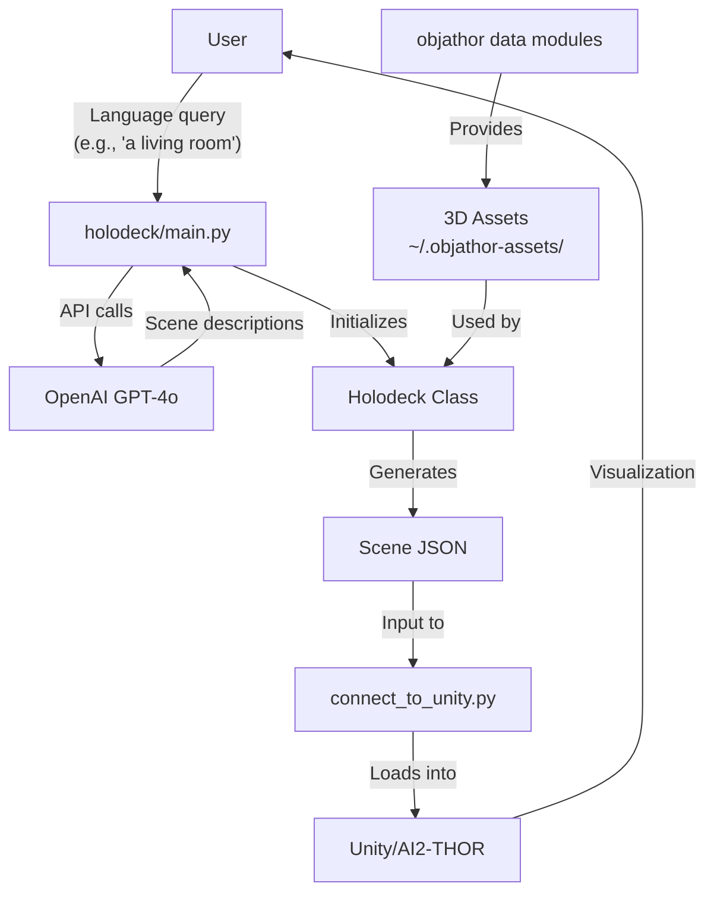
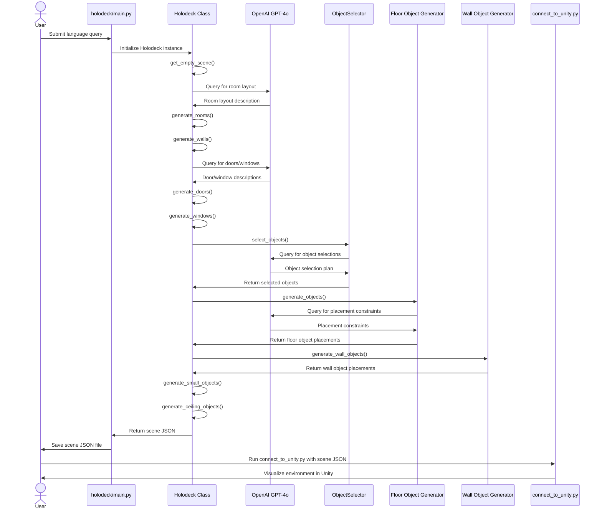
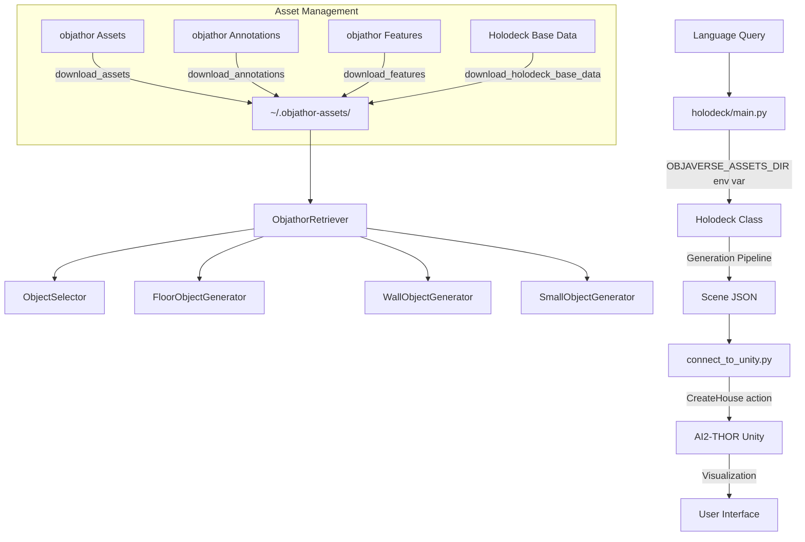

<!-- source: DeepWiki mcp.deepwiki.com · repo allenai/Holodeck · page 1 Holodeck Overview · fetched 2026-10-26 -->

# Holodeck Overview

<details>
<summary>Relevant source files</summary>

The following files were used as context for generating this wiki page:

- [README.md](README.md)
- [ai2holodeck/generation/holodeck.py](ai2holodeck/generation/holodeck.py)

</details>


Holodeck is a framework for generating 3D embodied AI environments from natural language descriptions. This system allows users to create detailed, interactive 3D scenes by providing simple text queries like "a living room" or "a modern kitchen with island."

For installation instructions, see [Installation and Setup](#2). For detailed information about the system architecture, see [System Architecture](#3).

## Purpose and Capabilities

Holodeck translates natural language descriptions into fully-realized 3D environments by:

1. Generating room layouts based on semantic understanding of the query
2. Creating walls, doors, and windows appropriate for the space
3. Selecting contextually appropriate objects from a 3D asset library
4. Placing objects using constraint-based systems that respect real-world arrangements
5. Rendering the final scene in the AI2-THOR visualization framework

The system supports generating both single-room and multi-room environments, with customizable object selection and placement strategies.

Sources: [README.md:1-11](), [ai2holodeck/generation/holodeck.py:56-67]()

## System Architecture Overview



The system begins with a user submitting a language query through `holodeck/main.py`. This query is processed using OpenAI's GPT-4o to generate detailed scene descriptions. The `Holodeck` class orchestrates the generation of a complete 3D scene, which is saved as a JSON file. This JSON file is then loaded into Unity via the AI2-THOR framework for visualization.

Sources: [README.md:14-19](), [ai2holodeck/generation/holodeck.py:56-62]()

## Core Components

```mermaid
classDiagram
    class Holodeck {
        +__init__(openai_api_key, openai_org, objaverse_asset_dir, single_room)
        +generate_scene(scene, query, save_dir, ...)
        +generate_rooms(scene, additional_requirements)
        +generate_walls(scene)
        +generate_doors(scene, additional_requirements)
        +generate_windows(scene, additional_requirements)
        +select_objects(scene, additional_requirements)
        +generate_ceiling_objects(scene, additional_requirements)
        +generate_small_objects(scene)
    }
    
    class FloorPlanGenerator {
        +generate_rooms(scene, additional_requirements)
    }
    
    class WallGenerator {
        +generate_walls(scene)
        +update_walls(walls, open_room_pairs)
    }
    
    class DoorGenerator {
        +generate_doors(scene, additional_requirements)
    }
    
    class WindowGenerator {
        +generate_windows(scene, additional_requirements)
    }
    
    class ObjectSelector {
        +select_objects(scene, additional_requirements)
        +plan_room(args)
        +get_objects_by_room(parsed_plan, scene, room_size, floor_capacity, wall_capacity)
    }
    
    class FloorObjectGenerator {
        +generate_objects(scene, use_constraint)
        +generate_objects_per_room(args)
        +parse_constraints(constraint_text, object_names)
    }
    
    class WallObjectGenerator {
        +generate_wall_objects(scene, use_constraint)
    }
    
    class SmallObjectGenerator {
        +generate_small_objects(scene, controller, receptacle_ids)
    }
    
    class ObjathorRetriever {
        // Asset retrieval functions
    }
    
    Holodeck --> FloorPlanGenerator: uses
    Holodeck --> WallGenerator: uses
    Holodeck --> DoorGenerator: uses
    Holodeck --> WindowGenerator: uses
    Holodeck --> ObjectSelector: uses
    Holodeck --> FloorObjectGenerator: uses
    Holodeck --> WallObjectGenerator: uses
    Holodeck --> SmallObjectGenerator: uses
    ObjectSelector --> ObjathorRetriever: uses
    FloorObjectGenerator --> ObjathorRetriever: uses
    WallObjectGenerator --> ObjathorRetriever: uses
    SmallObjectGenerator --> ObjathorRetriever: uses
```



The Holodeck system is centered around the `Holodeck` class which orchestrates the entire generation process. Each component handles a specific aspect of scene generation:

- **FloorPlanGenerator**: Creates room layouts based on language descriptions
- **WallGenerator**: Constructs walls based on room vertices
- **DoorGenerator & WindowGenerator**: Place doors to connect rooms and windows on exterior walls
- **ObjectSelector**: Selects objects suitable for each room based on its type and purpose
- **FloorObjectGenerator**: Places objects on the floor using constraint-based algorithms
- **WallObjectGenerator**: Places objects on walls (e.g., paintings, shelves)
- **SmallObjectGenerator**: Places small objects on surfaces of larger objects
- **ObjathorRetriever**: Retrieves 3D assets from the Objathor dataset based on semantic queries

Sources: [ai2holodeck/generation/holodeck.py:56-139]()

## Generation Pipeline

The scene generation process follows a structured pipeline, implemented by the `generate_scene` method in the `Holodeck` class:



The generation process follows these steps:

1. **Scene Initialization**: Create an empty scene structure
2. **Room Generation**: Generate room layouts based on the language query
3. **Wall Generation**: Construct walls based on room vertices
4. **Door & Window Generation**: Place doors to connect rooms and windows on exterior walls
5. **Object Selection**: Select appropriate objects for each room
6. **Object Placement**:
   - Floor objects: Place furniture and other floor-based objects
   - Wall objects: Place paintings, shelves, and other wall-mounted objects
   - Small objects: Place small objects on surfaces of larger objects
   - Ceiling objects: Place lights and other ceiling-mounted objects
7. **Light Generation**: Add lighting to enhance scene realism
8. **Export**: Save the final scene as a JSON file and generate visualization

Sources: [ai2holodeck/generation/holodeck.py:259-389]()

## Data Flow and Asset Management



The system relies on pre-downloaded assets from the Objathor dataset, which are stored in the `~/.objathor-assets/` directory by default. These assets include 3D models, annotations, and features that are used throughout the generation process. The directory path can be configured using the `OBJAVERSE_ASSETS_DIR` environment variable.

Sources: [README.md:30-38](), [ai2holodeck/generation/holodeck.py:38-53]()

## Basic Usage

To generate a new environment, you can use the following command:

```bash
python holodeck/main.py --query "a living room" --openai_api_key <OPENAI_API_KEY>
```

The system will generate a scene JSON file and a top-down image of the scene. To visualize the scene in Unity:

1. Install Unity (version 2020.3.25f1)
2. Clone the AI2-THOR repository
3. Load the Unity project and open the Procedural scene
4. Run the connection script:
   ```bash
   python connect_to_unity --scene <SCENE_JSON_FILE_PATH>
   ```
5. Press play in Unity to visualize the scene

Sources: [README.md:40-68]()

## Advanced Features

Holodeck also supports several advanced features:

- **Scene Variations**: Generate multiple variations of the same scene with different objects and layouts
- **Constraint-Based Placement**: Control object placement using semantic constraints
- **Selective Generation**: Generate only specific parts of a scene (e.g., only floor objects, only wall objects)
- **Ablation Studies**: Test different object placement strategies for research purposes

For more information on these features, see the System Architecture and Scene Generation Pipeline pages.

Sources: [ai2holodeck/generation/holodeck.py:391-509]()

## Summary

Holodeck provides a powerful framework for generating 3D environments from natural language descriptions. By combining large language models with a structured generation pipeline and a library of 3D assets, it enables the creation of diverse and semantically accurate scenes for embodied AI research and other applications.

For more detailed information on how to use Holodeck, see the [Usage Guide](#5) section.

Sources: [README.md:1-11](), [ai2holodeck/generation/holodeck.py:259-389]()

---

