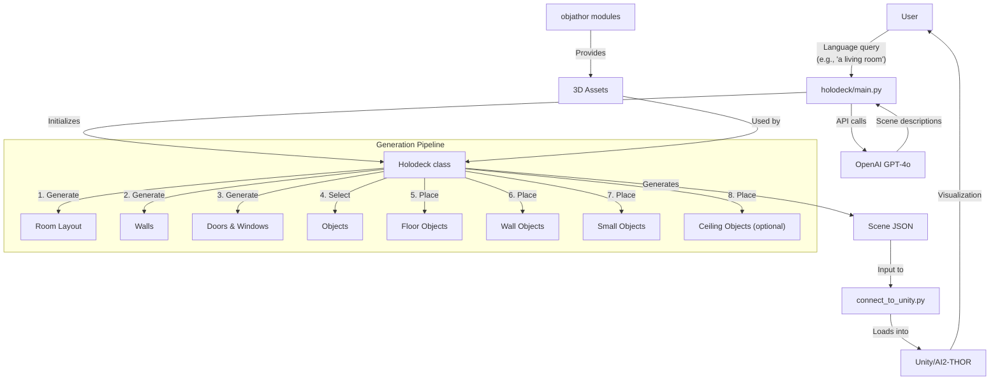
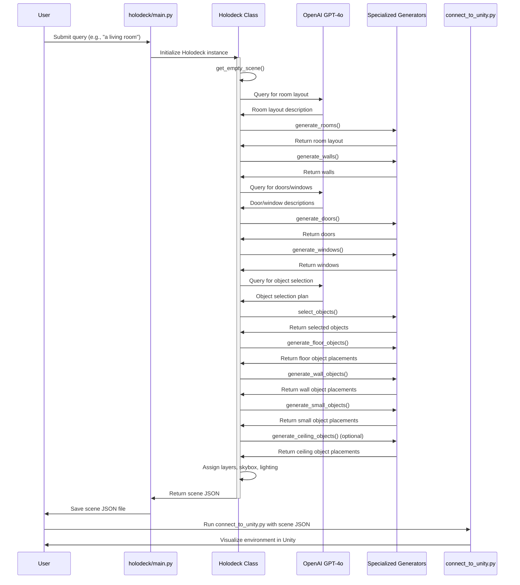
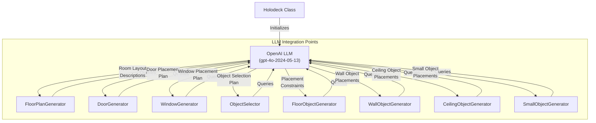
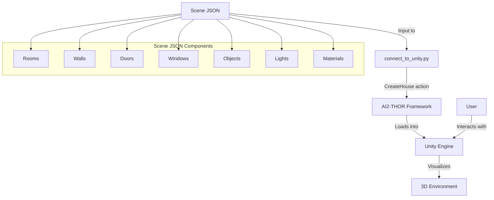
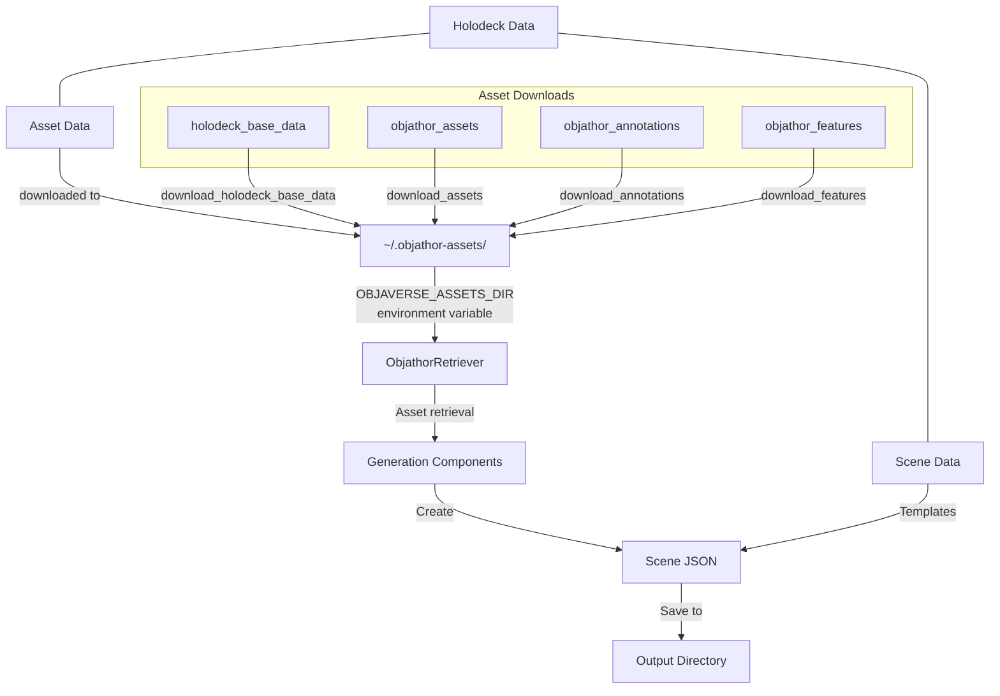
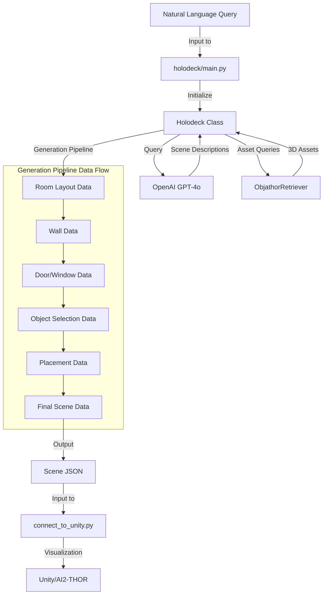
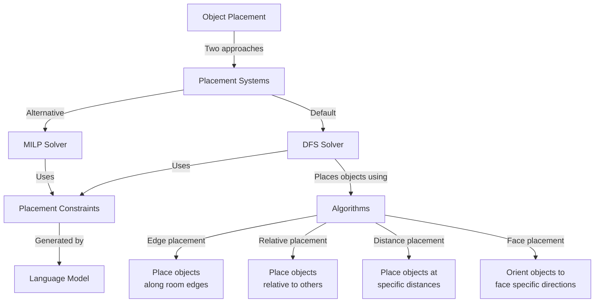
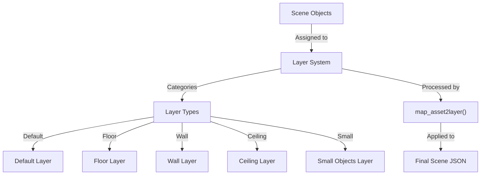

<!-- source: DeepWiki mcp.deepwiki.com · repo allenai/Holodeck · page 3 System Architecture · fetched 2026-10-26 -->

# System Architecture

Relevant source files

The following files were used as context for generating this wiki page:

- [README.md](README.md)
- [ai2holodeck/generation/holodeck.py](ai2holodeck/generation/holodeck.py)

This page documents the overall architecture of the Holodeck framework, explaining how different components interact to generate 3D environments from natural language descriptions. It focuses on the system's structure, the generation pipeline flow, and the integration with external systems like OpenAI's language models and Unity/AI2-THOR.

For details on specific generation components, see [Core Components](#4). For installation and setup information, see [Installation and Setup](#2).

## High-Level Architecture

### Holodeck System Overview

Sources: [ai2holodeck/generation/holodeck.py:259-389](), [README.md:42-44]()

This diagram illustrates the core architecture of Holodeck. The system begins with user input as a natural language query, which is processed by `holodeck/main.py`. This main script initializes the Holodeck class and coordinates the generation process through API calls to OpenAI's GPT-4o model. The Holodeck class orchestrates the step-by-step generation of the 3D environment, using asset data from objathor modules. The output is a Scene JSON file, which can be loaded into Unity using the AI2-THOR framework via `connect_to_unity.py`.

## Core Components

The Holodeck framework is built around a central `Holodeck` class that orchestrates various specialized generators, each responsible for different aspects of the 3D environment generation.

### Component Organization

```mermaid
classDiagram
    class Holodeck {
        +__init__(openai_api_key, openai_org, objaverse_asset_dir, single_room)
        +get_empty_scene()
        +empty_house(scene)
        +generate_rooms(scene, additional_requirements_room, used_assets)
        +generate_walls(scene)
        +generate_doors(scene, additional_requirements_door, used_assets)
        +generate_windows(scene, additional_requirements_window, used_assets)
        +select_objects(scene, additional_requirements_object, used_assets)
        +generate_ceiling_objects(scene, additional_requirements_ceiling)
        +generate_small_objects(scene, used_assets)
        +change_ceiling_material(scene)
        +generate_scene(scene, query, save_dir, used_assets, ...)
    }
    
    class FloorPlanGenerator {
        +generate_rooms(scene, additional_requirements_room)
    }
    
    class WallGenerator {
        +generate_walls(scene)
        +update_walls(walls, open_room_pairs)
    }
    
    class DoorGenerator {
        +generate_doors(scene, additional_requirements_door)
    }
    
    class WindowGenerator {
        +generate_windows(scene, additional_requirements_window)
    }
    
    class ObjectSelector {
        +select_objects(scene, additional_requirements_object)
    }
    
    class FloorObjectGenerator {
        +generate_objects(scene, use_constraint)
    }
    
    class WallObjectGenerator {
        +generate_wall_objects(scene, use_constraint)
    }
    
    class CeilingObjectGenerator {
        +generate_ceiling_objects(scene, additional_requirements_ceiling)
    }
    
    class SmallObjectGenerator {
        +generate_small_objects(scene, controller, receptacle_ids)
    }
    
    class ObjathorRetriever {
        +retrieve_assets(query, asset_count, exclude_ids)
    }
    
    Holodeck --> FloorPlanGenerator : uses
    Holodeck --> WallGenerator : uses
    Holodeck --> DoorGenerator : uses
    Holodeck --> WindowGenerator : uses
    Holodeck --> ObjectSelector : uses
    Holodeck --> FloorObjectGenerator : uses
    Holodeck --> WallObjectGenerator : uses
    Holodeck --> CeilingObjectGenerator : uses
    Holodeck --> SmallObjectGenerator : uses
    
    ObjectSelector --> ObjathorRetriever : uses
    FloorObjectGenerator --> ObjathorRetriever : uses
    WallObjectGenerator --> ObjathorRetriever : uses
    CeilingObjectGenerator --> ObjathorRetriever : uses
    SmallObjectGenerator --> ObjathorRetriever : uses
```

Sources: [ai2holodeck/generation/holodeck.py:56-123]()

The diagram shows the central `Holodeck` class and its relationships with specialized generator classes. Each generator is responsible for a specific aspect of scene generation:

- `FloorPlanGenerator`: Creates the basic room layouts
- `WallGenerator`: Generates walls based on room boundaries
- `DoorGenerator` and `WindowGenerator`: Add doors and windows to appropriate walls
- `ObjectSelector`: Selects appropriate objects for the scene based on room type and query
- `FloorObjectGenerator`: Places selected objects on the floor with appropriate positioning
- `WallObjectGenerator`: Places objects on walls (e.g., paintings, shelves)
- `CeilingObjectGenerator`: Adds ceiling elements (lights, fans)
- `SmallObjectGenerator`: Places small objects on receptacles (e.g., items on tables)
- `ObjathorRetriever`: Retrieves 3D assets from the objathor dataset

## Generation Pipeline Flow

The generation of a 3D environment follows a sequential process, where each step builds upon the results of previous steps.

### Generation Sequence

Sources: [ai2holodeck/generation/holodeck.py:259-389]()

The sequence diagram illustrates the step-by-step process of environment generation:

1. **Initialization**: User provides a natural language query, and the main script initializes the Holodeck instance.
2. **Room Generation**: The system queries the LLM for a room layout and generates the basic room structure.
3. **Wall Generation**: Walls are created based on the room boundaries.
4. **Door and Window Generation**: The LLM provides guidance on door and window placement, which are then added to appropriate walls.
5. **Object Selection**: The LLM helps select appropriate objects for the environment based on the query and room type.
6. **Object Placement**:
   - Floor objects are placed using constraint-based positioning
   - Wall objects are positioned on appropriate walls
   - Small objects are placed on available receptacles
   - Ceiling objects are optionally added
7. **Finalization**: The system assigns layers, adds a skybox, and configures lighting
8. **Output**: The generated scene is saved as a JSON file
9. **Visualization**: The user can load the scene into Unity using the AI2-THOR framework

## Integration with External Systems

Holodeck integrates with two key external systems: OpenAI's language models for natural language understanding and generation, and Unity/AI2-THOR for visualization and interaction.

### Language Model Integration

Sources: [ai2holodeck/generation/holodeck.py:70-74](), [README.md:45]()

The Holodeck framework uses OpenAI's GPT-4o model to generate detailed descriptions and plans for different aspects of environment generation. The language model is initialized during the Holodeck class construction and is used by various generators to:

1. Create room layouts from natural language descriptions
2. Plan door and window placements
3. Select appropriate objects for each room
4. Determine placement constraints for objects
5. Generate small object placements

### Unity and AI2-THOR Integration

Sources: [README.md:49-68]()

The Holodeck framework connects to Unity through the AI2-THOR framework for visualization and interaction:

1. The generated scene is saved as a JSON file with detailed information about rooms, walls, doors, windows, objects, lights, and materials.
2. The `connect_to_unity.py` script establishes a connection with Unity running the AI2-THOR framework.
3. The scene is loaded into Unity through the AI2-THOR framework's `CreateHouse` action.
4. The user can interact with the generated environment in Unity.

## Asset Management and Data Flow

The Holodeck system relies on a comprehensive asset management system that handles 3D models, annotations, and features.

### Asset Management

Sources: [README.md:30-38](), [ai2holodeck/generation/holodeck.py:11-20]()

The asset management system involves:

1. **Asset Downloads**: The system downloads various data sets to the `~/.objathor-assets/` directory:
   - `holodeck_base_data`: Base data for scene generation
   - `objathor_assets`: 3D model assets
   - `objathor_annotations`: Annotations for 3D models
   - `objathor_features`: Features for 3D models

2. **Environment Configuration**: The system uses the `OBJAVERSE_ASSETS_DIR` environment variable to locate the assets directory.

3. **Asset Retrieval**: The `ObjathorRetriever` class retrieves appropriate 3D assets for scene generation based on queries and constraints.

4. **Scene Generation**: The generation components use the retrieved assets to create the scene, which is saved as a JSON file.

### Data Flow

Sources: [ai2holodeck/generation/holodeck.py:259-389]()

The data flow through the Holodeck system follows these steps:

1. The user provides a natural language query to `holodeck/main.py`
2. The main script initializes the Holodeck class and passes the query
3. Holodeck consults the language model (OpenAI GPT-4o) for scene descriptions
4. Asset queries are sent to the ObjathorRetriever to find appropriate 3D assets
5. The generation pipeline processes the data in sequential stages:
   - Room layout data
   - Wall data
   - Door/window data
   - Object selection data
   - Placement data
   - Final scene data
6. The final scene is output as a JSON file
7. The JSON file can be loaded into Unity/AI2-THOR for visualization

## Key Configuration and Integration Points

The table below summarizes the key configuration and integration points in the Holodeck system:

| Component | Configuration | Purpose |
|-----------|---------------|---------|
| OpenAI LLM | `openai_api_key`, `openai_org` | Enables natural language processing for scene generation |
| CLIP Model | "ViT-L-14", "laion2b_s32b_b82k" | Provides visual understanding for asset selection |
| Sentence Transformer | "all-mpnet-base-v2" | Provides semantic understanding for queries |
| Asset Directory | `OBJAVERSE_ASSETS_DIR` environment variable | Specifies location of 3D assets |
| Retrieval Threshold | `self.retrieval_threshold = 28` | Controls asset retrieval sensitivity |
| Unity Connection | `connect_to_unity.py` | Enables visualization in Unity/AI2-THOR |

Sources: [ai2holodeck/generation/holodeck.py:56-123](), [README.md:38]()

## Advanced Architecture Features

### Constraint-Based Placement System

Sources: [ai2holodeck/generation/holodeck.py:313-314](), [README.md:19]()

The Holodeck system uses two approaches for object placement:

1. **DFS Solver (Default)**: A depth-first search algorithm that places objects according to constraints
2. **MILP Solver (Alternative)**: A mixed-integer linear programming approach (less used)

The constraint-based placement system allows for sophisticated object arrangements based on:
- Edge placement: Positioning objects along room edges
- Relative placement: Placing objects in relation to other objects
- Distance placement: Maintaining specific distances between objects
- Face placement: Orienting objects to face specific directions

### Layer System

Sources: [ai2holodeck/generation/holodeck.py:343]()

The layer system organizes scene elements for rendering and processing:

1. Objects are assigned to appropriate layers based on their type and placement
2. The `map_asset2layer()` function handles the layer assignment
3. Layers help organize the scene for Unity rendering and make it easier to manipulate specific types of objects

## Summary

The Holodeck system architecture follows a sequential pipeline approach to generate 3D environments from natural language descriptions. The core `Holodeck` class orchestrates specialized generators, each handling a specific aspect of the environment. The system integrates with OpenAI's language models for natural language understanding and with Unity/AI2-THOR for visualization.

Key architectural components include:
- Room and structure generators (rooms, walls, doors, windows)
- Object selection and placement systems
- Constraint-based placement algorithms
- Layer management
- External integrations (OpenAI, Unity/AI2-THOR)
- Asset management system

This architecture enables the flexible generation of diverse 3D environments based on natural language descriptions, making it a powerful tool for embodied AI research and applications.

---

